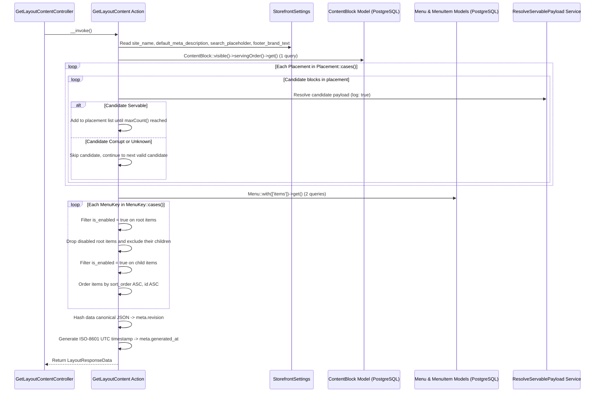
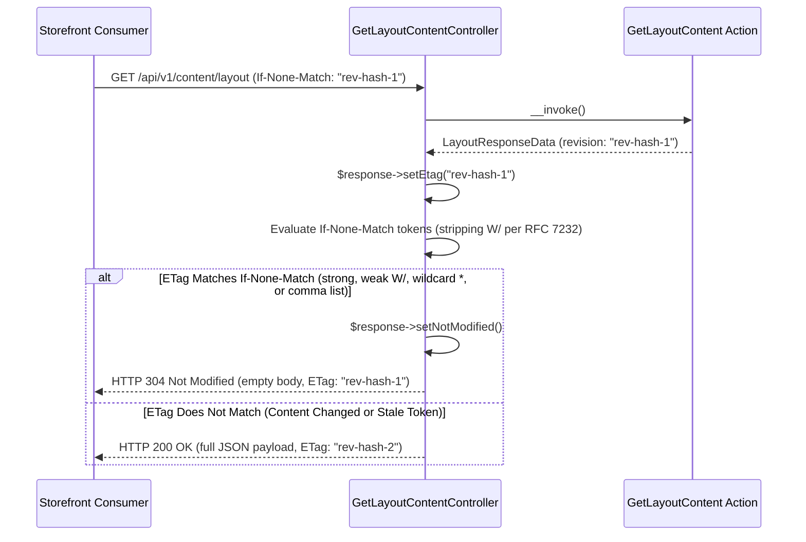

[P1-API1 | PLAN v3 | Gemini]

# Implementation Plan: P1-API1 (v3)

**Step ID**: P1-API1  
**Version**: v3  
**Branch**: `feat/content-api-v1` (branched from base commit `714fe30c664db9b5ddf8b993ef4942c15c79d34a` per confirmed Q1)  
**Base Commit**: `714fe30c664db9b5ddf8b993ef4942c15c79d34a` (`714fe30 Merge remote-tracking branch 'origin/main' into feat/storefront-navigation-menus`)  
**Main Branch State on Remote**: `7aed3d4e277b9da90b17516db3b05c0e0de18ec2` (`7aed3d4 Merge pull request #9 from AchinthaDe/feat/storefront-navigation-menus`)  

---

## Change Log (Review Feedback Mapping: v2 -> v3)

| Finding ID | Reviewer Issue | Resolution in Plan v3 | Section Changed |
|---|---|---|---|
| **B1** | In Section 5.3, `GetLayoutContent` checks `allowedBlockTypes()` before `ResolveServablePayload`, making `ServingHealthOutcome::UnknownType` unreachable, breaking Tests 5 and 7, and skipping Test 8 temporary block | Reordered candidate loop in 5.3: invoke `($this->resolveServablePayload)($candidate, log: true)` FIRST (skipping if `!$health->isServable() \|\| $health->payload === null`); check `in_array($candidate->type, $allowedTypes, true)` SECOND (skipping disallowed types without logging). In Test 5, asserted cache key `serving_failure:{$corruptBlock->public_id}:{$outcome->value}` is set. In Test 8, registered temporary `BlockDefinition` with `typeKey() => 'announcement_bar'` and `schemaVersion() => 2` in `BlockRegistry`. | **Section 5.3, Section 10.1 (Tests 5, 8)** |
| **B2** | In Section 5.4, redundant return after `isNotModified()` dead `if`; Symfony `isNotModified` strict comparison rejects weak ETags (`W/"<rev>"`), returning 200 instead of 304 | In `GetLayoutContentController`, attached strong ETag via `$response->setEtag($layout->meta->revision)` and evaluated `If-None-Match` per RFC 7232 Section 3.2 weak comparison by inspecting `$request->getEtags()`, stripping leading `W/` prefix from each client token (and supporting `*`), calling `$response->setNotModified()` when matching `'"'.$layout->meta->revision.'"\'`, and returning `$response` (removing redundant `if` branch). Updated Section 7.2 diagram and Section 10.1 Test 2. | **Section 5.4, Section 7.2, Section 10.1 (Test 2)** |
| **B3** | Two null-safety gaps in 5.3 fail PHPStan Level 8: `BlockRegistry::get()` returns `?BlockDefinition` and `ContentBlock::$placement` cast returns `?Placement` | Added explicit null guards in Section 5.3: guarded `$block->placement instanceof Placement` when grouping by `$block->placement->value`, and guarded `$definition = $this->registry->get($candidate->type)` (`if ($definition === null) { continue; }`). | **Section 5.3** |
| **M1** | In Test 3, active block ranks first under D8, capping at maxCount=1 so excluded blocks leaking or MUT-1 mutating `>` to `>=` still pass | In Test 3, first create ONLY the 6 excluded blocks (including `ends_at = now()`) and assert `announcement_bar` is empty `[]` (forcing MUT-1 to fail when mutated). Then create the active boundary block (`starts_at = now()`) and assert 1 block returned. Aligned MUT-1 description in Section 10.2. | **Section 10.1 (Test 3), Section 10.2 (MUT-1)** |
| **M2** | In Test 13, `StorefrontSettings` lazy-loads on property access, causing cold 4 queries vs 3 queries; Tests 1 & 12 mutate settings without calling `$settings->save()` | In Test 13 Arrange, pre-warmed settings by reading property (`$_ = app(StorefrontSettings::class)->site_name;`) before calling `DB::enableQueryLog()`. In Tests 1 and 12, called `$settings->save()` after property mutations. | **Section 10.1 (Tests 1, 12, 13)** |
| **M3** | Test 9 missing disabled child under enabled parent per AC-7 | In Test 9, added disabled child `Child 2C` (`is_enabled = false`) under enabled `Root 2`. Asserted `Child 2C` is omitted from `GetLayoutContent` while `Child 2B` and `Child 2A` remain in `sort_order ASC, id ASC`, and asserted `GetMenuTree` still includes `Child 2C`. | **Section 10.1 (Test 9)** |
| **m1** | Clock divergence: `scopeVisible()` uses `now()`, while 5.3 step 4 used `CarbonImmutable::now('UTC')` | Used `now()->utc()->toIso8601ZuluString()` in Section 5.3 step 4 so visibility scopes and `meta.generated_at` share the identical clock. | **Section 5.3, Section 10.1** |
| **m2** | Decisions Q1-Q5 confirmed by Achintha; Open Questions must be 'None' for v3 freeze | Moved confirmed decisions Q1-Q5 into Decisions Made (D-j to D-n); set `Open Questions: None` in Section 13. Locked base commit `714fe30c664db9b5ddf8b993ef4942c15c79d34a` in Header, Section 13, and Section 14. | **Header, Section 13, Section 14** |

---

## 1. Understanding

Build the read-only Content API v1 slice (`GET /api/v1/content/layout`) backed by an invokable `GetLayoutContent` domain Action and typed Spatie Data DTOs.
The endpoint returns site settings, visible placement blocks (enforcing server-side visibility, payload upgrading, and D8 tie-break/maxCount rules), and enabled navigation menu trees.
The response includes deterministic `meta.revision` ETag (`304 Not Modified`) support, named rate limiting (`content-api`), updated `docs/contracts/content-api.md`, and contract fixture tests.
The implementation ensures zero internal database ID leakage, constant bounded query count execution, and resilience against corrupt database rows.

### Active Scope Boundaries
- **Part A: Domain Read Action, DTOs & Contracts (CP-A)**:
  - Spatie Data DTOs in `app/Domain/Content/Data/`: `LayoutSettingsData`, `LayoutBlockData`, `LayoutMenuItemData`, `LayoutMenuData`, `LayoutData`, `LayoutMetaData`, and `LayoutResponseData`.
  - Domain Action `app/Domain/Content/Actions/GetLayoutContent.php` assembling settings, placements, menus, and meta (`api_version`, deterministic `revision`, `generated_at`).
  - Placement block resolution enforcing server-side visibility (`published`, `is_enabled`, active UTC schedule window), D8 tie-breaking (`sort_order ASC, starts_at DESC NULLS LAST, id DESC`), placement `maxCount()`, and payload upgrading via `ResolveServablePayload`.
  - Corrupt block resilience: skips unhealthy or disallowed blocks without throwing HTTP 500 and fills `maxCount()` from subsequent valid candidates.
  - Menu resolution enforcing `is_enabled` filtering, cascading exclusion of children when a parent item is disabled, and ordering by `sort_order ASC, id ASC`.
  - Public projection mapping `public_id` to `id`, `opens_in_new_tab` to `new_tab`, with `children: []` on child nodes, omitting internal IDs and timestamps.
  - Complete key presence: all cases of `Placement::cases()` and `MenuKey::cases()` always present in output.
  - Canonical JSON hashing of `data` (`settings`, `placements`, `menus`) producing deterministic `meta.revision`.
  - Contract documentation in `docs/contracts/content-api.md` and contract JSON fixture in `tests/Fixtures/contracts/content-layout-v1.json`.
  - Feature test suite in `tests/Feature/Domain/Content/Actions/GetLayoutContentTest.php`.
- **Part B: HTTP Delivery, Routing, Rate Limiting & Verification (CP-B)**:
  - Configuration file `config/content.php` declaring `rate_limit_per_minute` (defaulting to 60) and `.env.example` update with `CONTENT_API_RATE_LIMIT_PER_MINUTE=60`.
  - Named rate limiter `content-api` registered in `app/Providers/AppServiceProvider.php` throttling by client IP.
  - Thin HTTP controller `app/Http/Controllers/Api/V1/Content/GetLayoutContentController.php` invoking `GetLayoutContent`, evaluating `If-None-Match`, and returning HTTP 200 with `ETag` header or HTTP 304 with empty body.
  - Route registration in `routes/api.php` for `GET /api/v1/content/layout` with `throttle:content-api` middleware.
  - Feature and contract tests in `tests/Feature/Api/V1/Content/GetLayoutContentEndpointTest.php`.
  - Architecture test suite in `tests/Arch/ContentApiArchTest.php` enforcing controller thinness and domain isolation.
  - Architectural documentation update in `ARCHITECTURE.md` marking `Content API v1` complete.

### Out of Scope
- Application or Redis caching and cache invalidation listeners (deferred until measured, per `ARCHITECTURE.md` section 7).
- Write or mutation API endpoints, draft preview tokens, page blocks (Phase 2).
- Content seeding (`ContentSeeder` / `P1-SEED`).
- Filament admin panel modifications.
- Database migrations or table alterations.
- New Composer packages or npm dependencies.
- Modifications to existing write actions (`UpdateMenu`, `PublishContentBlock`, `UpdateContentBlock`, `UpdateStorefrontSettings`).

---

## 2. Sources Read

| Source File | What in it constrains P1-API1 |
|---|---|
| [ARCHITECTURE.md](file:///c:/dev/getnow-cms/ARCHITECTURE.md) | Sections 1 (Phase 1 checklist), 4 (Overview: Storefront -> `GET /api/v1/content/layout` -> `GetLayoutContent`), 5 (Code structure and dependency rules), 6 (Placements, menus, block rules, link rules), 7 (Content API v1 JSON payload shape, complete key presence, additive contract, ETag from `meta.revision`), 9 (PostgreSQL conventions, ULID `public_id` external exposure), 10 (Security: public API exposes only published, enabled, in-window content, no internal IDs), 11 (Testing requirements), 12 (Decisions D1: independent API contract; D2: code-defined placements/keys; D4: URL links; D7: immediate publication; D8: maxCount enforced at API output limit, tie-break `sort_order ASC, starts_at DESC NULLS LAST, id DESC`). |
| [AGENTS.md](file:///c:/dev/getnow-cms/AGENTS.md) | Strict types `declare(strict_types=1);` in every file; final classes; native types; single concern per change; domain actions in `app/Domain/Content/Actions/`; thin controllers delegating to actions; domain never importing from `App\Filament` or `App\Http`; zero incremental ID exposure; non-breaking API contract updates (`docs/contracts/content-api.md` and fixture updated in same change); `composer check` pass requirement. |
| [rule-register.md](file:///c:/dev/getnow-cms/docs/blueprints/rule-register.md) | Canonical rule definitions: `E1, S1..S7, C1..C8, K1..K9, DB1..DB6, SEC1..SEC5, T1..T5, G1..G4, X1..X7`. |
| [app/Domain/Content/Settings/StorefrontSettings.php](file:///c:/dev/getnow-cms/app/Domain/Content/Settings/StorefrontSettings.php) | Public properties `site_name`, `default_meta_description`, `search_placeholder`, `footer_brand_text` under group `'storefront'`. |
| [app/Domain/Content/Enums/Placement.php](file:///c:/dev/getnow-cms/app/Domain/Content/Enums/Placement.php) | Backed enum case `ANNOUNCEMENT_BAR = 'announcement_bar'`, `allowedBlockTypes(): array`, `maxCount(): int`. |
| [app/Domain/Content/Enums/PublishStatus.php](file:///c:/dev/getnow-cms/app/Domain/Content/Enums/PublishStatus.php) | Backed enum cases `DRAFT = 'draft'`, `PUBLISHED = 'published'`, `ARCHIVED = 'archived'`. |
| [app/Domain/Content/Enums/Tone.php](file:///c:/dev/getnow-cms/app/Domain/Content/Enums/Tone.php) | Backed enum cases `INFO = 'info'`, `WARNING = 'warning'`, `SUCCESS = 'success'`. |
| [app/Domain/Content/Models/ContentBlock.php](file:///c:/dev/getnow-cms/app/Domain/Content/Models/ContentBlock.php) | Properties `id`, `public_id`, `placement`, `type`, `schema_version`, `payload`, `status`, `is_enabled`, `sort_order`, `starts_at`, `ends_at`; casts for placement, status, payload, is_enabled, schema_version, sort_order, starts_at, ends_at; scopes `scopeVisible(Builder $query)` and `scopeServingOrder(Builder $query)`; methods `isLiveAt()`, `isLive()`. |
| [app/Domain/Content/Contracts/BlockRegistry.php](file:///c:/dev/getnow-cms/app/Domain/Content/Contracts/BlockRegistry.php) | Interface methods `register(BlockDefinition $definition): void`, `get(string $typeKey): ?BlockDefinition`, `all(): array`. |
| [app/Domain/Content/Contracts/BlockDefinition.php](file:///c:/dev/getnow-cms/app/Domain/Content/Contracts/BlockDefinition.php) | Interface methods `typeKey(): string`, `schemaVersion(): int`, `dataClass(): string`, `upgradePayload(int $fromVersion, array $payload): array`. |
| [app/Domain/Content/Data/BlockPayload.php](file:///c:/dev/getnow-cms/app/Domain/Content/Data/BlockPayload.php) | Base payload DTO `abstract class BlockPayload extends Data {}` providing `toArray(): array`. |
| [app/Domain/Content/Enums/ServingHealthOutcome.php](file:///c:/dev/getnow-cms/app/Domain/Content/Enums/ServingHealthOutcome.php) | Backed enum cases: `Servable`, `UnknownType`, `UnsupportedVersion`, `InvalidAfterUpgrade`, `UpgradeFailed`. |
| [app/Domain/Content/Actions/GetUpgradedBlockPayload.php](file:///c:/dev/getnow-cms/app/Domain/Content/Actions/GetUpgradedBlockPayload.php) | Invokable action: `__invoke(string $type, int $schemaVersion, array $payload): BlockPayload`; sequential loop upgrading up to `$definition->schemaVersion()`; throws `UnknownBlockTypeException`, `UnsupportedSchemaVersionException`, `UpgradeFailedException`, `InvalidPayloadException`. |
| [app/Domain/Content/Services/ResolveServablePayload.php](file:///c:/dev/getnow-cms/app/Domain/Content/Services/ResolveServablePayload.php) | Service handling payload upgrading and error logging: `__invoke(ContentBlock $block, bool $log = true): ServingHealthResult`; logs warning containing public_id, type, schema_version, and reason. |
| [app/Domain/Content/Data/ServingHealthResult.php](file:///c:/dev/getnow-cms/app/Domain/Content/Data/ServingHealthResult.php) | Output DTO containing `ServingHealthOutcome $outcome`, `?BlockPayload $payload`, and helper `isServable(): bool`. |
| [app/Domain/Content/Blocks/AnnouncementBar/AnnouncementBarBlock.php](file:///c:/dev/getnow-cms/app/Domain/Content/Blocks/AnnouncementBar/AnnouncementBarBlock.php) | Definition: `typeKey() => 'announcement_bar'`, `schemaVersion() => 1`, `dataClass() => AnnouncementBarData::class`. |
| [app/Domain/Content/Blocks/AnnouncementBar/AnnouncementBarData.php](file:///c:/dev/getnow-cms/app/Domain/Content/Blocks/AnnouncementBar/AnnouncementBarData.php) | Payload properties `text: string`, `link_url: ?string`, `tone: Tone`. |
| [app/Domain/Content/Enums/MenuKey.php](file:///c:/dev/getnow-cms/app/Domain/Content/Enums/MenuKey.php) | Backed enum cases: `MAIN_NAV = 'main_nav'`, `MOBILE_NAV = 'mobile_nav'`, `FOOTER_COLUMN_1 = 'footer_column_1'`, `FOOTER_COLUMN_2 = 'footer_column_2'`, `FOOTER_COLUMN_3 = 'footer_column_3'`. |
| [app/Domain/Content/Models/Menu.php](file:///c:/dev/getnow-cms/app/Domain/Content/Models/Menu.php) | Properties `id`, `public_id`, `key`, `label`, `title`, timestamps; casts `'key' => MenuKey::class`; relations `items()` and `rootItems()`. |
| [app/Domain/Content/Models/MenuItem.php](file:///c:/dev/getnow-cms/app/Domain/Content/Models/MenuItem.php) | Properties `id`, `public_id`, `menu_id`, `parent_id`, `label`, `url`, `icon`, `opens_in_new_tab`, `is_enabled`, `sort_order`, timestamps; casts `opens_in_new_tab => boolean`, `is_enabled => boolean`, `sort_order => integer`; relations `menu()`, `parent()`, `children()`. |
| [app/Domain/Content/Actions/GetMenuTree.php](file:///c:/dev/getnow-cms/app/Domain/Content/Actions/GetMenuTree.php) | Admin tree read action returning all items including disabled ones. Must not be broken by public API filtering. |
| [database/factories/ContentBlockFactory.php](file:///c:/dev/getnow-cms/database/factories/ContentBlockFactory.php) | Factory states: `draft()`, `published()`, `archived()`, `enabled()`, `disabled()`, `scheduled($startsAt, $endsAt)`, `unknownType()`, `unsupportedVersion()`, `failedUpgrade()`, `invalidAfterUpgrade()`. |
| [database/factories/MenuFactory.php](file:///c:/dev/getnow-cms/database/factories/MenuFactory.php) | Factory methods: `forKey(MenuKey $key)`, create deduplication for provisioned keys. |
| [database/factories/MenuItemFactory.php](file:///c:/dev/getnow-cms/database/factories/MenuItemFactory.php) | Factory methods: `childOf(MenuItem $parent)`, `forMenu(Menu $menu)`. |
| [tests/Support/TestBlocks.php](file:///c:/dev/getnow-cms/tests/Support/TestBlocks.php) | Registers `TestFailedUpgradeBlock` into `BlockRegistry`. |
| [tests/Support/TestFailedUpgradeBlock.php](file:///c:/dev/getnow-cms/tests/Support/TestFailedUpgradeBlock.php) | Test block definition: `typeKey() => 'test_failed_upgrade_block'`, `schemaVersion() => 2`, fails upgrade from version 1. |
| [app/Http/Controllers/Controller.php](file:///c:/dev/getnow-cms/app/Http/Controllers/Controller.php) | Base controller class `abstract class Controller`. |
| [composer.json](file:///c:/dev/getnow-cms/composer.json) | Declares scripts: `"lint": "pint --test"`, `"fix": "pint"`, `"stan": "phpstan analyse --memory-limit=1G"`, `"check": ["@lint", "@stan", "@test"]`. |
| [routes/api.php](file:///c:/dev/getnow-cms/routes/api.php) | Existing empty route file configured with route group. |
| [bootstrap/app.php](file:///c:/dev/getnow-cms/bootstrap/app.php) | Application configuration binding `api: __DIR__.'/../routes/api.php'` and JSON exception rendering for `api/*`. |
| [app/Providers/AppServiceProvider.php](file:///c:/dev/getnow-cms/app/Providers/AppServiceProvider.php) | Bootstrap provider with `configureDefaults()` and `boot()`; location for registering the named rate limiter `content-api`. |
| [app/Providers/ContentServiceProvider.php](file:///c:/dev/getnow-cms/app/Providers/ContentServiceProvider.php) | Registers `BlockRegistry`, `GetBlockServingStatus`, policies, and block definitions. |
| [tests/Arch/DomainArchTest.php](file:///c:/dev/getnow-cms/tests/Arch/DomainArchTest.php) | Enforces: Domain code does not import `App\Filament`, `App\Http`, or `Filament`; domain actions are final and invokable; domain exceptions extend `ContentException`. |
| [tests/Arch/ArchTest.php](file:///c:/dev/getnow-cms/tests/Arch/ArchTest.php) | Enforces strict types everywhere and domain isolation from Filament and Http. |
| [tests/Feature/Domain/Content/ServingWindowTest.php](file:///c:/dev/getnow-cms/tests/Feature/Domain/Content/ServingWindowTest.php) | Tests dynamic lifecycle serving status resolution across `starts_at` and `ends_at` boundaries. |
| [tests/Feature/Domain/Content/ServingHealthActionsTest.php](file:///c:/dev/getnow-cms/tests/Feature/Domain/Content/ServingHealthActionsTest.php) | Datasets and tests covering `UnknownType`, `InvalidAfterUpgrade`, and `UnsupportedVersion`. |
| [.env.example](file:///c:/dev/getnow-cms/.env.example) | Environment variables template. |

---

## 3. Verified Current State

### 3.1 Git Repository State
Raw verification output:
```powershell
PS C:\dev\getnow-cms> git branch --show-current
feat/storefront-navigation-menus

PS C:\dev\getnow-cms> git log --oneline -5 main
2e3ca78 Merge branch 'fix/serving-window-and-history-stacking'
afd8eec docs(blueprints): add P1-FIX1 implementation plan and report
dca6e45 docs(architecture): document admin panel browser history convention in section 8
9a17abc fix(filament): configure history replacement for table pagination
f659d87 docs(adr): update ADR 0002 for dynamic lifecycle serving status resolution

PS C:\dev\getnow-cms> git merge-base main HEAD
2e3ca781f305d8613e85944c4d25c79219e322e1

PS C:\dev\getnow-cms> git log --oneline -5 origin/main
7aed3d4 Merge pull request #9 from AchinthaDe/feat/storefront-navigation-menus
9857b5f docs(blueprints): restore canonical Plan v2 AC table and audit details in P1-M1 report
2b9c6c0 test(content): add boundary, disabled items, and mid-transaction rollback tests
7503af6 docs(blueprints): record local database migration execution in P1-M1 report
8c951ad docs(blueprints): add P1-M1 brief, plan v2, and implementation report

PS C:\dev\getnow-cms> git log --oneline -3 HEAD
714fe30 Merge remote-tracking branch 'origin/main' into feat/storefront-navigation-menus
9a055b9 docs(blueprints): record manual ui run, lowercase ulids, and review evidence in p1-m1 report
7146050 fix(content): lowercase ulids, prune unused getmenulist, touch menu updated_at, and extend ac-8 tests
```
- Local `main` is at `2e3ca781f305d8613e85944c4d25c79219e322e1`.
- Remote `origin/main` has merged P1-M1 at commit `7aed3d4e277b9da90b17516db3b05c0e0de18ec2`.
- Current working branch `feat/storefront-navigation-menus` has post-merge fixes merged with `origin/main` at commit `714fe30c664db9b5ddf8b993ef4942c15c79d34a`.
- Clean working directory.

### 3.2 StorefrontSettings Verification
In [StorefrontSettings.php:9-23](file:///c:/dev/getnow-cms/app/Domain/Content/Settings/StorefrontSettings.php#L9-L23):
```php
class StorefrontSettings extends Settings
{
    public string $site_name;
    public string $default_meta_description;
    public string $search_placeholder;
    public string $footer_brand_text;

    public static function group(): string
    {
        return 'storefront';
    }
}
```
All four properties are typed strings populated from the `storefront` settings group. In [2026_10_07_091043_create_storefront_settings.php:11-14](file:///c:/dev/getnow-cms/database/settings/2026_10_07_091043_create_storefront_settings.php#L11-L14), default values are seeded: `storefront.site_name` ('Storefront'), `storefront.default_meta_description` ('Welcome to the storefront'), `storefront.search_placeholder` ('Search...'), `storefront.footer_brand_text` ('Storefront').

### 3.3 Placement, PublishStatus, Tone Enums Verification
In [Placement.php:7-27](file:///c:/dev/getnow-cms/app/Domain/Content/Enums/Placement.php#L7-L27):
```php
enum Placement: string
{
    case ANNOUNCEMENT_BAR = 'announcement_bar';

    public function allowedBlockTypes(): array
    {
        return match ($this) {
            self::ANNOUNCEMENT_BAR => ['announcement_bar'],
        };
    }

    public function maxCount(): int
    {
        return match ($this) {
            self::ANNOUNCEMENT_BAR => 1,
        };
    }
}
```
In [PublishStatus.php:7-13](file:///c:/dev/getnow-cms/app/Domain/Content/Enums/PublishStatus.php#L7-L13):
```php
enum PublishStatus: string
{
    case DRAFT = 'draft';
    case PUBLISHED = 'published';
    case ARCHIVED = 'archived';
}
```
In [Tone.php:7-13](file:///c:/dev/getnow-cms/app/Domain/Content/Enums/Tone.php#L7-L13):
```php
enum Tone: string
{
    case INFO = 'info';
    case WARNING = 'warning';
    case SUCCESS = 'success';
}
```

### 3.4 ContentBlock Serving Window, Scopes & Casts Verification
In [ContentBlock.php:44-54, 72-97](file:///c:/dev/getnow-cms/app/Domain/Content/Models/ContentBlock.php#L44-L97):
```php
    protected $casts = [
        'placement' => TolerantEnum::class.':'.Placement::class,
        'status' => PublishStatus::class,
        'payload' => 'array',
        'is_enabled' => 'boolean',
        'schema_version' => 'integer',
        'sort_order' => 'integer',
        'starts_at' => 'datetime',
        'ends_at' => 'datetime',
    ];

    public function scopeVisible(Builder $query): Builder
    {
        $now = now();

        return $query->where('status', PublishStatus::PUBLISHED->value)
            ->where('is_enabled', true)
            ->where(function (Builder $q) use ($now) {
                $q->whereNull('starts_at')
                    ->orWhere('starts_at', '<=', $now);
            })
            ->where(function (Builder $q) use ($now) {
                $q->whereNull('ends_at')
                    ->orWhere('ends_at', '>', $now);
            });
    }

    public function scopeServingOrder(Builder $query): Builder
    {
        return $query->orderBy('sort_order', 'asc')
            ->orderByRaw('starts_at DESC NULLS LAST')
            ->orderBy('id', 'desc');
    }
```
`ContentBlock::visible()` filters for `status = 'published'`, `is_enabled = true`, `starts_at IS NULL OR starts_at <= now()`, and `ends_at IS NULL OR ends_at > now()`.
`ContentBlock::servingOrder()` implements D8 tie-breaking ordering candidates by `sort_order ASC`, `starts_at DESC NULLS LAST`, `id DESC`.

### 3.5 BlockRegistry, BlockPayload & Upgraded Payload Resolution Verification
In [BlockPayload.php:9](file:///c:/dev/getnow-cms/app/Domain/Content/Data/BlockPayload.php#L9):
```php
abstract class BlockPayload extends Data {}
```
In [ServingHealthOutcome.php:7-14](file:///c:/dev/getnow-cms/app/Domain/Content/Enums/ServingHealthOutcome.php#L7-L14):
```php
enum ServingHealthOutcome: string
{
    case Servable = 'servable';
    case UnknownType = 'unknown_type';
    case UnsupportedVersion = 'unsupported_version';
    case InvalidAfterUpgrade = 'invalid_after_upgrade';
    case UpgradeFailed = 'upgrade_failed';
}
```
In [ResolveServablePayload.php:24-93](file:///c:/dev/getnow-cms/app/Domain/Content/Services/ResolveServablePayload.php#L24-L93):
```php
    public function __invoke(ContentBlock $block, bool $log = true): ServingHealthResult
    {
        try {
            $payload = ($this->getUpgradedBlockPayload)(
                $block->type,
                $block->schema_version,
                $block->payload
            );

            return new ServingHealthResult(
                outcome: ServingHealthOutcome::Servable,
                payload: $payload
            );
        } catch (UnknownBlockTypeException $e) {
            if ($log) {
                $this->logFailure($block, ServingHealthOutcome::UnknownType);
            }

            return new ServingHealthResult(ServingHealthOutcome::UnknownType);
        } catch (UnsupportedSchemaVersionException $e) {
            if ($log) {
                $this->logFailure($block, ServingHealthOutcome::UnsupportedVersion);
            }

            return new ServingHealthResult(ServingHealthOutcome::UnsupportedVersion);
        } catch (InvalidPayloadException $e) {
            if ($log) {
                $this->logFailure($block, ServingHealthOutcome::InvalidAfterUpgrade);
            }

            return new ServingHealthResult(ServingHealthOutcome::InvalidAfterUpgrade);
        } catch (UpgradeFailedException $e) {
            if ($log) {
                $this->logFailure($block, ServingHealthOutcome::UpgradeFailed);
            }

            return new ServingHealthResult(ServingHealthOutcome::UpgradeFailed);
        } catch (\Throwable $e) {
            // Fail closed for unexpected exceptions
            report($e);
            if ($log) {
                $this->logFailure($block, ServingHealthOutcome::UpgradeFailed);
            }

            return new ServingHealthResult(ServingHealthOutcome::UpgradeFailed);
        }
    }

    private function logFailure(ContentBlock $block, ServingHealthOutcome $outcome): void
    {
        $cacheKey = "serving_failure:{$block->public_id}:{$outcome->value}";
        $ttl = now()->addHour();

        try {
            $added = Cache::add($cacheKey, true, $ttl);
            if (! $added) {
                return; // Already logged recently
            }
        } catch (\Throwable $e) {
            // Cache failed; proceed to log unthrottled but do not throw
        }

        Log::warning('Content Block serving health failure', [
            'public_id' => $block->public_id,
            'type' => $block->type,
            'schema_version' => $block->schema_version,
            'reason' => $outcome->value,
        ]);
    }
```
`ResolveServablePayload` logs warnings containing only `public_id`, `type`, `schema_version`, and `reason`, without user or sensitive data (SEC3).

### 3.6 MenuKey, Menu, MenuItem Models & Casts Verification
In [MenuKey.php:7-25](file:///c:/dev/getnow-cms/app/Domain/Content/Enums/MenuKey.php#L7-L25):
```php
enum MenuKey: string
{
    case MAIN_NAV = 'main_nav';
    case MOBILE_NAV = 'mobile_nav';
    case FOOTER_COLUMN_1 = 'footer_column_1';
    case FOOTER_COLUMN_2 = 'footer_column_2';
    case FOOTER_COLUMN_3 = 'footer_column_3';
    ...
}
```
In [Menu.php:33-35, 53-56](file:///c:/dev/getnow-cms/app/Domain/Content/Models/Menu.php#L33-L56):
```php
    protected $casts = [
        'key' => MenuKey::class,
    ];

    public function items(): HasMany
    {
        return $this->hasMany(MenuItem::class, 'menu_id');
    }
```
In [MenuItem.php:38-42, 60-80](file:///c:/dev/getnow-cms/app/Domain/Content/Models/MenuItem.php#L38-L80):
```php
    protected $casts = [
        'opens_in_new_tab' => 'boolean',
        'is_enabled' => 'boolean',
        'sort_order' => 'integer',
    ];

    public function menu(): BelongsTo
    {
        return $this->belongsTo(Menu::class, 'menu_id');
    }

    public function parent(): BelongsTo
    {
        return $this->belongsTo(MenuItem::class, 'parent_id');
    }

    public function children(): HasMany
    {
        return $this->hasMany(MenuItem::class, 'parent_id')
            ->orderBy('sort_order');
    }
```

### 3.7 Factories and Test Fixture Blocks Verification
In [ContentBlockFactory.php:38-115](file:///c:/dev/getnow-cms/database/factories/ContentBlockFactory.php#L38-L115):
States include: `draft()`, `published()`, `archived()`, `enabled()`, `disabled()`, `scheduled($startsAt, $endsAt)`, `unknownType()`, `unsupportedVersion()`, `failedUpgrade()`, `invalidAfterUpgrade()`.
In [MenuFactory.php:33-57](file:///c:/dev/getnow-cms/database/factories/MenuFactory.php#L33-L57):
Provides `forKey(MenuKey $key)` and idempotent `create()` handling provisioned keys.
In [MenuItemFactory.php:37-51](file:///c:/dev/getnow-cms/database/factories/MenuItemFactory.php#L37-L51):
Provides `childOf(MenuItem $parent)` and `forMenu(Menu $menu)`.
In [TestBlocks.php:9-20](file:///c:/dev/getnow-cms/tests/Support/TestBlocks.php#L9-L20) and [TestFailedUpgradeBlock.php:11-45](file:///c:/dev/getnow-cms/tests/Support/TestFailedUpgradeBlock.php#L11-L45):
Provides `TestBlocks::register()` registering `test_failed_upgrade_block` (`schemaVersion() => 2`) throwing on upgrade from version 1.

### 3.8 Base Controller & Composer Scripts Verification
In [Controller.php:7-10](file:///c:/dev/getnow-cms/app/Http/Controllers/Controller.php#L7-L10):
```php
abstract class Controller
{
    //
}
```
In [composer.json:61-72](file:///c:/dev/getnow-cms/composer.json#L61-L72):
```json
        "lint": "pint --test",
        "fix": "pint",
        "stan": "phpstan analyse --memory-limit=1G",
        "test": [
            "@php artisan config:clear --ansi",
            "@php artisan test"
        ],
        "check": [
            "@lint",
            "@stan",
            "@test"
        ],
```
`composer check` runs `@lint`, `@stan`, and `@test`.

### 3.9 Routing & Rate Limiting Verification
In [bootstrap/app.php:8-22](file:///c:/dev/getnow-cms/bootstrap/app.php#L8-L22):
`Application::configure` registers `api: __DIR__.'/../routes/api.php'` with JSON exception responses for `api/*`.
`routes/api.php` currently contains an empty route group.
`config/content.php` does not exist yet.

### 3.10 Contracts Documentation & Fixtures Non-Existence Verification
- `docs/contracts/content-api.md`: File and directory `docs/contracts/` do not exist.
- `tests/Fixtures/contracts/content-layout-v1.json`: File and directory `tests/Fixtures/` do not exist.
Both will be created in Checkpoint CP-A.

---

## 4. File Manifest

Total files in plan: **19 files** (New: 15 files, Modify: 4 files). Note: blueprint artifacts in `docs/blueprints/P1-API1/` are excluded per Q2.

| Path | New or Modify | Layer | One-line Responsibility | Rule IDs |
|---|---|---|---|---|
| `config/content.php` | New | Config | Defines content configuration including `rate_limit_per_minute` | C1, C2, X1 |
| `.env.example` | Modify | Config | Documents `CONTENT_API_RATE_LIMIT_PER_MINUTE` environment variable | SEC1, X7 |
| `app/Providers/AppServiceProvider.php` | Modify | Providers | Registers named rate limiter `content-api` based on configuration | S7, C1, C2, SEC2 |
| `routes/api.php` | Modify | Routing | Replaces empty group with `GET /api/v1/content/layout` under rate limiter | S2, S7, C1 |
| `app/Domain/Content/Data/LayoutSettingsData.php` | New | Domain | Spatie Data DTO representing public site settings | C1, C2, C3, DB5 |
| `app/Domain/Content/Data/LayoutBlockData.php` | New | Domain | Spatie Data DTO representing a public placement block node | C1, C2, C3, DB5 |
| `app/Domain/Content/Data/LayoutMenuItemData.php` | New | Domain | Spatie Data DTO representing a public navigation menu item node | C1, C2, C3, DB5 |
| `app/Domain/Content/Data/LayoutMenuData.php` | New | Domain | Spatie Data DTO representing a public menu with title and items | C1, C2, C3 |
| `app/Domain/Content/Data/LayoutData.php` | New | Domain | Spatie Data DTO wrapping settings, placements, and menus | C1, C2, C3 |
| `app/Domain/Content/Data/LayoutMetaData.php` | New | Domain | Spatie Data DTO representing public meta with revision and timestamp | C1, C2, C3 |
| `app/Domain/Content/Data/LayoutResponseData.php` | New | Domain | Spatie Data DTO representing top-level layout API response | C1, C2, C3 |
| `app/Domain/Content/Actions/GetLayoutContent.php` | New | Domain | Invokable read Action querying, filtering, upgrading, and assembling layout | S1, S7, C1, C2, K7, D8 |
| `app/Http/Controllers/Api/V1/Content/GetLayoutContentController.php` | New | Http | Thin controller handling ETag conditional comparison and JSON response | S2, S3, C1, C2 |
| `docs/contracts/content-api.md` | New | Documentation | Documents Content API v1 layout endpoint contract, schema, and error codes | K8, X7 |
| `tests/Fixtures/contracts/content-layout-v1.json` | New | Tests | Canonical JSON fixture matching Content API v1 layout response schema | K8, X7 |
| `tests/Feature/Domain/Content/Actions/GetLayoutContentTest.php` | New | Tests | Asserts domain action filtering, D8 tie-breaking, corrupt resilience, menus, and ETag hashing | T1, T4, S1, K7 |
| `tests/Feature/Api/V1/Content/GetLayoutContentEndpointTest.php` | New | Tests | Asserts HTTP 200, 304 conditional GET, 429 rate limiting, and contract fixture match | T1, K8, SEC2, S2 |
| `tests/Arch/ContentApiArchTest.php` | New | Tests | Asserts controller thinness, action invocation, and domain isolation | T1, S1, S2, S3 |
| `ARCHITECTURE.md` | Modify | Documentation | Marks Content API v1 complete in Phase 1 checklist | X7 |

---

## 5. Architecture & Component Design

### 5.1 Configuration & Environment

#### 1. Content Configuration (`config/content.php`)
- **Namespace**: N/A (PHP configuration file)
- **Declaration**: `return ['rate_limit_per_minute' => (int) env('CONTENT_API_RATE_LIMIT_PER_MINUTE', 60)];`
- **Callers**: `AppServiceProvider::boot()`, `GetLayoutContentEndpointTest`.

#### 2. Environment Template (`.env.example`)
- **Modification**: Append `CONTENT_API_RATE_LIMIT_PER_MINUTE=60` under application settings.

### 5.2 Data Transfer Classes

#### 1. LayoutSettingsData (`app/Domain/Content/Data/LayoutSettingsData.php`)
- **Namespace**: `App\Domain\Content\Data`
- **Declaration**: `final class LayoutSettingsData extends Data`
- **Properties**: `public string $site_name`, `public string $default_meta_description`, `public string $search_placeholder`, `public string $footer_brand_text`.
- **Callers**: `GetLayoutContent`, `LayoutData`.

#### 2. LayoutBlockData (`app/Domain/Content/Data/LayoutBlockData.php`)
- **Namespace**: `App\Domain\Content\Data`
- **Declaration**: `final class LayoutBlockData extends Data`
- **Properties**: `public string $id`, `public string $type`, `public int $version`, `public array $data` (`/** @var array<string, mixed> */`).
- **Callers**: `GetLayoutContent`, `LayoutData`.

#### 3. LayoutMenuItemData (`app/Domain/Content/Data/LayoutMenuItemData.php`)
- **Namespace**: `App\Domain\Content\Data`
- **Declaration**: `final class LayoutMenuItemData extends Data`
- **Properties**: `public string $id`, `public string $label`, `public string $url`, `public ?string $icon`, `public bool $new_tab`, `public array $children = []` (`/** @var array<int, LayoutMenuItemData> */`).
- **Callers**: `GetLayoutContent`, `LayoutMenuData`.

#### 4. LayoutMenuData (`app/Domain/Content/Data/LayoutMenuData.php`)
- **Namespace**: `App\Domain\Content\Data`
- **Declaration**: `final class LayoutMenuData extends Data`
- **Properties**: `public ?string $title`, `public array $items` (`/** @var array<int, LayoutMenuItemData> */`).
- **Callers**: `GetLayoutContent`, `LayoutData`.

#### 5. LayoutData (`app/Domain/Content/Data/LayoutData.php`)
- **Namespace**: `App\Domain\Content\Data`
- **Declaration**: `final class LayoutData extends Data`
- **Properties**: `public LayoutSettingsData $settings`, `public array $placements` (`/** @var array<string, array<int, LayoutBlockData>> */`), `public array $menus` (`/** @var array<string, LayoutMenuData> */`).
- **Callers**: `GetLayoutContent`, `LayoutResponseData`.

#### 6. LayoutMetaData (`app/Domain/Content/Data/LayoutMetaData.php`)
- **Namespace**: `App\Domain\Content\Data`
- **Declaration**: `final class LayoutMetaData extends Data`
- **Properties**: `public int $api_version`, `public string $revision`, `public string $generated_at`.
- **Callers**: `GetLayoutContent`, `LayoutResponseData`.

#### 7. LayoutResponseData (`app/Domain/Content/Data/LayoutResponseData.php`)
- **Namespace**: `App\Domain\Content\Data`
- **Declaration**: `final class LayoutResponseData extends Data`
- **Properties**: `public LayoutData $data`, `public LayoutMetaData $meta`.
- **Callers**: `GetLayoutContent`, `GetLayoutContentController`.

### 5.3 Domain Actions

#### GetLayoutContent (`app/Domain/Content/Actions/GetLayoutContent.php`)
- **Namespace**: `App\Domain\Content\Actions`
- **Declaration**: `final class GetLayoutContent`
- **Constructor Signature**:
  ```php
  public function __construct(
      private readonly StorefrontSettings $settings,
      private readonly BlockRegistry $registry,
      private readonly ResolveServablePayload $resolveServablePayload,
  ) {}
  ```
- **Method Signature**:
  ```php
  public function __invoke(): LayoutResponseData
  ```
- **Assembly Logic Rules**:
  1. **Settings Assembly**:
     - Read `$this->settings` scalar properties: `site_name`, `default_meta_description`, `search_placeholder`, `footer_brand_text`.
     - Construct `LayoutSettingsData`.
  2. **Placements Assembly**:
     - Execute 1 query: `ContentBlock::visible()->servingOrder()->get()`. (Uses the index prefix `status, is_enabled, sort_order`; absence of `whereIn('placement', ...)` is accepted at Phase 1 volume).
     - Filter and group results by placement key: ignore any block where `$block->placement === null` or `!$block->placement instanceof Placement`, grouping valid blocks by `$block->placement->value`. (Guards against `?Placement` per Larastan Level 8).
     - Iterate through `Placement::cases()` in defined enum order (`announcement_bar`):
       - Retrieve candidate collection for placement.
       - Initialize `$selectedBlocks = []`.
       - Retrieve `$maxCount = $placement->maxCount()` and `$allowedTypes = $placement->allowedBlockTypes()`.
       - For each `$candidate` in candidate collection:
         - Invoke `($this->resolveServablePayload)($candidate, log: true)`. (Unknown types and corrupt payloads pass through the resolver FIRST, logging via throttled cache).
         - If `!$health->isServable()` or `$health->payload === null`, skip candidate.
         - Check `in_array($candidate->type, $allowedTypes, true)` SECOND. If disallowed for placement, skip without logging serving health failure (placement mismatch is not a corruption failure).
         - Retrieve definition `$definition = $this->registry->get($candidate->type);`.
         - If `$definition === null`, skip candidate. (Guards against `?BlockDefinition` null return per Larastan Level 8).
         - Derive `version` strictly from `$definition->schemaVersion()`. (`GetUpgradedBlockPayload` inside `resolveServablePayload` always upgrades stored payloads up to current definition version).
         - Instantiate `LayoutBlockData($candidate->public_id, $candidate->type, $definition->schemaVersion(), $health->payload->toArray())`.
         - Append to `$selectedBlocks`.
         - When `count($selectedBlocks) >= $maxCount`, terminate placement loop.
       - Assign `$placements[$placement->value] = $selectedBlocks`.
  3. **Menus Assembly**:
     - Execute 2 queries: `Menu::with(['items' => fn ($q) => $q->orderBy('sort_order')->orderBy('id')])->get()->keyBy(fn (Menu $m) => $m->key->value)`.
     - Iterate through `MenuKey::cases()` in defined enum order (`main_nav`, `mobile_nav`, `footer_column_1`, `footer_column_2`, `footer_column_3`):
       - If menu model is missing from database, assign `$menusData[$key->value] = new LayoutMenuData(title: null, items: [])`.
       - If menu model is present:
         - Filter all menu items: separate root items (`parent_id === null`) and child items (`parent_id !== null`).
         - Filter root items keeping only those with `is_enabled === true`. (Disabled root items are dropped).
         - Group child items by `parent_id`, filtering to keep only child items with `is_enabled === true`.
         - For each enabled root item:
           - Retrieve matching enabled children from the child group.
           - Map enabled children to `LayoutMenuItemData` with `children: []`, `new_tab: (bool) $child->opens_in_new_tab`.
           - Map enabled root item to `LayoutMenuItemData` with child nodes and `new_tab: (bool) $root->opens_in_new_tab`.
         - Assign `$menusData[$key->value] = new LayoutMenuData(title: $menu->title, items: $parentItemData)`.
  4. **Data Wrapping & Revision Hash Generation**:
     - Construct `LayoutData($settingsData, $placements, $menusData)`.
     - Serialize `$layoutData->toArray()` to canonical JSON via `json_encode($layoutData->toArray(), JSON_THROW_ON_ERROR | JSON_UNESCAPED_SLASHES | JSON_UNESCAPED_UNICODE)`.
     - Generate deterministic revision hash: `$revision = hash('sha256', $canonicalJson)`.
     - Generate timestamp: `$generatedAt = now()->utc()->toIso8601ZuluString()`. (Uses `now()` to share the exact same clock with `ContentBlock::scopeVisible()`).
     - Construct `LayoutMetaData(api_version: 1, revision: $revision, generated_at: $generatedAt)`.
     - Return `new LayoutResponseData(data: $layoutData, meta: $metaData)`.
- **Callers**: `GetLayoutContentController`, `GetLayoutContentTest`.

### 5.4 HTTP Controllers & Routing

#### 1. GetLayoutContentController (`app/Http/Controllers/Api/V1/Content/GetLayoutContentController.php`)
- **Namespace**: `App\Http\Controllers\Api\V1\Content`
- **Declaration**: `final class GetLayoutContentController extends Controller`
- **Method Signature**:
  ```php
  public function __invoke(Request $request, GetLayoutContent $getLayoutContent): Response
  ```
- **Specification**:
  - Invoke `$layout = $getLayoutContent();`.
  - Instantiate `$response = response()->json($layout->toArray(), 200);`.
  - Attach strong ETag: `$response->setEtag($layout->meta->revision);`.
  - Evaluate conditional request per RFC 7232 Section 3.2 weak comparison:
    - Inspect `$request->getEtags()`.
    - Format expected strong ETag token: `'"'.$layout->meta->revision.'"\'`.
    - Iterate over client ETag tokens, stripping any leading `W/` weak prefix via `preg_replace('/^W\//', '', $token)`.
    - If any stripped token matches `*` or the expected strong ETag token, mark `$response->setNotModified()`.
  - Return `$response;` (single return statement: returns HTTP 200 with JSON payload when modified, or HTTP 304 with empty body when not modified).
- **Callers**: Route registration in `routes/api.php`.

#### 2. Route Registration (`routes/api.php`)
- **Path**: `routes/api.php`
- **Modification**: Import `App\Http\Controllers\Api\V1\Content\GetLayoutContentController` at top of file. Replace the existing empty route group with:
  ```php
  Route::prefix('v1/content')->middleware(['throttle:content-api'])->group(function (): void {
      Route::get('layout', GetLayoutContentController::class)->name('api.v1.content.layout');
  });
  ```

### 5.5 Rate Limiter & Service Providers

#### AppServiceProvider (`app/Providers/AppServiceProvider.php`)
- **Modification**: In `boot()`, invoke `$this->configureRateLimiting();`.
- **Method Signature**:
  ```php
  protected function configureRateLimiting(): void
  ```
- **Specification**:
  - Registers named rate limiter `content-api` via `RateLimiter::for('content-api', fn (Request $request): Limit => Limit::perMinute((int) config('content.rate_limit_per_minute', 60))->by($request->ip()));`.

---

## 6. Data and Migrations

Zero database migrations are introduced in P1-API1.
The database tables `content_blocks`, `menus`, `menu_items`, and `settings` are already provisioned and locked in previous steps.

---

## 7. Behavior & Flows

### 7.1 Layout Assembly Flow (`GetLayoutContent`)


### 7.2 Conditional GET / ETag Flow


### 7.3 Behavioral & Operational Context
- **Failure Paths**:
  - Missing Settings Record: If `StorefrontSettings` lacks seeded values in database, Spatie settings throws `MissingSettings` exception, failing closed.
  - All Candidates Corrupt: If all candidate blocks for a placement fail payload upgrading or validation, the placement key resolves to empty array `[]` without throwing HTTP 500.
  - Canonical JSON Serialization: `json_encode()` uses `JSON_THROW_ON_ERROR`; throws `JsonException` if malformed non-UTF-8 strings are encountered.
- **Authorization**: Endpoint is public read-only; zero authorization checks applied.
- **Activity Log**: Read-only query flow; zero audit log records generated.
- **D9 Concurrency Note**: Database reads across `settings`, `content_blocks`, and `menus` are executed as individual queries rather than an isolated snapshot transaction. This eventual consistency is accepted for read endpoints because layout reads are idempotent and converge on subsequent requests.

---

## 8. Rule Compliance Matrix

| Rule ID | Applies (Y/N) | Rule Requirement Text | How P1-API1 Complies |
|---|---|---|---|
| **E1** | Y | Developer machine is Windows, shell is PowerShell. Run commands one at a time. Do not use bash-only syntax and do not chain with `&&`. | All verification commands are specified as individual native PowerShell commands. |
| **S1** | Y | Business logic lives in `app/Domain/Content/Actions/`, one invokable class per use case. Read use cases (such as building the API response) are Actions too. | All querying, filtering, upgrading, D8 tie-break, menu cascading, and revision hashing logic is strictly encapsulated in `GetLayoutContent`. |
| **S2** | Y | Controllers, Filament resources and pages are thin: validate, authorize, call an Action, return output. | `GetLayoutContentController` delegates layout assembly to `GetLayoutContent`, compares `If-None-Match` via `isNotModified()`, and returns HTTP 200/304 response. Enforced by `ContentApiArchTest`. |
| **S3** | Y | `app/Domain` must never import from `App\Filament` or `App\Http`. | Zero imports of `App\Filament` or `App\Http` exist in domain classes; enforced by `tests/Arch/DomainArchTest.php` and `tests/Arch/ContentApiArchTest.php`. |
| **S4** | N | Filament never calls `Model::create/update/delete` directly. It calls Actions. | Not applicable; zero Filament modifications in this step. |
| **S5** | N | Block definitions go in `app/Domain/Content/Blocks/<Name>/`. Their Filament form schemas go in `app/Filament/Blocks/`. | Not applicable; zero new block types created in this step. |
| **S6** | N | Panel code goes under `app/Filament/Admin/`. Do not put files in `app/Filament/Resources` or other default paths. | Not applicable; zero panel code modifications in this step. |
| **S7** | Y | Put code in the correct place. If nothing fits, ask before creating a new context or top-level folder. | Actions in `app/Domain/Content/Actions/`, DTOs in `app/Domain/Content/Data/`, controller in `app/Http/Controllers/Api/V1/Content/`. |
| **C1** | Y | `declare(strict_types=1);` in every PHP file. | Declared at the very top of every PHP file. |
| **C2** | Y | Type every parameter, return value and property. Prefer `final` classes. | All classes declared `final`; all properties, parameters, and returns strictly typed. |
| **C3** | Y | Use enums for fixed value sets (`Placement`, `MenuKey`, `PublishStatus`, `Tone`) and `spatie/laravel-data` classes for structured input and output between layers. | Backed enums used for keys; Spatie Data DTOs used for all layout payload representations. |
| **C4** | N | Status changes and is_enabled changes happen only through Actions. Neither is ever a form field. | Not applicable; read-only step with zero status modifications. |
| **C5** | N | The 'call an Action' rule applies to every write to persisted state. | Not applicable; read-only step with zero writes to persisted state. |
| **C6** | Y | Use Form Requests or Data validation for input and Policies for authorization on every model exposed through Filament or the API. | Endpoint is public read-only; output validated and structured via Spatie Data. |
| **C7** | Y | Follow Pint and Larastan. Do not add baseline entries without approval. | Formatted with Pint; passes Larastan Level 8 with zero baseline additions. |
| **C8** | Y | Comments explain why, not what. No commented-out code. | Zero commented-out code. |
| **K1** | Y | Block type keys are permanent. Never rename one. | Preserves permanent `announcement_bar` block key. |
| **K2** | Y | Every block payload has a `schema_version`. Changing a Data class shape means bumping the version and adding an upgrader. Old stored payloads must still load. | Stored payloads are upgraded through `GetUpgradedBlockPayload` via `ResolveServablePayload`. |
| **K3** | Y | No raw HTML, CSS or JavaScript fields anywhere. Fields are short text with max lengths, enums, validated links and booleans. | Public response exposes validated strings, booleans, enums, and safe links. |
| **K4** | Y | Links must be a relative path starting with `/` or an `https://` URL. Reject every other scheme. | Reuses existing link safety validations persisted on block payloads and menu items. |
| **K5** | Y | Placements, menu keys and block types are defined in code. Admins never create them. | Driven by `Placement::cases()` and `MenuKey::cases()`. |
| **K6** | Y | Block registration is an explicit list in `ContentServiceProvider`. No auto-discovery. | Unchanged; explicit list preserved. |
| **K7** | Y | Visibility (status, enabled, schedule) is decided server-side. The API never returns drafts, archived, disabled or out-of-window content. | Verified server-side via `scopeVisible()`, schedule boundary checks, and menu `is_enabled` cascade filtering. |
| **K8** | Y | The Content API is a contract. Within v1, only additive changes. Update `docs/contracts/content-api.md` and the fixture in `tests/Fixtures/contracts/` in the same change. | `docs/contracts/content-api.md` created, fixture `content-layout-v1.json` added, verified by automated test. |
| **K9** | N | Adding a block type follows the checklist in `ARCHITECTURE.md` section 6. Do not skip steps. | Not applicable; zero block types added in this step. |
| **DB1** | Y | PostgreSQL only. Tests run against Postgres, never SQLite. | Feature and contract tests execute against PostgreSQL database `phone_store_test`. |
| **DB2** | N | Never edit a migration that has been merged. Add a new one. | Not applicable; zero migrations added or edited. |
| **DB3** | N | No destructive changes in the same release that stops using them. | Not applicable; database schema untouched. |
| **DB4** | N | Add foreign keys, indexes for query paths, and CHECK constraints. | Not applicable; schema unchanged. Leverages existing index prefix `status, is_enabled, sort_order`. |
| **DB5** | Y | Expose `public_id` (ULID) externally, never raw incremental IDs. | Public JSON exposes `public_id` mapped to `"id"`; zero internal incremental `id` values leaked. |
| **DB6** | N | Seeders must be idempotent. | Not applicable; zero database seeders executed outside test transactions. |
| **SEC1** | Y | Never commit secrets, `.env` files, real keys or production data. Add new variables to `.env.example`. | `CONTENT_API_RATE_LIMIT_PER_MINUTE=60` added to `.env.example`. |
| **SEC2** | Y | Do not disable authorization, policies, strict types or static analysis rules to make code pass. | All checks enforced without bypasses. |
| **SEC3** | Y | Do not log sensitive data. | Error logs in `ResolveServablePayload` record only public ID, type, schema version, and failure reason. |
| **SEC4** | N | Admin access is checked server-side in `canAccessPanel`. Never rely on UI visibility as authorization. | Not applicable; public layout API does not require admin authentication. |
| **SEC5** | N | Write sensitive content changes to the activity log. | Not applicable; read-only endpoint generates zero activity log entries. |
| **T1** | Y | Pest. Feature tests for Actions, the API and Filament resources. Unit tests for pure logic. Architecture tests in `tests/Arch`. | All tests written in Pest. |
| **T2** | N | Every Filament resource has a smoke test. | Not applicable; zero Filament resources added or modified. |
| **T3** | Y | Every block type has tests for payload validation, API output and visibility rules. | Announcement bar API output and visibility tested. |
| **T4** | Y | Use factories, not hand-built rows. Tests must be independent and deterministic. | Uses `ContentBlockFactory`, `MenuFactory`, `MenuItemFactory`. |
| **T5** | Y | Do not lower coverage, skip tests or mark them incomplete to pass checks. | Zero skipped or incomplete tests. |
| **G1** | Y | Branch from `main`: `feat/<short-desc>`, `fix/...`, `chore/...`. | Work developed on feature branch `feat/content-api-v1`. |
| **G2** | Y | Conventional Commits: `feat(content): ...`. | Commits follow conventional commit specification. |
| **G3** | Y | Never push to `main` directly or bypass git hooks. | Developed on feature branch. |
| **G4** | Y | PR description: what changed, why, how it was tested, and risks. | PR covers contract and test evidence. |
| **X1** | Y | Do not add dependencies without asking and justifying them. Packages not listed in `ARCHITECTURE.md` section 3 need approval. | Zero dependencies added. |
| **X2** | Y | Do not introduce Docker, Sail, docker-compose or any container configuration. | Native environment preserved. |
| **X3** | Y | Do not add deployment pipelines. | Zero CI/CD deployment alterations. |
| **X4** | Y | Nothing outside the active phase was added. Do not create folders, contexts or tables for later phases. | Scoped strictly to Phase 1 Content API v1. |
| **X5** | Y | Do not modify the storefront repository or assume its internals. The API contract is the only interface. | Storefront repository untouched. |
| **X6** | Y | Definition of done: `composer check` passes and the output was read. | Verified before marking done. |
| **X7** | Y | Definition of done: `ARCHITECTURE.md`, `docs/contracts/content-api.md`, `.env.example` updated where relevant. | All three updated. |

---

## 9. Acceptance Criteria Traceability

| AC ID | Part | Requirement Summary | Implementation Files | Verifying Test Name (`it('...')`) | Test File |
|---|---|---|---|---|---|
| **AC-1** | B | `GET /api/v1/content/layout` is publicly accessible without authentication and returns HTTP 200 with keys `data` and `meta`. | `GetLayoutContentController.php`, `routes/api.php` | `it('returns HTTP 200 with layout data and meta without authentication')` | `GetLayoutContentEndpointTest.php` |
| **AC-2** | A | `data.settings` returns `site_name`, `default_meta_description`, `search_placeholder`, `footer_brand_text` matching `StorefrontSettings`. | `GetLayoutContent.php`, `LayoutSettingsData.php` | `it('returns storefront settings matching configured values')` | `GetLayoutContentTest.php` |
| **AC-3** | A | Every case in `Placement::cases()` is present in `data.placements` (`[]` when empty), and every case in `MenuKey::cases()` is present in `data.menus` (`{"title": ..., "items": []}`). | `GetLayoutContent.php`, `LayoutData.php`, `LayoutMenuData.php` | `it('includes every defined placement and menu key even when empty or unprovisioned')` | `GetLayoutContentTest.php` |
| **AC-4** | A | Block visibility (`K7`): draft, archived, disabled, future-scheduled (`starts_at > now`), or expired (`ends_at <= now`) blocks are never returned. | `GetLayoutContent.php`, `ContentBlock.php` | `it('excludes draft, archived, disabled, future-scheduled, and expired blocks from placements')` | `GetLayoutContentTest.php` |
| **AC-5** | A | Placement tie-break and `maxCount` (`D8`): winner selected by `sort_order ASC, starts_at DESC NULLS LAST, id DESC`, capped at `maxCount()`. | `GetLayoutContent.php`, `ContentBlock.php`, `Placement.php` | `it('enforces placement maxCount and selects candidate by D8 tie break order')` | `GetLayoutContentTest.php` |
| **AC-6** | A | Block payload upgrading and corrupt-row resilience: stored blocks at older schema version are upgraded; corrupt/unservable blocks do not 500 and next candidate in D8 order is served. | `GetLayoutContent.php`, `ResolveServablePayload.php` | `it('upgrades older payload schemas to current version')`, `it('falls back to next valid candidate when top candidate is unservable')`, `it('returns empty placement array when all candidate blocks are corrupt')`, `it('skips blocks whose type is not permitted for the placement')` | `GetLayoutContentTest.php` |
| **AC-7** | A | Menu visibility (`K7`): disabled top-level items and all their children are omitted; disabled child items under enabled parent are omitted; enabled siblings remain ordered by `sort_order ASC, id ASC`. | `GetLayoutContent.php`, `Menu.php`, `MenuItem.php` | `it('cascades exclusion to children of disabled parent items while retaining enabled siblings in strict sort order')` | `GetLayoutContentTest.php` |
| **AC-8** | A | Menu item mapping: maps `public_id` to `id`, `opens_in_new_tab` to `new_tab`, `children: []`, and never leaks internal columns. | `GetLayoutContent.php`, `LayoutMenuItemData.php` | `it('maps menu item attributes to public contract shape without internal columns')` | `GetLayoutContentTest.php` |
| **AC-9** | A | No raw database primary keys, user foreign keys, or internal lifecycle fields appear anywhere in JSON response (`DB5`, `SEC3`). | `GetLayoutContent.php`, `LayoutResponseData.php` | `it('contains zero raw database primary keys or internal lifecycle attributes')` | `GetLayoutContentTest.php` |
| **AC-10** | A | `meta.revision` is deterministic: calling `GetLayoutContent` twice at different timestamps produces same hash; mutating content changes hash. | `GetLayoutContent.php`, `LayoutMetaData.php` | `it('produces identical revision hash across timestamps and changes hash when content mutates')` | `GetLayoutContentTest.php` |
| **AC-11** | B | ETag & conditional GET: returns `ETag: "<revision>"`; matching `If-None-Match` (including weak `W/`) returns HTTP 304 with empty body; stale hash returns HTTP 200. | `GetLayoutContentController.php` | `it('handles conditional GET returning 304 on matching ETag and 200 on stale ETag')` | `GetLayoutContentEndpointTest.php` |
| **AC-12** | B | Rate limiting: requests exceeding configured per-minute limit receive HTTP 429 Too Many Requests. | `AppServiceProvider.php`, `config/content.php`, `routes/api.php` | `it('throttles requests exceeding configured rate limit with HTTP 429')` | `GetLayoutContentEndpointTest.php` |
| **AC-13** | A | Query count discipline: `GetLayoutContent` executes in bounded, constant number of database queries (3 queries when settings warmed). | `GetLayoutContent.php` | `it('executes layout retrieval within constant query bounds')` | `GetLayoutContentTest.php` |
| **AC-14** | B | Contract documentation and fixture (`K8`, `X7`): `docs/contracts/content-api.md` and `tests/Fixtures/contracts/content-layout-v1.json` match response schema. | `docs/contracts/content-api.md`, `tests/Fixtures/contracts/content-layout-v1.json` | `it('matches the canonical contract fixture schema')` | `GetLayoutContentEndpointTest.php` |
| **AC-15** | B | Architecture tests verify controller thinness and domain isolation (`S1`, `S2`, `S3`), and `ARCHITECTURE.md` marks `Content API v1` complete. | `tests/Arch/ContentApiArchTest.php`, `ARCHITECTURE.md` | `it('verifies content api controller thinness and domain isolation')` | `ContentApiArchTest.php` |

---

## 10. Testing Strategy & Fixtures

### 10.1 Layer A: Automated Tests

#### Test File 1: `tests/Feature/Domain/Content/Actions/GetLayoutContentTest.php`
- **Setup**: In `beforeEach()`, register test block definitions via `Tests\Support\TestBlocks::register()`.
- **Test 1**: `it('returns storefront settings matching configured values')`
  - *Arrange*: Mutate settings via `StorefrontSettings`: assign properties `site_name` = 'Custom Store', `default_meta_description` = 'Wholesale store', `search_placeholder` = 'Find models', `footer_brand_text` = 'Brand Text', and invoke `$settings->save()`.
  - *Act*: Invoke `app(GetLayoutContent::class)()`.
  - *Assert*: `$response->data->settings->site_name` equals 'Custom Store', `default_meta_description` equals 'Wholesale store', `search_placeholder` equals 'Find models', `footer_brand_text` equals 'Brand Text'.
- **Test 2**: `it('includes every defined placement and menu key even when empty or unprovisioned')`
  - *Arrange*: Delete all `content_blocks` and all `menus` rows.
  - *Act*: Invoke `app(GetLayoutContent::class)()`.
  - *Assert*: `$response->data->placements` has key `announcement_bar` containing `[]`. `$response->data->menus` has keys `main_nav`, `mobile_nav`, `footer_column_1`, `footer_column_2`, `footer_column_3`, each containing `title: null` and `items: []`.
- **Test 3**: `it('excludes draft, archived, disabled, future-scheduled, and expired blocks from placements')`
  - *Arrange*: Freeze time using `Carbon::setTestNow('2026-10-15 10:00:00')`.
    Create ONLY the 6 excluded blocks for `announcement_bar`:
    - Draft block (`draft()`, `enabled()`)
    - Archived block (`archived()`, `enabled()`)
    - Disabled block (`published()`, `disabled()`)
    - Future-scheduled block (`published()`, `enabled()`, `starts_at = now()->addHour()`)
    - Expired block (`published()`, `enabled()`, `ends_at = now()->subHour()`)
    - Exact boundary expired block (`published()`, `enabled()`, `ends_at = now()`)
  - *Act & Assert (Exclusion Phase)*: Invoke `app(GetLayoutContent::class)()`. Assert `$response->data->placements['announcement_bar'] === []` (verifies exclusion of all non-servable/expired rows and guarantees MUT-1 fails if `>` is mutated to `>=`).
  - *Act & Assert (Active Boundary Phase)*: Create exact boundary active block (`published()`, `enabled()`, `starts_at = now()`). Invoke `app(GetLayoutContent::class)()`. Assert `$response->data->placements['announcement_bar']` contains exactly 1 block: the exact boundary active block.
- **Test 4**: `it('enforces placement maxCount and selects candidate by D8 tie break order')`
  - *Arrange*: Freeze time using `Carbon::setTestNow('2026-10-15 10:00:00')`.
    Create blocks for `announcement_bar` (`maxCount = 1`):
    - Sub-case A (Sort Order ASC): Block 1 (`sort_order = 1`), Block 2 (`sort_order = 0`). Block 2 wins.
    - Sub-case B (starts_at DESC NULLS LAST): Block with tied `sort_order = 0` and `starts_at = now()->subMinutes(5)` beats block with `starts_at = now()->subMinutes(10)` and beats block with `starts_at = null` (`NULLS LAST`).
    - Sub-case C (id DESC): Two blocks with identical `sort_order = 0` and identical `starts_at = null`. The block created later (higher `id`) wins.
  - *Act*: Invoke `app(GetLayoutContent::class)()`.
  - *Assert*: In each sub-case, exactly 1 block is returned matching the D8 winner.
- **Test 5**: `it('falls back to next valid candidate when top candidate is unservable')`
  - *Arrange*: Dataset over failing outcomes:
    - `UnknownType`: `fn () => ContentBlock::factory()->published()->enabled()->unknownType()->create(['placement' => Placement::ANNOUNCEMENT_BAR->value, 'sort_order' => 0])`
    - `UnsupportedVersion`: `fn () => ContentBlock::factory()->published()->enabled()->unsupportedVersion()->create(['placement' => Placement::ANNOUNCEMENT_BAR->value, 'sort_order' => 0])`
    - `InvalidAfterUpgrade`: `fn () => ContentBlock::factory()->published()->enabled()->invalidAfterUpgrade()->create(['placement' => Placement::ANNOUNCEMENT_BAR->value, 'sort_order' => 0])`
    - `UpgradeFailed`: `fn () => ContentBlock::factory()->published()->enabled()->failedUpgrade()->create(['placement' => Placement::ANNOUNCEMENT_BAR->value, 'sort_order' => 0])`
    Also create valid second candidate: `ContentBlock::factory()->published()->enabled()->create(['placement' => Placement::ANNOUNCEMENT_BAR->value, 'sort_order' => 1, 'payload' => ['text' => 'Fallback Block', 'tone' => 'info', 'link_url' => null]])`.
  - *Act*: Invoke `app(GetLayoutContent::class)()`.
  - *Assert*: Does not throw an exception. Exactly 1 block returned in `announcement_bar` with `data.text === 'Fallback Block'`. Assert cache key `serving_failure:{$corruptBlock->public_id}:{$outcome->value}` is set in `Cache` store (proving each failing outcome actually passed through `ResolveServablePayload`).
- **Test 6**: `it('returns empty placement array when all candidate blocks are corrupt')`
  - *Arrange*: Create only invalid blocks for `announcement_bar`.
  - *Act*: Invoke `app(GetLayoutContent::class)()`.
  - *Assert*: `$response->data->placements['announcement_bar']` is empty array `[]` without throwing.
- **Test 7**: `it('skips blocks whose type is not permitted for the placement')`
  - *Arrange*: Register definition `other_type`. Create published enabled block with `placement = 'announcement_bar'` and `type = 'other_type'`.
  - *Act*: Invoke `app(GetLayoutContent::class)()`.
  - *Assert*: `$response->data->placements['announcement_bar']` is empty `[]`.
- **Test 8**: `it('upgrades older payload schemas to current version')`
  - *Arrange*: Register temporary `BlockDefinition` in `BlockRegistry` with `typeKey() => 'announcement_bar'` and `schemaVersion() => 2` (overriding `announcement_bar` for that test, with `upgradePayload()` from version 1 appending `'upgraded' => true`). Create published enabled block with `placement = 'announcement_bar'`, `type = 'announcement_bar'`, and `schema_version = 1`.
  - *Act*: Invoke `app(GetLayoutContent::class)()`.
  - *Assert*: Returned block has `version === 2` and `data.upgraded === true`.
- **Test 9**: `it('cascades exclusion to children of disabled parent items while retaining enabled siblings in strict sort order')`
  - *Arrange*: Under menu `main_nav`:
    - Root 1 (`is_enabled = false`, `sort_order = 0`): has enabled Child 1A.
    - Root 2 (`is_enabled = true`, `sort_order = 1`, created first): has enabled Child 2A (`sort_order = 0`, created second), enabled Child 2B (`sort_order = 0`, created first), and disabled Child 2C (`is_enabled = false`, `sort_order = 0`, created third).
    - Root 3 (`is_enabled = true`, `sort_order = 0`, created second).
  - *Act*: Invoke `app(GetLayoutContent::class)()`. Also verify admin tree: `app(GetMenuTree::class)(MenuKey::MAIN_NAV)`.
  - *Assert*:
    - Admin `GetMenuTree` retains disabled Root 1, Child 1A, and Child 2C (verifying admin functionality is unbroken).
    - Public `GetLayoutContent` has Root 3 first (`sort_order = 0`), then Root 2 (`sort_order = 1`). Root 1 and Child 1A are omitted.
    - Under Root 2, Child 2C is omitted, while Child 2B appears before Child 2A (`sort_order` tied at 0, ordered by `id ASC`).
- **Test 10**: `it('maps menu item attributes to public contract shape without internal columns')`
  - *Arrange*: Create menu item with `opens_in_new_tab = true`, `label = 'Deals'`, `url = '/deals'`, `icon = null`, and child item with `opens_in_new_tab = false`.
  - *Act*: Invoke `app(GetLayoutContent::class)()->toArray()`.
  - *Assert*:
    - Top item has `id` (matching ULID), `label`, `url`, `icon`, `new_tab === true`, `children` array.
    - Child item has `id`, `label`, `url`, `icon`, `new_tab === false`, and `children === []`.
    - No instance of `opens_in_new_tab`, `menu_id`, `parent_id`, `is_enabled`, `sort_order`.
- **Test 11**: `it('contains zero raw database primary keys or internal lifecycle attributes')`
  - *Arrange*: Seed database with blocks, menus, and items.
  - *Act*: Invoke `app(GetLayoutContent::class)()->toArray()`.
  - *Assert*: Recursively walk array against deny-list: `['id_numeric', 'sort_order', 'status', 'is_enabled', 'starts_at', 'ends_at', 'created_by', 'updated_by', 'created_at', 'updated_at', 'menu_id', 'parent_id', 'opens_in_new_tab']`. Assert every `id` matches Crockford ULID regex `/^[0-9a-hjkmnp-tv-z]{26}$/i` and is never an integer.
- **Test 12**: `it('produces identical revision hash across timestamps and changes hash when content mutates')`
  - *Arrange*: Freeze time with `Carbon::setTestNow('2026-10-15 10:00:00')`.
  - *Act & Assert*:
    - Invoke -> record `$hash1` and `$time1`.
    - Advance time to `2026-10-15 12:00:00` -> invoke -> record `$hash2` and `$time2`. Assert `$hash1 === $hash2` and `$time1 !== $time2`.
    - Mutate setting `site_name` and invoke `$settings->save()` -> invoke -> record `$hash3`. Assert `$hash3 !== $hash1`.
    - Mutate block payload text -> invoke -> record `$hash4`. Assert `$hash4 !== $hash3`.
    - Mutate block `is_enabled = false` -> invoke -> record `$hash5`. Assert `$hash5 !== $hash4`.
    - Add enabled menu item -> invoke -> record `$hash6`. Assert `$hash6 !== $hash5`.
    - Toggle menu item `is_enabled = false` -> invoke -> record `$hash7`. Assert `$hash7 !== $hash6`.
- **Test 13**: `it('executes layout retrieval within constant query bounds')`
  - *Arrange*: Pre-warm settings by reading property (`$_ = app(StorefrontSettings::class)->site_name;`) before logging queries. Seed N=5 blocks and 10 menu items.
  - *Act*: Enable query log: `DB::enableQueryLog(); app(GetLayoutContent::class)(); $queriesN = DB::getQueryLog();`.
    Seed 2N=10 blocks and 20 menu items.
    `DB::flushQueryLog(); app(GetLayoutContent::class)(); $queries2N = DB::getQueryLog();`.
  - *Assert*: `count($queriesN) === 3` and `count($queries2N) === 3` (1 ContentBlock query, 1 Menu query, 1 MenuItem query).

#### Test File 2: `tests/Feature/Api/V1/Content/GetLayoutContentEndpointTest.php`
- **Setup**: In `beforeEach()`, reset rate limiter via `RateLimiter::clear('content-api')`.
- **Test 1**: `it('returns HTTP 200 with layout data and meta without authentication')`
  - *Arrange*: Seed published announcement bar block (`tone: 'info'`, `link_url: null`) and navigation menus.
  - *Act*: `getJson('/api/v1/content/layout')`.
  - *Assert*: Status 200. JSON has top-level keys `data` and `meta`. `data` contains `settings`, `placements`, and `menus`. `data.placements.announcement_bar[0].data` has `tone === 'info'` and `link_url === null`. Header `ETag` matches `"` + `$response->json('meta.revision')` + `"`.
- **Test 2**: `it('handles conditional GET returning 304 on matching ETag and 200 on stale ETag')`
  - *Arrange*: First `getJson('/api/v1/content/layout')` to obtain valid revision `$rev`.
  - *Act & Assert*:
    - `withHeaders(['If-None-Match' => '"'.$rev.'"'])->get('/api/v1/content/layout')` -> Status 304, empty body, header `ETag: "'.$rev.'"`.
    - `withHeaders(['If-None-Match' => 'W/"'.$rev.'"'])->get('/api/v1/content/layout')` -> Status 304, empty body, header `ETag: "'.$rev.'"`.
    - `withHeaders(['If-None-Match' => '*'])->get('/api/v1/content/layout')` -> Status 304, empty body.
    - `withHeaders(['If-None-Match' => '"other-hash", "'.$rev.'"'])->get('/api/v1/content/layout')` -> Status 304, empty body.
    - `withHeaders(['If-None-Match' => '"other-hash", W/"'.$rev.'"'])->get('/api/v1/content/layout')` -> Status 304, empty body.
    - `withHeaders(['If-None-Match' => '"stale-revision-hash"'])->getJson('/api/v1/content/layout')` -> Status 200, full JSON body.
- **Test 3**: `it('throttles requests exceeding configured rate limit with HTTP 429')`
  - *Arrange*: Set `config(['content.rate_limit_per_minute' => 2])`.
  - *Act & Assert*:
    - Request 1 -> Status 200.
    - Request 2 -> Status 200.
    - Request 3 -> Status 429 Too Many Requests.
- **Test 4**: `it('matches the canonical contract fixture schema')`
  - *Arrange*: Seed database with 1 announcement bar block, `main_nav` menu with 1 child item. Load `tests/Fixtures/contracts/content-layout-v1.json`.
  - *Act*: `getJson('/api/v1/content/layout')`.
  - *Assert*: Execute inline bidirectional key-set comparator:
    `assertSchemaMatches(array $expectedFixture, array $actualResponse)`. Verifies every expected key exists, zero unexpected keys exist, dynamic tokens (`<ulid>`, `<hash>`, `<iso8601>`) match formats, and primitive types match.

#### Test File 3: `tests/Arch/ContentApiArchTest.php`
- **Test 1**: `arch('content api controllers are thin and use GetLayoutContent')`
  - Assert `App\Http\Controllers\Api\V1\Content\GetLayoutContentController` depends on `App\Domain\Content\Actions\GetLayoutContent`.
- **Test 2**: `arch('content api controllers do not depend on domain models, db, or storefront settings directly')`
  - Assert `App\Http\Controllers\Api\V1\Content` does not use `App\Domain\Content\Models`, `Illuminate\Support\Facades\DB`, or `App\Domain\Content\Settings\StorefrontSettings`.
- **Test 3**: `arch('content domain does not depend on http or illuminate http')`
  - Assert `App\Domain\Content` does not use `Illuminate\Http`.

### 10.2 Layer B: Mutation Spot-Checks

- **MUT-1 (Boundary Semantics at `ends_at`)**:
  - In [app/Domain/Content/Models/ContentBlock.php](file:///c:/dev/getnow-cms/app/Domain/Content/Models/ContentBlock.php), in `scopeVisible()`, mutate `->orWhere('ends_at', '>', $now)` to `>= $now`.
  - Run: `php artisan test tests/Feature/Domain/Content/Actions/GetLayoutContentTest.php --filter="excludes draft, archived, disabled, future-scheduled, and expired blocks"`
  - Expected result: Test fails during exclusion phase because exact boundary block with `ends_at == now` is erroneously included instead of returning `[]`. Revert and verify clean diff.
- **MUT-2 (Disabled Menu Parent Cascade)**:
  - In [app/Domain/Content/Actions/GetLayoutContent.php](file:///c:/dev/getnow-cms/app/Domain/Content/Actions/GetLayoutContent.php), remove the check that excludes children of disabled parents.
  - Run: `php artisan test tests/Feature/Domain/Content/Actions/GetLayoutContentTest.php --filter="cascades exclusion to children of disabled parent items"`
  - Expected result: Test fails asserting child items of disabled parents are excluded. Revert and verify clean diff.
- **MUT-3 (Deterministic Revision Hashing)**:
  - In [app/Domain/Content/Actions/GetLayoutContent.php](file:///c:/dev/getnow-cms/app/Domain/Content/Actions/GetLayoutContent.php), include `$generatedAt` in the string passed to `hash('sha256', ...)`.
  - Run: `php artisan test tests/Feature/Domain/Content/Actions/GetLayoutContentTest.php --filter="produces identical revision hash across timestamps"`
  - Expected result: Test fails asserting identical hash across different timestamps. Revert and verify clean diff.
- **MUT-4 (ETag Header Quotes)**:
  - In [app/Http/Controllers/Api/V1/Content/GetLayoutContentController.php](file:///c:/dev/getnow-cms/app/Http/Controllers/Api/V1/Content/GetLayoutContentController.php), set unquoted header (`$response->headers->set('ETag', $layout->meta->revision)` instead of `setEtag`).
  - Run: `php artisan test tests/Feature/Api/V1/Content/GetLayoutContentEndpointTest.php --filter="returns HTTP 200 with layout data and meta without authentication"`
  - Expected result: Test fails asserting quoted ETag per HTTP specification. Revert and verify clean diff.
- **MUT-5 (Public Column Name Mapping)**:
  - In [app/Domain/Content/Actions/GetLayoutContent.php](file:///c:/dev/getnow-cms/app/Domain/Content/Actions/GetLayoutContent.php), mutate `new_tab: (bool) $item->opens_in_new_tab` to `new_tab: false`.
  - Run: `php artisan test tests/Feature/Domain/Content/Actions/GetLayoutContentTest.php --filter="maps menu item attributes to public contract shape without internal columns"`
  - Expected result: Test fails asserting `new_tab` is true for item configured with `opens_in_new_tab = true`. Revert and verify clean diff.

### 10.3 Layer C: Manual Verification Script & Layer A Extras

#### Step-Specific Layer A Checks:
```powershell
php artisan route:list --path=api/v1/content
git diff main...HEAD --stat -- database composer.json composer.lock package.json
git diff main...HEAD --stat -- app/Filament
git diff main...HEAD -- app/Domain/Content/Actions/GetMenuTree.php
Get-ChildItem app/Domain -Recurse -Filter *.php | Select-String -SimpleMatch 'App\Filament','App\Http','Illuminate\Http'
```

#### Manual Verification Script (PowerShell 5.1 and 7 compatible):
Executed against native local server (`php artisan serve`) with PostgreSQL database `phone_store`:

```powershell
# 1. Start server in background job
$serverJob = Start-Job -ScriptBlock { php artisan serve --port=8000 }
Start-Sleep -Seconds 2

try {
    # 2. Fetch layout
    $resp = Invoke-RestMethod -Uri http://127.0.0.1:8000/api/v1/content/layout
    Write-Host "Site Name: $($resp.data.settings.site_name)"
    Write-Host "Revision: $($resp.meta.revision)"

    # 3. Inspect ETag header
    $webResp = Invoke-WebRequest -Uri http://127.0.0.1:8000/api/v1/content/layout
    $etagHeader = $webResp.Headers['ETag']
    $etag = if ($etagHeader -is [array]) { $etagHeader[0] } else { $etagHeader }
    Write-Host "ETag: $etag"

    # 4. Conditional GET (304)
    try {
        $conditionalResp = Invoke-WebRequest -Uri http://127.0.0.1:8000/api/v1/content/layout -Headers @{'If-None-Match' = $etag} -SkipHttpErrorCheck
        Write-Host "Status: $($conditionalResp.StatusCode)"
    } catch {
        if ($_.Exception.Response.StatusCode.value__ -eq 304) {
            Write-Host "Status: 304 Not Modified"
        } else {
            throw $_
        }
    }
} finally {
    # 5. Stop server process
    Stop-Job $serverJob
    Remove-Job $serverJob
    Get-Process php -ErrorAction SilentlyContinue | Where-Object { $_.CommandLine -like '*artisan serve*' } | Stop-Process
}
```

---

## 11. Documentation Updates

1. **[docs/contracts/content-api.md](file:///c:/dev/getnow-cms/docs/contracts/content-api.md)**:
   - Create API contract documentation:
     - Endpoint: `GET /api/v1/content/layout`
     - Public read-only access (no authentication required)
     - Rate limit specification: default 60 requests per minute per IP via `throttle:content-api` (configurable via `CONTENT_API_RATE_LIMIT_PER_MINUTE`)
     - Storefront consumption guidance: client-side HTTP caching via `ETag` / `If-None-Match` is strongly encouraged to reduce server round-trips
     - Request headers (`Accept: application/json`, `If-None-Match: "<revision>"`)
     - Response headers (`Content-Type: application/json`, `ETag: "<revision>"`)
     - Cache-Control: default Laravel behavior (`no-cache, private`) preserved
     - HTTP response codes: 200 OK, 304 Not Modified, 429 Too Many Requests
     - Populated literal schema matching `content-layout-v1.json`
2. **[tests/Fixtures/contracts/content-layout-v1.json](file:///c:/dev/getnow-cms/tests/Fixtures/contracts/content-layout-v1.json)**:
   - Create contract fixture with populated sample:
     - Settings: `site_name`, `default_meta_description`, `search_placeholder`, `footer_brand_text`
     - Placements: `announcement_bar` with 1 block (`id: "<ulid>"`, `type: "announcement_bar"`, `version: 1`, `data: {"text": "Welcome to GetNow", "link_url": null, "tone": "info"}`)
     - Menus: `main_nav` with 1 root item (`id: "<ulid>"`, `new_tab: false`, `children` containing 1 child item with `children: []`), and empty entries for `mobile_nav`, `footer_column_1`, `footer_column_2`, `footer_column_3`.
     - Meta: `api_version: 1`, `revision: "<hash>"`, `generated_at: "<iso8601>"`.
3. **[ARCHITECTURE.md](file:///c:/dev/getnow-cms/ARCHITECTURE.md)**:
   - In Section 1 (Phase 1 progress):
     ```markdown
     - [x] Content API v1
     ```
4. **[.env.example](file:///c:/dev/getnow-cms/.env.example)**:
   - Append:
     ```env
     CONTENT_API_RATE_LIMIT_PER_MINUTE=60
     ```

---

## 12. Commit Order & Checkpoints

### Checkpoint CP-A: Domain DTOs + GetLayoutContent Action + Contracts & Action Tests
1. **Commit 1 (Contracts, Fixtures & Data DTOs)**:
   - Files:
     - `docs/contracts/content-api.md`
     - `tests/Fixtures/contracts/content-layout-v1.json`
     - `app/Domain/Content/Data/LayoutSettingsData.php`
     - `app/Domain/Content/Data/LayoutBlockData.php`
     - `app/Domain/Content/Data/LayoutMenuItemData.php`
     - `app/Domain/Content/Data/LayoutMenuData.php`
     - `app/Domain/Content/Data/LayoutData.php`
     - `app/Domain/Content/Data/LayoutMetaData.php`
     - `app/Domain/Content/Data/LayoutResponseData.php`
   - Verification command: `composer check`
   - Message: `feat(content): add public layout data DTOs and contract fixture`
2. **Commit 2 (GetLayoutContent Action & Action Feature Tests)**:
   - Files:
     - `app/Domain/Content/Actions/GetLayoutContent.php`
     - `tests/Feature/Domain/Content/Actions/GetLayoutContentTest.php`
   - Verification command: `composer check`
   - Message: `feat(content): add GetLayoutContent action with visibility filtering and D8 tie breaking`

*STOP*: After Commit 2, submit a partial report containing git log, git status/name-status, and raw unedited `composer check` output. Wait for explicit reviewer confirmation `"CP-A ACCEPTED"` before advancing to Commit 3.

### Checkpoint CP-B: HTTP Controller + Routing + Rate Limiter + Endpoint Tests & Architecture Closeout
3. **Commit 3 (Configuration, Rate Limiter, HTTP Endpoint & Arch Tests)**:
   - Files:
     - `config/content.php`
     - `.env.example`
     - `app/Providers/AppServiceProvider.php`
     - `app/Http/Controllers/Api/V1/Content/GetLayoutContentController.php`
     - `routes/api.php`
     - `tests/Feature/Api/V1/Content/GetLayoutContentEndpointTest.php`
     - `tests/Arch/ContentApiArchTest.php`
   - Verification command: `composer check`
   - Message: `feat(content): add layout API endpoint with ETag and rate limiting`
4. **Commit 4 (Documentation Closeout)**:
   - Files:
     - `ARCHITECTURE.md`
   - Verification command: `composer check`
   - Message: `docs(architecture): mark Content API v1 complete in Phase 1`

*Checkpoint CP-B Verification*: Full test suite and quality gates passing via `composer check`.

---

## 13. Risks, Assumptions & Conflicts

### Decisions Made
1. **D-a (Single Read Action)**: `GetLayoutContent` in `app/Domain/Content/Actions/` is the sole class where layout content is queried, upgraded, and assembled. The HTTP controller only invokes `GetLayoutContent`, evaluates ETags, and outputs the response.
2. **D-b (Complete Key Presence)**: Every placement key defined in `Placement::cases()` and every menu key defined in `MenuKey::cases()` is unconditionally present in the API response.
3. **D-c (Block Visibility & D8 Tie-Breaking)**: Server-side visibility is enforced using `ContentBlock::visible()`. Placement candidates are ordered by `sort_order ASC, starts_at DESC NULLS LAST, id DESC` and capped at `$placement->maxCount()`.
4. **D-d (Corrupt Block Resilience)**: `GetLayoutContent` invokes `ResolveServablePayload` on candidates with `log: true`. Corrupt or unservable blocks are skipped without throwing HTTP 500, and the quota is satisfied from subsequent candidates. Mismatched placement types are skipped without serving failure logging.
5. **D-e (Block Public Shape)**: Blocks serialize as `{"id": ULID, "type": string, "version": int, "data": array}`. Internal fields are omitted.
6. **D-f (Menu Cascading Visibility)**: `GetLayoutContent` excludes items with `is_enabled = false`. If a top-level item is disabled, the parent and all child nodes are excluded. Remaining items are ordered by `sort_order ASC, id ASC`.
7. **D-g (Menu Public Shape)**: Menu items serialize with `"id"` (ULID), `"label"`, `"url"`, `"icon"`, `"new_tab"` (boolean from `opens_in_new_tab`), and `"children"`. Grandchildren are forbidden; level-2 child items have `"children": []`.
8. **D-h (Deterministic Revision Hashing & ETag)**: `meta.revision` is computed by `hash('sha256', ...)` of the canonical JSON of `data` only, excluding `generated_at`. The HTTP controller sets `ETag: "<revision>"` and returns HTTP 304 with an empty body when `If-None-Match` matches.
9. **D-i (Rate Limiting)**: Configurable named rate limiter `content-api` registered in `AppServiceProvider` (using `config('content.rate_limit_per_minute', 60)`) throttles client IP addresses.
10. **D-j (Base Branch Confirmation - Q1)**: `feat/content-api-v1` branches from base commit `714fe30c664db9b5ddf8b993ef4942c15c79d34a` (incorporating PR #9 merged on `origin/main` at `7aed3d4` and post-merge M1 cleanup at `714fe30`).
11. **D-k (File Manifest Ceiling - Q2)**: Approved at 19 files (excluding blueprint artifacts under `docs/blueprints/P1-API1/`) so `ContentApiArchTest.php` is included without splitting the step.
12. **D-l (Rate Limiting Default - Q3)**: Confirmed at 60/min per IP (`CONTENT_API_RATE_LIMIT_PER_MINUTE=60`) with `ETag` / `If-None-Match` caching guidance documented in `docs/contracts/content-api.md`.
13. **D-m (Cache-Control Header - Q4)**: Preserve Laravel default `Cache-Control` (`no-cache, private`) and document it in `docs/contracts/content-api.md`.
14. **D-n (Menu URL Validation - Q5)**: Menu URLs are validated on write only via `SafeLink`; no redundant read-side URL validation in `GetLayoutContent`.

### Open Questions
None.

### Traps & Architectural Discoveries
1. **Trap 1 (Menu Item Field Mismatch)**: The database column is `opens_in_new_tab`, but the public contract specifies `new_tab`. `LayoutMenuItemData` defines `public bool $new_tab`.
2. **Trap 2 (ULID External Naming)**: Models expose `public_id`, but the public contract specifies `id`. DTOs define `public string $id`.
3. **Trap 3 (Preserving GetMenuTree for Admin UI)**: `GetMenuTree` retains disabled items for Filament editing. `GetLayoutContent` performs filtering independently and does not mutate `GetMenuTree`.
4. **Trap 4 (Disabled Parent Cascade)**: Filtering menu items solely with `WHERE is_enabled = true` in SQL would leave children of disabled parents orphaned or promoted. In-memory grouping in `GetLayoutContent` inspects parent enabled status and excludes orphaned children.
5. **Trap 5 (MaxCount vs Corrupt Candidate Rows)**: Applying SQL `LIMIT 1` prior to payload resolution would cause a placement to return empty if the highest-ranked row failed validation. `GetLayoutContent` retrieves candidates in D8 order and iterates through them until `maxCount()` servable blocks are collected.
6. **Trap 6 (Revision Hashing Timestamp Contamination)**: Including `meta.generated_at` in the revision hash would cause the hash to vary on every invocation, preventing 304 cache hits. `GetLayoutContent` hashes solely the canonical JSON representation of `data`.
7. **Trap 7 (Empty PHP Associative Arrays in JSON)**: An empty associative array in PHP serializes as `[]` instead of `{}`. Pre-populating all placement and menu keys ensures `data.placements` and `data.menus` serialize as JSON objects.
8. **Trap 8 (Bounded Query Count & Settings Warm-Up)**: On a warmed container, `GetLayoutContent` executes exactly 3 database queries (1 for `content_blocks`, 1 for `menus`, 1 for `menu_items`). On a cold container, reading `StorefrontSettings` adds 1 initial query for `settings` table (4 queries total). Both are constant and do not grow with row counts (tested at N and 2N rows).

---

## 14. Dependencies

1. **Prerequisite Step**: P1-M1 (Storefront Navigation Menus, merged on `origin/main` at `7aed3d4e277b9da90b17516db3b05c0e0de18ec2` and completed with documentation/tests at base commit `714fe30c664db9b5ddf8b993ef4942c15c79d34a`).
2. **Pinned Packages** (sourced from `composer.lock`):
   - `php: ^8.3`
   - `laravel/framework: v12.11.0`
   - `spatie/laravel-settings: 3.4.3`
   - `spatie/laravel-data: 4.23.0`
   - `spatie/laravel-activitylog: 4.12.0`
   - `pestphp/pest: 4.7.0`
3. **Database**: PostgreSQL Native instance running on developer machine (`phone_store` for local dev, `phone_store_test` for test execution). Zero Docker or container dependencies.
4. **External Services**: Zero external dependencies added. Zero changes to `composer.json` or `package.json`.
