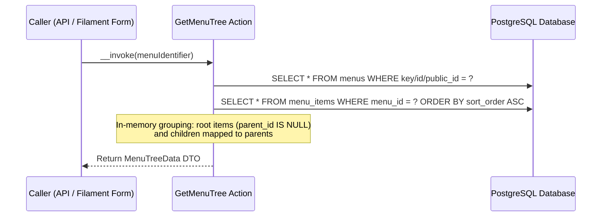
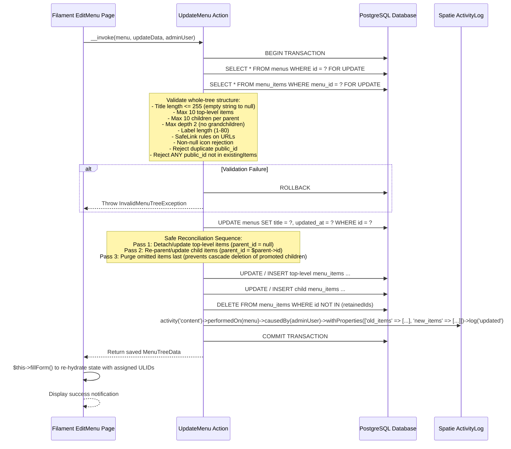

[P1-M1 | PLAN v2 | Gemini]

# Implementation Plan: P1-M1 (v2)

**Step ID**: P1-M1  
**Version**: v2  
**Branch**: `feat/storefront-navigation-menus` (branched from `main`)  
**Head Commit at Plan Creation**: `2e3ca781f305d8613e85944c4d25c79219e322e1` (`2e3ca78 Merge branch 'fix/serving-window-and-history-stacking'`)  

---

## Change Log (Review Feedback Mapping: v1 -> v2)

| Finding ID | Reviewer Issue | Resolution in Plan v2 | Section Changed |
|---|---|---|---|
| **B1** | `UpdateMenu` hard-deletes omitted items before updating retained items; cascading delete on `parent_id` destroys promoted children | Reordered item reconciliation in `UpdateMenu`: (1) detach/update retained top-level items and insert new top-level items, (2) update retained child items and insert new child items, (3) hard-delete omitted items last. Added explicit promoted-child survival test. | **Section 5.3.3, Section 7.2, Section 9, Section 10.1** |
| **B2** | Non-null submitted `public_id` not matching `$existingItems` is silently ignored rather than rejected | Required `UpdateMenu` to reject ANY submitted non-null `public_id` that is not present in the locked menu's `$existingItems` with `InvalidMenuTreeException::unknownPublicId()`. | **Section 5.3.3, Section 7.2, Section 9, Section 10.1** |
| **B3** | `GetMenuTree::__invoke` and `UpdateMenu::__invoke` signatures missing `Menu` type hint, causing `TypeError` when called from `EditMenu` | Updated signatures for both `GetMenuTree::__invoke` and `UpdateMenu::__invoke` to accept `Menu|MenuKey|string|int $menuIdentifier`. | **Section 5.3.1, Section 5.3.3, Section 5.5.5** |
| **B4** | Migration provisions 5 rows; `Menu::factory()->create()` triggers unique key collisions; missing factory specs | Added complete interface specifications for `MenuFactory` and `MenuItemFactory` in Section 5. Specified that `MenuFactory::create()` checks for existing provisioned records and returns them without duplicate insertion. | **Section 4, Section 5.1.4, Section 5.1.5, Section 9** |
| **B5** | Livewire repeater keys are UUIDs; `self` in Data attributes breaks nested hydration; repeaters default to 1 blank item | Added explicit `array_values()` normalization in `EditMenu`. Replaced `self` with explicit class names (`MenuItemData`, `UpdateMenuItemInputData`) in Data classes. Added `->defaultItems(0)` to both repeaters in `MenuForm`. | **Section 5.2.1, Section 5.2.5, Section 5.5.4, Section 5.5.5** |
| **B6** | Section 4 file count mismatch (claimed 30, listed 33); `FilamentSmokeTest` had "optional" phrasing; OD-1..OD-5 in Section 13 | Reconciled manifest to exactly 32 files (Part R: 18, Part W: 6, Part U: 8). Removed `FilamentSmokeTest.php` from manifest. Moved confirmed decisions OD-1 through OD-5 to Decisions Made; set Section 13 open questions to None. | **Section 4, Section 12, Section 13** |
| **M1** | `UpdateMenu` missing `MAX_TITLE_LENGTH = 255`, title length validation, and empty string normalization to null | Added `MAX_TITLE_LENGTH = 255` constant. Specified normalizing empty/whitespace-only titles to `null` and throwing `InvalidMenuTreeException::titleTooLong()` for titles exceeding 255 characters. | **Section 5.3.3, Section 9, Section 10.1** |
| **M2** | Activity log properties stored Data objects instead of plain arrays | Specified passing `$beforeTree->toArray()['items']` and `$savedTree->toArray()['items']` to `activity('content')->withProperties(...)`. | **Section 5.3.3, Section 7.2, Section 10.1** |
| **M3** | Missing interface specs for `InvalidMenuTreeException`, callers, thrown exceptions; redundant catch in `EditMenu`; missing re-hydration code | Added complete interface specs for `InvalidMenuTreeException` and all actions/policy (callers, thrown exceptions). Removed no-op `ValidationException` catch in `EditMenu`. Specified `$this->fillForm();` in `afterSave()`. | **Section 5.3, Section 5.4, Section 5.5.5** |
| **M4** | Template deviations: Section 1 title and length; Section 4 table format; Section 8 Applies column; Section 9/10 exact mapping and AAA lines | Retitled Section 1 to `1. Understanding` with goal in 4 lines. Converted Section 4 to table. Added `Applies (Y/N)` column to Section 8. Formatted Section 9 and Section 10 with exact AAA lines and test names. | **Section 1, Section 4, Section 8, Section 9, Section 10** |
| **m1** | Head commit reference update | Verified and recorded exact Git commit SHA `2e3ca781f305d8613e85944c4d25c79219e322e1` in header and Section 3.1. | **Header, Section 3.1** |
| **m2** | `MenuPolicy` property type alignment | Configured `MenuPolicy` methods (`viewAny`, `view`, `update`) to evaluate `$user->is_platform_admin` directly. | **Section 5.4** |

---

## 1. Understanding

Allow platform administrators to manage the five code-defined storefront navigation menus from the Filament admin panel.
An administrator edits a menu's storefront title and its items as a two-level tree through dedicated form repeaters.
Every persistence operation routes through a single atomic domain action (`UpdateMenu`) under a row lock, maintaining stable item ULIDs, rejecting malformed structures, and writing audit log entries.
Stored menu data is made accessible through domain read actions for subsequent Content API v1 consumption.

### Active Scope Boundaries
- **Part R: Data & Read (P1-M1a)**:
  - Single database migration creating PostgreSQL tables `menus` and `menu_items` with ULID public IDs, foreign keys, unique constraints, and check constraints (`sort_order >= 0`).
  - Idempotent provisioning of the five defined menu records in the migration.
  - `MenuKey` backed enum defining the five code-owned keys (`main_nav`, `mobile_nav`, `footer_column_1`, `footer_column_2`, `footer_column_3`).
  - `Menu` and `MenuItem` Eloquent models in `app/Domain/Content/Models/` with factories in `database/factories/`.
  - Output Data transfer classes in `app/Domain/Content/Data/`: `MenuItemData`, `MenuTreeData`, `MenuListData`, and `MenuSummaryData`.
  - Read Domain Actions in `app/Domain/Content/Actions/`: `GetMenuTree` (eager-loaded constant query count) and `GetMenuList` (summaries with item counts).
  - `MenuPolicy` in `app/Domain/Content/Policies/` registered in `ContentServiceProvider` restricting management to platform administrators and forbidding create/delete.
  - Feature tests covering database schema constraints, provisioning, drift detection, read Action query bounds, and policy gates.
- **Part W: Write & Validation (P1-M1b)**:
  - `UpdateMenu` Action in `app/Domain/Content/Actions/` with input Data classes `UpdateMenuData` and `UpdateMenuItemInputData`.
  - Domain exception `InvalidMenuTreeException` extending `ContentException`.
  - Atomic tree replacement in a single database transaction under a row lock (`lockForUpdate()`).
  - Reordered reconciliation: detach/update retained top-level items, update retained child items, insert new items, and hard-delete omitted items last.
  - Strict validation: depth limit 2 (no grandchildren), label length (1 to 80), title length (<= 255 with empty string normalized to null), link safety via `SafeLink`, caps (10 top-level, 10 children per parent), icon rejection (null required), duplicate public ID rejection, and foreign/unknown public ID rejection.
  - Activity logging via `spatie/laravel-activitylog` recording `'updated'` event with admin causer and plain array before/after snapshots.
  - Feature tests verifying persistence, ULID stability, promoted child survival, rejection paths, rollback on failure, and activity logging.
- **Part U: Admin UI (P1-M1c)**:
  - `MenuResource` in `app/Filament/Admin/Resources/MenuResource.php` registering strictly `index` and `edit` routes with `public_id` route binding.
  - `ListMenus` page and `MenuTable` displaying the five provisioned menus with label, key, title, item count, and timezone-adjusted date via `AdminTimezoneResolver`.
  - `EditMenu` page and `MenuForm` schema containing `title` input and a two-level nested repeater (`defaultItems(0)`) for top-level and child items.
  - Form hydration populated from `GetMenuTree`, decoupled from Eloquent relations.
  - Form save calling `UpdateMenu` Action once with `array_values` normalization, displaying fixed-copy notifications, handling domain exceptions, and re-hydrating form state via `$this->fillForm()`.
  - Table pagination configuring history replacement (`history: false`).
  - Documentation closeout in `ARCHITECTURE.md`.

### Out of Scope
- Public Content API endpoint `GET /api/v1/content/layout`, `GetLayoutContent` Action, public projection (ETags, revision hashes, caching, and filtering out disabled items).
- Real menu seed content in `ContentSeeder` (defer to dedicated seed data step).
- Settings page, retailer panel, roles, or permissions.
- Per-item Actions, separate `MenuItemResource`, Eloquent relation managers, drag-and-drop tree libraries, third-party sortable packages.
- Creating or deleting menus, modifying menu keys, modifying immutable admin labels.
- Soft deletes, trash restore, bulk table actions, import/export.
- Draft or published lifecycle states, revisions, or preview modes for menus.
- Catalog integration or category picker UI components.
- Activity log viewer in Filament.
- Modifying block domain actions or block form registry.

---

## 2. Sources Read

| Source File | What in it constrains P1-M1 |
|---|---|
| [ARCHITECTURE.md](file:///c:/dev/getnow-cms/ARCHITECTURE.md) | Sections 5 (Dependency rules), 6 (Menu tables, column specifications, links starting with `/` or `https://`, maximum depth 2), 7 (API response shape for menus), 8 (Filament conventions: thin resources, `AdminTimezoneResolver` usage, history convention), 9 (PostgreSQL conventions: ULID `public_id`, bigint PK, check constraints, migration placeholders), 10 (Menu edits written to activity log), 12 (Decisions D2: menu keys in code; D4: menus link by URL; D6: single platform admin flag; D9: last-write-wins). |
| [AGENTS.md](file:///c:/dev/getnow-cms/AGENTS.md) | Strict types `declare(strict_types=1);`, final classes, native types, single concern per change, domain actions in `app/Domain/Content/Actions/`, thin Filament resources delegating to Actions, zero direct model mutations in Filament, PostgreSQL dev/test requirement, `composer check` pass definition. |
| [rule-register.md](file:///c:/dev/getnow-cms/docs/blueprints/rule-register.md) | Canonical rule definitions: `E1, S1..S7, C1..C8, K1..K9, DB1..DB6, SEC1..SEC5, T1..T5, G1..G4, X1..X7`. |
| [docs/blueprints/P1-M1/brief.md](file:///c:/dev/getnow-cms/docs/blueprints/P1-M1/brief.md) | Blueprint requirements, acceptance criteria AC-1 through AC-14, decisions made 1 through 14, open decisions OD-1 through OD-5, traps 1 through 14, size guards, mutation spot-checks MUT-1 through MUT-5. |
| [app/Domain/Content/Actions/PublishContentBlock.php](file:///c:/dev/getnow-cms/app/Domain/Content/Actions/PublishContentBlock.php) | Action locking pattern (`lockForUpdate()`), transaction scoping (`DB::transaction`), and activity logging (`activity('content')->performedOn($block)->causedBy($causer)->withProperties(...)->event(...)->log(...)`). |
| [app/Domain/Content/Actions/UpdateContentBlock.php](file:///c:/dev/getnow-cms/app/Domain/Content/Actions/UpdateContentBlock.php) | Action input validation using Spatie Data classes, sorting arrays prior to diffing, and selective dirty checking. |
| [app/Support/Rules/SafeLink.php](file:///c:/dev/getnow-cms/app/Support/Rules/SafeLink.php) | Canonical link validation rule: accepts relative paths starting with `/` (excluding `//` and `/\`), accepts `https://` URLs, validates host presence, rejects credentials, whitespace, backslashes, schemes other than https, and lengths greater than 2048 characters. |
| [tests/Feature/Support/Rules/SafeLinkTest.php](file:///c:/dev/getnow-cms/tests/Feature/Support/Rules/SafeLinkTest.php) | Unit tests verifying `SafeLink` acceptance and rejection boundaries. |
| [app/Domain/Content/Policies/BaseContentPolicy.php](file:///c:/dev/getnow-cms/app/Domain/Content/Policies/BaseContentPolicy.php) | Base policy methods returning `$user->is_platform_admin` by default for `viewAny`, `view`, `create`, `update`, `delete`, `restore`, `forceDelete`. Constrains `MenuPolicy` to explicitly override `create`, `delete`, `restore`, and `forceDelete` to `false`. |
| [app/Domain/Content/Policies/ContentBlockPolicy.php](file:///c:/dev/getnow-cms/app/Domain/Content/Policies/ContentBlockPolicy.php) | Existing content policy implementation demonstrating explicit overrides returning `false` for destructive actions (`delete`, `deleteAny`, `restore`, `forceDelete`). |
| [app/Providers/ContentServiceProvider.php](file:///c:/dev/getnow-cms/app/Providers/ContentServiceProvider.php) | Policy registration via `Gate::policy(ContentBlock::class, ContentBlockPolicy::class)`. Constrains where `MenuPolicy` is registered. |
| [app/Models/User.php](file:///c:/dev/getnow-cms/app/Models/User.php) | User model providing `isAdmin()` and `canAccessPanel(Panel $panel)`. |
| [app/Filament/Admin/Resources/ContentBlockResource.php](file:///c:/dev/getnow-cms/app/Filament/Admin/Resources/ContentBlockResource.php) | Resource folder structure (`Pages`, `Schemas`, `Tables`), `$recordRouteKeyName = 'public_id'`, and `getUrl()` override extracting `public_id` from model instances. |
| [app/Filament/Admin/Resources/ContentBlockResource/Pages/ListContentBlocks.php](file:///c:/dev/getnow-cms/app/Filament/Admin/Resources/ContentBlockResource/Pages/ListContentBlocks.php) | Panel history convention: `queryStringHandlesPagination` returning `'history' => false`. |
| [app/Filament/Admin/Resources/ContentBlockResource/Pages/EditContentBlock.php](file:///c:/dev/getnow-cms/app/Filament/Admin/Resources/ContentBlockResource/Pages/EditContentBlock.php) | Thin page pattern: hydration via `mutateFormDataBeforeFill`, update delegation via `handleRecordUpdate` calling Action, fixed copy notifications, zero direct model writes. |
| [app/Filament/Admin/Resources/ContentBlockResource/Tables/ContentBlockTable.php](file:///c:/dev/getnow-cms/app/Filament/Admin/Resources/ContentBlockResource/Tables/ContentBlockTable.php) | Admin timezone resolution via `app(AdminTimezoneResolver::class)->resolve(config('admin.timezone', 'UTC'))` and `TextColumn` formatting with `->timezone($timezone)`. |
| [app/Filament/Admin/Services/AdminTimezoneResolver.php](file:///c:/dev/getnow-cms/app/Filament/Admin/Services/AdminTimezoneResolver.php) | Validates configured timezone identifier against `timezone_identifiers_list()` with fallback to UTC. |
| [app/Domain/Content/Exceptions/ContentException.php](file:///c:/dev/getnow-cms/app/Domain/Content/Exceptions/ContentException.php) | Base exception class `ContentException extends \Exception` required by `tests/Arch/DomainArchTest.php` for all domain exceptions. |
| [app/Domain/Content/Models/ContentBlock.php](file:///c:/dev/getnow-cms/app/Domain/Content/Models/ContentBlock.php) | Eloquent model using `HasUlids` and `uniqueIds() => ['public_id']` for external ULID generation. |
| [database/migrations/2026_10_08_185740_create_content_blocks_table.php](file:///c:/dev/getnow-cms/database/migrations/2026_10_08_185740_create_content_blocks_table.php) | PostgreSQL migration pattern: `$table->id()`, `$table->ulid('public_id')->unique()`, check constraints via `DB::statement()`. |
| [tests/TestCase.php](file:///c:/dev/getnow-cms/tests/TestCase.php) | Base test case class. |
| [tests/Pest.php](file:///c:/dev/getnow-cms/tests/Pest.php) | Test configuration binding `RefreshDatabase` to Feature tests. |
| [tests/Support/FilamentSmokeTest.php](file:///c:/dev/getnow-cms/tests/Support/FilamentSmokeTest.php) | Trait providing granular smoke assertions `assertListPageRenders` and `assertEditPageRenders`. |
| [tests/Feature/Admin/ContentBlock/ContentBlockEditTest.php](file:///c:/dev/getnow-cms/tests/Feature/Admin/ContentBlock/ContentBlockEditTest.php) | CR-02 test class pattern (`class ... extends TestCase { use FilamentSmokeTest; ... }`) avoiding static analysis issues with Pest closure `$this`. |
| [tests/Feature/Content/BlockFormRegistryTest.php](file:///c:/dev/getnow-cms/tests/Feature/Content/BlockFormRegistryTest.php) | Forbidden strings scan verifying zero occurrences of `RichEditor`, `MarkdownEditor`, `CodeEditor`, `KeyValue`, `->url(`, `DeleteAction`, `ForceDeleteAction`, `RestoreAction` in Filament folders. |
| [tests/Arch/DomainArchTest.php](file:///c:/dev/getnow-cms/tests/Arch/DomainArchTest.php) | Architectural rules: Domain actions are final and invokable; domain exceptions extend `ContentException`; domain never imports Filament or Http. |
| [tests/Arch/FilamentWritesTest.php](file:///c:/dev/getnow-cms/tests/Arch/FilamentWritesTest.php) | Architectural scan ensuring zero direct model write calls (`::create(`, `->update(`, `->delete(`, `->save(`, `->forceDelete(`) exist within `app/Filament`. |
| [composer.json](file:///c:/dev/getnow-cms/composer.json) | Package specifications: PHP `^8.3`, `filament/filament: ^5.0`, `spatie/laravel-activitylog: ^4.12`, `spatie/laravel-data: ^4.23`, `pestphp/pest: ^4.7`. |

---

## 3. Verified Current State

### 3.1 Git Repository State
- Working branch: `main`
- Ahead of `origin/main` by 7 commits.
- Head commit:
  ```
  2e3ca781f305d8613e85944c4d25c79219e322e1 (2e3ca78 Merge branch 'fix/serving-window-and-history-stacking')
  ```
- Previous commit history:
  ```
  afd8eec docs(blueprints): add P1-FIX1 implementation plan and report
  dca6e45 docs(architecture): document admin panel browser history convention in section 8
  9a17abc fix(filament): configure history replacement for table pagination
  f659d87 docs(adr): update ADR 0002 for dynamic lifecycle serving status resolution
  b151f98 Merge pull request #7 from AchinthaDe/feat/ui-content-block-view-and-transitions
  ```
- Non-existence verification of target entities:
  - `app/Domain/Content/Enums/MenuKey.php`: Does not exist.
  - `app/Domain/Content/Models/Menu.php`: Does not exist.
  - `app/Domain/Content/Models/MenuItem.php`: Does not exist.
  - `database/migrations/*menu*`: Zero matching migrations exist.
  - `app/Filament/Admin/Resources/MenuResource.php`: Does not exist.

### 3.2 Locking and Transaction Verification
In [PublishContentBlock.php:21-56](file:///c:/dev/getnow-cms/app/Domain/Content/Actions/PublishContentBlock.php#L21-L56):
```php
public function __invoke(int $id, ?User $causer = null): ContentBlock
{
    return DB::transaction(function () use ($id, $causer) {
        $block = ContentBlock::where('id', $id)->lockForUpdate()->firstOrFail();
        ...
        activity('content')
            ->performedOn($block)
            ->causedBy($causer)
            ->withProperties([
                'old_status' => $oldStatus?->value,
                'new_status' => PublishStatus::PUBLISHED->value,
            ])
            ->event('published')
            ->log('published');

        return $block;
    });
}
```
This verifies that domain write actions execute inside `DB::transaction(...)`, obtain a row lock via `->lockForUpdate()`, and write audit logs using `activity('content')` with the causer.

### 3.3 Link Validation Verification
In [SafeLink.php:12-66](file:///c:/dev/getnow-cms/app/Support/Rules/SafeLink.php#L12-L66):
```php
public function validate(string $attribute, mixed $value, Closure $fail): void
{
    if (! is_string($value)) {
        $fail('The :attribute must be a string.');
        return;
    }
    if (strlen($value) > 2048) {
        $fail('The :attribute is too long.');
        return;
    }
    if (preg_match('/[\s\x00-\x1F\x7F]/', $value)) {
        $fail('The :attribute contains invalid characters.');
        return;
    }
    if (str_contains($value, '\\')) {
        $fail('The :attribute contains invalid characters.');
        return;
    }
    if (str_starts_with($value, '//')) {
        $fail('The :attribute must be a valid path or URL.');
        return;
    }
    if (str_starts_with($value, '/')) {
        return;
    }
    if (stripos($value, 'https://') !== 0) {
        $fail('The :attribute must start with / or https://.');
        return;
    }
    $parsed = parse_url($value);
    if ($parsed === false || empty($parsed['host'])) {
        $fail('The :attribute must be a valid URL.');
        return;
    }
    if (isset($parsed['user']) || isset($parsed['pass'])) {
        $fail('The :attribute must not contain credentials.');
        return;
    }
}
```
`SafeLink` rejects protocol-relative `//host`, backslash variations (`\`, `/\`), non-https external schemes (`http://`, `javascript:`, `data:`, `mailto:`), control characters, and lengths exceeding 2048 characters. Menus reuse this rule directly without modification.

### 3.4 Policy Verification
In [BaseContentPolicy.php:9-45](file:///c:/dev/getnow-cms/app/Domain/Content/Policies/BaseContentPolicy.php#L9-L45):
```php
abstract class BaseContentPolicy
{
    public function viewAny(User $user): bool { return $user->is_platform_admin; }
    public function view(User $user, mixed $model): bool { return $user->is_platform_admin; }
    public function create(User $user): bool { return $user->is_platform_admin; }
    public function update(User $user, mixed $model): bool { return $user->is_platform_admin; }
    public function delete(User $user, mixed $model): bool { return $user->is_platform_admin; }
    public function restore(User $user, mixed $model): bool { return $user->is_platform_admin; }
    public function forceDelete(User $user, mixed $model): bool { return $user->is_platform_admin; }
}
```
Because `BaseContentPolicy::create`, `delete`, and `forceDelete` return `$user->is_platform_admin`, `MenuPolicy` must explicitly override `create`, `delete`, `deleteAny`, `restore`, and `forceDelete` to return `false` for all callers.

In [ContentServiceProvider.php:24-27](file:///c:/dev/getnow-cms/app/Providers/ContentServiceProvider.php#L24-L27):
```php
public function boot(): void
{
    Gate::policy(ContentBlock::class, ContentBlockPolicy::class);
    ...
}
```
Policy registration is handled by adding `Gate::policy(Menu::class, MenuPolicy::class);` to `boot()`.

### 3.5 Resource and History Routing Verification
In [ContentBlockResource.php:22, 38-53](file:///c:/dev/getnow-cms/app/Filament/Admin/Resources/ContentBlockResource.php#L22):
```php
protected static ?string $recordRouteKeyName = 'public_id';

public static function getUrl(
    ?string $name = null,
    array $parameters = [],
    bool $isAbsolute = true,
    ?string $panel = null,
    ?Model $tenant = null,
    bool $shouldGuessMissingParameters = false,
    ?string $configuration = null,
): string {
    if (isset($parameters['record']) && $parameters['record'] instanceof Model) {
        $routeKeyName = self::getRecordRouteKeyName() ?? $parameters['record']->getRouteKeyName();
        $parameters['record'] = $parameters['record']->getAttribute($routeKeyName);
    }

    return parent::getUrl($name, $parameters, $isAbsolute, $panel, $tenant, $shouldGuessMissingParameters, $configuration);
}
```
`MenuResource` will replicate this exact `getUrl()` override and `$recordRouteKeyName = 'public_id'` declaration.

In [ListContentBlocks.php:18-31](file:///c:/dev/getnow-cms/app/Filament/Admin/Resources/ContentBlockResource/Pages/ListContentBlocks.php#L18-L31):
```php
public function queryStringHandlesPagination(): array
{
    $queryString = [];
    foreach ($this->paginators as $pageName => $page) {
        $queryString['paginators.'.$pageName] = [
            'history' => false,
            'as' => (string) $pageName,
            'keep' => false,
        ];
    }
    return $queryString;
}
```
`ListMenus` will implement this method to conform to the panel browser history convention.

### 3.6 Timezone Display Path Verification
In [ContentBlockTable.php:57, 94-104](file:///c:/dev/getnow-cms/app/Filament/Admin/Resources/ContentBlockResource/Tables/ContentBlockTable.php#L57):
```php
$timezone = app(AdminTimezoneResolver::class)->resolve(config('admin.timezone', 'UTC'));
...
TextColumn::make('starts_at')
    ->label("Starts at ({$timezone})")
    ->dateTime()
    ->timezone($timezone)
    ->sortable(),
```
Only one timezone configuration path exists across the application: `app(AdminTimezoneResolver::class)->resolve(config('admin.timezone', 'UTC'))`. `MenuTable` will use this exact path to format the `updated_at` column.

### 3.7 Database Reset & Provisioning Strategy
In [tests/Pest.php:8-11](file:///c:/dev/getnow-cms/tests/Pest.php#L8-L11):
Feature tests utilize `RefreshDatabase::class`. In PostgreSQL, `RefreshDatabase` executes migrations once and wraps each test in a database transaction that rolls back at test completion. Data inserted by migrations remains present across tests unless mutated within the test. Factories creating menus by key must account for existing provisioned records.

---

## 4. File Manifest

Total files in plan: **32 files** (Part R: 18 files, Part W: 6 files, Part U: 8 files).

| Path | New or Modify | Layer | One-line Responsibility | Rule IDs |
|---|---|---|---|---|
| `database/migrations/2026_10_14_000000_create_menus_and_menu_items_tables.php` | New | Database | Creates PostgreSQL `menus` and `menu_items` tables, constraints, and provisions 5 keys | DB1, DB4, DB5, DB6, K5 |
| `app/Domain/Content/Enums/MenuKey.php` | New | Domain | Backed enum defining the five code-owned navigation menu keys | C1, C2, C3, K5 |
| `app/Domain/Content/Models/Menu.php` | New | Domain | Eloquent model for menu container with ULID public ID and relationships | C1, C2, S7, DB5 |
| `app/Domain/Content/Models/MenuItem.php` | New | Domain | Eloquent model for menu items with ULID public ID and parent-child relations | C1, C2, S7, DB4, DB5 |
| `database/factories/MenuFactory.php` | New | Database | Factory producing Menu models without colliding with provisioned rows | T4, DB6 |
| `database/factories/MenuItemFactory.php` | New | Database | Factory producing MenuItem models with parent-child relationship support | T4, DB4 |
| `app/Domain/Content/Data/MenuItemData.php` | New | Domain | Spatie Data DTO representing an item node with explicit nested children array | C1, C2, C3 |
| `app/Domain/Content/Data/MenuTreeData.php` | New | Domain | Spatie Data DTO representing a complete two-level menu tree | C1, C2, C3 |
| `app/Domain/Content/Data/MenuSummaryData.php` | New | Domain | Spatie Data DTO representing a single menu summary row with item count | C1, C2, C3 |
| `app/Domain/Content/Data/MenuListData.php` | New | Domain | Spatie Data DTO wrapping the complete list of menu summaries | C1, C2, C3 |
| `app/Domain/Content/Actions/GetMenuTree.php` | New | Domain | Invokable read Action returning full menu tree with constant query count | S1, S7, C1, C2 |
| `app/Domain/Content/Actions/GetMenuList.php` | New | Domain | Invokable read Action returning all menus with aggregated item counts | S1, S7, C1, C2 |
| `app/Domain/Content/Policies/MenuPolicy.php` | New | Domain | Authorization policy restricting management to platform admin; forbids create/delete | C6, SEC2, SEC4 |
| `app/Providers/ContentServiceProvider.php` | Modify | Providers | Registers `MenuPolicy` binding for `Menu` model in `boot()` | S7, C6 |
| `tests/Feature/Domain/Content/MenuSchemaAndProvisioningTest.php` | New | Tests | Asserts schema constraints, foreign keys, cascades, and provisioning drift | T1, DB1, DB4, K5 |
| `tests/Feature/Domain/Content/Actions/GetMenuTreeTest.php` | New | Tests | Asserts tree ordering, nesting hierarchy, and constant query count bounds | T1, S1 |
| `tests/Feature/Domain/Content/Actions/GetMenuListTest.php` | New | Tests | Asserts stable ordering and accurate item count aggregation for menu summaries | T1, S1 |
| `tests/Feature/Domain/Content/Policies/MenuPolicyTest.php` | New | Tests | Asserts platform admin permissions and explicit rejection of create/delete | T1, C6, SEC2 |
| `app/Domain/Content/Exceptions/InvalidMenuTreeException.php` | New | Domain | Domain exception extending `ContentException` with structured factory methods | C1, C2, S1 |
| `app/Domain/Content/Data/UpdateMenuItemInputData.php` | New | Domain | Spatie Data DTO representing an input item node with explicit children array | C1, C2, C3 |
| `app/Domain/Content/Data/UpdateMenuData.php` | New | Domain | Spatie Data DTO representing a full menu update submission | C1, C2, C3 |
| `app/Domain/Content/Actions/UpdateMenu.php` | New | Domain | Invokable write Action with row lock, in-place update, reordered diff, audit log | S1, S7, C1, C2, SEC5 |
| `tests/Feature/Domain/Content/Actions/UpdateMenuTest.php` | New | Tests | Tests atomic replacement, ULID stability, promoted child survival, and audit log | T1, S1, SEC5 |
| `tests/Feature/Domain/Content/Actions/UpdateMenuRejectionsTest.php` | New | Tests | Tests rejection of depth > 2, invalid links, foreign ULIDs, caps, and rollback | T1, S1, K3, K4 |
| `app/Filament/Admin/Resources/MenuResource.php` | New | Filament | Filament resource declaring index/edit routes, public ID key, and navigation | S2, S6, C6, DB5 |
| `app/Filament/Admin/Resources/MenuResource/Pages/ListMenus.php` | New | Filament | List page with history replacement configuration and zero create actions | S2, S6, C6 |
| `app/Filament/Admin/Resources/MenuResource/Pages/EditMenu.php` | New | Filament | Edit page with read hydration, Action delegation, and form re-hydration | S2, S4, S6, SEC3 |
| `app/Filament/Admin/Resources/MenuResource/Schemas/MenuForm.php` | New | Filament | Two-level nested repeater form schema with zero default items and SafeLink rule | S2, S6, K3, K4 |
| `app/Filament/Admin/Resources/MenuResource/Tables/MenuTable.php` | New | Filament | Table schema displaying label, key, title, item count, and timezone-adjusted date | S2, S6 |
| `tests/Feature/Admin/Menu/MenuResourceTest.php` | New | Tests | Tests list/edit smoke rendering, route authorization, and 404 on integer ID | T1, T2, DB5, SEC4 |
| `tests/Feature/Admin/Menu/MenuFormTest.php` | New | Tests | Tests form hydration, save delegation, error states, and double-save stability | T1, S4, SEC3 |
| `ARCHITECTURE.md` | Modify | Documentation | Updates Phase 1 progress checkbox for Menus and documents write rule in D9 | X7 |

---

## 5. Architecture & Component Design

### 5.1 Enums and Models

#### 1. MenuKey Enum (`app/Domain/Content/Enums/MenuKey.php`)
- **Namespace**: `App\Domain\Content\Enums`
- **Declaration**: `enum MenuKey: string`
- **Cases**:
  - `MAIN_NAV = 'main_nav'`
  - `MOBILE_NAV = 'mobile_nav'`
  - `FOOTER_COLUMN_1 = 'footer_column_1'`
  - `FOOTER_COLUMN_2 = 'footer_column_2'`
  - `FOOTER_COLUMN_3 = 'footer_column_3'`
- **Methods**: `public function defaultLabel(): string` mapping cases to human-readable names.
- **Callers**: `Menu` model, `MenuTreeData`, `MenuSummaryData`, Migration, `MenuSchemaAndProvisioningTest`.

#### 2. Menu Model (`app/Domain/Content/Models/Menu.php`)
- **Namespace**: `App\Domain\Content\Models`
- **Declaration**: `final class Menu extends Model`
- **Traits**: `HasFactory`, `HasUlids`
- **Properties**: `int $id`, `string $public_id`, `MenuKey $key`, `string $label`, `?string $title`, `Carbon|null $created_at`, `Carbon|null $updated_at`.
- **Casts**: `'key' => MenuKey::class`.
- **Unique IDs**: `public function uniqueIds(): array { return ['public_id']; }`.
- **Relationships**:
  - `public function items(): HasMany`: `hasMany(MenuItem::class, 'menu_id')`.
  - `public function rootItems(): HasMany`: `hasMany(MenuItem::class, 'menu_id')->whereNull('parent_id')->orderBy('sort_order')`.
- **Callers**: `GetMenuTree`, `GetMenuList`, `UpdateMenu`, `MenuPolicy`, `MenuResource`.

#### 3. MenuItem Model (`app/Domain/Content/Models/MenuItem.php`)
- **Namespace**: `App\Domain\Content\Models`
- **Declaration**: `final class MenuItem extends Model`
- **Traits**: `HasFactory`, `HasUlids`
- **Properties**: `int $id`, `string $public_id`, `int $menu_id`, `int|null $parent_id`, `string $label`, `string $url`, `string|null $icon`, `bool $opens_in_new_tab`, `bool $is_enabled`, `int $sort_order`, `Carbon|null $created_at`, `Carbon|null $updated_at`.
- **Casts**: `'opens_in_new_tab' => 'boolean'`, `'is_enabled' => 'boolean'`, `'sort_order' => 'integer'`.
- **Unique IDs**: `public function uniqueIds(): array { return ['public_id']; }`.
- **Relationships**:
  - `public function menu(): BelongsTo`: `belongsTo(Menu::class, 'menu_id')`.
  - `public function parent(): BelongsTo`: `belongsTo(MenuItem::class, 'parent_id')`.
  - `public function children(): HasMany`: `hasMany(MenuItem::class, 'parent_id')->orderBy('sort_order')`.
- **Callers**: `Menu`, `GetMenuTree`, `UpdateMenu`.

#### 4. MenuFactory (`database/factories/MenuFactory.php`)
- **Namespace**: `Database\Factories`
- **Declaration**: `final class MenuFactory extends Factory`
- **Model**: `Menu::class`
- **Definition**:
  ```php
  public function definition(): array
  {
      return [
          'public_id' => (string) Str::ulid(),
          'key' => MenuKey::MAIN_NAV,
          'label' => 'Main Navigation',
          'title' => null,
      ];
  }
  ```
- **Methods**:
  - `public function forKey(MenuKey $key): self`: sets `key` and matching `label`.
  - `public function create($attributes = [], ?Model $parent = null)`: overrides creation to prevent duplicate key collisions with provisioned rows:
    ```php
    public function create($attributes = [], ?Model $parent = null)
    {
        $rawAttributes = $this->getExpandedAttributes($attributes);
        $key = $rawAttributes['key'] ?? MenuKey::MAIN_NAV;
        $keyVal = $key instanceof MenuKey ? $key->value : $key;

        $existing = Menu::where('key', $keyVal)->first();
        if ($existing !== null) {
            if (array_key_exists('title', $rawAttributes)) {
                $existing->update(['title' => $rawAttributes['title']]);
            }
            return $existing;
        }

        return parent::create($attributes, $parent);
    }
    ```
- **Callers**: Feature tests, `MenuItemFactory`.

#### 5. MenuItemFactory (`database/factories/MenuItemFactory.php`)
- **Namespace**: `Database\Factories`
- **Declaration**: `final class MenuItemFactory extends Factory`
- **Model**: `MenuItem::class`
- **Definition**:
  ```php
  public function definition(): array
  {
      return [
          'public_id' => (string) Str::ulid(),
          'menu_id' => Menu::factory(),
          'parent_id' => null,
          'label' => fake()->words(2, true),
          'url' => '/'.fake()->slug(),
          'icon' => null,
          'opens_in_new_tab' => false,
          'is_enabled' => true,
          'sort_order' => 0,
      ];
  }
  ```
- **Methods**:
  - `public function childOf(MenuItem $parent): self`: binds `menu_id = $parent->menu_id` and `parent_id = $parent->id`.
  - `public function forMenu(Menu $menu): self`: binds `menu_id = $menu->id`.
- **Callers**: Feature tests.

### 5.2 Data Transfer Classes

#### 1. MenuItemData (`app/Domain/Content/Data/MenuItemData.php`)
```php
declare(strict_types=1);

namespace App\Domain\Content\Data;

use Spatie\LaravelData\Data;

final class MenuItemData extends Data
{
    /**
     * @param array<int, MenuItemData> $children
     */
    public function __construct(
        public string $public_id,
        public string $label,
        public string $url,
        public ?string $icon,
        public bool $opens_in_new_tab,
        public bool $is_enabled,
        public int $sort_order,
        public array $children = [],
    ) {}
}
```

#### 2. MenuTreeData (`app/Domain/Content/Data/MenuTreeData.php`)
```php
declare(strict_types=1);

namespace App\Domain\Content\Data;

use App\Domain\Content\Enums\MenuKey;
use Spatie\LaravelData\Data;

final class MenuTreeData extends Data
{
    /**
     * @param array<int, MenuItemData> $items
     */
    public function __construct(
        public string $public_id,
        public MenuKey $key,
        public string $label,
        public ?string $title,
        public array $items,
    ) {}
}
```

#### 3. MenuSummaryData (`app/Domain/Content/Data/MenuSummaryData.php`)
```php
declare(strict_types=1);

namespace App\Domain\Content\Data;

use App\Domain\Content\Enums\MenuKey;
use Illuminate\Support\Carbon;
use Spatie\LaravelData\Data;

final class MenuSummaryData extends Data
{
    public function __construct(
        public string $public_id,
        public MenuKey $key,
        public string $label,
        public ?string $title,
        public int $item_count,
        public ?Carbon $updated_at,
    ) {}
}
```

#### 4. MenuListData (`app/Domain/Content/Data/MenuListData.php`)
```php
declare(strict_types=1);

namespace App\Domain\Content\Data;

use Spatie\LaravelData\Data;

final class MenuListData extends Data
{
    /**
     * @param array<int, MenuSummaryData> $menus
     */
    public function __construct(
        public array $menus,
    ) {}
}
```

#### 5. UpdateMenuItemInputData (`app/Domain/Content/Data/UpdateMenuItemInputData.php`)
```php
declare(strict_types=1);

namespace App\Domain\Content\Data;

use Spatie\LaravelData\Data;

final class UpdateMenuItemInputData extends Data
{
    /**
     * @param array<int, UpdateMenuItemInputData> $children
     */
    public function __construct(
        public ?string $public_id,
        public string $label,
        public string $url,
        public ?string $icon = null,
        public bool $opens_in_new_tab = false,
        public bool $is_enabled = true,
        public array $children = [],
    ) {}
}
```

#### 6. UpdateMenuData (`app/Domain/Content/Data/UpdateMenuData.php`)
```php
declare(strict_types=1);

namespace App\Domain\Content\Data;

use Spatie\LaravelData\Data;

final class UpdateMenuData extends Data
{
    /**
     * @param array<int, UpdateMenuItemInputData> $items
     */
    public function __construct(
        public ?string $title,
        public array $items = [],
    ) {}
}
```

### 5.3 Domain Exceptions and Actions

#### 1. InvalidMenuTreeException (`app/Domain/Content/Exceptions/InvalidMenuTreeException.php`)
- **Namespace**: `App\Domain\Content\Exceptions`
- **Declaration**: `final class InvalidMenuTreeException extends ContentException`
- **Static Factory Methods**:
  - `public static function titleTooLong(int $max): self`: `"Menu title exceeds {$max} characters."`
  - `public static function labelInvalid(string $msg): self`: `"Invalid menu item label: {$msg}"`
  - `public static function urlInvalid(string $url): self`: `"Invalid menu item URL [{$url}]."`
  - `public static function depthExceeded(): self`: `"Menu structure exceeds maximum allowed depth of 2."`
  - `public static function capsExceeded(string $msg): self`: `"Menu item limit exceeded: {$msg}"`
  - `public static function iconNotSupported(): self`: `"Icons are not supported in menu items."`
  - `public static function unknownPublicId(string $publicId): self`: `"Item [{$publicId}] does not belong to this menu."`
  - `public static function duplicatePublicId(string $publicId): self`: `"Duplicate item public ID [{$publicId}] submitted."`
- **Callers**: `UpdateMenu`.

#### 2. GetMenuTree (`app/Domain/Content/Actions/GetMenuTree.php`)
- **Declaration**: `final class GetMenuTree`
- **Signature**: `public function __invoke(Menu|MenuKey|string|int $menuIdentifier): MenuTreeData`
- **Thrown Exceptions**: `Illuminate\Database\Eloquent\ModelNotFoundException`
- **Callers**: `EditMenu::mutateFormDataBeforeFill`, Feature tests.
- **Implementation**:
  - Resolves `Menu` record via model instance, `id`, `public_id`, or `key`.
  - Executes a single query to load all associated menu items: `$menu->items()->orderBy('sort_order')->get()`.
  - Assembles the in-memory hierarchy by filtering root items (`parent_id === null`) and assigning child items mapped by `parent_id`.
  - Total queries: exactly 2 queries (1 for `Menu`, 1 for `MenuItem` collection).

#### 3. GetMenuList (`app/Domain/Content/Actions/GetMenuList.php`)
- **Declaration**: `final class GetMenuList`
- **Signature**: `public function __invoke(): MenuListData`
- **Thrown Exceptions**: None
- **Callers**: `ListMenus`, Feature tests.
- **Implementation**:
  - Executes `Menu::withCount('items')->orderBy('id')->get()`.
  - Returns `MenuListData` containing array of `MenuSummaryData`.

#### 4. UpdateMenu (`app/Domain/Content/Actions/UpdateMenu.php`)
- **Declaration**: `final class UpdateMenu`
- **Signature**: `public function __invoke(Menu|MenuKey|string|int $menuIdentifier, UpdateMenuData $data, ?User $causer = null): MenuTreeData`
- **Constants**:
  - `public const int MAX_TOP_LEVEL_ITEMS = 10;`
  - `public const int MAX_CHILDREN_PER_PARENT = 10;`
  - `public const int MAX_LABEL_LENGTH = 80;`
  - `public const int MAX_URL_LENGTH = 2048;`
  - `public const int MAX_TITLE_LENGTH = 255;`
- **Thrown Exceptions**: `InvalidMenuTreeException`, `Illuminate\Database\Eloquent\ModelNotFoundException`
- **Callers**: `EditMenu::handleRecordUpdate`, Feature tests.
- **Reconciliation Algorithm**:
  1. Wrap all operations inside `DB::transaction(...)`.
  2. Resolve and lock `Menu` row: `Menu::where(...)->lockForUpdate()->firstOrFail()`.
  3. Load and key existing items: `$existingItems = $menu->items()->lockForUpdate()->get()->keyBy('public_id');`.
  4. Snapshot pre-update tree via `(new GetMenuTree)($menu)` for audit logging.
  5. Validate submitted title:
     - Normalize empty string or whitespace-only title to `null`:
       `$title = ($data->title !== null && trim($data->title) !== '') ? trim($data->title) : null;`
     - Reject if `$title !== null && mb_strlen($title) > self::MAX_TITLE_LENGTH` with `InvalidMenuTreeException::titleTooLong()`.
  6. Validate tree structure and inputs:
     - Top-level count <= `MAX_TOP_LEVEL_ITEMS`.
     - For each top-level item:
       - Validate label: not blank, trimmed length 1 to `MAX_LABEL_LENGTH`.
       - Validate URL using `SafeLink` instance.
       - Validate icon is null.
       - Validate `public_id`: if not null, assert present in `$existingItems` (reject unknown/foreign IDs) and assert not seen previously in this submission (reject duplicates).
       - Validate children count <= `MAX_CHILDREN_PER_PARENT`.
       - For each child item:
         - Validate label, URL with `SafeLink`, icon null.
         - Validate `public_id`: if not null, assert present in `$existingItems` and unique across submission.
         - Depth limit check: assert child has zero nested children.
  7. Update menu `title` on model.
  8. **Reordered Reconciliation Sequence**:
     - Track all submitted public IDs: `$submittedPublicIds = [];`.
     - **Pass 1 (Top-Level Items)**:
       - For each top-level item at index `$i`:
         - If `public_id` is present in `$existingItems`:
           - Update existing record in place: `parent_id = null`, `sort_order = $i`, `label`, `url`, `is_enabled`, `opens_in_new_tab`.
           - Record `$submittedPublicIds[] = $publicId;`.
           - Map temporary loop ID to record ID for child assignment.
         - If `public_id` is null:
           - Insert new `MenuItem` with `menu_id = $menu->id`, `parent_id = null`, `sort_order = $i`.
           - Record generated `public_id` in tracking list.
     - **Pass 2 (Child Items)**:
       - For each child item under parent at index `$j`:
         - If `public_id` is present in `$existingItems`:
           - Update existing record in place: `parent_id = $parentRecord->id`, `sort_order = $j`, attributes.
           - Record `$submittedPublicIds[] = $publicId;`.
         - If `public_id` is null:
           - Insert new `MenuItem` with `menu_id = $menu->id`, `parent_id = $parentRecord->id`, `sort_order = $j`.
           - Record generated `public_id` in tracking list.
     - **Pass 3 (Purge Omitted Items)**:
       - Execute hard deletion of omitted items:
         `$menu->items()->whereNotIn('public_id', $submittedPublicIds)->delete();`.
       - *Integrity Note*: Because retained items were re-parented in Pass 1 and Pass 2, no retained item references an omitted item as `parent_id`. Omitted parent deletion cascades safely without affecting promoted children.
  9. Load fresh post-update tree: `$savedTree = (new GetMenuTree)($menu);`.
  10. Record audit entry:
      ```php
      activity('content')
          ->performedOn($menu)
          ->causedBy($causer)
          ->withProperties([
              'old_title' => $beforeTree->title,
              'new_title' => $menu->title,
              'old_items' => $beforeTree->toArray()['items'],
              'new_items' => $savedTree->toArray()['items'],
          ])
          ->event('updated')
          ->log('updated');
      ```
  11. Return `$savedTree`.

### 5.4 Authorization Policy (`app/Domain/Content/Policies/MenuPolicy.php`)
- **Namespace**: `App\Domain\Content\Policies`
- **Declaration**: `final class MenuPolicy extends BaseContentPolicy`
- **Callers**: Laravel Gate, Filament authorization checks.
- **Thrown Exceptions**: None
- **Implementation**:
  ```php
  declare(strict_types=1);

  namespace App\Domain\Content\Policies;

  use App\Domain\Content\Models\Menu;
  use App\Models\User;

  final class MenuPolicy extends BaseContentPolicy
  {
      public function viewAny(User $user): bool
      {
          return $user->is_platform_admin;
      }

      public function view(User $user, mixed $model): bool
      {
          return $user->is_platform_admin;
      }

      public function create(User $user): bool
      {
          return false;
      }

      public function update(User $user, mixed $model): bool
      {
          return $user->is_platform_admin;
      }

      public function delete(User $user, mixed $model): bool
      {
          return false;
      }

      public function deleteAny(User $user): bool
      {
          return false;
      }

      public function restore(User $user, mixed $model): bool
      {
          return false;
      }

      public function restoreAny(User $user): bool
      {
          return false;
      }

      public function forceDelete(User $user, mixed $model): bool
      {
          return false;
      }

      public function forceDeleteAny(User $user): bool
      {
          return false;
      }
  }
  ```

### 5.5 Filament Resource & UI Components

#### 1. MenuResource (`app/Filament/Admin/Resources/MenuResource.php`)
- **Namespace**: `App\Filament\Admin\Resources`
- **Declaration**: `final class MenuResource extends Resource`
- **Model**: `Menu::class`
- **Route Key**: `protected static ?string $recordRouteKeyName = 'public_id';`
- **Navigation**: icon `'heroicon-o-bars-3'`, group `'Content'`, sort `2`.
- **URL Override**:
  ```php
  public static function getUrl(
      ?string $name = null,
      array $parameters = [],
      bool $isAbsolute = true,
      ?string $panel = null,
      ?Model $tenant = null,
      bool $shouldGuessMissingParameters = false,
      ?string $configuration = null,
  ): string {
      if (isset($parameters['record']) && $parameters['record'] instanceof Model) {
          $routeKeyName = self::getRecordRouteKeyName() ?? $parameters['record']->getRouteKeyName();
          $parameters['record'] = $parameters['record']->getAttribute($routeKeyName);
      }

      return parent::getUrl($name, $parameters, $isAbsolute, $panel, $tenant, $shouldGuessMissingParameters, $configuration);
  }
  ```
- **Pages**:
  - `'index'` => `Pages\ListMenus::route('/')`
  - `'edit'` => `Pages\EditMenu::route('/{record}/edit')`

#### 2. ListMenus (`app/Filament/Admin/Resources/MenuResource/Pages/ListMenus.php`)
- **Namespace**: `App\Filament\Admin\Resources\MenuResource\Pages`
- **Declaration**: `final class ListMenus extends ListRecords`
- **Resource**: `MenuResource::class`
- **Methods**:
  - `protected function getHeaderActions(): array { return []; }` (No create action).
  - `public function queryStringHandlesPagination(): array`: returns `['history' => false]` for each paginator to prevent browser history pollution.

#### 3. MenuTable (`app/Filament/Admin/Resources/MenuResource/Tables/MenuTable.php`)
- **Namespace**: `App\Filament\Admin\Resources\MenuResource\Tables`
- **Declaration**: `final class MenuTable`
- **Columns**:
  - `TextColumn::make('label')->label('Menu')->sortable()->searchable()`
  - `TextColumn::make('key')->label('Key')->badge()->color('gray')->sortable()`
  - `TextColumn::make('title')->label('Storefront Title')->placeholder('—')->sortable()`
  - `TextColumn::make('items_count')->counts('items')->label('Items')->sortable()`
  - `TextColumn::make('updated_at')->label("Updated at ({$timezone})")->dateTime()->timezone($timezone)->sortable()`
- **Row Action**: `EditAction::make()`
- **Row URL**: `fn (Menu $record): string => MenuResource::getUrl('edit', ['record' => $record])`
- **Bulk Actions**: empty array `[]`

#### 4. MenuForm (`app/Filament/Admin/Resources/MenuResource/Schemas/MenuForm.php`)
- **Namespace**: `App\Filament\Admin\Resources\MenuResource\Schemas`
- **Declaration**: `final class MenuForm`
- **Components**:
  - `TextInput::make('title')->label('Storefront Title')->maxLength(255)->nullable()`
  - `Repeater::make('items')->label('Menu Items')->maxItems(10)->defaultItems(0)`
    - Sub-components:
      - `Hidden::make('public_id')`
      - `TextInput::make('label')->required()->maxLength(80)`
      - `TextInput::make('url')->label('URL / Path')->required()->maxLength(2048)->rule(new SafeLink)`
      - `Toggle::make('opens_in_new_tab')->label('Open in new tab')->default(false)`
      - `Toggle::make('is_enabled')->label('Enabled')->default(true)`
      - `Repeater::make('children')->label('Sub-items')->maxItems(10)->defaultItems(0)`
        - Nested components:
          - `Hidden::make('public_id')`
          - `TextInput::make('label')->required()->maxLength(80)`
          - `TextInput::make('url')->label('URL / Path')->required()->maxLength(2048)->rule(new SafeLink)`
          - `Toggle::make('opens_in_new_tab')->label('Open in new tab')->default(false)`
          - `Toggle::make('is_enabled')->label('Enabled')->default(true)`

#### 5. EditMenu (`app/Filament/Admin/Resources/MenuResource/Pages/EditMenu.php`)
- **Namespace**: `App\Filament\Admin\Resources\MenuResource\Pages`
- **Declaration**: `final class EditMenu extends EditRecord`
- **Resource**: `MenuResource::class`
- **Header Actions**: `protected function getHeaderActions(): array { return []; }`
- **Hydration**:
  ```php
  protected function mutateFormDataBeforeFill(array $data): array
  {
      /** @var Menu $record */
      $record = $this->getRecord();
      $tree = app(GetMenuTree::class)($record);

      return [
          'title' => $tree->title,
          'items' => array_values(array_map(function (MenuItemData $item): array {
              return [
                  'public_id' => $item->public_id,
                  'label' => $item->label,
                  'url' => $item->url,
                  'opens_in_new_tab' => $item->opens_in_new_tab,
                  'is_enabled' => $item->is_enabled,
                  'children' => array_values(array_map(function (MenuItemData $child): array {
                      return [
                          'public_id' => $child->public_id,
                          'label' => $child->label,
                          'url' => $child->url,
                          'opens_in_new_tab' => $child->opens_in_new_tab,
                          'is_enabled' => $child->is_enabled,
                      ];
                  }, $item->children)),
              ];
          }, $tree->items)),
      ];
  }
  ```
- **Update Delegation**:
  ```php
  protected function handleRecordUpdate(Model $record, array $data): Model
  {
      $normalizedItems = array_values(array_map(function (array $item): UpdateMenuItemInputData {
          $children = isset($item['children']) && is_array($item['children'])
              ? array_values(array_map(function (array $child): UpdateMenuItemInputData {
                  return new UpdateMenuItemInputData(
                      public_id: $child['public_id'] ?? null,
                      label: (string) ($child['label'] ?? ''),
                      url: (string) ($child['url'] ?? ''),
                      opens_in_new_tab: (bool) ($child['opens_in_new_tab'] ?? false),
                      is_enabled: (bool) ($child['is_enabled'] ?? true),
                      children: [],
                  );
              }, $item['children']))
              : [];

          return new UpdateMenuItemInputData(
              public_id: $item['public_id'] ?? null,
              label: (string) ($item['label'] ?? ''),
              url: (string) ($item['url'] ?? ''),
              opens_in_new_tab: (bool) ($item['opens_in_new_tab'] ?? false),
              is_enabled: (bool) ($item['is_enabled'] ?? true),
              children: $children,
          );
      }, $data['items'] ?? []));

      $updateData = new UpdateMenuData(
          title: $data['title'] ?? null,
          items: $normalizedItems,
      );

      try {
          app(UpdateMenu::class)($record, $updateData, Filament::auth()->user());
      } catch (InvalidMenuTreeException) {
          Notification::make()
              ->danger()
              ->title('Update Failed')
              ->body('The menu structure is invalid and could not be saved.')
              ->send();
          throw new Halt;
      }

      return $record;
  }
  ```
- **Re-hydration After Save**:
  ```php
  protected function afterSave(): void
  {
      $this->fillForm();
  }
  ```

---

## 6. Data and Migrations

### Migration Definition: `2026_10_14_000000_create_menus_and_menu_items_tables.php`

```php
declare(strict_types=1);

use App\Domain\Content\Enums\MenuKey;
use Illuminate\Database\Migrations\Migration;
use Illuminate\Database\Schema\Blueprint;
use Illuminate\Support\Carbon;
use Illuminate\Support\Facades\DB;
use Illuminate\Support\Facades\Schema;
use Illuminate\Support\Str;

return new class extends Migration
{
    public function up(): void
    {
        Schema::create('menus', function (Blueprint $table) {
            $table->id();
            $table->ulid('public_id')->unique();
            $table->string('key', 64)->unique();
            $table->string('label', 80);
            $table->string('title', 255)->nullable();
            $table->timestamps();
        });

        Schema::create('menu_items', function (Blueprint $table) {
            $table->id();
            $table->ulid('public_id')->unique();
            $table->foreignId('menu_id')->constrained('menus')->cascadeOnDelete();
            $table->foreignId('parent_id')->nullable()->constrained('menu_items')->cascadeOnDelete();
            $table->string('label', 80);
            $table->string('url', 2048);
            $table->string('icon', 64)->nullable();
            $table->boolean('opens_in_new_tab')->default(false);
            $table->boolean('is_enabled')->default(true);
            $table->integer('sort_order')->default(0);
            $table->timestamps();

            $table->index(['menu_id', 'parent_id', 'sort_order']);
        });

        DB::statement('ALTER TABLE menu_items ADD CONSTRAINT menu_items_sort_order_check CHECK (sort_order >= 0)');

        // Provision the five code-owned menus idempotently
        $now = Carbon::now('UTC');
        foreach (MenuKey::cases() as $case) {
            $exists = DB::table('menus')->where('key', $case->value)->exists();
            if (! $exists) {
                DB::table('menus')->insert([
                    'public_id' => (string) Str::ulid(),
                    'key' => $case->value,
                    'label' => $case->defaultLabel(),
                    'title' => null,
                    'created_at' => $now,
                    'updated_at' => $now,
                ]);
            }
        }
    }

    public function down(): void
    {
        Schema::dropIfExists('menu_items');
        Schema::dropIfExists('menus');
    }
};
```

---

## 7. Behavior & Flows

### 7.1 Read Flow (`GetMenuTree`)


### 7.2 Write Flow (`UpdateMenu` with Safe Reconciliation Order)


---

## 8. Rule Compliance Matrix

| Rule ID | Applies (Y/N) | Rule Requirement Text | How P1-M1 Complies |
|---|---|---|---|
| **E1** | Y | Developer machine is Windows, shell is PowerShell. Run commands one at a time. Do not use bash-only syntax and do not chain with `&&`. | All manual verification and test execution commands are written strictly as individual PowerShell commands. |
| **S1** | Y | Business logic lives in `app/Domain/Content/Actions/`, one invokable class per use case. Read use cases (such as building the API response) are Actions too. | All tree reads and writes are encapsulated in invokable classes: `GetMenuTree`, `GetMenuList`, `UpdateMenu`. |
| **S2** | Y | Controllers, Filament resources and pages are thin: validate, authorize, call an Action, return output. | `EditMenu` and `ListMenus` delegate data retrieval and updates strictly to domain Actions; zero business logic in pages. |
| **S3** | Y | `app/Domain` must never import from `App\Filament` or `App\Http`. | Domain classes import zero namespaces from `App\Filament` or `App\Http`; enforced by `tests/Arch/DomainArchTest.php`. |
| **S4** | Y | Filament never calls `Model::create/update/delete` directly. It calls Actions. | Zero calls to `::create`, `->update`, `->save`, or `->delete` exist in Filament classes; form saves delegate strictly to `UpdateMenu`. |
| **S5** | Y | Block definitions go in `app/Domain/Content/Blocks/<Name>/`. Their Filament form schemas go in `app/Filament/Blocks/`. | Zero changes to block definitions or schemas. |
| **S6** | Y | Panel code goes under `app/Filament/Admin/`. Do not put files in `app/Filament/Resources` or other default paths. | All resource files placed strictly in `app/Filament/Admin/Resources/MenuResource/`. |
| **S7** | Y | Put code in the correct place. If nothing fits, ask before creating a new context or top-level folder. | Models in `app/Domain/Content/Models/`, Actions in `app/Domain/Content/Actions/`, Data DTOs in `app/Domain/Content/Data/`, Policies in `app/Domain/Content/Policies/`. |
| **C1** | Y | `declare(strict_types=1);` in every PHP file. | Strict types declared at the top of every new and modified PHP file. |
| **C2** | Y | Type every parameter, return value and property. Prefer `final` classes. | All classes declared `final`; all method parameters and returns strictly typed. |
| **C3** | Y | Use enums for fixed value sets (`Placement`, `MenuKey`, `PublishStatus`, `Tone`) and `spatie/laravel-data` classes for structured input and output between layers. | `MenuKey` backed enum used for keys; Spatie Data classes used for inputs and outputs. |
| **C4** | Y | Status changes (draft/published/archived) and is_enabled changes happen only through Actions (Publish, Archive, Enable, Disable). Neither is ever a form field. | Menus have zero draft/archive status; item `is_enabled` changes persist strictly through the `UpdateMenu` Action. |
| **C5** | Y | The 'call an Action' rule applies to every write to persisted state, including Spatie settings. Pages that save settings call an Action. | Menu persistence executes strictly via `UpdateMenu`. |
| **C6** | Y | Use Form Requests or Data validation for input and Policies for authorization on every model exposed through Filament or the API. | Input validated via Data classes and `SafeLink`; authorization enforced via `MenuPolicy`. |
| **C7** | Y | Follow Pint and Larastan. Do not add baseline entries without approval. | Code formatted with Pint; Larastan passes with zero baseline entries added. |
| **C8** | Y | Comments explain why, not what. No commented-out code. | Zero commented-out code. |
| **K1** | Y | Block type keys are permanent. Never rename one. | Block types untouched. |
| **K2** | Y | Every block payload has a `schema_version`. Changing a Data class shape means bumping the version and adding an upgrader. Old stored payloads must still load. | Block schemas untouched. |
| **K3** | Y | No raw HTML, CSS or JavaScript fields anywhere. Fields are short text with max lengths, enums, validated links and booleans. | Labels constrained to 80 chars; URLs constrained to 2048 chars validated by `SafeLink`; zero raw HTML/JS fields. |
| **K4** | Y | Links must be a relative path starting with `/` or an `https://` URL. Reject every other scheme. | Enforced by reusing `App\Support\Rules\SafeLink`. |
| **K5** | Y | Placements, menu keys and block types are defined in code. Admins never create them. | `MenuKey` defined in code; creation forbidden in `MenuPolicy`. |
| **K6** | Y | Block registration is an explicit list in `ContentServiceProvider`. No auto-discovery. | Block registration untouched. |
| **K7** | Y | Visibility (status, enabled, schedule) is decided server-side. The API never returns drafts, archived, disabled or out-of-window content. | Stored data supports server-side visibility decisions for Content API v1. |
| **K8** | Y | The Content API is a contract. Within v1, only additive changes. Update `docs/contracts/content-api.md` and the fixture in `tests/Fixtures/contracts/` in the same change. | Content API endpoint is out of scope for this step; schema matches contract specification. |
| **K9** | Y | Adding a block type follows the checklist in `ARCHITECTURE.md` section 6. Do not skip steps. | Zero block types added. |
| **DB1** | Y | PostgreSQL only. Tests run against Postgres, never SQLite. | All automated tests run against native PostgreSQL database `phone_store_test`. |
| **DB2** | Y | Never edit a migration that has been merged. Add a new one. You may edit your own unmerged migration. | Migration added as a new migration file. |
| **DB3** | Y | No destructive changes (drop or rename column or table) in the same release that stops using them. | Schema is additive; zero dropped tables or columns. |
| **DB4** | Y | Add foreign keys, indexes for query paths, and `CHECK` constraints for statuses and non-negative numbers. | Foreign keys on `menu_id` and `parent_id`, composite index on `(menu_id, parent_id, sort_order)`, check constraint on `sort_order >= 0`. |
| **DB5** | Y | Expose `public_id` (ULID) externally, never raw incremental IDs. | Public ULIDs used on all resource routes and API models; integer IDs never exposed in URLs. |
| **DB6** | Y | Seeders must be idempotent. Do not run destructive database commands against anything except the local `phone_store` and `phone_store_test` databases. | Provisioning in migration is idempotent. |
| **SEC1** | Y | Never commit secrets, `.env` files, real keys or production data. Add new variables to `.env.example`. | Zero secrets committed. |
| **SEC2** | Y | Do not disable authorization, policies, strict types or static analysis rules to make code pass. | Full authorization gates enforced on `MenuPolicy`. |
| **SEC3** | Y | Do not log sensitive data. Fixed notification copy used; exception messages never reach users. | Exception details caught and suppressed; fixed copy notifications returned to UI. |
| **SEC4** | Y | Admin access is checked server-side in `canAccessPanel`. Never rely on UI visibility as authorization. | Server-side access gates verified in `MenuPolicy` and `canAccessPanel`. |
| **SEC5** | Y | Write sensitive content changes (publish, disable, menu and settings edits) to the activity log. | `UpdateMenu` writes activity log entry with causer and before/after snapshot. |
| **T1** | Y | Pest. Feature tests for Actions, the API and Filament resources. Unit tests for pure logic. Architecture tests in `tests/Arch`. | All new tests written in Pest. |
| **T2** | Y | Every Filament resource has a smoke test that loads list, create and edit pages. | Smoke tests cover list and edit pages for `MenuResource` (create page does not exist). |
| **T3** | Y | Every block type has tests for payload validation, API output and visibility rules. | Block tests untouched. |
| **T4** | Y | Use factories, not hand-built rows. Tests must be independent and deterministic. | `MenuFactory` and `MenuItemFactory` implemented and utilized. |
| **T5** | Y | Do not lower coverage, skip tests or mark them incomplete to pass checks. | Zero tests skipped or marked incomplete. |
| **G1** | Y | Branch from `main`: `feat/<short-desc>`, `fix/...`, `chore/...`. | Work developed on branch `feat/storefront-navigation-menus`. |
| **G2** | Y | Conventional Commits: `feat(content): add announcement bar block`. | Commits formatted per conventional commit standard. |
| **G3** | Y | Never push to `main` directly or bypass git hooks. | Commits developed on feature branch. |
| **G4** | Y | PR description: what changed, why, how it was tested, and risks (migrations, API contract, security). | PR description covers changes and verification evidence. |
| **X1** | Y | Do not add dependencies without asking and justifying them. Packages not listed in `ARCHITECTURE.md` section 3 need approval. | Zero new composer or npm dependencies added. |
| **X2** | Y | Do not introduce Docker, Sail, docker-compose or any container configuration. | Native environment preserved. |
| **X3** | Y | Do not add deployment pipelines. A minimal GitHub Actions workflow is permitted strictly for running the same checks as local (`composer check`), but the project does not use CI/CD for deployments. | Zero CI/CD deployment alterations. |
| **X4** | Y | Nothing outside the active phase was added. Do not create folders, contexts or tables for later phases. | Scoped strictly to Phase 1 menus. |
| **X5** | Y | Do not modify the storefront repository or assume its internals. The API contract is the only interface. | Storefront repository untouched. |
| **X6** | Y | Definition of done: `composer check` passes and the output was read. | `composer check` verified green before declaring done. |
| **X7** | Y | Definition of done: `ARCHITECTURE.md`, `docs/contracts/content-api.md`, `.env.example` updated where relevant. | `ARCHITECTURE.md` updated at closeout. |

---

## 9. Acceptance Criteria Traceability

| AC ID | Part | Requirement Summary | Implementation Files | Verifying Test Name (`it('...')`) | Test File |
|---|---|---|---|---|---|
| **AC-1** | R | `menus` and `menu_items` match section 6; DB rejects duplicate keys, negative sort_order, orphan menu_id. | `database/migrations/2026_10_14_000000_create_menus_and_menu_items_tables.php`, `Menu.php`, `MenuItem.php` | `it('rejects duplicate menu key via database unique constraint')`, `it('rejects negative sort_order via database check constraint')`, `it('rejects orphan menu_id via foreign key constraint')`, `it('cascades deletion of menu items when menu is deleted')` | `MenuSchemaAndProvisioningTest.php` |
| **AC-2** | R | `MenuKey` has exactly five keys; after migration every key has a menu row; test fails on missing row; factory does not collide. | `MenuKey.php`, `MenuFactory.php`, `MenuItemFactory.php`, Migration | `it('provisions exactly the five code-owned menu keys on migration')`, `it('detects provisioning drift if an enum case has no corresponding database row')`, `it('resolves existing provisioned menu records via factory without unique collisions')` | `MenuSchemaAndProvisioningTest.php` |
| **AC-3** | R | `GetMenuTree` returns ordered tree with nested children; `GetMenuList` returns summaries with item counts; constant query count. | `GetMenuTree.php`, `GetMenuList.php`, `MenuItemData.php`, `MenuTreeData.php`, `MenuSummaryData.php`, `MenuListData.php` | `it('returns two-level menu tree ordered by sort_order')`, `it('executes menu tree retrieval within constant query bounds')`, `it('returns menu list summaries with accurate item counts')` | `GetMenuTreeTest.php`, `GetMenuListTest.php` |
| **AC-4** | R | `MenuPolicy`: true for platform admin on `viewAny`, `view`, `update`; false for non-admin; false for everyone on `create`, `delete`, `deleteAny`, `forceDelete`. | `MenuPolicy.php`, `ContentServiceProvider.php` | `it('allows platform admin on viewAny, view, update')`, `it('denies non-admin on all abilities')`, `it('denies create, delete, deleteAny, forceDelete for platform admin')` | `MenuPolicyTest.php` |
| **AC-5** | W | `UpdateMenu` replaces tree in one transaction under row lock; in-place update by `public_id`, new ULIDs for new items, hard delete for omitted items, `sort_order` from position. | `UpdateMenu.php`, `UpdateMenuData.php`, `UpdateMenuItemInputData.php` | `it('replaces menu title and items atomically under a row lock')`, `it('promotes child item safely when parent is deleted in same update')` | `UpdateMenuTest.php` |
| **AC-6** | W | `UpdateMenu` rejects with domain exception: empty label, label > 80, title > 255, invalid URL, depth > 2, caps exceeded, non-null icon, foreign `public_id`, unknown `public_id`, duplicate `public_id`. | `UpdateMenu.php`, `InvalidMenuTreeException.php`, `SafeLink.php` | `it('rejects link violations with InvalidMenuTreeException')`, `it('rejects structure violations and unknown public IDs with InvalidMenuTreeException')`, `it('rejects title exceeding maximum length with InvalidMenuTreeException')` | `UpdateMenuRejectionsTest.php` |
| **AC-7** | W | Atomicity: failure injected mid-save leaves previous tree and title unchanged. | `UpdateMenu.php` | `it('rolls back database modifications when an exception is triggered mid-transaction')` | `UpdateMenuTest.php` |
| **AC-8** | W | Exactly one activity entry on menu with causer on successful save; zero on rejection; two on consecutive saves. | `UpdateMenu.php` | `it('records activity log entry with causer and plain array tree diff')` | `UpdateMenuTest.php` |
| **AC-9** | W | Saving tree keeps `public_id` values for retained/reordered items; new items get new ULIDs; empty tree clears items. | `UpdateMenu.php` | `it('preserves public_id values on item reordering and reparenting')`, `it('generates new public_ids for newly added items')`, `it('hard deletes items omitted from submission')`, `it('empties menu when items array is empty')` | `UpdateMenuTest.php` |
| **AC-10** | U | `MenuResource` registers index and edit only; edit URL uses `public_id`; raw int id returns 404; list shows 5 menus, item counts, timezone date; history convention applied. | `MenuResource.php`, `ListMenus.php`, `MenuTable.php` | `it('registers only index and edit routes on MenuResource')`, `it('returns 404 when navigating to edit route via raw integer id')`, `it('configures table pagination on ListMenus with history false')` | `MenuResourceTest.php` |
| **AC-11** | U | Platform admin loads list and edit; non-admin gets 403; resource smoke test passes. | `MenuResource.php`, `ListMenus.php`, `EditMenu.php` | `it('renders list and edit pages for platform admin via smoke test')`, `it('returns 403 for non-admin on list and edit routes')` | `MenuResourceTest.php` |
| **AC-12** | U | Edit form prefilled from `GetMenuTree`; two-level repeater (items and children); no third level; inputs for label, url, new tab, enabled; hidden `public_id`; forbidden component scan passes. | `MenuForm.php`, `EditMenu.php`, `BlockFormRegistryTest.php` | `it('hydrates form from GetMenuTree rather than Eloquent relationships')`, `it('forbids third-level nesting in form schema')` | `MenuFormTest.php` |
| **AC-13** | U | Save calls `UpdateMenu` once; shows success notification; re-hydrates form state; consecutive saves create no duplicates. | `EditMenu.php`, `UpdateMenu.php` | `it('saves form data through UpdateMenu and re-hydrates state without duplicate creation on second save')` | `MenuFormTest.php` |
| **AC-14** | U | Invalid input shows field errors; domain rejection shows danger notification with fixed copy, no exception message, persists nothing. | `EditMenu.php`, `MenuForm.php` | `it('displays field errors for invalid URL inputs')`, `it('displays danger notification with fixed copy on domain rejection')` | `MenuFormTest.php` |

---

## 10. Testing Strategy & Fixtures

### 10.1 Layer A: Automated Tests

#### Test File 1: `tests/Feature/Domain/Content/MenuSchemaAndProvisioningTest.php`
- **Test 1**: `it('provisions exactly the five code-owned menu keys on migration')`
  - *Arrange*: Run database migration via `RefreshDatabase`.
  - *Act*: Query `DB::table('menus')->orderBy('id')->get()`.
  - *Assert*: Count is exactly 5. Keys match `MenuKey::cases()`. Labels match `defaultLabel()`. Titles are null.
- **Test 2**: `it('rejects duplicate menu key via database unique constraint')`
  - *Arrange*: Target existing key `MenuKey::MAIN_NAV->value`.
  - *Act*: Attempt `DB::table('menus')->insert(['public_id' => (string) Str::ulid(), 'key' => 'main_nav', 'label' => 'Duplicate'])`.
  - *Assert*: Throws `Illuminate\Database\QueryException` matching unique constraint violation.
- **Test 3**: `it('rejects negative sort_order via database check constraint')`
  - *Arrange*: Resolve provisioned menu `Menu::first()`.
  - *Act*: Attempt direct insert into `menu_items` with `sort_order = -1`.
  - *Assert*: Throws `QueryException` matching check constraint `menu_items_sort_order_check`.
- **Test 4**: `it('rejects orphan menu_id via foreign key constraint')`
  - *Arrange*: Set `menu_id = 999999`.
  - *Act*: Attempt insert into `menu_items`.
  - *Assert*: Throws `QueryException` matching foreign key constraint violation.
- **Test 5**: `it('cascades deletion of menu items when menu is deleted')`
  - *Arrange*: Create menu item under `Menu::first()` using `MenuItemFactory`.
  - *Act*: Delete menu via `DB::table('menus')->where('id', $menu->id)->delete()`.
  - *Assert*: `MenuItem::where('id', $item->id)->count()` equals 0.
- **Test 6**: `it('detects provisioning drift if an enum case has no corresponding database row')`
  - *Arrange*: Delete one row `Menu::where('key', MenuKey::FOOTER_COLUMN_3)->delete()`.
  - *Act*: Iterate `MenuKey::cases()` asserting existence.
  - *Assert*: Fails asserting `FOOTER_COLUMN_3` exists in database.
- **Test 7**: `it('resolves existing provisioned menu records via factory without unique collisions')`
  - *Arrange*: Call `Menu::factory()->forKey(MenuKey::MAIN_NAV)->create(['title' => 'Updated Title'])`.
  - *Act*: Query database for `MenuKey::MAIN_NAV`.
  - *Assert*: Total menus count remains 5; target menu title updated without query exception.

#### Test File 2: `tests/Feature/Domain/Content/Actions/GetMenuTreeTest.php`
- **Test 1**: `it('returns two-level menu tree ordered by sort_order')`
  - *Arrange*: Use `Menu::factory()->forKey(MenuKey::MAIN_NAV)->create()`. Create root item A (`sort_order = 1`), root item B (`sort_order = 0`), child A1 (`sort_order = 1`), child A2 (`sort_order = 0`) using `MenuItemFactory`.
  - *Act*: Invoke `app(GetMenuTree::class)($menu)`.
  - *Assert*: Returns `MenuTreeData`. Root items array has B first, then A. Item A's children array has A2 first, then A1.
- **Test 2**: `it('executes menu tree retrieval within constant query bounds')`
  - *Arrange*: Create 10 root items with 10 child items each (100 total items) using `MenuItemFactory`. Enable `DB::enableQueryLog()`.
  - *Act*: Invoke `app(GetMenuTree::class)($menu)`.
  - *Assert*: `count(DB::getQueryLog())` equals exactly 2 queries.

#### Test File 3: `tests/Feature/Domain/Content/Actions/GetMenuListTest.php`
- **Test 1**: `it('returns menu list summaries with accurate item counts')`
  - *Arrange*: Add 3 items to `main_nav` and 2 items to `mobile_nav` using `MenuItemFactory`.
  - *Act*: Invoke `app(GetMenuList::class)()`.
  - *Assert*: Returns `MenuListData` containing 5 summaries. `main_nav` summary has `item_count = 3`, `mobile_nav` has `item_count = 2`, remaining have `item_count = 0`. Summaries ordered by ID.

#### Test File 4: `tests/Feature/Domain/Content/Policies/MenuPolicyTest.php`
- **Test 1**: `it('allows platform admin on viewAny, view, update')`
  - *Arrange*: Create admin `$user = User::factory()->platformAdmin()->create()`. Resolve `Menu::first()`.
  - *Act*: Check `$user->can('viewAny', Menu::class)`, `$user->can('view', $menu)`, `$user->can('update', $menu)`.
  - *Assert*: All evaluate to `true`.
- **Test 2**: `it('denies non-admin on all abilities')`
  - *Arrange*: Create non-admin `$user = User::factory()->create(['is_platform_admin' => false])`.
  - *Act*: Check `viewAny`, `view`, `update`, `create`, `delete` on `$menu`.
  - *Assert*: All evaluate to `false`.
- **Test 3**: `it('denies create, delete, deleteAny, forceDelete for platform admin')`
  - *Arrange*: Create admin `$user = User::factory()->platformAdmin()->create()`. Resolve `Menu::first()`.
  - *Act*: Check `$user->can('create', Menu::class)`, `$user->can('delete', $menu)`, `$user->can('deleteAny', Menu::class)`, `$user->can('forceDelete', $menu)`.
  - *Assert*: All evaluate to `false`.

#### Test File 5: `tests/Feature/Domain/Content/Actions/UpdateMenuTest.php`
- **Test 1**: `it('replaces menu title and items atomically under a row lock')`
  - *Arrange*: Create admin user. Build `UpdateMenuData` with title `'Main Storefront Nav'` and 2 items.
  - *Act*: Invoke `app(UpdateMenu::class)(MenuKey::MAIN_NAV, $updateData, $admin)`.
  - *Assert*: Menu title updated. Items created in database with sequential `sort_order` (0, 1).
- **Test 2**: `it('promotes child item safely when parent is deleted in same update')`
  - *Arrange*: Create parent item P and child item C under `main_nav`. Build update submission that omits P and submits C as top-level item (`parent_id = null`).
  - *Act*: Invoke `app(UpdateMenu::class)($menu, $updateData, $admin)`.
  - *Assert*: Parent P is deleted from database. Child C survives with original `public_id` and now has `parent_id = null`.
- **Test 3**: `it('preserves public_id values on item reordering and reparenting')`
  - *Arrange*: Create root items X, Y and child X1. Build update submitting Y first, then X, with X1 reparented under Y.
  - *Act*: Invoke `app(UpdateMenu::class)($menu, $updateData, $admin)`.
  - *Assert*: Retained items X, Y, X1 keep original `public_id` values. `sort_order` and `parent_id` reflect new positions.
- **Test 4**: `it('generates new public_ids for newly added items')`
  - *Arrange*: Build update containing 1 existing item and 1 new item (`public_id = null`).
  - *Act*: Invoke `app(UpdateMenu::class)($menu, $updateData, $admin)`.
  - *Assert*: New item persisted with fresh valid ULID.
- **Test 5**: `it('hard deletes items omitted from submission')`
  - *Arrange*: Create 3 items. Submit update containing only 1 item.
  - *Act*: Invoke `app(UpdateMenu::class)($menu, $updateData, $admin)`.
  - *Assert*: 2 omitted items removed from `menu_items` table.
- **Test 6**: `it('empties menu when items array is empty')`
  - *Arrange*: Create 2 items. Submit update with `items = []`.
  - *Act*: Invoke `app(UpdateMenu::class)($menu, $updateData, $admin)`.
  - *Assert*: Menu has 0 items in database.
- **Test 7**: `it('rolls back database modifications when an exception is triggered mid-transaction')`
  - *Arrange*: Snapshot initial database state. Mock child persistence to throw exception.
  - *Act*: Attempt update invocation catching exception.
  - *Assert*: Database state matches initial snapshot.
- **Test 8**: `it('records activity log entry with causer and plain array tree diff')`
  - *Arrange*: Perform update as platform admin.
  - *Act*: Query `Activity::latest()->first()`.
  - *Assert*: `log_name = 'content'`, `event = 'updated'`, `causer_id = $admin->id`, `properties->old_items` and `properties->new_items` are plain PHP arrays.

#### Test File 6: `tests/Feature/Domain/Content/Actions/UpdateMenuRejectionsTest.php`
- **Test 1**: `it('rejects link violations with InvalidMenuTreeException')`
  - *Arrange*: Dataset of invalid URLs: `javascript:alert(1)`, `JaVaScRiPt:alert(1)`, `//evil.com`, `/\evil.com`, `http://x`, `data:text/html`, `mailto:a@b.c`, string of 2049 chars.
  - *Act*: Invoke `UpdateMenu` with each URL.
  - *Assert*: Throws `InvalidMenuTreeException`. Zero database writes; zero activity logs.
- **Test 2**: `it('rejects structure violations and unknown public IDs with InvalidMenuTreeException')`
  - *Arrange*: Test cases for: depth > 2 (child with children), top-level items > 10, children per parent > 10, non-null icon, duplicate public ID in submission, and unknown/foreign public ID (`01J...` not in `$existingItems`).
  - *Act*: Invoke `UpdateMenu` for each case.
  - *Assert*: Throws `InvalidMenuTreeException` on every case. Zero database modifications.
- **Test 3**: `it('rejects title exceeding maximum length with InvalidMenuTreeException')`
  - *Arrange*: Build update with `title = str_repeat('a', 256)`.
  - *Act*: Invoke `UpdateMenu`.
  - *Assert*: Throws `InvalidMenuTreeException::titleTooLong()`.

#### Test File 7: `tests/Feature/Admin/Menu/MenuResourceTest.php`
- **Test 1**: `it('registers only index and edit routes on MenuResource')`
  - *Arrange*: Inspect `MenuResource::getPages()`.
  - *Act*: Extract registered route keys.
  - *Assert*: Exactly `['index', 'edit']`. Zero create or view routes.
- **Test 2**: `it('returns 404 when navigating to edit route via raw integer id')`
  - *Arrange*: Authenticate platform admin.
  - *Act*: GET `/admin/menus/1/edit`.
  - *Assert*: Response status is 404.
- **Test 3**: `it('configures table pagination on ListMenus with history false')`
  - *Arrange*: Instantiate `ListMenus`.
  - *Act*: Call `queryStringHandlesPagination()`.
  - *Assert*: Every paginator entry contains `'history' => false`.
- **Test 4**: `it('renders list and edit pages for platform admin via smoke test')`
  - *Arrange*: Authenticate platform admin. Resolve `Menu::first()`.
  - *Act*: Execute `ContentBlockEditSmokeTest` pattern: call `$this->assertListPageRenders(ListMenus::class)` and `$this->assertEditPageRenders(EditMenu::class, $menu)`.
  - *Assert*: Both pages render with HTTP 200.
- **Test 5**: `it('returns 403 for non-admin on list and edit routes')`
  - *Arrange*: Authenticate regular user. Resolve `Menu::first()`.
  - *Act*: GET `/admin/menus` and GET `/admin/menus/{$menu->public_id}/edit`.
  - *Assert*: Both return HTTP 403.

#### Test File 8: `tests/Feature/Admin/Menu/MenuFormTest.php`
- **Test 1**: `it('hydrates form from GetMenuTree rather than Eloquent relationships')`
  - *Arrange*: Create menu items under `main_nav`. Mount `Livewire::test(EditMenu::class, ['record' => $menu->public_id])`.
  - *Act*: Inspect Livewire component form data.
  - *Assert*: `data.title` and `data.items` hydrated matching `GetMenuTree`.
- **Test 2**: `it('forbids third-level nesting in form schema')`
  - *Arrange*: Inspect `MenuForm::form(new Schema)->getComponents()`.
  - *Act*: Traverse `items` repeater to nested `children` repeater.
  - *Assert*: `children` repeater schema contains zero nested `Repeater` components.
- **Test 3**: `it('saves form data through UpdateMenu and re-hydrates state without duplicate creation on second save')`
  - *Arrange*: Mount `EditMenu` Livewire component. Add 1 top-level item and 1 child item.
  - *Act*: Call `save`. Then immediately call `save` a second time without touching inputs.
  - *Assert*: Success notification sent. Total item count in database remains exactly 2. Zero duplicate rows created.
- **Test 4**: `it('displays field errors for invalid URL inputs')`
  - *Arrange*: Mount `EditMenu`. Set item URL to `//evil.com`.
  - *Act*: Call `save`.
  - *Assert*: `assertHasErrors(['data.items.0.url'])`. Zero changes persisted in database.
- **Test 5**: `it('displays danger notification with fixed copy on domain rejection')`
  - *Arrange*: Bind throwing instance of `UpdateMenu` to container. Mount `EditMenu`.
  - *Act*: Call `save`.
  - *Assert*: Danger notification sent with title `'Update Failed'`. No raw exception message in body.

### 10.2 Layer B: Mutation Spot-Checks

- **MUT-1 (Policy Gate)**:
  - In [app/Domain/Content/Policies/MenuPolicy.php](file:///c:/dev/getnow-cms/app/Domain/Content/Policies/MenuPolicy.php), change `create(User $user): bool` to return `true` for platform admin.
  - Run: `php artisan test tests/Feature/Domain/Content/Policies/MenuPolicyTest.php`
  - Expected result: Test fails asserting `create` must return false. Revert and verify clean diff.
- **MUT-2 (Link Safety Rule)**:
  - In [app/Domain/Content/Actions/UpdateMenu.php](file:///c:/dev/getnow-cms/app/Domain/Content/Actions/UpdateMenu.php), bypass protocol-relative `str_starts_with($url, '//')` check.
  - Run: `php artisan test tests/Feature/Domain/Content/Actions/UpdateMenuRejectionsTest.php --filter=protocol_relative`
  - Expected result: Test fails asserting rejection of `//evil.com`. Revert and verify clean diff.
- **MUT-3 (ID Stability)**:
  - In [app/Domain/Content/Actions/UpdateMenu.php](file:///c:/dev/getnow-cms/app/Domain/Content/Actions/UpdateMenu.php), change in-place update logic to delete all items and recreate them.
  - Run: `php artisan test tests/Feature/Domain/Content/Actions/UpdateMenuTest.php --filter=preserves_public_id`
  - Expected result: Test fails asserting retained item ULIDs must match original IDs. Revert and verify clean diff.
- **MUT-4 (Foreign ID Ownership)**:
  - In [app/Domain/Content/Actions/UpdateMenu.php](file:///c:/dev/getnow-cms/app/Domain/Content/Actions/UpdateMenu.php), comment out the check verifying submitted `public_id`s belong to the target menu.
  - Run: `php artisan test tests/Feature/Domain/Content/Actions/UpdateMenuRejectionsTest.php --filter=foreign_public_id`
  - Expected result: Test fails asserting rejection of foreign public IDs. Revert and verify clean diff.
- **MUT-5 (Form Re-hydration)**:
  - In [app/Filament/Admin/Resources/MenuResource/Pages/EditMenu.php](file:///c:/dev/getnow-cms/app/Filament/Admin/Resources/MenuResource/Pages/EditMenu.php), remove `$this->fillForm();` in `afterSave()`.
  - Run: `php artisan test tests/Feature/Admin/Menu/MenuFormTest.php --filter=duplicate`
  - Expected result: Test fails on consecutive saves because newly created items lack IDs in form state and duplicate on second submit. Revert and verify clean diff.

### 10.3 Layer C: Manual UI Script (Part U)
Executed against native local server (`php artisan serve`) with PostgreSQL database `phone_store`:

1. Open `/admin/menus`. Expect five menus with label, key, title, item count 0, an Edit row action, no New button, and no delete action.
2. Open `main_nav`. Add two top-level items: `Phones` with `/shop?category=phones`, then `Deals` with `/deals`. Under `Phones` add child item `Samsung` with `/shop?category=samsung`. Save. Expect success notification. Reload page. Expect same order and nesting.
3. Check audit log via tinker:
   ```powershell
   php artisan tinker --execute="dump(Spatie\Activitylog\Models\Activity::latest('id')->first()->only(['log_name','event','description','causer_id','subject_type']));"
   ```
   Expect menu entry with administrator as causer.
4. Verify ID stability via tinker:
   ```powershell
   php artisan tinker --execute="dump(DB::table('menu_items')->orderBy('id')->get(['public_id','label','parent_id','sort_order'])->all());"
   ```
   Move `Deals` above `Phones`, save, reload, run tinker command again. Expect order changed and all `public_id` values identical.
5. Save twice more with no changes. Expect item counts and IDs unchanged (zero duplicates).
6. Set item URL to each invalid variation: `javascript:alert(1)`, `//evil.com`, `http://example.com`, `mailto:a@b.c`. Expect field error each time and zero persistence. Set `https://example.com/x`; expect successful save.
7. Verify child row. Expect zero UI controls to add a third level (grandchild).
8. Attempt adding 11 top-level items. Expect form to block additions past 10.
9. Toggle an item to disabled, save, reload. Expect item remains disabled and visible in admin form.
10. Open `/admin/menus/1/edit`. Expect 404 response.
11. Open `main_nav` in two browser tabs. Tab A adds an item and saves. Tab B modifies title and saves. Expect Tab B succeeds and Tab A's item is replaced (Decision D9 last-write-wins).
12. Remove all items from menu and save. Expect success notification and empty menu.

---

## 11. Documentation Updates

1. **[ARCHITECTURE.md](file:///c:/dev/getnow-cms/ARCHITECTURE.md)**:
   - Section 1 (Phase 1 Progress): Check off Menus:
     ```markdown
     - [x] Menus
     ```
   - Section 12 (Decisions, table row D9): Document concurrency rule for menu writes:
     ```markdown
     | D9 | Concurrency & Locks: Content blocks use last-write-wins for payloads, pessimistic locking for state transitions. Menus use whole-tree atomic replacement under a row lock, last-write-wins. |
     ```

---

## 12. Commit Order & Checkpoints

### Checkpoint 1: Part R (Data & Read)
1. **Commit 1 (Migration, Enums, Models & Factories)**:
   - Files:
     - `database/migrations/2026_10_14_000000_create_menus_and_menu_items_tables.php`
     - `app/Domain/Content/Enums/MenuKey.php`
     - `app/Domain/Content/Models/Menu.php`
     - `app/Domain/Content/Models/MenuItem.php`
     - `database/factories/MenuFactory.php`
     - `database/factories/MenuItemFactory.php`
     - `tests/Feature/Domain/Content/MenuSchemaAndProvisioningTest.php`
   - Command: `php artisan test tests/Feature/Domain/Content/MenuSchemaAndProvisioningTest.php`
   - Message: `feat(content): create menus and menu_items tables with provisioning`
2. **Commit 2 (Read Actions & Policy)**:
   - Files:
     - `app/Domain/Content/Data/MenuItemData.php`
     - `app/Domain/Content/Data/MenuTreeData.php`
     - `app/Domain/Content/Data/MenuSummaryData.php`
     - `app/Domain/Content/Data/MenuListData.php`
     - `app/Domain/Content/Actions/GetMenuTree.php`
     - `app/Domain/Content/Actions/GetMenuList.php`
     - `app/Domain/Content/Policies/MenuPolicy.php`
     - `app/Providers/ContentServiceProvider.php`
     - `tests/Feature/Domain/Content/Actions/GetMenuTreeTest.php`
     - `tests/Feature/Domain/Content/Actions/GetMenuListTest.php`
     - `tests/Feature/Domain/Content/Policies/MenuPolicyTest.php`
   - Command: `composer check`
   - Message: `feat(content): add menu read actions and menu policy`

### Checkpoint 2: Part W (Write & Validation)
3. **Commit 3 (UpdateMenu Action & Tests)**:
   - Files:
     - `app/Domain/Content/Exceptions/InvalidMenuTreeException.php`
     - `app/Domain/Content/Data/UpdateMenuItemInputData.php`
     - `app/Domain/Content/Data/UpdateMenuData.php`
     - `app/Domain/Content/Actions/UpdateMenu.php`
     - `tests/Feature/Domain/Content/Actions/UpdateMenuTest.php`
     - `tests/Feature/Domain/Content/Actions/UpdateMenuRejectionsTest.php`
   - Command: `composer check`
   - Message: `feat(content): add atomic UpdateMenu action with row locking and audit logging`

### Checkpoint 3: Part U (Filament Admin UI & Closeout)
4. **Commit 4 (Filament Menu Resource, Pages, and Schemas)**:
   - Files:
     - `app/Filament/Admin/Resources/MenuResource.php`
     - `app/Filament/Admin/Resources/MenuResource/Pages/ListMenus.php`
     - `app/Filament/Admin/Resources/MenuResource/Pages/EditMenu.php`
     - `app/Filament/Admin/Resources/MenuResource/Schemas/MenuForm.php`
     - `app/Filament/Admin/Resources/MenuResource/Tables/MenuTable.php`
     - `tests/Feature/Admin/Menu/MenuResourceTest.php`
     - `tests/Feature/Admin/Menu/MenuFormTest.php`
   - Command: `composer check`
   - Message: `feat(filament): add menu management resource with nested tree editing`
5. **Commit 5 (Documentation Updates)**:
   - Files:
     - `ARCHITECTURE.md`
   - Command: `composer check`
   - Message: `docs(architecture): mark menus complete and record menu write concurrency in D9`

---

## 13. Risks, Assumptions & Conflicts

### Decisions Made (Confirmed by Achintha)
1. **OD-1 (Execution Split)**: Confirmed by Achintha. The 3-part sequential breakdown (`Part R: P1-M1a`, `Part W: P1-M1b`, `Part U: P1-M1c`) is mapped to Checkpoints 1, 2, and 3 in Section 12, ensuring every commit leaves `composer check` green.
2. **OD-2 (Menu Row Provisioning)**: Option A confirmed by Achintha. The migration provisions the five `MenuKey` rows idempotently with default labels and null titles, guarded by drift tests.
3. **OD-3 (Concurrency on Save)**:
   - *Existing Content Block Concurrency Comparison*: Content blocks use pessimistic row locking (`lockForUpdate()`) strictly inside atomic state transitions (Publish, Enable, Disable, Archive) to catch illegal states and refresh, whereas block payload form edits use strict last-write-wins under a database transaction with zero optimistic version tokens (documented in ADR 0003 and ARCHITECTURE.md D9).
   - *Menu Concurrency Approach*: Conforms to the same model: whole-tree replacement inside `DB::transaction(...)` under `Menu::lockForUpdate()`, last-write-wins. If two administrators edit concurrently, row serialization ensures the last committed transaction overwrites without race conditions or partial states.
4. **OD-4 (Menu Item Icons)**: Confirmed by Achintha. Database column `icon` varchar(64) nullable is created; Filament UI omits icon inputs; `UpdateMenu` validates that icon input is null.
5. **OD-5 (Tree Caps)**: Confirmed by Achintha. Enforce `MAX_TOP_LEVEL_ITEMS = 10` and `MAX_CHILDREN_PER_PARENT = 10` in both `UpdateMenu` and `MenuForm` repeaters.

### Open Questions
- **None**. All decisions and design parameters are locked.

### Traps & Architectural Discoveries
1. **Trap 1 (Test Database Strategy)**:
   - Verified that `tests/Pest.php` binds `RefreshDatabase` for Feature tests. In PostgreSQL, `RefreshDatabase` wraps tests in transactions and keeps rows inserted during migration.
   - *Mitigation*: `MenuFactory::create()` checks for existing provisioned records by `key` and returns them without duplicate insertion, preventing unique constraint violations.
2. **Trap 3 (Shared SafeLink Rule Verification)**:
   - Verified [app/Support/Rules/SafeLink.php](file:///c:/dev/getnow-cms/app/Support/Rules/SafeLink.php). It already rejects backslashes, `//`, non-https schemes, and lengths exceeding 2048 chars. Zero modifications or CRs required.
3. **Trap 7 (Forbidden Component Scan)**:
   - Verified [tests/Feature/Content/BlockFormRegistryTest.php](file:///c:/dev/getnow-cms/tests/Feature/Content/BlockFormRegistryTest.php) scans for `->url(`. Menu form schema uses `TextInput::make('url')` and attaches `new SafeLink` via `->rule()`. Literal `->url()` method is never called.
4. **Trap 9 (Admin Timezone Configuration Path)**:
   - Verified [ContentBlockTable.php](file:///c:/dev/getnow-cms/app/Filament/Admin/Resources/ContentBlockResource/Tables/ContentBlockTable.php) and [ContentBlockMetadataSchema.php](file:///c:/dev/getnow-cms/app/Filament/Admin/Resources/ContentBlockResource/Schemas/ContentBlockMetadataSchema.php).
   - *Finding*: Exactly one configuration path exists: `app(AdminTimezoneResolver::class)->resolve(config('admin.timezone', 'UTC'))`. `MenuTable` reuses this path.
5. **Trap 11 (Smoke Test Helper for Zero-Create Resources)**:
   - Verified [tests/Support/FilamentSmokeTest.php](file:///c:/dev/getnow-cms/tests/Support/FilamentSmokeTest.php): methods `assertListPageRenders` and `assertEditPageRenders` are decoupled individual helpers that support resources without create pages directly.

---

## 14. Dependencies

1. **Prerequisite Step**: P1-UI4 and P1-FIX1 (Merged to `main` at head commit `2e3ca781f305d8613e85944c4d25c79219e322e1`).
2. **Pinned Packages** (sourced from `composer.lock`):
   - `php: ^8.3`
   - `filament/filament: v5.10.0`
   - `filament/forms: v5.10.0`
   - `filament/tables: v5.10.0`
   - `livewire/livewire: v4.4.7`
   - `spatie/laravel-activitylog: 4.12.0`
   - `spatie/laravel-data: 4.23.0`
   - `pestphp/pest: 4.7.0`
3. **Database**: PostgreSQL Native instance running on developer machine (`phone_store` for local dev, `phone_store_test` for test execution). Zero Docker or container dependencies.
4. **External Services**: Zero external dependencies added. Zero changes to `composer.json` or `package.json`.
