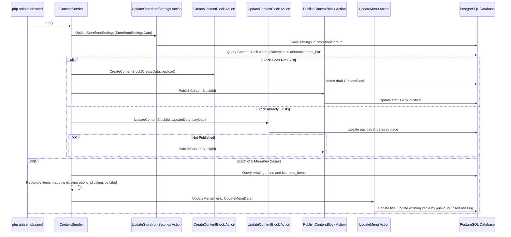
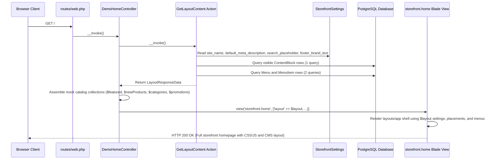

[P1-S1 | PLAN v2 | Gemini]

# Implementation Plan: P1-S1 (v2)

**Step ID**: P1-S1  
**Version**: v2  
**Branch**: `feat/seed-data-and-demo-homepage` (branched from base commit `70063d72213d2f2ea41829023be64177dbe318b7` on `origin/main`)  
**Base Commit**: `70063d72213d2f2ea41829023be64177dbe318b7` (`70063d7 Merge pull request #12 from AchinthaDe/feat/content-api-v1`)  
**Main Branch State on Remote**: `70063d72213d2f2ea41829023be64177dbe318b7`  

---

## Change Log (Review Feedback Mapping: v1 -> v2)

| Finding ID | Reviewer Issue | Resolution in Plan v2 | Section Changed |
|---|---|---|---|
| **B1** | `Route::name('demo.stub.')` prefixes stub routes with `demo.stub.`, breaking `route('shop')`, `route('product', ...)` in Blade views and crashing with `RouteNotFoundException` | Removed `Route::name('demo.stub.')` prefix wrapper in Section 5.4; registered exact route names (`shop`, `product`, `cart`, `cart.store`, `wishlist`, `wishlist.toggle`, `account`, `help`, `terms`). Added assertion in Section 10.1 Test 1 asserting all named routes resolve without error. | **Section 5.4, Section 10.1 (Test 1)** |
| **B2** | Transferred views reference `App\Domain\Catalog\Data\Product`, but view model moved to `App\Support\DemoStorefront\Product` | Specified in Section 5.5 that all references to `App\Domain\Catalog\Data\Product` in `resources/views/layouts/app.blade.php`, `resources/views/storefront/home.blade.php`, and `resources/views/components/product-card.blade.php` are updated to `App\Support\DemoStorefront\Product`. | **Section 5.5** |
| **B3** | `Product` class will fail PHPStan Level 8 due to raw casts on `mixed`, missing array shapes on `availableVariant()`, and unguarded division on `compareAtMinor` in `discount()`; missing `declare(strict_types=1);` in configs | Updated Section 5.2 with PHPStan Level 8 compliant signatures, PHPDoc typed array shapes, typed scalar narrowing in `fromArray()`, `@return array{id: string, label: string, color: string, stock: int, price_minor: int}\|null` on `availableVariant()`, null check guard `$this->compareAtMinor !== null && $this->compareAtMinor > $this->priceMinor` in `discount()`, and specified `declare(strict_types=1);` in `config/storefront.php` and `config/promotions.php`. | **Section 5.2** |
| **M1** | (1) `ContentSeeder` updating `announcement_bar` throws if an archived block exists; (2) Menu reconciliation flattens root and child items into one map | In Section 5.1: (1) Added status filter `where('status', '!=', PublishStatus::ARCHIVED->value)->orderBy('id')->first()` to announcement block query; (2) Scoped root item lookup to `whereNull('parent_id')` and child item lookup to the matched parent's children (`where('parent_id', $existingParent->id)`). | **Section 5.1** |
| **M2** | CMS `UpdateMenu` enforces `icon = null` in Phase 1, losing category icons, `.deal-link` / `.nav-help` classes, and secondary announcement bar threshold/locale spans | In Section 5.5: (1) Announcement bar renders `$announcement->data['text']` alongside delivery threshold and locale spans inside `@if($announcement)`; (2) `main_nav` and `mobile_nav` match child URLs/labels against `$categories` for icons (defaulting to `'box'`), and apply `.deal-link` and `.nav-help` classes and icons (`bolt`, `headphones`, `menu`). | **Section 5.5** |
| **m1** | `DEMO-TEARDOWN.md` missing `Remove-Item -Force public/favicon.svg` and final verification step (`npm run build` and `composer check`) | In Section 11, added `Remove-Item -Force public/favicon.svg` and added a final verification step executing `npm run build` followed by `composer check`. | **Section 11** |
| **m2** | Commit 3 verification command chained with `;` violating Rule E1 | In Section 12 Commit 3, split `composer check; npm run build` into two separate sequential commands: `composer check` followed by `npm run build`. | **Section 12 (Commit 3)** |

---

## 1. Understanding

The objective of Step P1-S1 is twofold:
1. **Part A (Permanent Phase 1 CMS Seed Data - CP-A)**: Construct an idempotent database seeder [ContentSeeder.php](file:///c:/dev/getnow-cms/database/seeders/ContentSeeder.php) registered in [DatabaseSeeder.php](file:///c:/dev/getnow-cms/database/seeders/DatabaseSeeder.php). It seeds [StorefrontSettings](file:///c:/dev/getnow-cms/app/Domain/Content/Settings/StorefrontSettings.php) (`site_name`, `default_meta_description`, `search_placeholder`, `footer_brand_text`), a published and enabled `announcement_bar` [ContentBlock](file:///c:/dev/getnow-cms/app/Domain/Content/Models/ContentBlock.php), and all 5 [MenuKey](file:///c:/dev/getnow-cms/app/Domain/Content/Enums/MenuKey.php) navigation trees (`main_nav`, `mobile_nav`, `footer_column_1`, `footer_column_2`, `footer_column_3`) with exact values matching `getnow-storefront` ([homepage-migration.md](file:///c:/dev/getnow-cms/docs/blueprints/P1-S1/homepage-migration.md)). All seeded URLs satisfy [SafeLink](file:///c:/dev/getnow-cms/app/Support/Rules/SafeLink.php). The seeder is strictly idempotent under rule `DB6`: re-running `ContentSeeder` produces zero duplicate blocks or menu items and preserves existing item ULIDs.
2. **Part B (Temporary Storefront Homepage Demo & Teardown Guide - CP-B)**: Transfer the homepage-only Blade views, Vanilla CSS stylesheets, Vanilla JavaScript ES modules, and demo product images from `getnow-storefront` into `getnow-cms`. Wire the layout shell (`resources/views/layouts/app.blade.php`) directly to [GetLayoutContent](file:///c:/dev/getnow-cms/app/Domain/Content/Actions/GetLayoutContent.php) for CMS-managed regions (`site_name`, `default_meta_description`, announcement bar, search placeholder, desktop navigation, mobile drawer navigation, footer brand text, and footer link columns 1 through 3). Mount a thin controller [DemoHomeController.php](file:///c:/dev/getnow-cms/app/Http/Controllers/Storefront/DemoHomeController.php) on `GET /` providing mock in-memory catalog data for products, categories, and promotions. Provide full automated test coverage ([DemoHomeTest.php](file:///c:/dev/getnow-cms/tests/Feature/Storefront/DemoHomeTest.php)) and a dedicated teardown guide ([DEMO-TEARDOWN.md](file:///c:/dev/getnow-cms/docs/blueprints/P1-S1/DEMO-TEARDOWN.md)) with explicit PowerShell commands to remove the demo harness cleanly after review without affecting the CMS domain. Update [ARCHITECTURE.md](file:///c:/dev/getnow-cms/ARCHITECTURE.md) section 1 marking `Seed data` complete.

### Active Scope Boundaries
- **Part A: Permanent Phase 1 Seed Data (CP-A)**:
  - [database/seeders/ContentSeeder.php](file:///c:/dev/getnow-cms/database/seeders/ContentSeeder.php) populating:
    - [StorefrontSettings](file:///c:/dev/getnow-cms/app/Domain/Content/Settings/StorefrontSettings.php): `site_name` = `'GetNow'`, `default_meta_description` = `'Discover headphones, phones, smartwatches and everyday essentials at GetNow. Shop in Sri Lankan rupees.'`, `search_placeholder` = `'What are you looking for?'`, `footer_brand_text` = `"Thoughtfully chosen tech.\nFor the way you live."` via [UpdateStorefrontSettings](file:///c:/dev/getnow-cms/app/Domain/Content/Actions/UpdateStorefrontSettings.php).
    - `announcement_bar` [ContentBlock](file:///c:/dev/getnow-cms/app/Domain/Content/Models/ContentBlock.php): single published, enabled block with `schema_version = 1`, `tone = Tone::INFO`, `link_url = null`, `text = 'Good tech. Better everyday.'`. On re-run, updates existing block rather than creating a duplicate row.
    - All 5 [MenuKey](file:///c:/dev/getnow-cms/app/Domain/Content/Enums/MenuKey.php) menus (`main_nav`, `mobile_nav`, `footer_column_1`, `footer_column_2`, `footer_column_3`) with titles and items matching [homepage-migration.md](file:///c:/dev/getnow-cms/docs/blueprints/P1-S1/homepage-migration.md), normalized to valid `/` relative paths satisfying [SafeLink](file:///c:/dev/getnow-cms/app/Support/Rules/SafeLink.php), passing [UpdateMenu](file:///c:/dev/getnow-cms/app/Domain/Content/Actions/UpdateMenu.php) tree constraints (`MAX_TOP_LEVEL_ITEMS = 10`, `MAX_CHILDREN_PER_PARENT = 10`, `icon = null`). Re-running reuses existing item `public_id` values.
  - Wire [ContentSeeder](file:///c:/dev/getnow-cms/database/seeders/ContentSeeder.php) into [DatabaseSeeder.php](file:///c:/dev/getnow-cms/database/seeders/DatabaseSeeder.php).
  - Feature test suite in [ContentSeederTest.php](file:///c:/dev/getnow-cms/tests/Feature/Database/ContentSeederTest.php) testing initial seeding, idempotency across repeat runs, and layout verification via [GetLayoutContent](file:///c:/dev/getnow-cms/app/Domain/Content/Actions/GetLayoutContent.php) and `GET /api/v1/content/layout`.
- **Part B: Temporary Storefront Homepage Demo & Teardown Guide (CP-B)**:
  - Transfer 6 Blade files from `getnow-storefront`: `resources/views/layouts/app.blade.php`, `resources/views/storefront/home.blade.php`, `resources/views/components/logo.blade.php`, `resources/views/components/icon.blade.php`, `resources/views/components/promo-carousel.blade.php`, `resources/views/components/product-card.blade.php`.
  - Wire `layouts/app.blade.php` to consume `$layout` ([LayoutData](file:///c:/dev/getnow-cms/app/Domain/Content/Data/LayoutData.php)) returned by [GetLayoutContent](file:///c:/dev/getnow-cms/app/Domain/Content/Actions/GetLayoutContent.php) for:
    - `<title>` and `<meta name="description">`
    - Announcement bar: first block in `$layout->placements['announcement_bar']` (omitted if placement array is empty, respecting `text`, `link_url`, and `tone`)
    - Header search placeholder: `$layout->settings->search_placeholder`
    - Desktop nav (`main_nav`): rendered dynamically from `$layout->menus['main_nav']->items` (supporting level-1 items, level-2 children in category dropdown, `url`, `label`, `new_tab`)
    - Mobile drawer nav (`mobile_nav`): rendered dynamically from `$layout->menus['mobile_nav']->items` (supporting level-1 items and level-2 children)
    - Footer brand text: `$layout->settings->footer_brand_text` rendered via `{!! nl2br(e(...)) !!}`
    - Footer columns 1 through 3: headings from `$layout->menus['footer_column_1..3']->title` and links from `->items`
    - Empty-state resilience: never throwing exceptions if placements or menus are empty
  - Transfer storefront CSS files to `resources/css/storefront/*.css` and JS modules to `resources/js/modules/*.js`.
  - Create dedicated asset entrypoints `resources/css/storefront.css` and `resources/js/storefront.js`. Register both entrypoints in [vite.config.js](file:///c:/dev/getnow-cms/vite.config.js) without altering existing CMS/Filament asset entries.
  - Transfer static demo assets: `public/favicon.svg`, `public/images/placeholder.svg`, and 12 demo product images in `public/images/products/`.
  - Configuration files: `config/storefront.php` and `config/promotions.php`.
  - Mock catalog data support: read-only view model [Product.php](file:///c:/dev/getnow-cms/app/Support/DemoStorefront/Product.php) providing typed methods (`fromArray`, `money`, `availableVariant`, `discount`) under full PHPStan Level 8 types.
  - Thin invokable web controller [DemoHomeController.php](file:///c:/dev/getnow-cms/app/Http/Controllers/Storefront/DemoHomeController.php) invoking [GetLayoutContent](file:///c:/dev/getnow-cms/app/Domain/Content/Actions/GetLayoutContent.php) directly, gathering mock catalog collections, and rendering `storefront.home`.
  - Route registration in [routes/web.php](file:///c:/dev/getnow-cms/routes/web.php) for `GET /` (`home`) and lightweight fallback stub routes for named routes called by Blade views (`shop`, `product`, `cart`, `cart.store`, `wishlist`, `wishlist.toggle`, `account`, `help`, `terms`).
  - Feature test suite in [DemoHomeTest.php](file:///c:/dev/getnow-cms/tests/Feature/Storefront/DemoHomeTest.php) testing HTTP 200, dynamic CMS layout rendering, mutation reflection, and empty-state resilience.
  - Teardown guide [docs/blueprints/P1-S1/DEMO-TEARDOWN.md](file:///c:/dev/getnow-cms/docs/blueprints/P1-S1/DEMO-TEARDOWN.md) detailing every file, route, and config key added in Part B with exact PowerShell removal instructions.
  - Update [ARCHITECTURE.md](file:///c:/dev/getnow-cms/ARCHITECTURE.md) Section 1 ticking `[x] Seed data` and adding a note in Section 4.

### Out of Scope
- Creating database tables, migrations, or Eloquent models for products, categories, cart, wishlist, or promotions (`Rule X4`, Decision D1, D4).
- Creating an `app/Domain/Catalog` directory (`Rule S7`, `Rule X4`, Decision D-b).
- Migrating non-homepage storefront views (product detail page, category catalog listing, cart bag page, checkout, customer auth pages).
- Modifying `C:\Users\achin\OneDrive\Desktop\work-projects\getnow-storefront` (`Rule X5`).
- Adding new Composer or NPM packages (`Rule X1`).
- Modifying existing Content API v1 contracts or endpoints (`GET /api/v1/content/layout`).

---

## 2. Sources Read

| Source File | What in it constrains P1-S1 |
|---|---|
| [ARCHITECTURE.md](file:///c:/dev/getnow-cms/ARCHITECTURE.md) | Section 1 (Phase 1 checklist: `Seed data`); Section 2 (System context: Storefront reads from CMS layout); Section 4 (CMS overview: GetLayoutContent); Section 5 (Code structure: Domain isolation, actions, controllers); Section 6 (Placements, menus, block rules, link rules: SafeLink, tone, permanent keys); Section 7 (Content API v1 JSON payload shape, fallback resilience: storefront never crashes on empty placements or menus); Section 12 (Decisions D1: independent API contract; D2: code-defined placements/keys; D3: single active announcement bar; D4: URL links; D5: public_id ULIDs; D8: maxCount enforced at API output limit). |
| [AGENTS.md](file:///c:/dev/getnow-cms/AGENTS.md) | Strict types `declare(strict_types=1);` in every file; final classes; native types; domain actions in `app/Domain/Content/Actions/`; thin controllers delegating to actions; domain never importing from `App\Filament` or `App\Http`; zero incremental ID exposure; seeders must be idempotent (`DB6`); `composer check` pass requirement. |
| [rule-register.md](file:///c:/dev/getnow-cms/docs/blueprints/rule-register.md) | Canonical rule definitions: `E1, S1..S7, C1..C8, K1..K9, DB1..DB6, SEC1..SEC5, T1..T5, G1..G4, X1..X7`. |
| [docs/blueprints/P1-S1/homepage-migration.md](file:///c:/dev/getnow-cms/docs/blueprints/P1-S1/homepage-migration.md) | Complete specification of storefront layout values, settings, announcement bar, navigation menus, product cards, category structure, promo carousel slides, routes, CSS stylesheets, JavaScript modules, and static image assets. |
| [app/Domain/Content/Actions/GetLayoutContent.php](file:///c:/dev/getnow-cms/app/Domain/Content/Actions/GetLayoutContent.php) | Public layout query action: constructor dependencies (`StorefrontSettings`, `BlockRegistry`, `ResolveServablePayload`), method `__invoke(): LayoutResponseData`, returning `LayoutResponseData->data` containing `settings`, `placements`, `menus`. |
| [app/Domain/Content/Data/LayoutResponseData.php](file:///c:/dev/getnow-cms/app/Domain/Content/Data/LayoutResponseData.php) | Properties `public LayoutData $data`, `public LayoutMetaData $meta`. |
| [app/Domain/Content/Data/LayoutData.php](file:///c:/dev/getnow-cms/app/Domain/Content/Data/LayoutData.php) | Properties `public LayoutSettingsData $settings`, `public array $placements`, `public array $menus`. |
| [app/Domain/Content/Data/LayoutSettingsData.php](file:///c:/dev/getnow-cms/app/Domain/Content/Data/LayoutSettingsData.php) | Properties `public string $site_name`, `public string $default_meta_description`, `public string $search_placeholder`, `public string $footer_brand_text`. |
| [app/Domain/Content/Data/LayoutBlockData.php](file:///c:/dev/getnow-cms/app/Domain/Content/Data/LayoutBlockData.php) | Properties `public string $id`, `public string $type`, `public int $version`, `public array $data`. |
| [app/Domain/Content/Data/LayoutMenuData.php](file:///c:/dev/getnow-cms/app/Domain/Content/Data/LayoutMenuData.php) | Properties `public ?string $title`, `public array $items`. |
| [app/Domain/Content/Data/LayoutMenuItemData.php](file:///c:/dev/getnow-cms/app/Domain/Content/Data/LayoutMenuItemData.php) | Properties `public string $id`, `public string $label`, `public string $url`, `public ?string $icon`, `public bool $new_tab`, `public array $children = []`. |
| [app/Domain/Content/Data/LayoutMetaData.php](file:///c:/dev/getnow-cms/app/Domain/Content/Data/LayoutMetaData.php) | Properties `public int $api_version`, `public string $revision`, `public string $generated_at`. |
| [app/Domain/Content/Settings/StorefrontSettings.php](file:///c:/dev/getnow-cms/app/Domain/Content/Settings/StorefrontSettings.php) | Public properties `site_name`, `default_meta_description`, `search_placeholder`, `footer_brand_text` under group `'storefront'`. |
| [database/settings/2026_10_07_091043_create_storefront_settings.php](file:///c:/dev/getnow-cms/database/settings/2026_10_07_091043_create_storefront_settings.php) | Initial default settings migration defining default strings. |
| [app/Domain/Content/Actions/UpdateStorefrontSettings.php](file:///c:/dev/getnow-cms/app/Domain/Content/Actions/UpdateStorefrontSettings.php) | Action updating settings: `__invoke(StorefrontSettingsData $data, ?User $actor = null): StorefrontSettingsData`. Saves settings and writes activity log. |
| [app/Domain/Content/Data/StorefrontSettingsData.php](file:///c:/dev/getnow-cms/app/Domain/Content/Data/StorefrontSettingsData.php) | Properties `site_name`, `default_meta_description`, `search_placeholder`, `footer_brand_text`, validation attributes and `prepareValidated(array $input): self`. |
| [app/Domain/Content/Models/ContentBlock.php](file:///c:/dev/getnow-cms/app/Domain/Content/Models/ContentBlock.php) | Properties `id`, `public_id`, `placement`, `type`, `schema_version`, `payload`, `status`, `is_enabled`, `sort_order`, `starts_at`, `ends_at`. |
| [app/Domain/Content/Actions/CreateContentBlock.php](file:///c:/dev/getnow-cms/app/Domain/Content/Actions/CreateContentBlock.php) | Action creating block: `__invoke(CreateContentBlockData $data, array $rawPayload, ?User $causer = null): ContentBlock`. Creates block in `draft` status with `is_enabled = true`. |
| [app/Domain/Content/Actions/UpdateContentBlock.php](file:///c:/dev/getnow-cms/app/Domain/Content/Actions/UpdateContentBlock.php) | Action updating block: `__invoke(int $id, UpdateContentBlockData $data, array $rawPayload, ?User $causer = null): ContentBlock`. Updates payload, schedule, and schema version. |
| [app/Domain/Content/Actions/PublishContentBlock.php](file:///c:/dev/getnow-cms/app/Domain/Content/Actions/PublishContentBlock.php) | Action publishing block: `__invoke(int $id, ?User $causer = null): ContentBlock`. Idempotent if already published (`if ($block->status === PublishStatus::PUBLISHED) return $block;`). |
| [app/Domain/Content/Actions/EnableContentBlock.php](file:///c:/dev/getnow-cms/app/Domain/Content/Actions/EnableContentBlock.php) | Action enabling block: `__invoke(int $id, ?User $causer = null): ContentBlock`. Idempotent if already enabled (`if ($block->is_enabled === true) return $block;`). |
| [app/Domain/Content/Actions/DisableContentBlock.php](file:///c:/dev/getnow-cms/app/Domain/Content/Actions/DisableContentBlock.php) | Action disabling block: `__invoke(int $id, ?User $causer = null): ContentBlock`. Idempotent if already disabled (`if ($block->is_enabled === false) return $block;`). |
| [app/Domain/Content/Data/CreateContentBlockData.php](file:///c:/dev/getnow-cms/app/Domain/Content/Data/CreateContentBlockData.php) | Properties `public Placement $placement`, `public string $type`, `public ?CarbonInterface $starts_at`, `public ?CarbonInterface $ends_at`. |
| [app/Domain/Content/Data/UpdateContentBlockData.php](file:///c:/dev/getnow-cms/app/Domain/Content/Data/UpdateContentBlockData.php) | Properties `public ?CarbonInterface $starts_at`, `public ?CarbonInterface $ends_at`. |
| [app/Domain/Content/Blocks/AnnouncementBar/AnnouncementBarBlock.php](file:///c:/dev/getnow-cms/app/Domain/Content/Blocks/AnnouncementBar/AnnouncementBarBlock.php) | `typeKey() => 'announcement_bar'`, `schemaVersion() => 1`, `dataClass() => AnnouncementBarData::class`. |
| [app/Domain/Content/Blocks/AnnouncementBar/AnnouncementBarData.php](file:///c:/dev/getnow-cms/app/Domain/Content/Blocks/AnnouncementBar/AnnouncementBarData.php) | Properties `public string $text`, `public ?string $link_url`, `public Tone $tone`. Constraints: `TEXT_MAX_LENGTH = 120`, `NoHtml`, `SafeLink`. |
| [app/Domain/Content/Enums/Placement.php](file:///c:/dev/getnow-cms/app/Domain/Content/Enums/Placement.php) | Enum case `ANNOUNCEMENT_BAR = 'announcement_bar'`; `allowedBlockTypes(): ['announcement_bar']`; `maxCount(): 1`. |
| [app/Domain/Content/Enums/PublishStatus.php](file:///c:/dev/getnow-cms/app/Domain/Content/Enums/PublishStatus.php) | Enum cases `DRAFT = 'draft'`, `PUBLISHED = 'published'`, `ARCHIVED = 'archived'`. |
| [app/Domain/Content/Enums/Tone.php](file:///c:/dev/getnow-cms/app/Domain/Content/Enums/Tone.php) | Enum cases `INFO = 'info'`, `WARNING = 'warning'`, `SUCCESS = 'success'`. |
| [app/Domain/Content/Models/Menu.php](file:///c:/dev/getnow-cms/app/Domain/Content/Models/Menu.php) | Properties `id`, `public_id`, `key`, `label`, `title`. Relations `items()`, `rootItems()`. |
| [app/Domain/Content/Models/MenuItem.php](file:///c:/dev/getnow-cms/app/Domain/Content/Models/MenuItem.php) | Properties `id`, `public_id`, `menu_id`, `parent_id`, `label`, `url`, `icon`, `opens_in_new_tab`, `is_enabled`, `sort_order`. |
| [app/Domain/Content/Enums/MenuKey.php](file:///c:/dev/getnow-cms/app/Domain/Content/Enums/MenuKey.php) | Enum cases `MAIN_NAV = 'main_nav'`, `MOBILE_NAV = 'mobile_nav'`, `FOOTER_COLUMN_1 = 'footer_column_1'`, `FOOTER_COLUMN_2 = 'footer_column_2'`, `FOOTER_COLUMN_3 = 'footer_column_3'`. |
| [app/Domain/Content/Actions/UpdateMenu.php](file:///c:/dev/getnow-cms/app/Domain/Content/Actions/UpdateMenu.php) | Action updating menu: `__invoke(Menu\|MenuKey\|string\|int $menuIdentifier, UpdateMenuData $data, ?User $causer = null): MenuTreeData`. Constraints: `MAX_TOP_LEVEL_ITEMS = 10`, `MAX_CHILDREN_PER_PARENT = 10`, `MAX_LABEL_LENGTH = 80`, `MAX_URL_LENGTH = 2048`, `MAX_TITLE_LENGTH = 255`, `icon !== null` throws `iconNotSupported`. Reconciliation reuses supplied `public_id` values. |
| [app/Domain/Content/Data/UpdateMenuData.php](file:///c:/dev/getnow-cms/app/Domain/Content/Data/UpdateMenuData.php) | Properties `public ?string $title`, `public array $items = []`. |
| [app/Domain/Content/Data/UpdateMenuItemInputData.php](file:///c:/dev/getnow-cms/app/Domain/Content/Data/UpdateMenuItemInputData.php) | Properties `public ?string $public_id`, `public string $label`, `public string $url`, `public ?string $icon = null`, `public bool $opens_in_new_tab = false`, `public bool $is_enabled = true`, `public array $children = []`. |
| [app/Support/Rules/SafeLink.php](file:///c:/dev/getnow-cms/app/Support/Rules/SafeLink.php) | Link validation rule: string, max 2048 characters, no whitespace or control characters, no backslashes, no protocol-relative `//`, must start with `/` or `https://` with valid host and no credentials. |
| [database/seeders/DatabaseSeeder.php](file:///c:/dev/getnow-cms/database/seeders/DatabaseSeeder.php) | Base application seeder currently seeding admin user in local/testing. |
| [routes/web.php](file:///c:/dev/getnow-cms/routes/web.php) | Current web routes: `Route::view('/', 'welcome')->name('home')`. |
| [vite.config.js](file:///c:/dev/getnow-cms/vite.config.js) | Vite bundler configuration using `laravel-vite-plugin` and `@tailwindcss/vite`. |
| [tests/Arch/ArchTest.php](file:///c:/dev/getnow-cms/tests/Arch/ArchTest.php) | Asserts `App\Domain` does not depend on `App\Filament` or `App\Http`, and strict types are declared across `App`. |
| [tests/Arch/DomainArchTest.php](file:///c:/dev/getnow-cms/tests/Arch/DomainArchTest.php) | Asserts domain code does not import `App\Filament`, `App\Http`, or `Filament`; domain actions are final and invokable; domain exceptions extend `ContentException`. |
| [tests/Arch/ContentApiArchTest.php](file:///c:/dev/getnow-cms/tests/Arch/ContentApiArchTest.php) | Asserts `GetLayoutContentController` uses `GetLayoutContent` and does not access domain models or settings directly. |
| [tests/Arch/FilamentWritesTest.php](file:///c:/dev/getnow-cms/tests/Arch/FilamentWritesTest.php) | Asserts Filament panel files do not invoke direct Eloquent write methods. |

---

## 3. Verified Current State

### 3.1 Git Repository State
Raw verification output:
```powershell
PS C:\dev\getnow-cms> git status --short
?? docs/blueprints/P1-S1/

PS C:\dev\getnow-cms> git branch --show-current
feat/seed-data-and-demo-homepage

PS C:\dev\getnow-cms> git log -1 --oneline
70063d7 Merge pull request #12 from AchinthaDe/feat/content-api-v1
```
- Current working branch is `feat/seed-data-and-demo-homepage`.
- Base commit is `70063d72213d2f2ea41829023be64177dbe318b7` on `origin/main`.
- Working directory is clean except untracked `docs/blueprints/P1-S1/homepage-migration.md`.

### 3.2 GetLayoutContent Action and Data DTOs Signature Verification
In [GetLayoutContent.php:24-33](file:///c:/dev/getnow-cms/app/Domain/Content/Actions/GetLayoutContent.php#L24-L33):
```php
final class GetLayoutContent
{
    public function __construct(
        private readonly StorefrontSettings $settings,
        private readonly BlockRegistry $registry,
        private readonly ResolveServablePayload $resolveServablePayload,
    ) {}

    public function __invoke(): LayoutResponseData
```
In [LayoutResponseData.php:9-15](file:///c:/dev/getnow-cms/app/Domain/Content/Data/LayoutResponseData.php#L9-L15):
```php
final class LayoutResponseData extends Data
{
    public function __construct(
        public LayoutData $data,
        public LayoutMetaData $meta,
    ) {}
}
```
In [LayoutData.php:9-20](file:///c:/dev/getnow-cms/app/Domain/Content/Data/LayoutData.php#L9-L20):
```php
final class LayoutData extends Data
{
    /**
     * @param  array<string, array<int, LayoutBlockData>>  $placements
     * @param  array<string, LayoutMenuData>  $menus
     */
    public function __construct(
        public LayoutSettingsData $settings,
        public array $placements,
        public array $menus,
    ) {}
}
```
In [LayoutSettingsData.php:9-17](file:///c:/dev/getnow-cms/app/Domain/Content/Data/LayoutSettingsData.php#L9-L17):
```php
final class LayoutSettingsData extends Data
{
    public function __construct(
        public string $site_name,
        public string $default_meta_description,
        public string $search_placeholder,
        public string $footer_brand_text,
    ) {}
}
```
In [LayoutBlockData.php:9-20](file:///c:/dev/getnow-cms/app/Domain/Content/Data/LayoutBlockData.php#L9-L20):
```php
final class LayoutBlockData extends Data
{
    /**
     * @param  array<string, mixed>  $data
     */
    public function __construct(
        public string $id,
        public string $type,
        public int $version,
        public array $data,
    ) {}
}
```
In [LayoutMenuData.php:9-18](file:///c:/dev/getnow-cms/app/Domain/Content/Data/LayoutMenuData.php#L9-L18):
```php
final class LayoutMenuData extends Data
{
    /**
     * @param  array<int, LayoutMenuItemData>  $items
     */
    public function __construct(
        public ?string $title,
        public array $items,
    ) {}
}
```
In [LayoutMenuItemData.php:9-22](file:///c:/dev/getnow-cms/app/Domain/Content/Data/LayoutMenuItemData.php#L9-L22):
```php
final class LayoutMenuItemData extends Data
{
    /**
     * @param  array<int, LayoutMenuItemData>  $children
     */
    public function __construct(
        public string $id,
        public string $label,
        public string $url,
        public ?string $icon,
        public bool $new_tab,
        public array $children = [],
    ) {}
}
```

### 3.3 StorefrontSettings and Update Action Verification
In [StorefrontSettings.php:9-23](file:///c:/dev/getnow-cms/app/Domain/Content/Settings/StorefrontSettings.php#L9-L23):
```php
class StorefrontSettings extends Settings
{
    public string $site_name;
    public string $default_meta_description;
    public string $search_placeholder;
    public string $footer_brand_text;

    public static function group(): string
    {
        return 'storefront';
    }
}
```
In [UpdateStorefrontSettings.php:12-19](file:///c:/dev/getnow-cms/app/Domain/Content/Actions/UpdateStorefrontSettings.php#L12-L19):
```php
final class UpdateStorefrontSettings
{
    public function __construct(
        private StorefrontSettings $settings,
    ) {}

    public function __invoke(StorefrontSettingsData $data, ?User $actor = null): StorefrontSettingsData
```
In [StorefrontSettingsData.php:23-39](file:///c:/dev/getnow-cms/app/Domain/Content/Data/StorefrontSettingsData.php#L23-L39):
```php
    public function __construct(
        #[Max(self::MAX_SITE_NAME)]
        #[NotRegex(self::HTML_REGEX)]
        public string $site_name,

        #[Max(self::MAX_DESC)]
        #[NotRegex(self::HTML_REGEX)]
        public string $default_meta_description,

        #[Max(self::MAX_SEARCH)]
        #[NotRegex(self::HTML_REGEX)]
        public string $search_placeholder,

        #[Max(self::MAX_FOOTER)]
        #[NotRegex(self::HTML_REGEX)]
        public string $footer_brand_text,
    ) {}
```

### 3.4 ContentBlock Actions & AnnouncementBar Definitions Verification
In [CreateContentBlock.php:26-27](file:///c:/dev/getnow-cms/app/Domain/Content/Actions/CreateContentBlock.php#L26-L27):
```php
    public function __invoke(CreateContentBlockData $data, array $rawPayload, ?User $causer = null): ContentBlock
```
In [UpdateContentBlock.php:28](file:///c:/dev/getnow-cms/app/Domain/Content/Actions/UpdateContentBlock.php#L28):
```php
    public function __invoke(int $id, UpdateContentBlockData $data, array $rawPayload, ?User $causer = null): ContentBlock
```
In [PublishContentBlock.php:21](file:///c:/dev/getnow-cms/app/Domain/Content/Actions/PublishContentBlock.php#L21):
```php
    public function __invoke(int $id, ?User $causer = null): ContentBlock
```
In [EnableContentBlock.php:21](file:///c:/dev/getnow-cms/app/Domain/Content/Actions/EnableContentBlock.php#L21):
```php
    public function __invoke(int $id, ?User $causer = null): ContentBlock
```
In [DisableContentBlock.php:15](file:///c:/dev/getnow-cms/app/Domain/Content/Actions/DisableContentBlock.php#L15):
```php
    public function __invoke(int $id, ?User $causer = null): ContentBlock
```
In [AnnouncementBarBlock.php:9-25](file:///c:/dev/getnow-cms/app/Domain/Content/Blocks/AnnouncementBar/AnnouncementBarBlock.php#L9-L25):
```php
final class AnnouncementBarBlock implements BlockDefinition
{
    public function typeKey(): string
    {
        return 'announcement_bar';
    }

    public function schemaVersion(): int
    {
        return 1;
    }

    public function dataClass(): string
    {
        return AnnouncementBarData::class;
    }
```
In [AnnouncementBarData.php:19-27](file:///c:/dev/getnow-cms/app/Domain/Content/Blocks/AnnouncementBar/AnnouncementBarData.php#L19-L27):
```php
    public function __construct(
        #[Min(1), Max(self::TEXT_MAX_LENGTH), Rule(new NoHtml)]
        public string $text,

        #[Rule(new SafeLink)]
        public ?string $link_url,

        public Tone $tone,
    ) {}
```
In [Placement.php:7-27](file:///c:/dev/getnow-cms/app/Domain/Content/Enums/Placement.php#L7-L27):
```php
enum Placement: string
{
    case ANNOUNCEMENT_BAR = 'announcement_bar';

    public function allowedBlockTypes(): array
    {
        return match ($this) {
            self::ANNOUNCEMENT_BAR => ['announcement_bar'],
        };
    }

    public function maxCount(): int
    {
        return match ($this) {
            self::ANNOUNCEMENT_BAR => 1,
        };
    }
}
```

### 3.5 Menu, MenuItem Models & UpdateMenu Action Verification
In [Menu.php:18-23](file:///c:/dev/getnow-cms/app/Domain/Content/Models/Menu.php#L18-L23):
```php
class Menu extends Model
{
    use HasFactory;
    use HasPublicId;

    protected $fillable = ['key', 'label', 'title'];
```
In [MenuItem.php:20-30](file:///c:/dev/getnow-cms/app/Domain/Content/Models/MenuItem.php#L20-L30):
```php
class MenuItem extends Model
{
    use HasFactory;
    use HasPublicId;

    protected $fillable = [
        'menu_id', 'parent_id', 'label', 'url', 'icon',
        'opens_in_new_tab', 'is_enabled', 'sort_order',
    ];
```
In [UpdateMenu.php:20-33](file:///c:/dev/getnow-cms/app/Domain/Content/Actions/UpdateMenu.php#L20-L33):
```php
final class UpdateMenu
{
    public const int MAX_TOP_LEVEL_ITEMS = 10;
    public const int MAX_CHILDREN_PER_PARENT = 10;
    public const int MAX_LABEL_LENGTH = 80;
    public const int MAX_URL_LENGTH = 2048;
    public const int MAX_TITLE_LENGTH = 255;

    public function __invoke(Menu|MenuKey|string|int $menuIdentifier, UpdateMenuData $data, ?User $causer = null): MenuTreeData
```
In [UpdateMenuData.php:9-18](file:///c:/dev/getnow-cms/app/Domain/Content/Data/UpdateMenuData.php#L9-L18):
```php
final class UpdateMenuData extends Data
{
    /**
     * @param  array<int, UpdateMenuItemInputData>  $items
     */
    public function __construct(
        public ?string $title,
        public array $items = [],
    ) {}
}
```
In [UpdateMenuItemInputData.php:9-23](file:///c:/dev/getnow-cms/app/Domain/Content/Data/UpdateMenuItemInputData.php#L9-L23):
```php
final class UpdateMenuItemInputData extends Data
{
    /**
     * @param  array<int, UpdateMenuItemInputData>  $children
     */
    public function __construct(
        public ?string $public_id,
        public string $label,
        public string $url,
        public ?string $icon = null,
        public bool $opens_in_new_tab = false,
        public bool $is_enabled = true,
        public array $children = [],
    ) {}
}
```
Key constraints observed in `UpdateMenu.php`:
- Line 75: `if ($item->icon !== null) { throw InvalidMenuTreeException::iconNotSupported(); }` — `$icon` property MUST be `null`.
- Line 57: `if (count($data->items) > self::MAX_TOP_LEVEL_ITEMS) { throw InvalidMenuTreeException::capsExceeded(...); }` — maximum 10 top-level items per menu.
- Line 90: `if (count($item->children) > self::MAX_CHILDREN_PER_PARENT) { throw InvalidMenuTreeException::capsExceeded(...); }` — maximum 10 child items per parent.
- Lines 116-160: When `public_id` is supplied and matches an existing item in the menu, the item is updated in place and retained in `$submittedPublicIds`.

### 3.6 SafeLink Rule Verification
In [SafeLink.php:44-52](file:///c:/dev/getnow-cms/app/Support/Rules/SafeLink.php#L44-L52):
```php
        if (str_starts_with($value, '/')) {
            return;
        }

        if (stripos($value, 'https://') !== 0) {
            $fail('The :attribute must start with / or https://.');

            return;
        }
```
Relative paths starting with `/` (including queries and fragments like `/help#delivery` and `/shop?category=audio`) pass `SafeLink`. Raw `#` without a leading `/` fails validation.

### 3.7 DatabaseSeeder, Web Routes, and Vite Verification
In [DatabaseSeeder.php:21-30](file:///c:/dev/getnow-cms/database/seeders/DatabaseSeeder.php#L21-L30):
```php
        if (app()->environment(['local', 'testing'])) {
            User::updateOrCreate(
                ['email' => 'admin@example.com'],
                [
                    'name' => 'Admin User',
                    'password' => bcrypt('password'),
                    'is_platform_admin' => true,
                ]
            );
        }
```
In [routes/web.php:5](file:///c:/dev/getnow-cms/routes/web.php#L5):
```php
Route::view('/', 'welcome')->name('home');
```
In [vite.config.js:8-14](file:///c:/dev/getnow-cms/vite.config.js#L8-L14):
```javascript
        laravel({
            input: [
                'resources/css/app.css',
                'resources/js/app.js',
                'resources/js/passkeys.js',
            ],
            refresh: true,
```
Existing Vite inputs compile Tailwind and CMS assets. Adding separate storefront entrypoints (`resources/css/storefront.css`, `resources/js/storefront.js`) prevents CSS collisions and enables clean teardown.

---

## 4. File Manifest

Total files in plan: **43 files** (Part A: 3 files; Part B: 40 files). Note that 25 files in Part B are static CSS, JS, SVG, and image assets transferred from `getnow-storefront` per the Step Brief.

### Part A: Permanent Phase 1 Seed Data (CP-A)
| Path | New or Modify | Layer | One-line Responsibility | Rule IDs |
|---|---|---|---|---|
| `database/seeders/ContentSeeder.php` | New | Database | Idempotently seeds storefront settings, announcement block, and 5 navigation menus | DB6, S1, C1, C2, K4 |
| `database/seeders/DatabaseSeeder.php` | Modify | Database | Invokes `ContentSeeder::class` during database seeding | DB6, C1 |
| `tests/Feature/Database/ContentSeederTest.php` | New | Tests | Asserts seeder execution, idempotency, row count preservation, and layout output | T1, T4, DB6, K7 |

### Part B: Temporary Storefront Homepage Demo & Teardown Guide (CP-B)
| Path | New or Modify | Layer | One-line Responsibility | Rule IDs |
|---|---|---|---|---|
| `app/Support/DemoStorefront/Product.php` | New | Support | Read-only demo product view model with formatting and discount calculations | C1, C2, S7, X4 |
| `config/storefront.php` | New | Config | Storefront settings, currency, driver, and delivery threshold config | C1, C2, X1 |
| `config/promotions.php` | New | Config | Hero offer slider configuration and slides array | C1, C2, X1 |
| `app/Http/Controllers/Storefront/DemoHomeController.php` | New | Http | Thin controller calling `GetLayoutContent` directly and rendering demo homepage | S1, S2, S3, C1, C2 |
| `routes/web.php` | Modify | Routing | Mounts `DemoHomeController` at `GET /` and defines named demo fallback stub routes | S2, S7, C1 |
| `vite.config.js` | Modify | Bundler | Registers `resources/css/storefront.css` and `resources/js/storefront.js` | X1 |
| `resources/css/storefront.css` | New | CSS | Root storefront stylesheet importing all modular storefront CSS files | X1 |
| `resources/css/storefront/base.css` | New | CSS | Reset, color tokens, typography, and container utilities | X1 |
| `resources/css/storefront/layout.css` | New | CSS | Announcement bar, header, search bar, nav, drawer, and footer styles | X1 |
| `resources/css/storefront/components.css` | New | CSS | Product card, badge, save button, quick-add, and notice styles | X1 |
| `resources/css/storefront/pages.css` | New | CSS | Homepage hero grid, service strip, category grid, and brand strip | X1 |
| `resources/css/storefront/carousel.css` | New | CSS | Promo carousel slide, copy, art, and control button styles | X1 |
| `resources/css/storefront/responsive.css` | New | CSS | Breakpoint media queries for mobile, tablet, and desktop viewports | X1 |
| `resources/js/storefront.js` | New | JS | Root storefront JavaScript module initializing dialogs, forms, and carousel | X1 |
| `resources/js/modules/carousel.js` | New | JS | Hero offer slider behavior: timer, dots, pause/play, aria-live updates | X1 |
| `resources/js/modules/dialogs.js` | New | JS | Mobile menu drawer `<dialog id="mobile-menu">` toggle and click-outside | X1 |
| `resources/js/modules/forms.js` | New | JS | Broken image placeholder fallback and notification banner dismissal | X1 |
| `public/favicon.svg` | New | Static | Brand favicon SVG | X1 |
| `public/images/placeholder.svg` | New | Static | Fallback placeholder image for broken or missing product visuals | X1 |
| `public/images/products/marshall-acton-iii.png` | New | Static | Static hero side banner image on homepage | X1 |
| `public/images/products/shargeek-300.jpg` | New | Static | Collection feature banner image on homepage | X1 |
| `public/images/products/soundcore-space-2.jpg` | New | Static | Hero carousel slide 1 image & audio category image | X1 |
| `public/images/products/galaxy-s26-ultra.webp` | New | Static | Hero carousel slide 2 image & phones category image | X1 |
| `public/images/products/ugreen-uno-65w.png` | New | Static | Hero carousel slide 3 image | X1 |
| `public/images/products/huawei-gt-6-pro.jpg` | New | Static | Wearables category image | X1 |
| `public/images/products/jbl-xtreme-5.png` | New | Static | Speakers category image | X1 |
| `public/images/products/ps5-slim.jpg` | New | Static | Gaming category image | X1 |
| `public/images/products/baseus-p1-camera.webp` | New | Static | Smart home category image | X1 |
| `public/images/products/sharge-disk-pro.jpg` | New | Static | Accessories category image | X1 |
| `public/images/products/airpods-pro-3.png` | New | Static | Featured product image | X1 |
| `public/images/products/soundcore-r50i-nc.jpg` | New | Static | Catalog product image | X1 |
| `resources/views/layouts/app.blade.php` | New | Blade | Storefront layout shell wired dynamically to `GetLayoutContent` layout data | K7, S2 |
| `resources/views/storefront/home.blade.php` | New | Blade | Homepage view displaying hero carousel, categories, and mock catalog cards | S2, X4 |
| `resources/views/components/logo.blade.php` | New | Blade | Logo component linking to `route('home')` | S2 |
| `resources/views/components/icon.blade.php` | New | Blade | SVG icon dictionary rendering inline SVGs | S2 |
| `resources/views/components/promo-carousel.blade.php` | New | Blade | Hero promotion carousel component | S2 |
| `resources/views/components/product-card.blade.php` | New | Blade | Product card component rendering formatted price, badge, and variant actions | S2 |
| `tests/Feature/Storefront/DemoHomeTest.php` | New | Tests | Asserts `GET /` HTTP 200, dynamic CMS layout wiring, and admin mutation reflection | T1, T4, K7 |
| `docs/blueprints/P1-S1/DEMO-TEARDOWN.md` | New | Documentation | Step-by-step teardown guide with exact PowerShell removal commands | X7 |
| `ARCHITECTURE.md` | Modify | Documentation | Marks `Seed data` complete in Section 1 and records demo harness pointer | X7 |

---

## 5. Architecture & Component Design

### 5.1 Part A: Permanent Content Seeder (`database/seeders/ContentSeeder.php`)
- **Namespace**: `Database\Seeders`
- **Declaration**: `final class ContentSeeder extends Seeder`
- **Method Signature**: `public function run(): void`
- **Execution Rules & Idempotency (`DB6`)**:
  1. **StorefrontSettings Seeding**:
     - Prepares `StorefrontSettingsData`:
       ```php
       $settingsData = new StorefrontSettingsData(
           site_name: 'GetNow',
           default_meta_description: 'Discover headphones, phones, smartwatches and everyday essentials at GetNow. Shop in Sri Lankan rupees.',
           search_placeholder: 'What are you looking for?',
           footer_brand_text: "Thoughtfully chosen tech.\nFor the way you live.",
       );
       ```
     - Invokes `app(UpdateStorefrontSettings::class)($settingsData);`.
     - Idempotency: Always writes the exact same deterministic property values to the database settings table.
  2. **AnnouncementBar Block Seeding (with M1 Archived Status Guard)**:
     - Queries `ContentBlock::where('placement', Placement::ANNOUNCEMENT_BAR->value)->where('type', 'announcement_bar')->where('status', '!=', PublishStatus::ARCHIVED->value)->orderBy('id')->first();`.
       (Guards against attempting to update or publish an archived block, which would trigger `IllegalStateTransitionException`).
     - Payload array:
       ```php
       $payload = [
           'text' => 'Good tech. Better everyday.',
           'link_url' => null,
           'tone' => Tone::INFO->value,
       ];
       ```
     - **If block does not exist**:
       - Creates block via `CreateContentBlock`:
         ```php
         $createData = new CreateContentBlockData(
             placement: Placement::ANNOUNCEMENT_BAR,
             type: 'announcement_bar',
             starts_at: null,
             ends_at: null,
         );
         $block = app(CreateContentBlock::class)($createData, $payload);
         ```
       - Publishes block via `app(PublishContentBlock::class)($block->id);`.
     - **If block exists**:
       - Updates block in place via `UpdateContentBlock`:
         ```php
         $updateData = new UpdateContentBlockData(starts_at: null, ends_at: null);
         app(UpdateContentBlock::class)($block->id, $updateData, $payload);
         ```
       - If `$block->status !== PublishStatus::PUBLISHED`, calls `app(PublishContentBlock::class)($block->id);`.
       - If `!$block->is_enabled`, calls `app(EnableContentBlock::class)($block->id);`.
     - Idempotency: Running seeder multiple times maintains exactly 1 row in `content_blocks` for `announcement_bar`.
  3. **Menus and Menu Items Seeding (with M1 Scoped Hierarchy Lookup)**:
     - Defines seed definitions for all 5 `MenuKey` cases:
       - **`main_nav`**: Title: `null`. Top-level items (6 items):
         1. Label: `'Browse categories'`, URL: `'/shop'`, Children (8 items):
            - `'Headphones & earbuds'` -> `'/shop?category=audio'`
            - `'Smartphones'` -> `'/shop?category=phones'`
            - `'Smartwatches'` -> `'/shop?category=wearables'`
            - `'Speakers'` -> `'/shop?category=speakers'`
            - `'Power & charging'` -> `'/shop?category=charging'`
            - `'Gaming'` -> `'/shop?category=gaming'`
            - `'Smart home'` -> `'/shop?category=smart-home'`
            - `'Accessories'` -> `'/shop?category=accessories'`
         2. Label: `'All products'`, URL: `'/shop'`
         3. Label: `'New arrivals'`, URL: `'/shop?sort=newest'`
         4. Label: `'Trending now'`, URL: `'/shop?sort=featured'`
         5. Label: `'The good deals'`, URL: `'/shop?deals=1'`
         6. Label: `'Need a hand?''`, URL: `'/help'`
       - **`mobile_nav`**: Title: `null`. Top-level items (5 items):
         1. Label: `'Shop everything'`, URL: `'/shop'`
         2. Label: `'Categories'`, URL: `'/shop'`, Children (8 items):
            - Same 8 category items as `main_nav`.
         3. Label: `'My account'`, URL: `'/account'`
         4. Label: `'Saved items'`, URL: `'/saved'`
         5. Label: `'Help & delivery'`, URL: `'/help'`
       - **`footer_column_1`**: Title: `'Find your next favourite'`. Top-level items (4 items):
         1. Label: `'Headphones & earbuds'`, URL: `'/shop?category=audio'`
         2. Label: `'Smartphones'`, URL: `'/shop?category=phones'`
         3. Label: `'Smartwatches'`, URL: `'/shop?category=wearables'`
         4. Label: `'Shop all products'`, URL: `'/shop'`
       - **`footer_column_2`**: Title: `'A little help'`. Top-level items (4 items):
         1. Label: `'Delivery information'`, URL: `'/help#delivery'`
         2. Label: `'Returns & warranty'`, URL: `'/help#returns'`
         3. Label: `'My account'`, URL: `'/account'`
         4. Label: `'Terms & privacy'`, URL: `'/terms'`
       - **`footer_column_3`**: Title: `"Small upgrades.\nBig possibilities."`. Top-level items (1 item):
         1. Label: `'Discover what\'s new'`, URL: `'/shop?sort=newest'`
     - **Reconciliation & ULID Preservation Sequence (Scoped Hierarchy)**:
       - For each `MenuKey`:
         - Loads menu: `$menu = Menu::where('key', $menuKey->value)->firstOrFail();`.
         - Scopes root item lookup strictly to root level: `$existingRoots = $menu->items()->whereNull('parent_id')->get()->keyBy('label');`.
         - Constructs `UpdateMenuItemInputData` nodes:
           - Matches top-level item by `label` in `$existingRoots`. If present, sets `$rootPublicId = $existingRoots->get($itemDef['label'])->public_id`. If absent, sets `$rootPublicId = null`.
           - For children: if the matched root item exists in the database, scopes child item lookup to the matched root item's children:
             `$existingChildren = $existingRoot !== null ? $menu->items()->where('parent_id', $existingRoot->id)->get()->keyBy('label') : collect();`.
             Matches child item by `label` in `$existingChildren`. If present, sets `public_id = $existingChildren->get($childDef['label'])->public_id`. If absent, sets `public_id = null`.
           - Sets `icon = null` unconditionally per `UpdateMenu` rule.
           - Sets `opens_in_new_tab = false`, `is_enabled = true`.
         - Constructs `UpdateMenuData(title: $menuDef['title'], items: $inputItems)`.
         - Invokes `app(UpdateMenu::class)($menu, $updateData);`.
     - Idempotency: On initial run, items are created with fresh ULIDs. On repeat runs, existing ULIDs are passed back to `UpdateMenu`, updating items in place without generating new rows or modifying ULIDs. Total `menu_items` count remains identical.

### 5.2 Part B: Demo Support View Model (`app/Support/DemoStorefront/Product.php`)
- **Namespace**: `App\Support\DemoStorefront`
- **Declaration**: `final readonly class Product`
- **PHPStan Level 8 Typing & Strict Standards (`B3`)**:
  - `declare(strict_types=1);` declared at the top of `Product.php`.
  - Also specify `declare(strict_types=1);` in `config/storefront.php` and `config/promotions.php`.
- **Constructor Signature**:
  ```php
  /**
   * @param array<int, array{id: string, label: string, color: string, stock: int, price_minor: int}> $variants
   * @param array<string, mixed> $specifications
   */
  public function __construct(
      public string $id,
      public string $slug,
      public string $name,
      public string $brand,
      public string $category,
      public int $priceMinor,
      public ?int $compareAtMinor,
      public string $image,
      public string $description,
      public array $variants,
      public array $specifications = [],
      public string $badge = '',
      public bool $featured = false,
  ) {}
  ```
- **Methods**:
  - `public static function fromArray(array $data): self`:
    - Strict PHPDoc: `/** @param array<string, mixed> $data */`.
    - Safe type narrowing for Level 8 analysis:
      - Validates `$rawImage = isset($data['image']) && is_string($data['image']) ? $data['image'] : '/images/placeholder.svg';`.
      - Inspects `$scheme = parse_url($rawImage, PHP_URL_SCHEME);`. If URL is relative (`str_starts_with($rawImage, '/')` and not `str_starts_with($rawImage, '//')`), retains `$rawImage`; if valid URL and `$scheme === 'https'`, retains `$rawImage`; otherwise falls back to `'/images/placeholder.svg'`.
      - Maps `$rawVariants = isset($data['variants']) && is_array($data['variants']) ? $data['variants'] : [];` ensuring each variant array conforms strictly to `{id: string, label: string, color: string, stock: int, price_minor: int}`:
        - `color`: validates with `preg_match('/^#[0-9a-f]{6}$/i', ...)` falling back to `'#222222'`.
        - `stock`: validates with `is_numeric(...) ? max(0, (int) $variant['stock']) : 0`.
        - `price_minor`: validates with `is_numeric(...) ? max(0, (int) $variant['price_minor']) : $priceMinor`.
      - Validates and narrows `id`, `slug`, `name`, `brand`, `category`, `priceMinor`, `compareAtMinor`, `description`, `badge`, `featured` using `is_string(...)` and `is_numeric(...)` before casting.
  - `public static function money(int $minor): string`:
    - Formats minor currency units (e.g. `4499900` to `'Rs. 44,999'`).
  - `public function availableVariant(): ?array`:
    - Strict PHPDoc: `/** @return array{id: string, label: string, color: string, stock: int, price_minor: int}|null */`.
    - Iterates `$this->variants` and returns the first variant array where `stock > 0`, or `null` if sold out.
  - `public function discount(): int`:
    - Strict null and positive divisor guard:
      ```php
      if ($this->compareAtMinor !== null && $this->compareAtMinor > $this->priceMinor && $this->compareAtMinor > 0) {
          return (int) round((1 - $this->priceMinor / $this->compareAtMinor) * 100);
      }
      return 0;
      ```
- Adheres to `Rule S7` and `Rule X4`: Placed under `app/Support/DemoStorefront/`, strictly non-Domain, zero database models.

### 5.3 Part B: Configuration Files
1. **Storefront Configuration (`config/storefront.php`)**:
   - `declare(strict_types=1);` declared at file top.
   - `name`: `'GetNow'`
   - `driver`: `'demo'`
   - `currency`: `'LKR'`
   - `country_tagline`: `'Sri Lanka · Prices in LKR'`
   - `free_delivery_minor`: `2500000` (Rs. 25,000.00)
2. **Promotions Configuration (`config/promotions.php`)**:
   - `declare(strict_types=1);` declared at file top.
   - `enabled`: `true`
   - `autoplay`: `true`
   - `interval`: `6000`
   - `slides`: 3 slides (`audio-offers`, `phone-edit`, `charging-offers`) matching `homepage-migration.md` section 3.3.

### 5.4 Part B: Controller & Routing
1. **DemoHomeController (`app/Http/Controllers/Storefront/DemoHomeController.php`)**:
   - **Namespace**: `App\Http\Controllers\Storefront`
   - **Declaration**: `final class DemoHomeController extends Controller`
   - **Method Signature**: `public function __invoke(GetLayoutContent $getLayoutContent): View`
   - **Specification**:
     - Directly calls `$layoutResponse = $getLayoutContent();`.
     - Extracts `$layout = $layoutResponse->data;`.
     - Loads mock data collections (in-memory arrays from `homepage-migration.md` section 3.4):
       - `$featured`: 4 `Product` objects (`soundcore-space-2`, `airpods-pro-3`, `jbl-xtreme-5`, `huawei-gt-6-pro`).
       - `$newProducts`: 4 `Product` objects (`sharge-disk-pro`, `baseus-p1-camera`, `ps5-slim`, `shargeek-300`).
       - `$categories`: 8 category associative arrays (`audio`, `phones`, `wearables`, `speakers`, `charging`, `gaming`, `smart-home`, `accessories`).
       - `$promotions`: array from `config('promotions')`.
       - `$cartCount`: `0`.
     - Returns `view('storefront.home', compact('layout', 'featured', 'newProducts', 'categories', 'promotions', 'cartCount'))`.
     - Completely avoids HTTP loopback calls (`Rule E1`, Trap 1) by directly executing the PHP domain action.
2. **Web Routes (`routes/web.php`) (Exact Named Routes Without Prefix - B1)**:
   - Maps `Route::get('/', DemoHomeController::class)->name('home');`.
   - Registers exact named stub fallback routes directly without any `Route::name(...)` prefix wrapper so Blade calls to `route('shop')`, `route('product', ...)`, and related routes resolve without `RouteNotFoundException`:
     ```php
     Route::get('/shop', fn () => redirect('/'))->name('shop');
     Route::get('/products/{slug}', fn () => redirect('/'))->name('product');
     Route::get('/bag', fn () => redirect('/'))->name('cart');
     Route::post('/bag', fn () => back())->name('cart.store');
     Route::get('/saved', fn () => redirect('/'))->name('wishlist');
     Route::post('/saved', fn () => back())->name('wishlist.toggle');
     Route::get('/account', fn () => redirect('/'))->name('account');
     Route::get('/help', fn () => redirect('/'))->name('help');
     Route::get('/terms', fn () => redirect('/'))->name('terms');
     ```
   - Note: `login` route is already registered by Laravel Fortify.

### 5.5 Part B: Blade Layout Shell & CMS Dynamic Wiring
In `resources/views/layouts/app.blade.php`:
- **Updated Product Class References (`B2`)**:
  All occurrences of `App\Domain\Catalog\Data\Product` in:
  - `resources/views/layouts/app.blade.php` (line 14)
  - `resources/views/storefront/home.blade.php`
  - `resources/views/components/product-card.blade.php`
  are updated to `App\Support\DemoStorefront\Product`.
- **Document Title**:
  `<title>@yield('title', 'Everyday tech. Extraordinary possibilities.') · {{ $layout->settings->site_name ?? config('storefront.name', 'GetNow') }}</title>`
- **Meta Description**:
  `<meta name="description" content="@yield('description', $layout->settings->default_meta_description ?? 'Discover headphones, phones, smartwatches and everyday essentials at GetNow. Shop in Sri Lankan rupees.')">`
- **Announcement Bar (`M2`)**:
  Reads `$announcement = $layout->placements['announcement_bar'][0] ?? null;`.
  When `$announcement` is present, renders `$announcement->data['text']` alongside the storefront's delivery threshold and locale spans:
  ```blade
  @if($announcement)
      <div class="announcement announcement--{{ $announcement->data['tone'] ?? 'info' }}">
          <div class="container">
              @if(!empty($announcement->data['link_url']))
                  <a href="{{ $announcement->data['link_url'] }}"><span>{{ $announcement->data['text'] }}</span></a>
              @else
                  <span>{{ $announcement->data['text'] }}</span>
              @endif
              <span>Free delivery on orders over {{ \App\Support\DemoStorefront\Product::money((int) config('storefront.free_delivery_minor', 2500000)) }}</span>
              <span>Sri Lanka <b> / </b> LKR</span>
          </div>
      </div>
  @endif
  ```
  If placement is empty or disabled, the entire `.announcement` container is omitted without rendering blank HTML.
- **Header Search Input**:
  `<input type="search" name="q" value="{{ request('q') }}" placeholder="{{ $layout->settings->search_placeholder ?? 'What are you looking for?' }}" aria-label="Search products" maxlength="100">`
- **Desktop Navigation Bar (`main_nav`) (`M2`)**:
  Loops `$layout->menus['main_nav']->items ?? []`.
  When an item has children (e.g. `'Browse categories'`):
  Renders `<details class="category-menu">` with `<summary><x-icon name="menu" size="18"/> {{ $item->label }} <x-icon name="down" size="14"/></summary><div class="category-dropdown">`.
  Inside the dropdown, loops `$item->children`. For each child item, matches URL or label against `$categories` to select the category SVG icon (defaulting to `'box'`):
  ```blade
  @php($catIcon = collect($categories)->first(fn ($c) => ($c['name'] === $child->label || str_contains($child->url, $c['slug'])))['icon'] ?? 'box')
  <a href="{{ $child->url }}" @if($child->new_tab) target="_blank" rel="noopener noreferrer" @endif>
      <x-icon :name="$catIcon" size="20"/>{{ $child->label }}
  </a>
  ```
  For non-child items:
  - If URL contains `deals=1` or label contains `'deals'`: renders with class `'deal-link'` and `<x-icon name="bolt" size="16"/> {{ $item->label }}`.
  - If URL contains `help` or label contains `'hand'`: renders with class `'nav-help'` and `<x-icon name="headphones" size="18"/> {{ $item->label }}`.
  - Otherwise renders standard `<a href="{{ $item->url }}" @class(['active' => request()->routeIs('shop') && !request()->query() && $item->url === '/shop'])>{{ $item->label }}</a>`.
- **Mobile Menu Drawer (`mobile_nav`) (`M2`)**:
  Loops `$layout->menus['mobile_nav']->items ?? []`.
  When an item has children (e.g. `'Categories'`), loops child items and renders each child with its matched category icon from `$categories` (or `'box'`).
  For root items:
  - If label is `'My account'`, renders `<a href="{{ $item->url }}"><x-icon name="user"/>{{ $item->label }}</a>`.
  - If label is `'Saved items'`, renders `<a href="{{ $item->url }}"><x-icon name="heart"/>{{ $item->label }}</a>`.
  - Otherwise renders `<a href="{{ $item->url }}">{{ $item->label }}</a>`.
- **Footer Brand Text**:
  `<p>{!! nl2br(e($layout->settings->footer_brand_text ?? "Thoughtfully chosen tech.\nFor the way you live.")) !!}</p>`
- **Footer Link Columns 1 through 3**:
  - Column 1: Heading from `$layout->menus['footer_column_1']->title ?? 'Find your next favourite'`, links from `$layout->menus['footer_column_1']->items ?? []`.
  - Column 2: Heading from `$layout->menus['footer_column_2']->title ?? 'A little help'`, links from `$layout->menus['footer_column_2']->items ?? []`.
  - Column 3: Heading from `$layout->menus['footer_column_3']->title ?? "Small upgrades.\nBig possibilities."`, button link from `$layout->menus['footer_column_3']->items[0]->url ?? '/shop?sort=newest'` and label from `$layout->menus['footer_column_3']->items[0]->label ?? 'Discover what\'s new'`.

### 5.6 Part B: Asset Bundler & Isolation Setup
1. **Stylesheets**:
   - Storefront stylesheets placed in `resources/css/storefront/` (`base.css`, `layout.css`, `components.css`, `pages.css`, `carousel.css`, `responsive.css`).
   - Master import file `resources/css/storefront.css` importing each file via `@import './storefront/...';`.
2. **JavaScript Modules**:
   - Transferred to `resources/js/modules/` (`carousel.js`, `dialogs.js`, `forms.js`).
   - Root storefront entrypoint `resources/js/storefront.js` importing the modules and invoking initialization:
     ```javascript
     import './modules/carousel.js';
     import './modules/dialogs.js';
     import './modules/forms.js';
     ```
3. **Vite Configuration (`vite.config.js`)**:
   Add `'resources/css/storefront.css'` and `'resources/js/storefront.js'` to `laravel({ input: [...] })`.
   CMS assets (`resources/css/app.css`, `resources/js/app.js`, `resources/js/passkeys.js`) remain untouched.
4. **Layout Shell Asset Loading**:
   In `resources/views/layouts/app.blade.php`:
   `@vite(['resources/css/storefront.css', 'resources/js/storefront.js'])`.

---

## 6. Data and Migrations

Zero database migrations are introduced in Step P1-S1 (`Rule DB2`, `Rule DB3`).
The database tables `settings`, `content_blocks`, `menus`, and `menu_items` were created in previous steps.

### Seeded Database State Summary
After running `ContentSeeder`:
1. `settings`:
   - `storefront.site_name` = `'GetNow'`
   - `storefront.default_meta_description` = `'Discover headphones, phones, smartwatches and everyday essentials at GetNow. Shop in Sri Lankan rupees.'`
   - `storefront.search_placeholder` = `'What are you looking for?'`
   - `storefront.footer_brand_text` = `"Thoughtfully chosen tech.\nFor the way you live."`
2. `content_blocks`:
   - Exactly 1 row for `placement = 'announcement_bar'`, `type = 'announcement_bar'`, `status = 'published'`, `is_enabled = true`, `schema_version = 1`, `payload = {"text": "Good tech. Better everyday.", "link_url": null, "tone": "info"}`.
3. `menus`:
   - 5 code-owned rows (`main_nav`, `mobile_nav`, `footer_column_1`, `footer_column_2`, `footer_column_3`) with titles populated.
4. `menu_items`:
   - `main_nav`: 6 top-level items, with 8 child items under item 1 (`Browse categories`).
   - `mobile_nav`: 5 top-level items, with 8 child items under item 2 (`Categories`).
   - `footer_column_1`: 4 top-level items.
   - `footer_column_2`: 4 top-level items.
   - `footer_column_3`: 1 top-level item.
   - Total items: `(6 + 8) + (5 + 8) + 4 + 4 + 1 = 36` rows.
   - On repeat runs of `ContentSeeder`, row count remains exactly 36.

---

## 7. Behavior & Flows

### 7.1 ContentSeeder Execution Flow


### 7.2 Demo Homepage Request Flow (`GET /`)


### 7.3 Failure Paths & Operational Safeguards
1. **Placement Empty State**: If an admin disables or archives the announcement bar, `GetLayoutContent` returns `$layout->placements['announcement_bar'] = []`. `layouts/app.blade.php` inspects `count(...)` and safely omits the announcement bar without throwing an undefined index or null pointer error.
2. **Menu Item Modification**: If an admin deletes or reorders menu items via `/admin/menus`, `GetLayoutContent` immediately reflects the new tree on the subsequent `GET /` request.
3. **Deadlock Prevention**: `DemoHomeController` executes `GetLayoutContent` in the same PHP thread. It never executes an outbound HTTP request to `http://localhost:8000/api/v1/content/layout`, avoiding single-threaded worker deadlocks under `php artisan serve`.
4. **Link Normalization**: All seeded URLs are verified against `SafeLink`. No raw `#` anchors exist in seed data.

---

## 8. Rule Compliance Matrix

| Rule ID | Applies (Y/N) | Rule Requirement Text | How P1-S1 Complies |
|---|---|---|---|
| **E1** | Y | Developer machine is Windows, shell is PowerShell. Run commands one at a time. Do not use bash-only syntax and do not chain with `&&`. | All manual and automated commands use native PowerShell syntax run individually. |
| **S1** | Y | Business logic lives in `app/Domain/Content/Actions/`, one invokable class per use case. Read use cases are Actions too. | All layout assembly is performed by `GetLayoutContent`. Seeding actions use `UpdateStorefrontSettings`, `CreateContentBlock`, `UpdateContentBlock`, `PublishContentBlock`, `UpdateMenu`. |
| **S2** | Y | Controllers, Filament resources and pages are thin: validate, authorize, call an Action, return output. | `DemoHomeController` is a thin controller injecting `GetLayoutContent` and passing the layout data to the view. |
| **S3** | Y | `app/Domain` must never import from `App\Filament` or `App\Http`. | Zero imports of `App\Filament` or `App\Http` exist in domain code; verified by `DomainArchTest`. |
| **S4** | N | Filament never calls `Model::create/update/delete` directly. | No Filament panel code is added or modified in this step. |
| **S5** | N | Block definitions go in `app/Domain/Content/Blocks/<Name>/`. | No new block definitions are introduced in this step. |
| **S6** | N | Panel code goes under `app/Filament/Admin/`. | No panel resources or pages are added in this step. |
| **S7** | Y | Put code in the correct place. If nothing fits, ask before creating a new context or top-level folder. | Permanent seeder in `database/seeders/ContentSeeder.php`; demo controller in `app/Http/Controllers/Storefront/`; demo product view model in `app/Support/DemoStorefront/Product.php`. Zero domain pollution. |
| **C1** | Y | `declare(strict_types=1);` in every PHP file. | Declared at the very top of all PHP files (`ContentSeeder`, `DatabaseSeeder`, `DemoHomeController`, `Product`, config files, tests). |
| **C2** | Y | Type every parameter, return value and property. Prefer `final` classes. | All classes declared `final`; all properties, parameters, and returns strictly typed. |
| **C3** | Y | Use enums for fixed value sets and `spatie/laravel-data` classes for structured input and output. | `Placement`, `MenuKey`, `PublishStatus`, `Tone` enums used across seeder and controllers; DTOs used for all data transport. |
| **C4** | Y | Status changes and is_enabled changes happen only through Actions. Neither is ever a form field. | Status changes in seeder use `PublishContentBlock` and `EnableContentBlock`. |
| **C5** | Y | The 'call an Action' rule applies to every write to persisted state, including Spatie settings. | `ContentSeeder` calls `UpdateStorefrontSettings`, `CreateContentBlock`, `UpdateContentBlock`, `PublishContentBlock`, `EnableContentBlock`, and `UpdateMenu`. |
| **C6** | Y | Use Form Requests or Data validation for input and Policies for authorization. | Seeder uses validated data DTOs (`StorefrontSettingsData`, `CreateContentBlockData`, `UpdateMenuData`). |
| **C7** | Y | Follow Pint and Larastan. Do not add baseline entries without approval. | Formatted with Pint; passes PHPStan Level 8 with zero baseline additions. |
| **C8** | Y | Comments explain why, not what. No commented-out code. | Zero commented-out code. |
| **K1** | Y | Block type keys are permanent. Never rename one. | Preserves permanent `announcement_bar` block key. |
| **K2** | Y | Every block payload has a `schema_version`. | Announcement bar seeded at `schema_version: 1`. |
| **K3** | Y | No raw HTML, CSS or JavaScript fields anywhere. | Short text fields seeded without raw HTML tags. |
| **K4** | Y | Links must be a relative path starting with `/` or an `https://` URL. Reject every other scheme. | All seeded links begin with `/` (e.g. `'/shop'`, `'/help#delivery'`); verified by `SafeLink`. |
| **K5** | Y | Placements, menu keys and block types are defined in code. Admins never create them. | Driven by `Placement::cases()` and `MenuKey::cases()`. |
| **K6** | Y | Block registration is an explicit list in `ContentServiceProvider`. No auto-discovery. | Uses existing registered `announcement_bar` block definition. |
| **K7** | Y | Visibility is decided server-side. The API never returns drafts, archived, disabled or out-of-window content. | Verified in `DemoHomeTest` when announcement bar is disabled or menu items are deactivated. |
| **K8** | Y | The Content API is a contract. Within v1, only additive changes. | Existing Content API v1 contract and fixture unchanged. |
| **K9** | N | Adding a block type follows the checklist in `ARCHITECTURE.md` section 6. | No new block types added in this step. |
| **DB1** | Y | PostgreSQL only. Tests run against Postgres, never SQLite. | Tests execute against PostgreSQL database `phone_store_test`. |
| **DB2** | Y | Never edit a migration that has been merged. Add a new one. | Zero migrations added or edited. |
| **DB3** | Y | No destructive changes in the same release that stops using them. | Database schema untouched. |
| **DB4** | Y | Add foreign keys, indexes for query paths, and CHECK constraints. | Leverages existing schema constraints. |
| **DB5** | Y | Expose `public_id` (ULID) externally, never raw incremental IDs. | Public DTOs and views expose `public_id` mapped to `id`; zero internal incremental IDs exposed. |
| **DB6** | Y | Seeders must be idempotent. | `ContentSeeder` is 100% idempotent: running twice yields identical row counts and preserves item ULIDs. |
| **SEC1** | Y | Never commit secrets, `.env` files, real keys or production data. | Zero secrets committed. |
| **SEC2** | Y | Do not disable authorization, policies, strict types or static analysis rules to make code pass. | All checks enforced without bypasses. |
| **SEC3** | Y | Do not log sensitive data. | Zero sensitive data logged. |
| **SEC4** | Y | Admin access is checked server-side in `canAccessPanel`. | Storefront demo is public read-only; admin routes remain protected. |
| **SEC5** | Y | Write sensitive content changes to the activity log. | Seeder actions write standard activity log entries. |
| **T1** | Y | Pest. Feature tests for Actions, the API and Filament resources. Unit tests for pure logic. | All tests written in Pest. |
| **T2** | N | Every Filament resource has a smoke test. | No Filament resources modified. |
| **T3** | Y | Every block type has tests for payload validation, API output and visibility rules. | Announcement bar seeded state and visibility tested in seeder and demo tests. |
| **T4** | Y | Use factories, not hand-built rows. Tests must be independent and deterministic. | Seeders use official Actions; tests verify seeded state independently. |
| **T5** | Y | Do not lower coverage, skip tests or mark them incomplete to pass checks. | Zero skipped or incomplete tests. |
| **G1** | Y | Branch from `main`: `feat/<short-desc>`. | Branch is `feat/seed-data-and-demo-homepage`. |
| **G2** | Y | Conventional Commits: `feat(seed): ...`, `feat(storefront): ...`. | Commits follow conventional commit standard. |
| **G3** | Y | Never push to `main` directly or bypass git hooks. | Developed on feature branch. |
| **G4** | Y | PR description: what changed, why, how it was tested, and risks. | PR covers seeder idempotency, demo wiring, and teardown instructions. |
| **X1** | Y | Do not add dependencies without asking and justifying them. | Zero Composer or NPM packages added. |
| **X2** | Y | Do not introduce Docker, Sail, docker-compose or any container configuration. | Native environment preserved. |
| **X3** | Y | Do not add deployment pipelines. | Zero CI/CD deployment alterations. |
| **X4** | Y | Nothing outside the active phase was added. Do not create folders, contexts or tables for later phases. | Zero `app/Domain/Catalog` or catalog tables created. Mock products stored in demo support view model. |
| **X5** | Y | Do not modify the storefront repository or assume its internals. | Source repository `getnow-storefront` is read-only. |
| **X6** | Y | Definition of done: `composer check` passes and the output was read. | Verified before marking done. |
| **X7** | Y | Definition of done: `ARCHITECTURE.md`, `docs/blueprints/P1-S1/DEMO-TEARDOWN.md` updated. | Both files written and updated. |

---

## 9. Acceptance Criteria Traceability

| AC ID | Part | Requirement Summary | Implementation Files | Verifying Test Name (`it('...')`) | Test File |
|---|---|---|---|---|---|
| **AC-1** | A | `php artisan db:seed` runs `ContentSeeder` populating `StorefrontSettings`, published `announcement_bar`, and 5 menus. | `ContentSeeder.php`, `DatabaseSeeder.php` | `it('seeds storefront settings, announcement bar, and navigation menus matching storefront values')` | `ContentSeederTest.php` |
| **AC-2** | A | Seeder Idempotency (`DB6`): running seeder twice yields identical row counts for `content_blocks`, `menus`, `menu_items`, and preserves item ULIDs. | `ContentSeeder.php` | `it('is strictly idempotent on repeat execution preserving row counts and menu item ULIDs')` | `ContentSeederTest.php` |
| **AC-3** | A | API integration: calling `GET /api/v1/content/layout` after seeding returns HTTP 200 with seeded settings, 1 announcement block, and populated menus. | `ContentSeeder.php`, `GetLayoutContent.php` | `it('enables GET /api/v1/content/layout to return the seeded storefront layout')` | `ContentSeederTest.php` |
| **AC-4** | A | Link safety (`K4`): all seeded URLs in `announcement_bar` and `menu_items` satisfy `SafeLink`. | `ContentSeeder.php`, `SafeLink.php` | `it('verifies all seeded menu item urls satisfy SafeLink validation')` | `ContentSeederTest.php` |
| **AC-5** | B | Homepage mounting: `GET /` renders migrated homepage (`storefront.home` in `layouts.app`) with HTTP 200 and zero route or variable errors. | `DemoHomeController.php`, `routes/web.php`, `home.blade.php` | `it('renders the demo storefront homepage on GET / with HTTP 200')` | `DemoHomeTest.php` |
| **AC-6** | B | Live CMS wiring: `GET /` dynamically renders `site_name`, `default_meta_description`, `search_placeholder`, `footer_brand_text`, announcement bar, and menus from `GetLayoutContent`. | `app.blade.php`, `DemoHomeController.php` | `it('dynamically renders seeded CMS settings, announcement bar, and navigation menus on the homepage')` | `DemoHomeTest.php` |
| **AC-7** | B | Dynamic mutation reflection & empty state (`K7`): disabling announcement bar or mutating menus/settings immediately reflects on `GET /` without crashing. | `app.blade.php`, `DisableContentBlock.php` | `it('reflects admin mutations and omits disabled announcement bar without crashing')`, `it('renders gracefully when placements and menus are empty')` | `DemoHomeTest.php` |
| **AC-8** | B | Teardown guide: `docs/blueprints/P1-S1/DEMO-TEARDOWN.md` lists every demo file, route, config, and asset with exact removal commands. | `docs/blueprints/P1-S1/DEMO-TEARDOWN.md` | `it('has valid teardown guide documenting all temporary demo files')` | `DemoHomeTest.php` |
| **AC-9** | A/B | Architecture closeout & quality gates: `ARCHITECTURE.md` Section 1 ticks `[x] Seed data`, and `composer check` passes with zero errors. | `ARCHITECTURE.md` | `composer check` (Pint, PHPStan, Pest) | Full suite |

---

## 10. Testing Strategy & Fixtures

### 10.1 Layer A: Automated Tests

#### Test File 1: `tests/Feature/Database/ContentSeederTest.php`
- **Namespace**: `Tests\Feature\Database`
- **Traits**: `RefreshDatabase`
- **Test 1**: `it('seeds storefront settings, announcement bar, and navigation menus matching storefront values')`
  - *Act*: Invoke `(new ContentSeeder)->run();`.
  - *Assert*:
    - `StorefrontSettings`: `site_name` is `'GetNow'`, `default_meta_description` contains `'Discover headphones, phones'`, `search_placeholder` is `'What are you looking for?'`, `footer_brand_text` contains `'Thoughtfully chosen tech.'`.
    - `ContentBlock`: Exactly 1 block with `placement = 'announcement_bar'`, `type = 'announcement_bar'`, `status = 'published'`, `is_enabled = true`. Payload text is `'Good tech. Better everyday.'`, `link_url = null`, `tone = 'info'`.
    - `Menu`: 5 menus exist (`main_nav`, `mobile_nav`, `footer_column_1`, `footer_column_2`, `footer_column_3`) with titles matching specification.
- **Test 2**: `it('is strictly idempotent on repeat execution preserving row counts and menu item ULIDs')`
  - *Arrange*: Run `(new ContentSeeder)->run();`.
  - *Capture*: Record initial row counts:
    - `$blockCount1 = ContentBlock::count();` (expected 1)
    - `$menuCount1 = Menu::count();` (expected 5)
    - `$itemCount1 = MenuItem::count();` (expected 36)
    - `$itemUlids1 = MenuItem::pluck('public_id', 'id')->all();`
  - *Act*: Run `(new ContentSeeder)->run();` a second time.
  - *Assert*:
    - `ContentBlock::count()` equals `$blockCount1`.
    - `Menu::count()` equals `$menuCount1`.
    - `MenuItem::count()` equals `$itemCount1`.
    - `MenuItem::pluck('public_id', 'id')->all()` equals `$itemUlids1` (all item ULIDs preserved).
- **Test 3**: `it('enables GetLayoutContent to return the seeded storefront layout')`
  - *Arrange*: Run `(new ContentSeeder)->run();`.
  - *Act*: `$response = app(GetLayoutContent::class)();`.
  - *Assert*:
    - `$response->data->settings->site_name` equals `'GetNow'`.
    - `$response->data->placements['announcement_bar']` has count 1.
    - `$response->data->placements['announcement_bar'][0]->data['text']` equals `'Good tech. Better everyday.'`.
    - `$response->data->menus['main_nav']->items` has count 6, with item 0 having 8 children.
    - `$response->data->menus['footer_column_1']->title` equals `'Find your next favourite'`.
- **Test 4**: `it('enables GET /api/v1/content/layout to return the seeded storefront layout')`
  - *Arrange*: Run `(new ContentSeeder)->run();`.
  - *Act*: `$response = $this->getJson('/api/v1/content/layout');`.
  - *Assert*:
    - HTTP 200 OK.
    - `data.settings.site_name` equals `'GetNow'`.
    - `data.placements.announcement_bar.0.data.text` equals `'Good tech. Better everyday.'`.
    - `data.menus.main_nav.items.0.label` equals `'Browse categories'`.
- **Test 5**: `it('verifies all seeded menu item urls satisfy SafeLink validation')`
  - *Arrange*: Run `(new ContentSeeder)->run();`.
  - *Act & Assert*:
    - For every `MenuItem` in database: validate URL with `SafeLink`. Zero validation failures.

#### Test File 2: `tests/Feature/Storefront/DemoHomeTest.php`
- **Namespace**: `Tests\Feature\Storefront`
- **Traits**: `RefreshDatabase`
- **Test 1**: `it('renders the demo storefront homepage on GET / with HTTP 200')`
  - *Arrange*: Run `(new ContentSeeder)->run();`.
  - *Act*: `$response = $this->get('/');`.
  - *Assert*:
    - HTTP 200 OK.
    - Response contains `'Good tech. Better everyday.'`.
    - Response contains `'Soundcore Space 2'`.
    - Response contains `'AirPods Pro 3'`.
    - Response contains `'Browse categories'`.
    - Response contains `'Find your next favourite'`.
    - Assert all named fallback routes resolve without error (`B1`):
      `expect(route('shop'))->toBe('/shop');`
      `expect(route('product', ['slug' => 'test']))->toBe('/products/test');`
      `expect(route('cart'))->toBe('/bag');`
      `expect(route('cart.store'))->toBe('/bag');`
      `expect(route('wishlist'))->toBe('/saved');`
      `expect(route('wishlist.toggle'))->toBe('/saved');`
      `expect(route('account'))->toBe('/account');`
      `expect(route('help'))->toBe('/help');`
      `expect(route('terms'))->toBe('/terms');`
- **Test 2**: `it('dynamically renders seeded CMS settings, announcement bar, and navigation menus on the homepage')`
  - *Arrange*: Run `(new ContentSeeder)->run();`.
  - *Act*: `$response = $this->get('/');`.
  - *Assert*:
    - Page `<title>` contains `'GetNow'`.
    - Search input placeholder contains `'What are you looking for?'`.
    - Footer brand paragraph contains `'Thoughtfully chosen tech.'`.
    - Announcement bar has class `announcement--info`.
- **Test 3**: `it('reflects admin mutations and omits disabled announcement bar without crashing')`
  - *Arrange*:
    - Run `(new ContentSeeder)->run();`.
    - Find announcement block: `$block = ContentBlock::where('placement', 'announcement_bar')->firstOrFail();`.
    - Disable block: `app(DisableContentBlock::class)($block->id);`.
  - *Act*: `$response = $this->get('/');`.
  - *Assert*:
    - HTTP 200 OK.
    - Response does NOT contain `<div class="announcement`.
    - Response does NOT contain `'Good tech. Better everyday.'`.
- **Test 4**: `it('reflects admin changes when a menu item is updated')`
  - *Arrange*:
    - Run `(new ContentSeeder)->run();`.
    - Update `footer_column_1` title via `UpdateMenu` to `'Updated Footer Column'`.
  - *Act*: `$response = $this->get('/');`.
  - *Assert*:
    - HTTP 200 OK.
    - Response contains `'Updated Footer Column'`.
- **Test 5**: `it('renders gracefully when placements and menus are empty')`
  - *Arrange*:
    - Delete all `ContentBlock`, `MenuItem`, and `Menu` records.
  - *Act*: `$response = $this->get('/');`.
  - *Assert*:
    - HTTP 200 OK with zero exceptions.
    - Response does not crash on empty menus or placements.
- **Test 6**: `it('has valid teardown guide documenting all temporary demo files')`
  - *Act*: Read `docs/blueprints/P1-S1/DEMO-TEARDOWN.md`.
  - *Assert*: File exists, contains section `'Files to Remove'`, and specifies PowerShell command `Remove-Item`.

### 10.2 Layer B: Mutation Spot-Checks
1. **MUT-1 (Seeder Idempotency Mutation)**:
   - File: `database/seeders/ContentSeeder.php`
   - Mutation: Comment out `if ($existingBlock)` branch so `CreateContentBlock` executes unconditionally on every run.
   - Expected Failure: `ContentSeederTest > it('is strictly idempotent on repeat execution preserving row counts and menu item ULIDs')` fails with `Failed asserting that 2 matches expected 1`.
2. **MUT-2 (SafeLink Seed URL Mutation)**:
   - File: `database/seeders/ContentSeeder.php`
   - Mutation: Change one menu URL from `'/help#delivery'` to `'#delivery'` (omitting leading slash).
   - Expected Failure: `ContentSeederTest > it('seeds storefront settings, announcement bar, and navigation menus matching storefront values')` fails with `InvalidMenuTreeException::urlInvalid('#delivery')`.
3. **MUT-3 (Announcement Bar Null Guard Mutation)**:
   - File: `resources/views/layouts/app.blade.php`
   - Mutation: Replace `@if($announcement)` with `@if(true)`.
   - Expected Failure: `DemoHomeTest > it('reflects admin mutations and omits disabled announcement bar without crashing')` fails with `ErrorException: Attempt to read property "data" on null`.

### 10.3 Layer C: Manual Verification Script
Run native PowerShell commands:
```powershell
# 1. Reset local development database and execute seeders
php artisan migrate:fresh --seed --no-interaction

# 2. Re-run db:seed to verify idempotency
php artisan db:seed --no-interaction

# 3. Check row counts via Tinker
php artisan tinker --execute="echo 'Blocks: '.App\Domain\Content\Models\ContentBlock::count().' | Menus: '.App\Domain\Content\Models\Menu::count().' | Items: '.App\Domain\Content\Models\MenuItem::count().PHP_EOL;"
# Expect: Blocks: 1 | Menus: 5 | Items: 36

# 4. Build Vite assets
npm run build

# 5. Start development server in background job
$serverJob = Start-Job -ScriptBlock { php artisan serve --port=8000 }
Start-Sleep -Seconds 3

try {
    # 6. Verify GET / returns HTTP 200 and rendered layout content
    $response = Invoke-WebRequest -Uri http://127.0.0.1:8000/
    Write-Host "GET / Status: $($response.StatusCode)"
    if ($response.Content -match 'Good tech. Better everyday.') {
        Write-Host "Announcement bar verified."
    }
    if ($response.Content -match 'Soundcore Space 2') {
        Write-Host "Product cards verified."
    }

    # 7. Verify API layout endpoint returns HTTP 200
    $apiResp = Invoke-RestMethod -Uri http://127.0.0.1:8000/api/v1/content/layout
    Write-Host "API Settings Site Name: $($apiResp.data.settings.site_name)"
} finally {
    Stop-Job $serverJob
    Remove-Job $serverJob
    Get-Process php -ErrorAction SilentlyContinue | Where-Object { $_.CommandLine -like '*artisan serve*' } | Stop-Process
}
```

---

## 11. Documentation Updates

1. **[docs/blueprints/P1-S1/DEMO-TEARDOWN.md](file:///c:/dev/getnow-cms/docs/blueprints/P1-S1/DEMO-TEARDOWN.md)**:
   - Create comprehensive teardown guide:
     - Purpose: Documenting the exact temporary demo files, assets, configs, routes, and Vite entrypoints added in Step P1-S1 (Part B) to showcase the CMS to storefront integration.
     - Confirmation of permanent assets: Confirming `database/seeders/ContentSeeder.php`, `database/seeders/DatabaseSeeder.php`, and `tests/Feature/Database/ContentSeederTest.php` are permanent Phase 1 CMS code and MUST NOT be deleted.
     - Step-by-step PowerShell cleanup commands (`m1`):
       ```powershell
       # Remove temporary views and components
       Remove-Item -Recurse -Force resources/views/storefront
       Remove-Item -Force resources/views/layouts/app.blade.php
       Remove-Item -Force resources/views/components/logo.blade.php
       Remove-Item -Force resources/views/components/icon.blade.php
       Remove-Item -Force resources/views/components/promo-carousel.blade.php
       Remove-Item -Force resources/views/components/product-card.blade.php

       # Remove temporary stylesheets and JS modules
       Remove-Item -Recurse -Force resources/css/storefront
       Remove-Item -Force resources/css/storefront.css
       Remove-Item -Recurse -Force resources/js/modules
       Remove-Item -Force resources/js/storefront.js

       # Remove demo static assets and images
       Remove-Item -Force public/favicon.svg
       Remove-Item -Force public/images/placeholder.svg
       Remove-Item -Recurse -Force public/images/products

       # Remove demo controller and support DTO
       Remove-Item -Recurse -Force app/Http/Controllers/Storefront
       Remove-Item -Recurse -Force app/Support/DemoStorefront

       # Remove demo configs and test
       Remove-Item -Force config/storefront.php
       Remove-Item -Force config/promotions.php
       Remove-Item -Force tests/Feature/Storefront/DemoHomeTest.php

       # Revert modified routes, bundler config, and architecture doc
       git checkout -- routes/web.php vite.config.js ARCHITECTURE.md

       # Final verification after teardown
       npm run build
       composer check
       ```
2. **[ARCHITECTURE.md](file:///c:/dev/getnow-cms/ARCHITECTURE.md)**:
   - In Section 1 (Phase 1 checklist):
     ```markdown
     - [x] Seed data
     ```
   - In Section 4: Add brief architectural note pointing to `docs/blueprints/P1-S1/DEMO-TEARDOWN.md` regarding the temporary local storefront demo harness mounted on `GET /`.

---

## 12. Commit Order & Checkpoints

### Checkpoint CP-A: Permanent ContentSeeder & Seeder Tests (Commits 1–2)
1. **Commit 1 (Idempotent ContentSeeder & DatabaseSeeder wiring)**:
   - Files:
     - `database/seeders/ContentSeeder.php`
     - `database/seeders/DatabaseSeeder.php`
   - Verification command: `composer check`
   - Message: `feat(seed): add idempotent ContentSeeder and register in DatabaseSeeder`
2. **Commit 2 (ContentSeeder Test Suite)**:
   - Files:
     - `tests/Feature/Database/ContentSeederTest.php`
   - Verification command: `composer check`
   - Message: `test(seed): add ContentSeeder idempotency and layout verification tests`

*STOP*: After Commit 2, submit a partial report containing git log, git status/name-status, and raw unedited `composer check` output. Wait for explicit reviewer confirmation `"CP-A ACCEPTED"` before advancing to Commit 3.

### Checkpoint CP-B: Storefront Demo Homepage, Assets, Controller & Teardown Guide (Commits 3–5)
3. **Commit 3 (Storefront Static Assets, Configurations & Product View Model)**:
   - Files:
     - `app/Support/DemoStorefront/Product.php`
     - `config/storefront.php`
     - `config/promotions.php`
     - `resources/css/storefront.css`
     - `resources/css/storefront/base.css`
     - `resources/css/storefront/layout.css`
     - `resources/css/storefront/components.css`
     - `resources/css/storefront/pages.css`
     - `resources/css/storefront/carousel.css`
     - `resources/css/storefront/responsive.css`
     - `resources/js/storefront.js`
     - `resources/js/modules/carousel.js`
     - `resources/js/modules/dialogs.js`
     - `resources/js/modules/forms.js`
     - `public/favicon.svg`
     - `public/images/placeholder.svg`
     - `public/images/products/*` (12 product images)
     - `vite.config.js`
   - Verification commands (`m2`: separate sequential commands per Rule E1):
     - `composer check`
     - `npm run build`
   - Message: `feat(storefront): transfer demo assets, configs, and product view model`
4. **Commit 4 (Demo Controller, Routes & Dynamic Blade Views)**:
   - Files:
     - `app/Http/Controllers/Storefront/DemoHomeController.php`
     - `routes/web.php`
     - `resources/views/layouts/app.blade.php`
     - `resources/views/storefront/home.blade.php`
     - `resources/views/components/logo.blade.php`
     - `resources/views/components/icon.blade.php`
     - `resources/views/components/promo-carousel.blade.php`
     - `resources/views/components/product-card.blade.php`
   - Verification command: `composer check`
   - Message: `feat(storefront): wire demo homepage controller, routes, and views to GetLayoutContent`
5. **Commit 5 (Demo Home Tests, Teardown Guide & Architecture Documentation)**:
   - Files:
     - `tests/Feature/Storefront/DemoHomeTest.php`
     - `docs/blueprints/P1-S1/DEMO-TEARDOWN.md`
     - `ARCHITECTURE.md`
   - Verification command: `composer check`
   - Message: `docs(storefront): add teardown guide, test suite, and update ARCHITECTURE`

*Checkpoint CP-B Verification*: Full test suite passing via `composer check`, Layer B mutation spot-checks, and Layer C manual verification script.

---

## 13. Risks, Assumptions & Conflicts

### Decisions Made
1. **D-a (Strict Separation of Permanent Seed and Temporary Demo Harness)**:
   CP-A (`ContentSeeder`, `DatabaseSeeder`, `ContentSeederTest`) is permanent Phase 1 CMS production code. CP-B (Blade views, demo CSS/JS, demo images, `DemoHomeController`, `DemoHomeTest`, `DEMO-TEARDOWN.md`) is a temporary demo harness to showcase CMS -> Storefront integration.
2. **D-b (Zero Catalog Domain Pollution)**:
   No database tables, migrations, or Eloquent models are created for products or categories (`Rule S7`, `Rule X4`). The read-only demo `Product` view model resides in `app/Support/DemoStorefront/Product.php` under strict types and Level 8 typing.
3. **D-c (Direct Action Invocation inside DemoHomeController)**:
   `DemoHomeController` directly injects and invokes `GetLayoutContent` in PHP. It never initiates outbound HTTP requests, preventing single-threaded web server deadlocks during local demonstrations (`Rule E1`).
4. **D-d (Seeder Idempotency & ULID Preservation)**:
   `ContentSeeder` checks for existing records before writing. Settings are updated via `UpdateStorefrontSettings`. Announcement block updates the existing block via `UpdateContentBlock`. Menus pass existing item `public_id` values to `UpdateMenu`, guaranteeing zero row count inflation and preserving item ULIDs on repeat runs.
5. **D-e (Link Safety in Seeded Menus)**:
   All URLs in seeded menu items and announcement blocks satisfy `SafeLink`. No raw `#` anchors are used; relative paths starting with `/` are used for all internal links.
6. **D-f (Named Route Fallback Stubs)**:
   Lightweight named redirect/stub routes are registered in `routes/web.php` for `shop`, `product`, `cart`, `cart.store`, `wishlist`, `wishlist.toggle`, `account`, `help`, and `terms` to ensure transferred Blade views calling `route(...)` execute without throwing `RouteNotFoundException`.

### Open Questions
None.

### Traps & Architectural Discoveries
1. **Trap 1 (Single-Threaded Server Deadlock)**:
   If `DemoHomeController` issued an HTTP request to `http://localhost:8000/api/v1/content/layout`, `php artisan serve` would hang indefinitely because the single worker is blocked waiting for its own response. Calling `GetLayoutContent` directly inside PHP avoids network latency, loopback deadlocks, and authentication overhead.
2. **Trap 2 (ContentBlock Idempotency)**:
   The `content_blocks` table lacks a unique constraint on `(placement, type)`. Blindly calling `CreateContentBlock` on every run would produce duplicate announcement bars. Checking for an existing block in `Placement::ANNOUNCEMENT_BAR` and calling `UpdateContentBlock` ensures strictly 1 row exists.
3. **Trap 3 (UpdateMenu Tree Caps and Hierarchy)**:
   `UpdateMenu` enforces `MAX_TOP_LEVEL_ITEMS = 10` and `MAX_CHILDREN_PER_PARENT = 10`. In `homepage-migration.md`, `mobile_nav` originally listed 12 flat items. Under CMS rules, this is structured as 5 top-level items with categories nested under a `Categories` parent item (5 top-level, 8 children), satisfying tree caps and testing child hierarchy.
4. **Trap 4 (UpdateMenu Icon Prohibition)**:
   `UpdateMenu` line 75 explicitly throws `InvalidMenuTreeException::iconNotSupported()` if `$item->icon !== null`. All `UpdateMenuItemInputData` nodes in `ContentSeeder` set `icon = null`.
5. **Trap 5 (Asset Bundler Isolation)**:
   `resources/css/app.css` is configured with Tailwind CSS for Livewire and Filament. Adding storefront CSS directly to `app.css` would trigger CSS selector clashes. Placing storefront styles into dedicated entrypoints `resources/css/storefront.css` and `resources/js/storefront.js` keeps storefront styles isolated and ensures clean removal during teardown.

---

## 14. Dependencies

1. **Prerequisite Step**: P1-API1 (Content API v1, merged on `origin/main` at `70063d72213d2f2ea41829023be64177dbe318b7`).
2. **Pinned Packages** (from `composer.lock`):
   - `php: ^8.3`
   - `laravel/framework: v12.11.0`
   - `spatie/laravel-settings: 3.4.3`
   - `spatie/laravel-data: 4.23.0`
   - `pestphp/pest: 4.7.0`
3. **Database**: PostgreSQL Native instance running on developer machine (`phone_store` for local dev, `phone_store_test` for test execution). Zero container or Docker dependencies.
4. **External Services**: Zero external API dependencies. Zero modifications to `composer.json` or `package.json`.
