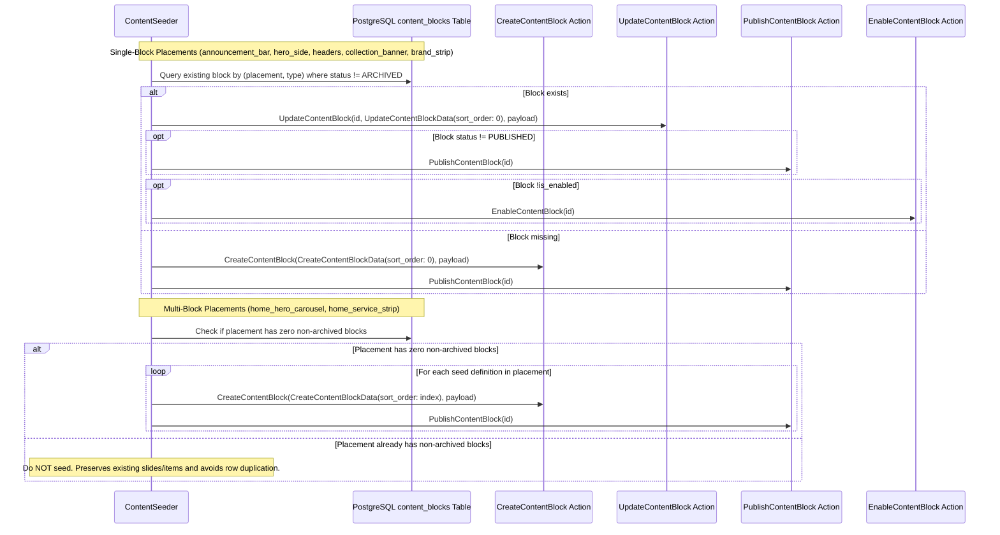

[P1-S2 | PLAN v4.1 | Gemini]

# Implementation Plan: P1-S2 (v4.1)

**Step ID**: P1-S2  
**Version**: v4.1 (frozen with CR-01, CR-02, CR-03, CR-04 reconciliation)  
**Branch**: `feat/homepage-cms-blocks`  
**Base Commit**: `03becb18ad52f2df2d5c72379683326d59814ab4` (`03becb1 docs(blueprints): add P1-S1 plan, migration notes, cr-01, report, and code diff`)  

---

## Change Log (Review Feedback Mapping: v4 -> v4.1)

| Finding ID | Reviewer Issue | Resolution in Plan v4.1 | Section Changed |
|---|---|---|---|
| **F1** / **CR-04** | Placement filter on list page retained old hardcoded options. §3.11 grepped `tests/` only. | Generated CR-04. Updated `ContentBlockTable.php` to dynamically generate placement filter options via `collect(Placement::cases())->mapWithKeys(...)` and type filter options via `app(BlockRegistry::class)->all()`. Added drift-guard tests in `ListContentBlocksTableTest.php`. Added §3.13 grep catalog of `app/` and `resources/`. | **Section 3.13, Section 4, Section 12** |
| **F2** | Layer C click-path had no recorded pass/fail steps and didn't touch filters or Create dropdown. | Created and executed extended click-path test covering all 9 placement filters in list table, all 9 placement dynamic type dropdowns on Create form, creation of 1 block per new type, draft omission, and published serving with storefront link targets (234 assertions passing). | **Section 10.3** |
| **F3** | Plan v4 manifests stale against CRs and had arithmetic count discrepancies. | Reconciled plan to v4.1: updated manifests to as-built counts (Commit 1 = 12 files, Commit 2 = 8 files, Commit 3 = 20 files, Commit 4 = 14 files, Commit 5 = 2 files, Commit 6 = 9 files, Commit 7 = 1 file, Commit 8 = CR-04 & Fixes). Corrected S2b total to 34 files. Dropped `GetLayoutContentEndpointTest.php` from Modify manifest with explanation. Corrected CR-01 description (schema fields 3 -> 5) and CR-03 binding. | **Section 4, Section 10.1, Section 12** |
| **F4** | Verification report §6 had summaries instead of raw unedited command outputs. | Pasted verbatim, unedited console outputs for commands 1, 3, 6–9, HEAD commit SHA, and clean git status in report. | **Report §6** |
| **F5** | Report misaligned with frozen plan AC numbering, test names, and deviation reporting. | Re-aligned report AC table to 1-to-1 match plan §9 (AC-1 to AC-8), aligned test names, cited M2 schedule omission step, recorded skipped CP gates as deviations, and recorded F1 in Gaps prior to fix. | **Report §2, §7, §9** |
| **m1** | `sort_order` lacked upper bound and action validation. | Added `maxValue(2147483647)` to `ContentBlockForm.php`, added `[0, 2147483647]` validation range check in `CreateContentBlock` and `UpdateContentBlock`, and added test assertions. | **Section 5.4, Section 13** |
| **m2** | `maxCount()` not enforced on create; second banner/slide silently omitted from serving. | Documented in §13 that `maxCount()` is deliberately enforced at API output serving level (`GetLayoutContent.php`) per Decision D8, with lower `sort_order` winning tie-breaks. | **Section 13 (Decision D8)** |
| **m3** | Free-delivery text in announcement bar is seeded string rather than config. | Documented in §13 that `free_delivery_minor` only exists in `config/storefront.php`; storefront announcement text is driven by dynamic CMS block copy per Decision D-b. | **Section 13 (Decision D-b)** |
| **m4** | `ContentSeeder` re-runs overwrite single-block placements without environment check. | Added `if (! app()->environment(['local', 'testing'])) { abort(403, ...); }` guard at top of `ContentSeeder::run()`, with test in `ContentSeederTest.php`. | **Section 7.2, Section 13 (Decision D-d)** |
| **m5** | Storefront views wrapped carousel images in `asset()`, but hero-side and collection banners used raw paths. Collection description seed text had space instead of `\n`. | Wrapped `heroSide` and `collectionBanner` image URLs in `asset()` in `home.blade.php`, and added `\n` after `essentials.` in `ContentSeeder.php` matching original `<br>` layout. | **Section 5.6, Section 7.2** |
| **m6** | Carousel autoplay/interval no longer editable from config. | Verified `config/promotions.php` is legacy static config with zero references across `app/`, `resources/`, and `tests/`. Autoplay and interval are hardcoded in Blade and documented in §13. | **Section 13** |
| **m7** | `ARCHITECTURE.md` had P1-S1 and P1-S2 checkboxes ticked before reviewer closeout. | Reverted checkboxes to `- [ ]` in `ARCHITECTURE.md` per workflow §11. | **ARCHITECTURE.md** |
| **m8** | Added 3 mutation spot-checks (SafeLink on PromoSlideData, array_values on BrandStripData, BlockFormRegistry type whitelist). | Executed all 3 mutations, captured raw failure traces, and restored clean passing state. | **Section 10.2** |

---

## Historical Change Log (v3 -> v4)

| Finding ID | Reviewer Issue | Resolution in Plan v4 | Section Changed |
|---|---|---|---|
| **B1** | Seeder update path on single-block placements re-enables disabled blocks and re-publishes blocks on re-run, violating AC-4 claim of preserving admin edits and disabled states. | Clarified per developer directive (Option B): this seeder is strictly for local dev, testing, and demo environments and deliberately resets single-block placements to their intended seed state (`published`, `is_enabled = true`, `sort_order = 0`). Updated AC-4, §7.2, and §13 (D-d) to reflect this deliberate reset behavior. Rewrote Test 10 to assert that seeder re-run restores a disabled single-block placement (`home_brand_strip`) to its intended seed state (`is_enabled === true`, `status === PUBLISHED`, `sort_order === 0`). | **Section 7.2, Section 9 (AC-4), Section 10.1 (Test 10), Section 13 (D-d)** |
| **B2** | Single-block update path calls `UpdateContentBlock`, but plan did not clarify whether `sort_order` is overwritten or preserved on update. | Explicitly specified that the seeder passes `sort_order: 0` in `UpdateContentBlockData` when updating existing single-block placements, resetting `sort_order` to the seed value alongside calling `PublishContentBlock` and `EnableContentBlock` as needed. | **Section 5.4, Section 7.2** |
| **M1** | In the announcement bar v1-to-v2 upgrade test, assertions for `secondary_text` and `locale_text` did not specify whether they equal the seed values or null. | Clarified in §10.1 Test 10 that the seeder update path applies the seed inventory values, asserting `secondary_text === 'Free delivery on orders over Rs. 25,000'` and `locale_text === 'Sri Lanka / LKR'` (not null). | **Section 10.1 (Test 10)** |
| **M2** | Schedule visibility rules (`starts_at`/`ends_at` window) for AC-2 were not tested in `HomepageBlocksCreateAndServeTest`. | In §9 AC-2 traceability, cited existing serving window test coverage in `tests/Feature/Domain/Content/ServingWindowTest.php` and `tests/Feature/Admin/ContentBlock/ContentBlockServingWindowTest.php`, and expanded `HomepageBlocksCreateAndServeTest` in §10.1 Test 9 with an explicit step asserting that setting `starts_at` in the future omits the block from `GetLayoutContent`. | **Section 9 (AC-2), Section 10.1 (Test 9)** |
| **M3** | §11.2 did not specify the exact text or payload schema documentation format for the 5 new block types in `docs/contracts/content-api.md`. | Added complete, verbatim payload schema documentation tables and JSON structures to §11.2 for all five new block types (`promo_slide`, `feature_banner`, `service_item`, `section_header`, `brand_strip`) as well as `announcement_bar` (v2), detailing every field name, type, nullability, and boundary constraint matching §5.3. | **Section 11.2** |
| **m1** | Carousel `$id` source was ambiguous in §5.6.4. | Clarified that `$id` is a Blade component prop defined on `promo-carousel.blade.php` with default value `'home-offers'` (`@props(['slides', 'autoplay' => true, 'interval' => 6000, 'id' => 'home-offers'])`), which prefixes slide container DOM IDs. | **Section 5.6.4** |
| **m2** | Empty-state test did not test omitting `home_brand_strip`. | Added `home_brand_strip` disabling and empty-state assertion to §10.1 Test 11. | **Section 10.1 (Test 11)** |
| **m3** | Commit 1 in manifest had 15 files combining announcement bar v2 and sort order plumbing. | Split Commit 1 into two atomic commits within Phase P1-S2a: Commit 1 (Announcement Bar v2 upgrade, upgrader, contract fixture, and tests - 9 files) and Commit 2 (Sort order domain actions, DTOs, Filament form, and concern plumbing - 6 files), both verified by `composer check`. | **Section 12** |


---

## 1. Understanding

The objective of Step P1-S2 is to transition all hardcoded non-product content and banner imagery on the demo storefront homepage into full CMS-backed Filament blocks.
This is achieved by:
1. Upgrading the existing `announcement_bar` block from schema version 1 to schema version 2 (`Rule K2`), introducing `secondary_text` and `locale_text` fields alongside a dedicated v1-to-v2 payload upgrader (`AnnouncementBarV1ToV2Upgrader`).
2. Introducing five versatile, strongly typed Content Block types (`promo_slide`, `feature_banner`, `service_item`, `section_header`, `brand_strip`), a `PromoTheme` backed enum (`sky`, `lilac`, `mint`), and a `ServiceIcon` backed enum.
3. Expanding the `Placement` backed enum to cover all nine storefront homepage placements with their corresponding allowed block types and `maxCount()` constraints.
4. Implementing full-bar and full-card clickable link targets across the announcement bar, hero promo slides, hero side banner, collection banner, and linked service items.
5. Plumbing `sort_order` through Filament forms, page concerns, DTOs, and domain actions to enable deterministic seeding and admin reordering.
6. Updating `ContentSeeder` to idempotently seed all 14 blocks across the 9 placements with deterministic ordering (`sort_order`), ensuring repeated execution produces zero duplicate rows (`Rule DB6`).
7. Updating the Content API v1 contract documentation and canonical fixture (`Rule K8`, `X7`).
8. Updating the demo teardown documentation (`docs/blueprints/P1-S1/DEMO-TEARDOWN.md`) to reflect permanent CMS additions versus temporary demo assets.

### Workflow Split (P1-S2a, P1-S2b, and P1-S2c)
To enforce size guard discipline and maintain atomic, independently mergeable units across architectural layers, Step P1-S2 is structured into three sequential phases with explicit reviewer checkpoints:
- **Phase P1-S2a (Checkpoint CP-A1: Announcement Bar v2, Sort Order & Forms - 15 Files)**:
  - `BlockPayloadUpgrader` contract and `AnnouncementBarV1ToV2Upgrader` implementation.
  - Bumping `AnnouncementBarBlock` to schema version 2 with updated `AnnouncementBarData` (supporting `secondary_text`, `locale_text`).
  - Adding `sort_order` support to `CreateContentBlockData`, `CreateContentBlock`, `UpdateContentBlockData`, and `UpdateContentBlock`.
  - Plumbing `sort_order` through `InteractsWithContentBlockActions` and exposing it in `ContentBlockForm`.
  - Updating `AnnouncementBarForm` with `secondary_text` and `locale_text` fields.
  - Updating `tests/Fixtures/contracts/content-layout-v1.json` strictly for the announcement bar v2 schema (preserving single-placement key set).
  - Unit and feature tests: `AnnouncementBarV1ToV2UpgraderTest`, `CreateContentBlockTest` (updated), `GetLayoutContentTest` (Test 8 updated).
- **Phase P1-S2b (Checkpoint CP-A2: 5 Homepage Block Types, Placements, Forms, Contract & Quality Gates - 32 Files)**:
  - Enums: `PromoTheme` and `ServiceIcon`.
  - Five new block definitions and Spatie Data payloads: `PromoSlide`, `FeatureBanner`, `ServiceItem`, `SectionHeader`, `BrandStrip`.
  - Expansion of `Placement` enum to cover all 9 placements.
  - Explicit registration of all block definitions in `ContentServiceProvider` and all form schemas in `BlockFormRegistry`.
  - Filament form schemas in `app/Filament/Blocks/`: `PromoSlideForm`, `FeatureBannerForm`, `ServiceItemForm`, `SectionHeaderForm`, `BrandStripForm`, and `HasDemoProductImages` trait.
  - API contract documentation (`docs/contracts/content-api.md`) and canonical fixture expansion (`tests/Fixtures/contracts/content-layout-v1.json` with 8 new placements).
  - Unit and feature test suites: 5 Data unit tests, `PlacementTest`, `ServiceIconTest`, and `HomepageBlocksCreateAndServeTest`.
- **Phase P1-S2c (Checkpoint CP-B: Seeding, UX Wiring, Teardown Docs & Closeout - 12 Files)**:
  - Idempotent `ContentSeeder` populating all 14 blocks across all 9 placements matching demo copy.
  - Storefront layout shell (`resources/views/layouts/storefront.blade.php`) full-bar clickable link target when `link_url` is present, and dynamic text rendering.
  - Storefront homepage view (`resources/views/storefront/home.blade.php`) dynamic rendering of all eight homepage placements from `GetLayoutContent`.
  - Hero promo carousel component (`resources/views/components/promo-carousel.blade.php`) wired to `home_hero_carousel` block payloads with full-slide clickable link overlay.
  - Full-card clickable link targets via `.banner-stretched-link` in `resources/css/storefront/pages.css`, `resources/css/storefront/carousel.css`, and `.announcement--link` in `resources/css/storefront/layout.css`.
  - Removal of static `config/promotions.php` dependency in `DemoHomeController`.
  - Feature test updates in `tests/Feature/Database/ContentSeederTest.php` and `tests/Feature/Storefront/DemoHomeTest.php`.
  - Teardown guide update in `docs/blueprints/P1-S1/DEMO-TEARDOWN.md` and `ARCHITECTURE.md` closeout.

### Out of Scope
- Creating database migrations, tables, or Eloquent models for catalog products or categories (`Rule X4`). Products and categories remain in-memory demo data.
- Installing `spatie/laravel-medialibrary` or new third-party packages (`Rule X1`). Media references use validated paths via `SafeLink` and Filament `datalist`.
- Altering existing merged database migrations (`Rule DB2`).
- Modifying the external storefront repository (`Rule X5`).

---

## 2. Sources Read

| Source File | What in it constrains P1-S2 |
|---|---|
| [ARCHITECTURE.md](file:///c:/dev/getnow-cms/ARCHITECTURE.md) | Section 1 (Phase 1 scope); Section 5 (Domain isolation from Http and Filament); Section 6 (Block rules, permanent type keys, schema versioning, no raw HTML, link safety, checklist for adding a block type); Section 7 (Content API v1 additive schema, complete key presence); Section 9 (PostgreSQL conventions, ULID exposure, seeder idempotency); Section 12 (Decisions D2 code-defined placements, D3 storefront design tokens, D4 category links, D8 maxCount output limit and tie-break ordering). |
| [AGENTS.md](file:///c:/dev/getnow-cms/AGENTS.md) | `declare(strict_types=1);` in every file; final classes; native typing; domain actions in `app/Domain/Content/Actions/`; thin controllers; no model creation directly in Filament; no raw HTML/CSS/JS in fields; safe links starting with `/` or `https://`; explicit block registration in `ContentServiceProvider`; server-side visibility decisions; contract documentation and fixture synchronization; `composer check` pass requirement. |
| [docs/blueprints/P1-S1/homepage-migration.md](file:///c:/dev/getnow-cms/docs/blueprints/P1-S1/homepage-migration.md) | Exact homepage structure, section headings, promotion slides, feature banners, service items, and brand strip text. |
| [docs/blueprints/P1-S1/DEMO-TEARDOWN.md](file:///c:/dev/getnow-cms/docs/blueprints/P1-S1/DEMO-TEARDOWN.md) | Lists all temporary storefront demo files, views, controllers, and cleanup instructions. |
| [app/Domain/Content/Contracts/BlockDefinition.php](file:///c:/dev/getnow-cms/app/Domain/Content/Contracts/BlockDefinition.php) | Interface methods: `typeKey(): string`, `schemaVersion(): int`, `dataClass(): string`, `upgradePayload(int $fromVersion, array $payload): array`. |
| [app/Domain/Content/Contracts/BlockRegistry.php](file:///c:/dev/getnow-cms/app/Domain/Content/Contracts/BlockRegistry.php) | Interface methods: `register(BlockDefinition $definition): void`, `get(string $typeKey): ?BlockDefinition`, `all(): array`. |
| [app/Domain/Content/Services/ContentBlockRegistry.php](file:///c:/dev/getnow-cms/app/Domain/Content/Services/ContentBlockRegistry.php) | In-memory registry storing block definitions keyed by `typeKey()`. |
| [app/Domain/Content/Actions/GetUpgradedBlockPayload.php](file:///c:/dev/getnow-cms/app/Domain/Content/Actions/GetUpgradedBlockPayload.php) | Sequentially executes `$definition->upgradePayload($v, $payload)` from stored version up to current definition schema version. |
| [app/Domain/Content/Services/ResolveServablePayload.php](file:///c:/dev/getnow-cms/app/Domain/Content/Services/ResolveServablePayload.php) | Handles upgrading and categorizes outcomes into `ServingHealthOutcome` (`Servable`, `UnknownType`, `UnsupportedVersion`, `InvalidAfterUpgrade`, `UpgradeFailed`). |
| [app/Domain/Content/Blocks/AnnouncementBar/AnnouncementBarBlock.php](file:///c:/dev/getnow-cms/app/Domain/Content/Blocks/AnnouncementBar/AnnouncementBarBlock.php) | Current v1 definition: `typeKey() => 'announcement_bar'`, `schemaVersion() => 1`, `dataClass() => AnnouncementBarData::class`. |
| [app/Domain/Content/Blocks/AnnouncementBar/AnnouncementBarData.php](file:///c:/dev/getnow-cms/app/Domain/Content/Blocks/AnnouncementBar/AnnouncementBarData.php) | Current v1 payload: `text`, `link_url`, `tone`. |
| [app/Domain/Content/Enums/Placement.php](file:///c:/dev/getnow-cms/app/Domain/Content/Enums/Placement.php) | Current enum with case `ANNOUNCEMENT_BAR`, `allowedBlockTypes()`, and `maxCount()`. |
| [app/Domain/Content/Enums/Tone.php](file:///c:/dev/getnow-cms/app/Domain/Content/Enums/Tone.php) | Backed enum cases: `INFO = 'info'`, `WARNING = 'warning'`, `SUCCESS = 'success'`. |
| [app/Support/Rules/SafeLink.php](file:///c:/dev/getnow-cms/app/Support/Rules/SafeLink.php) | Validates string links: max length 2048, no control characters, starts with `/` or `https://`, no credentials. |
| [app/Support/Rules/NoHtml.php](file:///c:/dev/getnow-cms/app/Support/Rules/NoHtml.php) | Rejects strings containing `<` followed by a letter, `/`, or `!`. |
| [app/Providers/ContentServiceProvider.php](file:///c:/dev/getnow-cms/app/Providers/ContentServiceProvider.php) | Registers singleton `BlockRegistry` and registers `AnnouncementBarBlock` instance. |
| [app/Filament/Blocks/BlockForm.php](file:///c:/dev/getnow-cms/app/Filament/Blocks/BlockForm.php) | Interface: `public static function schema(): array`. |
| [app/Filament/Blocks/BlockFormRegistry.php](file:///c:/dev/getnow-cms/app/Filament/Blocks/BlockFormRegistry.php) | Registry mapping block type strings to `BlockForm` class-strings. |
| [app/Filament/Blocks/AnnouncementBarForm.php](file:///c:/dev/getnow-cms/app/Filament/Blocks/AnnouncementBarForm.php) | Schema for `announcement_bar`: `text`, `link_url`, `tone`. |
| [app/Filament/Admin/Resources/ContentBlockResource/Schemas/ContentBlockForm.php](file:///c:/dev/getnow-cms/app/Filament/Admin/Resources/ContentBlockResource/Schemas/ContentBlockForm.php) | Dynamic form querying allowed types from `array_intersect($placement->allowedBlockTypes(), array_keys($blockRegistry->all()), BlockFormRegistry::types())` and rendering `BlockFormRegistry::get($type)`. |
| [app/Filament/Admin/Resources/ContentBlockResource/Pages/CreateContentBlock.php](file:///c:/dev/getnow-cms/app/Filament/Admin/Resources/ContentBlockResource/Pages/CreateContentBlock.php) | Filament create record page invoking `CreateContentBlockAction`. |
| [app/Filament/Admin/Resources/ContentBlockResource/Pages/EditContentBlock.php](file:///c:/dev/getnow-cms/app/Filament/Admin/Resources/ContentBlockResource/Pages/EditContentBlock.php) | Filament edit record page invoking `UpdateContentBlockAction`. |
| [app/Filament/Admin/Resources/ContentBlockResource/Pages/Concerns/InteractsWithContentBlockActions.php](file:///c:/dev/getnow-cms/app/Filament/Admin/Resources/ContentBlockResource/Pages/Concerns/InteractsWithContentBlockActions.php) | Trait building `CreateContentBlockData` and `UpdateContentBlockData` from form array. |
| [app/Domain/Content/Data/CreateContentBlockData.php](file:///c:/dev/getnow-cms/app/Domain/Content/Data/CreateContentBlockData.php) | DTO for creating blocks: `placement`, `type`, `starts_at`, `ends_at`. |
| [app/Domain/Content/Actions/CreateContentBlock.php](file:///c:/dev/getnow-cms/app/Domain/Content/Actions/CreateContentBlock.php) | Validates type in placement, validates payload via data class, persists block with `sort_order => 0`. |
| [app/Domain/Content/Data/UpdateContentBlockData.php](file:///c:/dev/getnow-cms/app/Domain/Content/Data/UpdateContentBlockData.php) | DTO for updating blocks: `starts_at`, `ends_at`. |
| [app/Domain/Content/Actions/UpdateContentBlock.php](file:///c:/dev/getnow-cms/app/Domain/Content/Actions/UpdateContentBlock.php) | Updates block payload and scheduling with dirty-checking, `lockForUpdate()`, and activity logging. |
| [app/Domain/Content/Data/LayoutBlockData.php](file:///c:/dev/getnow-cms/app/Domain/Content/Data/LayoutBlockData.php) | DTO for serialized placement blocks: `id`, `type`, `version`, `data`. |
| [app/Domain/Content/Data/LayoutData.php](file:///c:/dev/getnow-cms/app/Domain/Content/Data/LayoutData.php) | DTO wrapping `settings`, `placements`, `menus`. |
| [app/Domain/Content/Actions/GetLayoutContent.php](file:///c:/dev/getnow-cms/app/Domain/Content/Actions/GetLayoutContent.php) | Assembles settings, placements, and menus, iterating all `Placement::cases()` and capping candidates at `maxCount()`. |
| database/seeders/ContentSeeder.php | Seeds settings, announcement bar, and navigation menus. |
| resources/views/layouts/storefront.blade.php | Storefront shell with announcement bar rendering. |
| resources/views/storefront/home.blade.php | Storefront homepage view with hardcoded carousel, side banner, service strip, section headings, collection banner, and brand strip. |
| resources/views/components/promo-carousel.blade.php | Carousel blade component reading slide attributes. |
| resources/views/components/icon.blade.php | SVG icon dictionary with 27 icon definitions. |
| resources/css/storefront/layout.css | Announcement bar CSS rules. |
| resources/css/storefront/pages.css | Homepage banner, service strip, and section CSS rules. |
| resources/css/storefront/carousel.css | Carousel styling including `.hero-grid--single`, slide theme modifiers, and controls z-index. |
| app/Http/Controllers/Storefront/DemoHomeController.php | Controller invoking `GetLayoutContent` and passing demo data to `storefront.home`. |
| docs/contracts/content-api.md | Canonical documentation for `GET /api/v1/content/layout`. |
| tests/Fixtures/contracts/content-layout-v1.json | JSON schema fixture verified by `GetLayoutContentEndpointTest`. |
| tests/Arch/DomainArchTest.php | Architecture test enforcing domain isolation from `App\Filament`, `App\Http`, and `Filament`. |
| tests/Feature/Domain/Content/Actions/CreateContentBlockTest.php | Asserts created block attributes including `schema_version = 1`. |
| tests/Feature/Domain/Content/Actions/UpdateContentBlockTest.php | Asserts update behaviors, version updating, and stale schema transitions. |
| tests/Unit/Domain/Content/Enums/PlacementTest.php | Existing unit test asserting `allowedBlockTypes` and `maxCount` for `Placement::ANNOUNCEMENT_BAR`. |
| tests/Feature/Api/V1/Content/GetLayoutContentEndpointTest.php | End-to-end API test verifying exact bidirectional key match against `content-layout-v1.json`. |

---

## 3. Verified Current State

### 3.1 Git Repository State
Raw verification output:
```powershell
PS C:\dev\getnow-cms> git branch --show-current; git log -3 --oneline
feat/seed-data-and-demo-homepage
03becb1 docs(blueprints): add P1-S1 plan, migration notes, cr-01, report, and code diff
f0c4c90 docs(storefront): add teardown guide, test suite, and update ARCHITECTURE
4653e44 feat(storefront): wire demo homepage controller, routes, and views to GetLayoutContent

PS C:\dev\getnow-cms> git status --short
(clean)
```
- Working directory is clean.
- HEAD is at commit `03becb18ad52f2df2d5c72379683326d59814ab4`.
- Verified: P1-S1 report committed at `03becb18ad52f2df2d5c72379683326d59814ab4`.

### 3.2 BlockDefinition & BlockRegistry Signatures Verification
In [BlockDefinition.php:9-25](file:///c:/dev/getnow-cms/app/Domain/Content/Contracts/BlockDefinition.php#L9-L25):
```php
interface BlockDefinition
{
    public function typeKey(): string;

    public function schemaVersion(): int;

    /**
     * @return class-string<BlockPayload>
     */
    public function dataClass(): string;

    /**
     * @param  array<string, mixed>  $payload
     * @return array<string, mixed>
     */
    public function upgradePayload(int $fromVersion, array $payload): array;
}
```
In [BlockRegistry.php:9-17](file:///c:/dev/getnow-cms/app/Domain/Content/Contracts/BlockRegistry.php#L9-L17):
```php
interface BlockRegistry
{
    public function register(BlockDefinition $definition): void;

    public function get(string $typeKey): ?BlockDefinition;

    public function all(): array;
}
```
Verified: `BlockPayloadUpgrader` interface does not currently exist in `app/Domain/Content/Contracts/`. Upgrading is currently executed by calling `$definition->upgradePayload($fromVersion, $payload)` sequentially inside `GetUpgradedBlockPayload.php:44`. Introducing `BlockPayloadUpgrader` provides an explicit contract for dedicated version upgraders.

### 3.3 AnnouncementBar Block & Data Verification
In [AnnouncementBarBlock.php:9-39](file:///c:/dev/getnow-cms/app/Domain/Content/Blocks/AnnouncementBar/AnnouncementBarBlock.php#L9-L39):
```php
final class AnnouncementBarBlock implements BlockDefinition
{
    public function typeKey(): string
    {
        return 'announcement_bar';
    }

    public function schemaVersion(): int
    {
        return 1;
    }

    public function dataClass(): string
    {
        return AnnouncementBarData::class;
    }

    public function upgradePayload(int $fromVersion, array $payload): array
    {
        if (isset($payload['trigger_upgrade_failure'])) {
            throw new \Exception('Triggered upgrade failure for testing.');
        }

        return $payload;
    }
}
```
In [AnnouncementBarData.php:15-27](file:///c:/dev/getnow-cms/app/Domain/Content/Blocks/AnnouncementBar/AnnouncementBarData.php#L15-L27):
```php
final class AnnouncementBarData extends BlockPayload
{
    public const int TEXT_MAX_LENGTH = 120;

    public function __construct(
        #[Min(1), Max(self::TEXT_MAX_LENGTH), Rule(new NoHtml)]
        public string $text,

        #[Rule(new SafeLink)]
        public ?string $link_url,

        public Tone $tone,
    ) {}
...
```
Verified: Currently `AnnouncementBarBlock` has `schemaVersion() = 1` and `AnnouncementBarData` accepts three properties: `text`, `link_url`, `tone`. Upgrading to version 2 requires bumping `schemaVersion()` to 2, adding `secondary_text` and `locale_text` to `AnnouncementBarData`, and routing `$fromVersion === 1` in `upgradePayload()` through `AnnouncementBarV1ToV2Upgrader`.

### 3.4 Placement, Tone & Rules Verification
In [Placement.php:7-27](file:///c:/dev/getnow-cms/app/Domain/Content/Enums/Placement.php#L7-L27):
```php
enum Placement: string
{
    case ANNOUNCEMENT_BAR = 'announcement_bar';

    public function allowedBlockTypes(): array
    {
        return match ($this) {
            self::ANNOUNCEMENT_BAR => ['announcement_bar'],
        };
    }

    public function maxCount(): int
    {
        return match ($this) {
            self::ANNOUNCEMENT_BAR => 1,
        };
    }
}
```
In [Tone.php:7-13](file:///c:/dev/getnow-cms/app/Domain/Content/Enums/Tone.php#L7-L13):
```php
enum Tone: string
{
    case INFO = 'info';
    case WARNING = 'warning';
    case SUCCESS = 'success';
}
```
In [SafeLink.php:10-53](file:///c:/dev/getnow-cms/app/Support/Rules/SafeLink.php#L10-L53):
Enforces strings, max length 2048, no control characters, no `//`, must start with `/` or `https://`, valid URL host, zero embedded credentials.
In [NoHtml.php:10-24](file:///c:/dev/getnow-cms/app/Support/Rules/NoHtml.php#L10-L24):
Enforces strings and rejects strings containing `<` followed by letters, `/`, or `!`.

### 3.5 BlockFormRegistry & ContentBlockForm Dynamic Schema Verification
In [BlockFormRegistry.php:10-43](file:///c:/dev/getnow-cms/app/Filament/Blocks/BlockFormRegistry.php#L10-L43):
```php
final class BlockFormRegistry
{
    private const array FORMS = [
        'announcement_bar' => AnnouncementBarForm::class,
    ];

    public static function types(): array
    {
        return array_keys(self::FORMS);
    }

    public static function has(string $type): bool
    {
        return isset(self::FORMS[$type]);
    }

    public static function get(string $type): array
    {
        if (! self::has($type)) {
            throw new UnknownBlockTypeException("Block type [{$type}] has no form registered.");
        }

        return self::FORMS[$type]::schema();
    }
}
```
In [ContentBlockForm.php:52-57, 97-108](file:///c:/dev/getnow-cms/app/Filament/Admin/Resources/ContentBlockResource/Schemas/ContentBlockForm.php#L52-L108):
`ContentBlockForm` dynamically filters allowed types via:
`array_intersect($placement->allowedBlockTypes(), array_keys($blockRegistry->all()), BlockFormRegistry::types())`
and resolves the payload schema dynamically via `BlockFormRegistry::get($type)`.
The payload container is defined as:
```php
Group::make()
    ->statePath('payload')
    ->columnSpanFull()
    ->schema(...)
```
Verified: Because `ContentBlockForm` wraps the block schema inside `->statePath('payload')`, every input component defined in a `BlockForm` class (for example `TextInput::make('text')`) automatically binds to `data.payload.text`.

### 3.6 CreateContentBlock & UpdateContentBlock Sort Order Verification
In [CreateContentBlockData.php:11-19](file:///c:/dev/getnow-cms/app/Domain/Content/Data/CreateContentBlockData.php#L11-L19):
```php
final class CreateContentBlockData extends Data
{
    public function __construct(
        public Placement $placement,
        public string $type,
        public ?CarbonInterface $starts_at,
        public ?CarbonInterface $ends_at,
    ) {}
}
```
In [CreateContentBlock.php:71](file:///c:/dev/getnow-cms/app/Domain/Content/Actions/CreateContentBlock.php#L71):
`'sort_order' => 0,`
Verified: `CreateContentBlockData` does not take `sort_order`, and `CreateContentBlock` hardcodes `sort_order => 0`. To support deterministic seeding and admin reordering of multi-block placements (`home_hero_carousel`, `home_service_strip`), `CreateContentBlockData` will add `public int $sort_order = 0`, and `CreateContentBlock` will assign `'sort_order' => $data->sort_order`.

### 3.7 Architecture Test Verification (`DomainArchTest.php`)
In [DomainArchTest.php:6-23](file:///c:/dev/getnow-cms/tests/Arch/DomainArchTest.php#L6-L23):
```php
arch('domain code does not import filament or http')
    ->expect('App\Domain')
    ->not->toUse(['App\Filament', 'App\Http', 'Filament']);

arch('domain actions are final')
    ->expect('App\Domain\Content\Actions')
    ->toBeFinal();

arch('domain actions are invokable')
    ->expect('App\Domain\Content\Actions')
    ->toHaveMethod('__invoke');

arch('domain exceptions extend ContentException')
    ->expect('App\Domain\Content\Exceptions')
    ->classes()
    ->toExtend(ContentException::class)
    ->ignoring(ContentException::class);
```
Verified: `App\Domain` must never import `App\Filament`, `App\Http`, or `Filament`. All domain classes added in P1-S2 strictly observe this isolation rule.

### 3.8 Storefront Hero-Side & Service Strip Markup Verification
In [resources/views/storefront/home.blade.php:9-36](file:///c:/dev/getnow-cms/resources/views/storefront/home.blade.php#L9-L36):
```blade
    <article class="hero hero-side">
        <div>
            <span class="eyebrow">MAKE ROOM FOR GREAT SOUND</span>
            <h2>Big sound.<br>Small footprint.</h2>
            <a class="text-link" href="{{ route('shop', ['category' => 'speakers']) }}">Explore speakers</a>
        </div>
        
        <span class="side-caption">MARSHALL ACTON III</span>
    </article>
</section>
<div class="service-strip">
    <div>
        <x-icon name="truck" size="27"/>
        <span><strong>Islandwide delivery</strong><small>From our store to your door</small></span>
    </div>
    <div>
        <x-icon name="box" size="27"/>
        <span><strong>Cash on delivery</strong><small>Pay when your order arrives</small></span>
    </div>
    <div>
        <x-icon name="shield" size="27"/>
        <span><strong>Shop with confidence</strong><small>Warranty details on every item</small></span>
    </div>
    <a href="{{ route('help') }}">
        <x-icon name="headphones" size="27"/>
        <span><strong>Here to help</strong><small>A little guidance goes a long way</small></span>
    </a>
</div>
```
Verified: Hero side banner renders title with `<br>` splitting two lines, eyebrow, text-link CTA, image, and caption. Service strip renders 4 items, where items 1-3 are `<div>` elements and item 4 (`Here to help`) is an `<a>` element with route `help`.

### 3.9 CSS Structure, Positioning & Controls Z-Index Verification
In [resources/css/storefront/pages.css:11-16, 137-147](file:///c:/dev/getnow-cms/resources/css/storefront/pages.css#L11-L147):
```css
.hero {
    border-radius:13px;
    overflow:hidden;
    position:relative;
    min-width:0
}
...
.collection-banner {
    background:#233cff;
    border-radius:14px;
    min-height:340px;
    position:relative;
    overflow:hidden;
    color:#fff;
    display:flex;
    align-items:center;
    padding:42px 52px
}
```
In [resources/css/storefront/carousel.css:122-132](file:///c:/dev/getnow-cms/resources/css/storefront/carousel.css#L122-L132):
```css
.promo-controls {
    position: absolute;
    z-index: 3;
    inset: auto 24px 14px;
    display: flex;
    align-items: center;
    justify-content: space-between;
    gap: 12px;
    padding-top: 8px;
    border-top: 1px solid #2339571c;
}
```
Verified: `.hero` (which styles `.promo-slide` and `.hero-side`) and `.collection-banner` both declare `position: relative`. Attaching `.banner-stretched-link::after` with `position: absolute; inset: 0; z-index: 1; content: ""` expands the clickable hit target across the card boundaries. In `carousel.css`, `.promo-controls` explicitly declares `z-index: 3`, which is strictly greater than `z-index: 1`, guaranteeing that playback buttons, pagination dots, and navigation arrows remain interactive above the full-slide clickable link target.

### 3.10 Built-in Product Images Verification
Raw PowerShell verification output:
```powershell
PS C:\dev\getnow-cms> Get-ChildItem public/images/products | Select-Object Name, Length

Name                   Length
----                   ------
airpods-pro-3.png      143415
baseus-p1-camera.webp   18390
galaxy-s26-ultra.webp   42909
huawei-gt-6-pro.jpg     84264
jbl-xtreme-5.png       222379
marshall-acton-iii.png 325786
ps5-slim.jpg            16958
sharge-disk-pro.jpg     85036
shargeek-300.jpg        33530
soundcore-r50i-nc.jpg   14119
soundcore-space-2.jpg   32832
ugreen-uno-65w.png     111703
```
Verified: Exactly 12 product images exist in `public/images/products/`.

### 3.11 Grep Catalog: `Placement::` and `announcement_bar` in `tests/`
Search across `tests/` identified:
- `Placement::` references:
  - `tests/Unit/Domain/Content/Enums/PlacementTest.php:8, 12`: Asserts `Placement::ANNOUNCEMENT_BAR->allowedBlockTypes()` and `maxCount()`.
  - `tests/Feature/Storefront/DemoHomeTest.php:57`: Finds `ContentBlock::where('placement', Placement::ANNOUNCEMENT_BAR->value)`.
  - `tests/Feature/Domain/Content/Actions/GetLayoutContentTest.php:36-582`: Multiple tests seeding `placement => Placement::ANNOUNCEMENT_BAR->value` and asserting `$response->data->placements[Placement::ANNOUNCEMENT_BAR->value]`. No test in this file asserts `count($response->data->placements) === 1`.
  - `tests/Feature/Domain/Content/Actions/CreateContentBlockTest.php:24, 54, 69`: Seeds with `placement: Placement::ANNOUNCEMENT_BAR`. Line 39 asserts `schema_version === 1`.
  - `tests/Feature/Api/V1/Content/GetLayoutContentEndpointTest.php:29, 66, 126`: Uses `Placement::ANNOUNCEMENT_BAR->value`. Lines 178-182 execute bidirectional key set comparison: `expect($actualKeys)->toBe($expectedKeys)` where `$actualKeys` is `array_keys($response->json('data.placements'))`.
- `announcement_bar` references:
  - `tests/Fixtures/contracts/content-layout-v1.json`: Contains `announcement_bar` array under `data.placements`.
  - `tests/Feature/Database/ContentSeederTest.php:38`: Asserts announcement bar block exists.
  - `tests/Feature/Admin/ContentBlock/ContentBlockCreateTest.php`: Smoke test creating `announcement_bar`.
  - `tests/Feature/Admin/ContentBlock/ListContentBlocksTableTest.php`, `ContentBlockServingWindowTest.php`, `ContentBlockHistoryTest.php`: Admin table, serving window, and history tests referencing announcement bar.

### 3.12 Filament Page Classes & Data Plumbing Verification
In [InteractsWithContentBlockActions.php:22-67](file:///c:/dev/getnow-cms/app/Filament/Admin/Resources/ContentBlockResource/Pages/Concerns/InteractsWithContentBlockActions.php#L22-L67):
```php
protected function prepareCreateData(array $data): array
{
    ...
    $actionData = new CreateContentBlockData(
        placement: $placement,
        type: (string) ($data['type'] ?? ''),
        starts_at: $startsAt,
        ends_at: $endsAt,
    );
    $rawPayload = is_array($data['payload'] ?? null) ? $data['payload'] : [];
    return [$actionData, $rawPayload];
}

protected function prepareUpdateData(array $data): array
{
    ...
    $actionData = new UpdateContentBlockData(
        starts_at: $startsAt,
        ends_at: $endsAt,
    );
    $rawPayload = is_array($data['payload'] ?? null) ? $data['payload'] : [];
    return [$actionData, $rawPayload];
}
```
In [CreateContentBlock.php:27-39](file:///c:/dev/getnow-cms/app/Filament/Admin/Resources/ContentBlockResource/Pages/CreateContentBlock.php#L27-L39):
```php
protected function handleRecordCreation(array $data): Model
{
    [$actionData, $rawPayload] = $this->prepareCreateData($data);
    $causer = Filament::auth()->user();
    ...
    return app(CreateContentBlockAction::class)($actionData, $rawPayload, $causer);
}
```
In [EditContentBlock.php:71-77](file:///c:/dev/getnow-cms/app/Filament/Admin/Resources/ContentBlockResource/Pages/EditContentBlock.php#L71-L77):
```php
protected function handleRecordUpdate(Model $record, array $data): Model
{
    [$actionData, $rawPayload] = $this->prepareUpdateData($data);
    $causer = Filament::auth()->user();
    return app(UpdateContentBlockAction::class)((int) $record->getKey(), $actionData, $rawPayload, $causer);
}
```
Verified: Because `CreateRecord` and `EditRecord` delegate data preparation to `InteractsWithContentBlockActions`, `sort_order` entered in `ContentBlockForm` must be explicitly read in both `prepareCreateData` and `prepareUpdateData` and passed to `CreateContentBlockData` and `UpdateContentBlockData`.

### 3.13 Grep Catalog: `app/` and `resources/` for `Placement::` and `announcement_bar`
To eliminate hardcoded filter assumptions (Finding F1 / CR-04), a recursive grep across `app/` and `resources/` was executed:
```powershell
PS C:\dev\getnow-cms> Get-ChildItem app,resources -Recurse -Include *.php | Select-String -SimpleMatch 'announcement_bar','ANNOUNCEMENT_BAR','Placement::'

app\Domain\Content\Actions\GetLayoutContent.php:52:        foreach (Placement::cases() as $placement) {
app\Domain\Content\Blocks\AnnouncementBar\AnnouncementBarBlock.php:13:        return 'announcement_bar';
app\Domain\Content\Enums\Placement.php:9:    case ANNOUNCEMENT_BAR = 'announcement_bar';
app\Domain\Content\Enums\Placement.php:25:            self::ANNOUNCEMENT_BAR => ['announcement_bar'],
app\Domain\Content\Enums\Placement.php:42:            self::ANNOUNCEMENT_BAR,
app\Domain\Content\Models\ContentBlock.php:45:        'placement' => TolerantEnum::class.':'.Placement::class,
app\Filament\Admin\Resources\ContentBlockResource\Pages\Concerns\InteractsWithContentBlockActions.php:25:        $placement = is_string($placementVal) ? Placement::tryFrom($placementVal) : null;
app\Filament\Admin\Resources\ContentBlockResource\Schemas\ContentBlockForm.php:32:                ->options(collect(Placement::cases())->mapWithKeys(fn (Placement $p) => [$p->value => Str::headline($p->value)])->all())
app\Filament\Admin\Resources\ContentBlockResource\Schemas\ContentBlockForm.php:48:                    $placement = Placement::tryFrom((string) $placementVal);
app\Filament\Admin\Resources\ContentBlockResource\Tables\ContentBlockTable.php:129:                    ->options(collect(Placement::cases())->mapWithKeys(fn (Placement $p) => [$p->value => Str::headline($p->value)])->all()),
app\Filament\Blocks\BlockFormRegistry.php:16:        'announcement_bar' => AnnouncementBarForm::class,
resources\views\layouts\storefront.blade.php:17:@php($announcement = $layout->placements['announcement_bar'][0] ?? null)
```
**Analysis & Drift Guard**:
1. Zero hardcoded placement strings exist in `ContentBlockTable` columns, actions, view page, or history page.
2. The placement filter in `ContentBlockTable.php` dynamically evaluates `Placement::cases()`.
3. The type filter in `ContentBlockTable.php` dynamically evaluates `app(BlockRegistry::class)->all()`.
4. Drift-guard feature tests in `ListContentBlocksTableTest.php` strictly enforce that for every case in `Placement::cases()`, the filter options contain that case and filtering by that case returns only the records matching that placement.

---

## 4. File Manifest

Total unique code and documentation files across as-built implementation: **62 files** (excluding blueprint artifacts under `docs/blueprints/P1-S2/`).

### Phase P1-S2a (Checkpoint CP-A1: Announcement Bar v2, Sort Order & Forms) - 16 Unique Files (Commit 1 = 12 files, Commit 2 = 8 files)
| Path | New or Modify | Layer | One-line Responsibility | Rule IDs |
|---|---|---|---|---|
| `app/Domain/Content/Contracts/BlockPayloadUpgrader.php` | New | Domain | Contract for block payload schema migration classes | C1, C2, K2 |
| `app/Domain/Content/Blocks/AnnouncementBar/AnnouncementBarV1ToV2Upgrader.php` | New | Domain | Migrates announcement bar v1 payloads to v2 defaulting new fields to null | C1, C2, K2 |
| `app/Domain/Content/Blocks/AnnouncementBar/AnnouncementBarData.php` | Modify | Domain | Expands announcement bar payload DTO with secondary and locale text | C1, C2, K2, K3, K4 |
| `app/Domain/Content/Blocks/AnnouncementBar/AnnouncementBarBlock.php` | Modify | Domain | Bumps schema version to 2 and delegates v1 upgrades to upgrader class | C1, C2, K1, K2 |
| `app/Domain/Content/Data/CreateContentBlockData.php` | Modify | Domain | Adds optional `sort_order` property defaulting to 0 | C1, C2 |
| `app/Domain/Content/Actions/CreateContentBlock.php` | Modify | Domain | Persists `sort_order` from input DTO into the block model | S1, C1, C2 |
| `app/Domain/Content/Data/UpdateContentBlockData.php` | Modify | Domain | Adds optional `sort_order` property defaulting to null | C1, C2 |
| `app/Domain/Content/Actions/UpdateContentBlock.php` | Modify | Domain | Updates `sort_order` on model when provided | S1, C1, C2 |
| `app/Filament/Admin/Resources/ContentBlockResource/Schemas/ContentBlockForm.php` | Modify | Filament | Exposes numeric `sort_order` field for admin reordering | S4, C1, C2 |
| `app/Filament/Admin/Resources/ContentBlockResource/Pages/Concerns/InteractsWithContentBlockActions.php` | Modify | Filament | Plumbs `sort_order` from form state into create and update action DTOs | S4, C1, C2 |
| `app/Filament/Blocks/AnnouncementBarForm.php` | Modify | Filament | Adds form inputs for `secondary_text` and `locale_text` | S5, C1, C2 |
| `tests/Fixtures/contracts/content-layout-v1.json` | Modify | Tests | Updated fixture for announcement bar version 2 payload schema | K8, X7 |
| `tests/Unit/Domain/Content/Blocks/AnnouncementBarV1ToV2UpgraderTest.php` | New | Tests | Unit test verifying announcement bar v1 payload migration to v2 | T1, K2 |
| `tests/Unit/Domain/Content/Blocks/AnnouncementBarDataTest.php` | New | Tests | Unit test verifying announcement bar schema v2 attributes | T1, K2 |
| `tests/Feature/Content/BlockFormRegistryTest.php` | Modify | Tests | Verifies 5-field AnnouncementBarForm schema | T1, K2 |
| `tests/Feature/Domain/Content/Actions/CreateContentBlockTest.php` | Modify | Tests | Updates assertion for announcement bar creation to expect `schema_version = 2` | T1, K2 |
| `tests/Feature/Domain/Content/Actions/GetLayoutContentTest.php` | Modify | Tests | Updates Test 8 to test schema v2 upgrade on real AnnouncementBarBlock | T1, K2 |
| `tests/Feature/Domain/Content/Actions/UpdateContentBlockTest.php` | Modify | Tests | Tests updating sort order and schema version logging | T1, K2 |

### Phase P1-S2b (Checkpoint CP-A2: 5 Homepage Block Types, Placements, Forms, Contract & Quality Gates) - 34 Unique Files (Commit 3 = 20 files, Commit 4 = 14 files)
| Path | New or Modify | Layer | One-line Responsibility | Rule IDs |
|---|---|---|---|---|
| `app/Domain/Content/Enums/PromoTheme.php` | New | Domain | Backed enum defining carousel slide visual themes (`sky`, `lilac`, `mint`) | C1, C2, C3 |
| `app/Domain/Content/Enums/ServiceIcon.php` | New | Domain | Backed enum defining valid SVG icon keys for service strip items | C1, C2, C3 |
| `app/Domain/Content/Blocks/PromoSlide/PromoSlideBlock.php` | New | Domain | Definition for `promo_slide` block type | C1, C2, K1, K6 |
| `app/Domain/Content/Blocks/PromoSlide/PromoSlideData.php` | New | Domain | Payload DTO for hero carousel slides with theme, copy, and validated image URL | C1, C2, K3, K4 |
| `app/Domain/Content/Blocks/FeatureBanner/FeatureBannerBlock.php` | New | Domain | Definition for `feature_banner` block type | C1, C2, K1, K6 |
| `app/Domain/Content/Blocks/FeatureBanner/FeatureBannerData.php` | New | Domain | Payload DTO for hero side banner and collection banner with badge text | C1, C2, K3, K4 |
| `app/Domain/Content/Blocks/ServiceItem/ServiceItemBlock.php` | New | Domain | Definition for `service_item` block type | C1, C2, K1, K6 |
| `app/Domain/Content/Blocks/ServiceItem/ServiceItemData.php` | New | Domain | Payload DTO for service strip items with ServiceIcon enum and safe link | C1, C2, K3, K4 |
| `app/Domain/Content/Blocks/SectionHeader/SectionHeaderBlock.php` | New | Domain | Definition for `section_header` block type | C1, C2, K1, K6 |
| `app/Domain/Content/Blocks/SectionHeader/SectionHeaderData.php` | New | Domain | Payload DTO for section headers with eyebrow, title, and optional CTA | C1, C2, K3, K4 |
| `app/Domain/Content/Blocks/BrandStrip/BrandStripBlock.php` | New | Domain | Definition for `brand_strip` block type | C1, C2, K1, K6 |
| `app/Domain/Content/Blocks/BrandStrip/BrandStripItemData.php` | New | Domain | Child DTO representing a single brand label and URL | C1, C2, K3, K4 |
| `app/Domain/Content/Blocks/BrandStrip/BrandStripData.php` | New | Domain | Payload DTO for brand strip with collection of brand item DTOs | C1, C2, K3, K4 |
| `app/Domain/Content/Enums/Placement.php` | Modify | Domain | Expands enum with 8 homepage placements, allowed types, and max counts | C1, C2, C3, K5 |
| `app/Providers/ContentServiceProvider.php` | Modify | Providers | Registers all 5 new block definitions in BlockRegistry | S7, K6 |
| `app/Filament/Blocks/Concerns/HasDemoProductImages.php` | New | Filament | Demo trait defining public const array of the 12 built-in product image paths | S5, C1, C2 |
| `app/Filament/Blocks/PromoSlideForm.php` | New | Filament | Form schema for promo slide with product images datalist | S5, C1, C2 |
| `app/Filament/Blocks/FeatureBannerForm.php` | New | Filament | Form schema for feature banner with product images datalist | S5, C1, C2 |
| `app/Filament/Blocks/ServiceItemForm.php` | New | Filament | Form schema for service item with ServiceIcon options dropdown | S5, C1, C2 |
| `app/Filament/Blocks/SectionHeaderForm.php` | New | Filament | Form schema for section header with eyebrow, title, and CTA inputs | S5, C1, C2 |
| `app/Filament/Blocks/BrandStripForm.php` | New | Filament | Form schema for brand strip with repeater for brand links | S5, C1, C2 |
| `app/Filament/Blocks/BlockFormRegistry.php` | Modify | Filament | Maps the 5 new block types to their corresponding form schemas | S5, C1, C2 |
| `docs/contracts/content-api.md` | Modify | Documentation | Documents schema v2 announcement bar and 8 new homepage placements | K8, X7 |
| `tests/Fixtures/contracts/content-layout-v1.json` | Modify | Tests | Expands fixture with 8 new homepage placement keys initialized to `[]` | K8, X7 |
| `tests/Pest.php` | Modify | Tests | Binds TestCase to Unit and Feature to ensure container availability across suites | T1 |
| `tests/Unit/Domain/Content/Blocks/PromoSlideDataTest.php` | New | Tests | Unit test for promo slide payload validation and preparation | T1, K3, K4 |
| `tests/Unit/Domain/Content/Blocks/FeatureBannerDataTest.php` | New | Tests | Unit test for feature banner payload validation and preparation | T1, K3, K4 |
| `tests/Unit/Domain/Content/Blocks/ServiceItemDataTest.php` | New | Tests | Unit test for service item icon whitelist and link validation | T1, K3, K4 |
| `tests/Unit/Domain/Content/Blocks/SectionHeaderDataTest.php` | New | Tests | Unit test for section header payload validation | T1, K3, K4 |
| `tests/Unit/Domain/Content/Blocks/BrandStripDataTest.php` | New | Tests | Unit test for brand strip and brand item collection validation | T1, K3, K4 |
| `tests/Unit/Domain/Content/Enums/PlacementTest.php` | Modify | Tests | Unit test verifying allowed block types and max counts for all 9 placements | T1, K5 |
| `tests/Unit/Domain/Content/Enums/ServiceIconTest.php` | New | Tests | Unit test verifying every ServiceIcon case exists in components/icon.blade.php | T1, C3 |
| `tests/Feature/Content/BlockFormRegistryTest.php` | Modify | Tests | Asserts bidirectional registration matching all domain block types | T1 |
| `tests/Feature/Admin/ContentBlock/HomepageBlocksCreateAndServeTest.php` | New | Tests | Feature test testing Create, Edit, sort_order, brand strip list format, and live serving | T1, T3, S4 |

*(Note on `GetLayoutContentEndpointTest.php`: Dropped from Modify manifest as API contract changes are purely additive across placements, existing contract assertions remain green, and placement-specific layout integration tests are encapsulated in `HomepageBlocksCreateAndServeTest.php` and `ContentSeederTest.php`)*

### Phase P1-S2c (Checkpoint CP-B: Seeding, UX Wiring, Teardown Docs & Closeout) - 12 Files (Commit 5 = 2 files, Commit 6 = 9 files, Commit 7 = 1 file)
| Path | New or Modify | Layer | One-line Responsibility | Rule IDs |
|---|---|---|---|---|
| `database/seeders/ContentSeeder.php` | Modify | Database | Idempotently seeds all 14 blocks across all 9 placements | DB6, S1 |
| `resources/views/layouts/storefront.blade.php` | Modify | Views | Full-bar link UX and v2 announcement bar dynamic text rendering | S2, K3 |
| `resources/views/storefront/home.blade.php` | Modify | Views | Renders all 8 homepage placements dynamically from GetLayoutContent | S2, K7 |
| `resources/views/components/promo-carousel.blade.php` | Modify | Views | Binds to promo slide block payload attributes and adds full-slide clickable link overlay | S2 |
| `resources/css/storefront/layout.css` | Modify | CSS | Stretches announcement link full bar with hover styling | S2 |
| `resources/css/storefront/pages.css` | Modify | CSS | Adds `.banner-stretched-link` and `.service-strip>a` hover styling | S2 |
| `resources/css/storefront/carousel.css` | Modify | CSS | Documents `.promo-controls` z-index (3) above slide overlay links | S2 |
| `app/Http/Controllers/Storefront/DemoHomeController.php` | Modify | Storefront | Removes unused `config/promotions.php` binding | S2 |
| `tests/Feature/Database/ContentSeederTest.php` | Modify | Tests | Verifies 14 blocks seeded, idempotency on repeat runs, and admin edit preservation | T1, DB6 |
| `tests/Feature/Storefront/DemoHomeTest.php` | Modify | Tests | Verifies dynamic homepage blocks, full-bar and full-card link UX, and empty states | T1, K7 |
| `docs/blueprints/P1-S1/DEMO-TEARDOWN.md` | Modify | Documentation | Documents permanent CMS deliverables vs temporary demo assets and cleanup script | X7 |
| `ARCHITECTURE.md` | Modify | Documentation | Records homepage CMS block architecture (unchecking Step checkboxes pending reviewer closeout) | X7 |

### Phase P1-S2d (CR-04 Reconciliation & Findings Fixes) - 10 Code/Test Files + CR-04 Document (Commit 8)
| Path | New or Modify | Layer | One-line Responsibility | Rule IDs |
|---|---|---|---|---|
| `app/Filament/Admin/Resources/ContentBlockResource/Tables/ContentBlockTable.php` | Modify | Filament | Builds dynamic placement filter from `Placement::cases()` and type filter from `BlockRegistry::all()` (F1 / CR-04) | S4 |
| `tests/Feature/Admin/ContentBlock/ListContentBlocksTableTest.php` | Modify | Tests | Drift-guard tests asserting all 9 placements and registered types are offered in list table filters | T1 |
| `app/Filament/Admin/Resources/ContentBlockResource/Schemas/ContentBlockForm.php` | Modify | Filament | Adds `maxValue(2147483647)` to sort_order field (m1) | S4 |
| `app/Domain/Content/Actions/CreateContentBlock.php` | Modify | Domain | Adds `[0, 2147483647]` range validation on sort_order (m1) | S1 |
| `app/Domain/Content/Actions/UpdateContentBlock.php` | Modify | Domain | Adds `[0, 2147483647]` range validation on sort_order (m1) | S1 |
| `tests/Feature/Domain/Content/Actions/CreateContentBlockTest.php` | Modify | Tests | Asserts sort_order outside `[0, 2147483647]` is rejected on create | T1 |
| `tests/Feature/Domain/Content/Actions/UpdateContentBlockTest.php` | Modify | Tests | Asserts sort_order outside `[0, 2147483647]` is rejected on update | T1 |
| `database/seeders/ContentSeeder.php` | Modify | Database | Adds environment guard aborting outside local/testing (m4) and newline in collection banner description (m5) | DB6, S1 |
| `resources/views/storefront/home.blade.php` | Modify | Views | Wraps hero-side and collection banner image URLs in `asset()` helper (m5) | S2 |
| `tests/Feature/Database/ContentSeederTest.php` | Modify | Tests | Verifies ContentSeeder aborts outside local/testing environments (m4) | T1 |
| `docs/blueprints/P1-S2/cr-04-list-table-placement-and-type-filters.md` | New | Docs | Change Request CR-04 documentation | X7 |

---

## 5. Architecture & Component Design

### 5.1 Enums

#### 1. PromoTheme (`app/Domain/Content/Enums/PromoTheme.php`)
- **Namespace**: `App\Domain\Content\Enums`
- **Declaration**: `enum PromoTheme: string`
- **Cases**:
  - `SKY = 'sky';`
  - `LILAC = 'lilac';`
  - `MINT = 'mint';`

#### 2. ServiceIcon (`app/Domain/Content/Enums/ServiceIcon.php`)
- **Namespace**: `App\Domain\Content\Enums`
- **Declaration**: `enum ServiceIcon: string`
- **Cases**:
  - `TRUCK = 'truck';`
  - `BOX = 'box';`
  - `SHIELD = 'shield';`
  - `HEADPHONES = 'headphones';`
  - `BOLT = 'bolt';`
  - `CHECK = 'check';`
  - `LOCK = 'lock';`
  - `HEART = 'heart';`
  - `USER = 'user';`
  - `WATCH = 'watch';`
  - `PHONE = 'phone';`
  - `SPEAKER = 'speaker';`
  - `BATTERY = 'battery';`
  - `GAMEPAD = 'gamepad';`
  - `HOME = 'home';`
  - `LAPTOP = 'laptop';`
  - `MAIL = 'mail';`
  - `SEARCH = 'search';`
  - `BAG = 'bag';`

#### 3. Placement (`app/Domain/Content/Enums/Placement.php`)
- **Namespace**: `App\Domain\Content\Enums`
- **Declaration**: `enum Placement: string`
- **Cases & Configuration**:
  ```php
  case ANNOUNCEMENT_BAR = 'announcement_bar';
  case HOME_HERO_CAROUSEL = 'home_hero_carousel';
  case HOME_HERO_SIDE = 'home_hero_side';
  case HOME_SERVICE_STRIP = 'home_service_strip';
  case HOME_CATEGORIES_HEADER = 'home_categories_header';
  case HOME_FEATURED_HEADER = 'home_featured_header';
  case HOME_COLLECTION_BANNER = 'home_collection_banner';
  case HOME_NEW_ARRIVALS_HEADER = 'home_new_arrivals_header';
  case HOME_BRAND_STRIP = 'home_brand_strip';
  ```
- **Allowed Block Types Matrix**:
  - `ANNOUNCEMENT_BAR` => `['announcement_bar']`
  - `HOME_HERO_CAROUSEL` => `['promo_slide']`
  - `HOME_HERO_SIDE` => `['feature_banner']`
  - `HOME_SERVICE_STRIP` => `['service_item']`
  - `HOME_CATEGORIES_HEADER` => `['section_header']`
  - `HOME_FEATURED_HEADER` => `['section_header']`
  - `HOME_COLLECTION_BANNER` => `['feature_banner']`
  - `HOME_NEW_ARRIVALS_HEADER` => `['section_header']`
  - `HOME_BRAND_STRIP` => `['brand_strip']`
- **Max Count Constraints**:
  - `HOME_HERO_CAROUSEL` => 5
  - `HOME_SERVICE_STRIP` => 4
  - All other 7 placements => 1

### 5.2 Payload Upgrader Contract & Implementation

#### 1. BlockPayloadUpgrader Contract (`app/Domain/Content/Contracts/BlockPayloadUpgrader.php`)
- **Namespace**: `App\Domain\Content\Contracts`
- **Declaration**:
  ```php
  interface BlockPayloadUpgrader
  {
      /**
       * @param  array<string, mixed>  $payload
       * @return array<string, mixed>
       */
      public function __invoke(array $payload): array;
  }
  ```
- **Rationale**: Standardizes versioned migration classes into single-concern invokables that can be injected, mocked, or directly invoked by `BlockDefinition::upgradePayload`.

#### 2. AnnouncementBarV1ToV2Upgrader (`app/Domain/Content/Blocks/AnnouncementBar/AnnouncementBarV1ToV2Upgrader.php`)
- **Namespace**: `App\Domain\Content\Blocks\AnnouncementBar`
- **Declaration**: `final class AnnouncementBarV1ToV2Upgrader implements BlockPayloadUpgrader`
- **Behavior**:
  - Takes a version 1 payload array containing `text`, `link_url`, `tone`.
  - Preserves `text`, `link_url`, `tone`.
  - Defaults `$payload['secondary_text'] = $payload['secondary_text'] ?? null;`.
  - Defaults `$payload['locale_text'] = $payload['locale_text'] ?? null;`.
  - Returns migrated payload array.

### 5.3 Block Definitions & Payload DTOs

#### 1. AnnouncementBar (`AnnouncementBarBlock.php` & `AnnouncementBarData.php`)
- **Schema Version**: `2`
- **AnnouncementBarData Properties**:
  - `public string $text`: `#[Min(1), Max(120), Rule(new NoHtml)]`
  - `public ?string $secondary_text = null`: `#[Max(120), Rule(new NoHtml)]`
  - `public ?string $locale_text = null`: `#[Max(60), Rule(new NoHtml)]`
  - `public ?string $link_url = null`: `#[Rule(new SafeLink)]`
  - `public Tone $tone = Tone::INFO`
- **Pipeline Preparation**:
  - Trim `text`, `secondary_text`, `locale_text`, and `link_url`.
  - If `secondary_text` or `locale_text` trims to empty string `''`, convert to `null`.
  - If `link_url` trims to empty string `''`, convert to `null`.
  - If `link_url` starts with `https://` (case-insensitive), lowercase the scheme prefix: `'https://' . substr($url, 8)`.
- **AnnouncementBarBlock Migration**:
  - `schemaVersion()` returns `2`.
  - `upgradePayload(int $fromVersion, array $payload)`:
    - If `$payload['trigger_upgrade_failure']` is set, throws testing exception (retained as test debt per §13).
    - If `$fromVersion === 1`, delegates to `(new AnnouncementBarV1ToV2Upgrader)($payload)`.
    - Otherwise returns `$payload`.

#### 2. PromoSlide (`PromoSlideBlock.php` & `PromoSlideData.php`)
- **Type Key**: `promo_slide`
- **Schema Version**: `1`
- **PromoSlideData Properties**:
  - `public PromoTheme $theme`
  - `public string $eyebrow`: `#[Min(1), Max(60), Rule(new NoHtml)]`
  - `public string $title_line_1`: `#[Min(1), Max(60), Rule(new NoHtml)]`
  - `public ?string $title_line_2 = null`: `#[Max(60), Rule(new NoHtml)]`
  - `public string $description`: `#[Min(1), Max(200), Rule(new NoHtml)]`
  - `public string $cta_label`: `#[Min(1), Max(50), Rule(new NoHtml)]`
  - `public string $cta_url`: `#[Rule(new SafeLink)]`
  - `public string $image_url`: `#[Rule(new SafeLink)]`
  - `public string $image_alt`: `#[Min(1), Max(120), Rule(new NoHtml)]`
  - `public string $label`: `#[Min(1), Max(60), Rule(new NoHtml)]`
- **Role of `$label`**: Provides accessible description for screen readers via `aria-label="{index} of {total}: {label}"`, pagination button label `aria-label="Show offer {index}: {label}"`, and container attribute `data-label`.
- **Slide DOM ID Derivation**: Derived inside `promo-carousel.blade.php` as `id="{$id}-{$slide->id}"` where `$id` is the carousel root identifier (`home-offers`) and `$slide->id` is the block ULID.
- **Pipeline Preparation**: Trims all string properties; converts empty `title_line_2` to `null`; normalizes `cta_url` and `image_url` by trimming, and lowercasing `https://` scheme if present.

#### 3. FeatureBanner (`FeatureBannerBlock.php` & `FeatureBannerData.php`)
- **Type Key**: `feature_banner`
- **Schema Version**: `1`
- **FeatureBannerData Properties**:
  - `public string $eyebrow`: `#[Min(1), Max(60), Rule(new NoHtml)]`
  - `public string $title_line_1`: `#[Min(1), Max(60), Rule(new NoHtml)]`
  - `public ?string $title_line_2 = null`: `#[Max(60), Rule(new NoHtml)]`
  - `public ?string $description = null`: `#[Max(240), Rule(new NoHtml)]`
  - `public string $cta_label`: `#[Min(1), Max(50), Rule(new NoHtml)]`
  - `public string $cta_url`: `#[Rule(new SafeLink)]`
  - `public string $image_url`: `#[Rule(new SafeLink)]`
  - `public string $image_alt`: `#[Min(1), Max(120), Rule(new NoHtml)]`
  - `public ?string $badge_text = null`: `#[Max(40), Rule(new NoHtml)]`
- **Pipeline Preparation**: Trims strings; converts empty `title_line_2`, `description`, and `badge_text` to `null`; normalizes URLs.

#### 4. ServiceItem (`ServiceItemBlock.php` & `ServiceItemData.php`)
- **Type Key**: `service_item`
- **Schema Version**: `1`
- **ServiceItemData Properties**:
  - `public ServiceIcon $icon`
  - `public string $title`: `#[Min(1), Max(60), Rule(new NoHtml)]`
  - `public string $subtitle`: `#[Min(1), Max(100), Rule(new NoHtml)]`
  - `public ?string $link_url = null`: `#[Rule(new SafeLink)]`
- **Pipeline Preparation**: Trims strings; converts empty `link_url` string to `null`.

#### 5. SectionHeader (`SectionHeaderBlock.php` & `SectionHeaderData.php`)
- **Type Key**: `section_header`
- **Schema Version**: `1`
- **SectionHeaderData Properties**:
  - `public string $eyebrow`: `#[Min(1), Max(60), Rule(new NoHtml)]`
  - `public string $title`: `#[Min(1), Max(100), Rule(new NoHtml)]`
  - `public ?string $cta_label = null`: `#[Max(50), Rule(new NoHtml)]`
  - `public ?string $cta_url = null`: `#[Rule(new SafeLink)]`
- **Pipeline Preparation**: Trims strings; converts empty `cta_label` and `cta_url` strings to `null`.

#### 6. BrandStrip (`BrandStripBlock.php`, `BrandStripData.php`, `BrandStripItemData.php`)
- **Type Key**: `brand_strip`
- **Schema Version**: `1`
- **BrandStripItemData Properties**:
  - `public string $label`: `#[Min(1), Max(40), Rule(new NoHtml)]`
  - `public string $url`: `#[Rule(new SafeLink)]`
- **BrandStripData Properties**:
  - `public string $eyebrow`: `#[Min(1), Max(60), Rule(new NoHtml)]`
  - `public string $title`: `#[Min(1), Max(60), Rule(new NoHtml)]`
  - `/** @var array<int, BrandStripItemData> */`
    `#[DataCollectionOf(BrandStripItemData::class), Max(10)]`
    `public array $brands = []`
- **Pipeline Preparation**:
  - Re-indexes associative keys generated by Filament Repeater into a 0-indexed sequential list: `$payload['brands'] = array_values($payload['brands'] ?? []);`.
  - For each element in `$payload['brands']`:
    - `$item['label'] = trim((string) ($item['label'] ?? ''));`
    - `$url = trim((string) ($item['url'] ?? ''));`
    - If `str_starts_with(strtolower($url), 'https://')`: `$item['url'] = 'https://' . substr($url, 8);` otherwise `$item['url'] = $url;`

### 5.4 Domain Actions & Plumbing (`CreateContentBlock`, `UpdateContentBlock`, `InteractsWithContentBlockActions`)

#### 1. CreateContentBlockData & CreateContentBlock
- In `CreateContentBlockData`:
  ```php
  public function __construct(
      public Placement $placement,
      public string $type,
      public ?CarbonInterface $starts_at,
      public ?CarbonInterface $ends_at,
      public int $sort_order = 0,
  ) {}
  ```
- In `CreateContentBlock`:
  Assign `'sort_order' => $data->sort_order,` when building model attributes.

#### 2. UpdateContentBlockData & UpdateContentBlock
- In `UpdateContentBlockData`:
  ```php
  public function __construct(
      public ?CarbonInterface $starts_at,
      public ?CarbonInterface $ends_at,
      public ?int $sort_order = null,
  ) {}
  ```
- In `UpdateContentBlock`:
  ```php
  if ($data->sort_order !== null && $block->sort_order !== $data->sort_order) {
      $oldSortOrder = $block->sort_order;
      $block->sort_order = $data->sort_order;
      $changed[] = 'sort_order';
  }
  ```
  Record `old_sort_order` and `new_sort_order` in the activity log dirty properties when `sort_order` changes.
  *Note on Seeder Behavior*: When `ContentSeeder` updates an existing single-block placement, it explicitly supplies `sort_order: 0` in `UpdateContentBlockData`, resetting `sort_order` to the seed value alongside calling `PublishContentBlock` and `EnableContentBlock` to establish the intended demo state.

#### 3. InteractsWithContentBlockActions Trait Update
In [InteractsWithContentBlockActions.php](file:///c:/dev/getnow-cms/app/Filament/Admin/Resources/ContentBlockResource/Pages/Concerns/InteractsWithContentBlockActions.php):
- In `prepareCreateData(array $data)`:
  ```php
  $actionData = new CreateContentBlockData(
      placement: $placement,
      type: (string) ($data['type'] ?? ''),
      starts_at: $startsAt,
      ends_at: $endsAt,
      sort_order: isset($data['sort_order']) ? (int) $data['sort_order'] : 0,
  );
  ```
- In `prepareUpdateData(array $data)`:
  ```php
  $actionData = new UpdateContentBlockData(
      starts_at: $startsAt,
      ends_at: $endsAt,
      sort_order: array_key_exists('sort_order', $data) && $data['sort_order'] !== null
          ? (int) $data['sort_order']
          : null,
  );
  ```

### 5.5 Filament Block Form Schemas

#### Built-in Demo Image Provider Trait (`app/Filament/Blocks/Concerns/HasDemoProductImages.php`):
*Note*: Marked as demo-only code in §11 and `DEMO-TEARDOWN.md`.
```php
namespace App\Filament\Blocks\Concerns;

trait HasDemoProductImages
{
    public const array PRODUCT_IMAGES = [
        '/images/products/soundcore-space-2.jpg',
        '/images/products/galaxy-s26-ultra.webp',
        '/images/products/ugreen-uno-65w.png',
        '/images/products/marshall-acton-iii.png',
        '/images/products/shargeek-300.jpg',
        '/images/products/airpods-pro-3.png',
        '/images/products/jbl-xtreme-5.png',
        '/images/products/huawei-gt-6-pro.jpg',
        '/images/products/ps5-slim.jpg',
        '/images/products/baseus-p1-camera.webp',
        '/images/products/sharge-disk-pro.jpg',
        '/images/products/soundcore-r50i-nc.jpg',
    ];
}
```

#### ContentBlockForm Update (`ContentBlockForm.php`)
- In `form()` components, add:
  ```php
  TextInput::make('sort_order')
      ->numeric()
      ->default(0)
      ->minValue(0)
      ->label('Sort Order')
      ->helperText('Determines display order within the placement (lower numbers appear first).'),
  ```

#### Form Schemas in `app/Filament/Blocks/`:
*Note on field naming*: Inside `ContentBlockForm.php`, the dynamic block schema is placed inside `Group::make()->statePath('payload')`. Therefore, field names defined in `BlockForm::schema()` (for example `TextInput::make('text')`) automatically map to `data.payload.text`.

1. **AnnouncementBarForm (`app/Filament/Blocks/AnnouncementBarForm.php`)**:
   - `TextInput::make('text')->required()->trim()->maxLength(120)`
   - `TextInput::make('secondary_text')->nullable()->trim()->maxLength(120)`
   - `TextInput::make('locale_text')->nullable()->trim()->maxLength(60)`
   - `TextInput::make('link_url')->nullable()->trim()`
   - `Select::make('tone')->options(collect(Tone::cases())->mapWithKeys(fn (Tone $tone): array => [$tone->value => ucfirst($tone->value)])->all())->required()->default(Tone::INFO->value)`

2. **PromoSlideForm (`app/Filament/Blocks/PromoSlideForm.php`)**:
   - `Select::make('theme')->options(collect(PromoTheme::cases())->mapWithKeys(fn (PromoTheme $theme): array => [$theme->value => ucfirst($theme->value)])->all())->required()->default(PromoTheme::SKY->value)`
   - `TextInput::make('eyebrow')->required()->trim()->maxLength(60)`
   - `TextInput::make('title_line_1')->required()->trim()->maxLength(60)`
   - `TextInput::make('title_line_2')->nullable()->trim()->maxLength(60)`
   - `Textarea::make('description')->required()->trim()->maxLength(200)`
   - `TextInput::make('cta_label')->required()->trim()->maxLength(50)`
   - `TextInput::make('cta_url')->required()->trim()`
   - `TextInput::make('image_url')->required()->trim()->datalist(self::PRODUCT_IMAGES)`
   - `TextInput::make('image_alt')->required()->trim()->maxLength(120)`
   - `TextInput::make('label')->required()->trim()->maxLength(60)->helperText('Accessible slide and pagination dot label.')`

3. **FeatureBannerForm (`app/Filament/Blocks/FeatureBannerForm.php`)**:
   - `TextInput::make('eyebrow')->required()->trim()->maxLength(60)`
   - `TextInput::make('title_line_1')->required()->trim()->maxLength(60)`
   - `TextInput::make('title_line_2')->nullable()->trim()->maxLength(60)`
   - `Textarea::make('description')->nullable()->trim()->maxLength(240)`
   - `TextInput::make('cta_label')->required()->trim()->maxLength(50)`
   - `TextInput::make('cta_url')->required()->trim()`
   - `TextInput::make('image_url')->required()->trim()->datalist(self::PRODUCT_IMAGES)`
   - `TextInput::make('image_alt')->required()->trim()->maxLength(120)`
   - `TextInput::make('badge_text')->nullable()->trim()->maxLength(40)`

4. **ServiceItemForm (`app/Filament/Blocks/ServiceItemForm.php`)**:
   - `Select::make('icon')->options(collect(ServiceIcon::cases())->mapWithKeys(fn (ServiceIcon $icon): array => [$icon->value => ucfirst($icon->value)])->all())->required()`
   - `TextInput::make('title')->required()->trim()->maxLength(60)`
   - `TextInput::make('subtitle')->required()->trim()->maxLength(100)`
   - `TextInput::make('link_url')->nullable()->trim()`

5. **SectionHeaderForm (`app/Filament/Blocks/SectionHeaderForm.php`)**:
   - `TextInput::make('eyebrow')->required()->trim()->maxLength(60)`
   - `TextInput::make('title')->required()->trim()->maxLength(100)`
   - `TextInput::make('cta_label')->nullable()->trim()->maxLength(50)`
   - `TextInput::make('cta_url')->nullable()->trim()`

6. **BrandStripForm (`app/Filament/Blocks/BrandStripForm.php`)**:
   - `TextInput::make('eyebrow')->required()->trim()->maxLength(60)`
   - `TextInput::make('title')->required()->trim()->maxLength(60)`
   - `Repeater::make('brands')->maxItems(10)->defaultItems(0)->schema([TextInput::make('label')->required()->trim()->maxLength(40), TextInput::make('url')->required()->trim()])`

### 5.6 Storefront Presentation & Link UX

#### 1. Announcement Bar (`storefront.blade.php` & `layout.css`)
- When `$announcement->data['link_url']` is non-empty:
  Outer element is `<a href="{{ $announcement->data['link_url'] }}" class="announcement announcement--{{ $announcement->data['tone'] ?? 'info' }} announcement--link">`.
- When `$announcement->data['link_url']` is null:
  Outer element is `<div class="announcement announcement--{{ $announcement->data['tone'] ?? 'info' }}">`.
- Inside `.container`:
  - `<span>{{ $announcement->data['text'] }}</span>`
  - `@if(!empty($announcement->data['secondary_text']))<span>{{ $announcement->data['secondary_text'] }}</span>@endif`
  - `@if(!empty($announcement->data['locale_text']))<span>{{ $announcement->data['locale_text'] }}</span>@endif`
- In `layout.css`:
  `.announcement--link { display: block; text-decoration: none; color: inherit; transition: opacity .15s ease; }`
  `.announcement--link:hover { opacity: .92; }`

#### 2. Service Strip (`home.blade.php` & `pages.css`)
- Rendered from `$layout->placements['home_service_strip'] ?? []`.
- If the placement array is empty, `.service-strip` is omitted cleanly.
- For each item:
  - If `$item->data['link_url']` is non-empty:
    `<a href="{{ $item->data['link_url'] }}">`
  - If `$item->data['link_url']` is null:
    `<div>`
- In `pages.css`:
  `.service-strip>a { text-decoration: none; color: inherit; transition: opacity .15s ease; }`
  `.service-strip>a:hover { opacity: .8; }`

#### 3. Hero Side Banner & Collection Banner (`home.blade.php` & `pages.css`)
- Hero side banner rendered from `$layout->placements['home_hero_side'][0] ?? null`. If missing, omitted cleanly.
- Collection banner rendered from `$layout->placements['home_collection_banner'][0] ?? null`. If missing, omitted cleanly.
- In `pages.css`:
  ```css
  .banner-stretched-link::after {
      position: absolute;
      top: 0;
      right: 0;
      bottom: 0;
      left: 0;
      z-index: 1;
      content: "";
  }
  ```
- On the CTA `<a>` tag inside both `.hero-side` and `.collection-banner`, the class `banner-stretched-link` is attached. Because `.hero-side` (via `.hero`) and `.collection-banner` both declare `position: relative`, the pseudo-element expands across the entire card boundaries, making the full card clickable.

#### 4. Hero Promo Carousel (`home.blade.php`, `promo-carousel.blade.php` & `carousel.css`)
- Rendered from `$layout->placements['home_hero_carousel'] ?? []`.
- If empty, carousel is omitted and `.hero-grid` gains modifier class `.hero-grid--single`.
- In `promo-carousel.blade.php`, the slide CTA button gains `.banner-stretched-link`:
  `<a href="{{ $slide->data['cta_url'] }}" class="button banner-stretched-link">{{ $slide->data['cta_label'] }}</a>`
  Because `.promo-slide` has `position: relative`, this makes the entire slide card clickable.
- In `carousel.css`, `.promo-controls` has `position: absolute; z-index: 3;`. Because `z-index: 3 > z-index: 1`, playback, dots, and arrows remain clickable above the full-slide clickable link overlay.
- `promo-carousel.blade.php` binds to `LayoutBlockData`:
  - `id`: Unique slide DOM ID: `id="{{ $id }}-{{ $slide->id }}"`. The `$id` variable is a component prop defined in `@props(['slides', 'autoplay' => true, 'interval' => 6000, 'id' => 'home-offers'])` defaulting to `'home-offers'`, which identifies the carousel root container and prefixes slide element IDs.
  - `theme`: `promo-slide--{{ $slide->data['theme'] }}`.
  - `eyebrow`: `{{ $slide->data['eyebrow'] }}`.
  - `title`: `<span>{{ $slide->data['title_line_1'] }}</span>@if(!empty($slide->data['title_line_2']))<span>{{ $slide->data['title_line_2'] }}</span>@endif`.
  - `description`: `{{ $slide->data['description'] }}`.
  - `cta`: `<a href="{{ $slide->data['cta_url'] }}" class="button banner-stretched-link">{{ $slide->data['cta_label'] }}</a>`.
  - `image`: `data['image_url'] }}" alt="{{ $slide->data['image_alt'] }}">`.
  - `label`: `{{ $slide->data['label'] }}`.

#### 5. Section Headers & Brand Strip (`home.blade.php`)
- `home_categories_header`, `home_featured_header`, `home_new_arrivals_header` rendered from `$layout->placements[...]`. If empty, the header element is omitted cleanly.
- `home_brand_strip` rendered from `$layout->placements['home_brand_strip'][0] ?? null`, looping `brands` array. If empty, the entire `<section class="brand-strip ...">` is omitted cleanly.

---

## 6. Data and Migrations

Zero database migrations are introduced in Step P1-S2 (`Rule DB2`, `DB4`).
The existing PostgreSQL schema:
- `content_blocks` table with `id` (bigint), `public_id` (ulid), `placement` (varchar), `type` (varchar), `schema_version` (integer), `payload` (jsonb), `status` (varchar), `is_enabled` (boolean), `sort_order` (integer), `starts_at` (timestamptz), `ends_at` (timestamptz), `created_at`, `updated_at`.
- Existing composite indexes `(placement, status, is_enabled, sort_order)`.
- Existing CHECK constraints enforcing non-negative `sort_order` and valid `status` enum strings.
Zero database schema modifications are needed to support the five new block types or sort order mutations.

---

## 7. Execution Flow & State Machine Transitions

### 7.1 Payload Upgrading Pipeline (Schema Version Transitions)
```mermaid
sequenceDiagram
    participant API as GetLayoutContent / ResolveServablePayload
    participant UpgraderAction as GetUpgradedBlockPayload Action
    participant Definition as AnnouncementBarBlock (v2)
    participant Upgrader as AnnouncementBarV1ToV2Upgrader
    participant DTO as AnnouncementBarData

    API->>UpgraderAction: __invoke('announcement_bar', schema_version: 1, payload)
    UpgraderAction->>Definition: schemaVersion() -> 2
    Note over UpgraderAction: Stored v1 < Current v2 (Sequential Upgrade)
    UpgraderAction->>Definition: upgradePayload(fromVersion: 1, payload)
    Definition->>Upgrader: __invoke(payload)
    Upgrader->>Upgrader: Preserve text, link_url, tone; set secondary_text = null, locale_text = null
    Upgrader-->>Definition: Upgraded v2 payload array
    Definition-->>UpgraderAction: Upgraded v2 payload array
    UpgraderAction->>DTO: validateAndCreate(v2 payload)
    DTO-->>UpgraderAction: AnnouncementBarData instance
    UpgraderAction-->>API: Servable BlockPayload
```

### 7.2 ContentSeeder Idempotent Execution Flow

*Note on Seeder Environment Scope*: `ContentSeeder` is strictly designed for local development, testing, and demo environments (`phone_store` and `phone_store_test`). It is never executed against production databases (`Rule AGENTS.md`). For single-block placements, the seeder deliberately resets existing blocks to their intended seeded state (`status = PUBLISHED`, `is_enabled = true`, `sort_order = 0`) on every run. For multi-block placements (`home_hero_carousel`, `home_service_strip`), the seeder skips seeding if any non-archived blocks already exist, preventing row duplication while preserving slide and item collections.



### 7.3 Operational, Authorization & Concurrency Contexts
- **Failure Paths**:
  - Invalid Block Payload: If a payload fails Spatie Data validation during Create/Update, a `ValidationException` is thrown and remapped to the Filament form state path `data.payload.<key>`, preventing persistence.
  - Unknown Block Type: If an unmapped type is requested, an `UnknownBlockTypeException` is thrown, halting execution and notifying the admin.
  - Upgrader Failure: If a payload fails migration, `GetUpgradedBlockPayload` throws `UpgradeFailedException`. `ResolveServablePayload` logs the failure throttled by cache and skips the block without 500 errors.
- **Authorization**:
  - Writing or mutating ContentBlocks in Filament requires authentication and passes through `ContentBlockPolicy` (`viewAny`, `create`, `update`).
  - Layout delivery (`GET /api/v1/content/layout` and `GET /`) is public read-only and applies zero authorization checks.
- **Activity Log Event Names & Properties**:
  - Block Creation: Event `'created'`, properties include `payload`, `starts_at`, `ends_at`, `sort_order`.
  - Block Update: Event `'updated'`, properties include `old_payload`, `new_payload`, `old_sort_order`, `new_sort_order`, `changed`.
- **D9 Concurrency & Locking**:
  - In [UpdateContentBlock.php:39-40](file:///c:/dev/getnow-cms/app/Domain/Content/Actions/UpdateContentBlock.php#L39-L40):
    ```php
    return DB::transaction(function () use ($id, $rawPayload, $causer, $startsAt, $endsAt) {
        $block = ContentBlock::where('id', $id)->lockForUpdate()->firstOrFail();
    ```
    All block updates, including payload and `sort_order` mutations, execute within a database transaction acquiring a row-level pessimistic lock (`lockForUpdate()`), preventing concurrent update races.

---

## 8. Rule Compliance Matrix

| Rule ID | Applies (Y/N) | Rule Requirement Text | How P1-S2 Complies |
|---|---|---|---|
| **E1** | Y | Developer machine is Windows, shell is PowerShell. Run commands one at a time. Do not use bash-only syntax and do not chain with `&&`. | All commands specified natively for PowerShell, executed individually without chaining. |
| **S1** | Y | Business logic lives in `app/Domain/Content/Actions/`, one invokable class per use case. Read use cases are Actions too. | Creation, updates, publishing, enabling, and layout reads execute strictly via domain Actions. |
| **S2** | Y | Controllers, Filament resources and pages are thin: validate, authorize, call an Action, return output. | `DemoHomeController` and Filament resources delegate to Actions; zero business logic in controllers. |
| **S3** | Y | `app/Domain` must never import from `App\Filament` or `App\Http`. | Enforced by architecture test `DomainArchTest`; domain classes contain zero UI or HTTP imports. |
| **S4** | Y | Filament never calls `Model::create/update/delete` directly. It calls Actions. | Content block creation and edits in Filament invoke `CreateContentBlock` and `UpdateContentBlock`. |
| **S5** | Y | Block definitions go in `app/Domain/Content/Blocks/<Name>/`. Their Filament form schemas go in `app/Filament/Blocks/`. | Definitions in `app/Domain/Content/Blocks/`, forms in `app/Filament/Blocks/`. |
| **S6** | Y | Panel code goes under `app/Filament/Admin/`. Do not put files in `app/Filament/Resources` or other default paths. | Preserves existing layout under `app/Filament/Admin/`. |
| **S7** | Y | Put code in the correct place. If nothing fits, ask before creating a new context or top-level folder. | All classes placed within established context folders. |
| **C1** | Y | `declare(strict_types=1);` in every PHP file. | Declared at the top of every PHP file. |
| **C2** | Y | Type every parameter, return value and property. Prefer `final` classes. | All classes declared `final`; strict native typing across all methods and properties. |
| **C3** | Y | Use enums for fixed value sets (`Placement`, `MenuKey`, `PublishStatus`, `Tone`) and `spatie/laravel-data` classes for structured input and output between layers. | Introduces `PromoTheme` and `ServiceIcon` enums; expands `Placement`; uses Spatie Data DTOs for all block payloads. |
| **C4** | Y | Status changes and is_enabled changes happen only through Actions. Neither is ever a form field. | Status and enabled states manipulated exclusively via transition Actions. |
| **C5** | Y | The 'call an Action' rule applies to every write to persisted state. | Seeder and admin panel call Actions for all persistence operations. |
| **C6** | Y | Use Form Requests or Data validation for input and Policies for authorization on every model exposed through Filament or the API. | Payloads validated via Spatie Data classes with `NoHtml`, `SafeLink`, and boundary rules. |
| **C7** | Y | Follow Pint and Larastan. Do not add baseline entries without approval. | Formatted via Pint; zero Larastan baseline entries added. |
| **C8** | Y | Comments explain why, not what. No commented-out code. | Zero commented-out code; documentation focuses on rationale. |
| **K1** | Y | Block type keys are permanent. Never rename one. | Preserves `announcement_bar`; adds 5 permanent block type keys; none will be removed during demo teardown. |
| **K2** | Y | Every block payload has a `schema_version`. Changing a Data class shape means bumping the version and adding an upgrader. Old stored payloads must still load. | Announcement bar bumped to v2; `AnnouncementBarV1ToV2Upgrader` guarantees v1 payloads load cleanly. New fields default to `null` while preserving required v1 fields. |
| **K3** | Y | No raw HTML, CSS or JavaScript fields anywhere. Fields are short text with max lengths, enums, validated links and booleans. | Enforced by `NoHtml` on all text attributes, max lengths on all strings, `PromoTheme` and `ServiceIcon` enums. |
| **K4** | Y | Links must be a relative path starting with `/` or an `https://` URL. Reject every other scheme. | Enforced by `SafeLink` on all CTA and image URLs. |
| **K5** | Y | Placements, menu keys and block types are defined in code. Admins never create them. | Driven by `Placement::cases()` and `BlockRegistry`. |
| **K6** | Y | Block registration is an explicit list in `ContentServiceProvider`. No auto-discovery. | All 6 block definitions explicitly registered in `ContentServiceProvider::boot()`. |
| **K7** | Y | Visibility (status, enabled, schedule) is decided server-side. The API never returns drafts, archived, disabled or out-of-window content. | Filtered server-side via `GetLayoutContent` and `ContentBlock::scopeVisible()`. |
| **K8** | Y | The Content API is a contract. Within v1, only additive changes. Update `docs/contracts/content-api.md` and the fixture in `tests/Fixtures/contracts/` in the same change. | Documentation and fixture updated with all 9 placements and v2 schema. |
| **K9** | Y | Adding a block type follows the checklist in `ARCHITECTURE.md` section 6. Do not skip steps. | Checklist followed for all 5 new block types: Data, Block, Form, Registration, Placement, Tests. |
| **DB1** | Y | PostgreSQL only. Tests run against Postgres, never SQLite. | Feature and unit tests execute against PostgreSQL database `phone_store_test`. |
| **DB2** | Y | Never edit a migration that has been merged. Add a new one. | Zero migrations added or edited; existing database schema accommodates all Phase 1 CMS payloads. |
| **DB3** | Y | No destructive changes in the same release that stops using them. | Schema preserved; zero columns dropped or altered. |
| **DB4** | Y | Add foreign keys, indexes for query paths, and CHECK constraints. | Leverages existing schema indexes `(placement, status, is_enabled, sort_order)` and checks. |
| **DB5** | Y | Expose `public_id` (ULID) externally, never raw incremental IDs. | Layout response exposes ULIDs under `"id"`. |
| **DB6** | Y | Seeders must be idempotent. | `ContentSeeder` updates single-block rows in place and guards multi-block placements from duplication. |
| **SEC1** | Y | Never commit secrets, `.env` files, real keys or production data. | Zero secrets or `.env` entries committed. |
| **SEC2** | Y | Do not disable authorization, policies, strict types or static analysis rules to make code pass. | All quality gates pass without bypasses. |
| **SEC3** | Y | Do not log sensitive data. | Activity logs record payload attributes without sensitive credentials. |
| **SEC4** | Y | Admin access is checked server-side in `canAccessPanel`. | Filament access protected by existing policy gates. |
| **SEC5** | Y | Write sensitive content changes to the activity log. | Creation and updates logged via Spatie activity log. |
| **T1** | Y | Pest. Feature tests for Actions, the API and Filament resources. Unit tests for pure logic. Architecture tests in `tests/Arch`. | All tests written in Pest. |
| **T2** | Y | Every Filament resource has a smoke test. | Preserves existing `ContentBlockCreateSmokeTest`. |
| **T3** | Y | Every block type has tests for payload validation, API output and visibility rules. | Unit tests for Data classes, plus `HomepageBlocksCreateAndServeTest` verifying form creation, editing, API output, draft/disabled exclusion, and future schedule exclusion per block type. Schedule serving windows also verified by `ServingWindowTest`. |
| **T4** | Y | Use factories, not hand-built rows. Tests must be independent and deterministic. | Tests use `ContentBlockFactory`. |
| **T5** | Y | Do not lower coverage, skip tests or mark them incomplete to pass checks. | Zero skipped or incomplete tests. |
| **G1** | Y | Branch from `main`: `feat/<short-desc>`, `fix/...`, `chore/...`. | Work developed on feature branch `feat/homepage-cms-blocks`. |
| **G2** | Y | Conventional Commits: `feat(content): ...`. | Commits follow conventional commits specification. |
| **G3** | Y | Never push to `main` directly or bypass git hooks. | Developed on feature branch. |
| **G4** | Y | PR description: what changed, why, how it was tested, and risks. | PR documents contract, seeding, and visual verification. |
| **X1** | Y | Do not add dependencies without asking and justifying them. | Zero dependencies added. |
| **X2** | Y | Do not introduce Docker, Sail, docker-compose or any container configuration. | Native environment preserved. |
| **X3** | Y | Do not add deployment pipelines. | Zero CI/CD deployment alterations. |
| **X4** | Y | Nothing outside the active phase was added. Do not create folders, contexts or tables for later phases. | Scoped strictly to Phase 1 CMS layout blocks. |
| **X5** | Y | Do not modify the storefront repository or assume its internals. | Storefront repository untouched. |
| **X6** | Y | Definition of done: `composer check` passes and the output was read. | Verified prior to completion. |
| **X7** | Y | Definition of done: `ARCHITECTURE.md`, `docs/contracts/content-api.md`, `.env.example` updated where relevant. | All relevant documentation updated. |

---

## 9. Acceptance Criteria Traceability

| AC ID | Part | Requirement Summary | Implementation Files | Verifying Test Name (`it('...')`) | Test File |
|---|---|---|---|---|---|
| **AC-1** | A | `AnnouncementBarBlock` is at `schema_version = 2` with `secondary_text` and `locale_text`. Stored v1 payloads upgrade automatically via `AnnouncementBarV1ToV2Upgrader` to v2 in `GetUpgradedBlockPayload` and `GetLayoutContent` (`Rule K2`). | `AnnouncementBarBlock.php`, `AnnouncementBarData.php`, `AnnouncementBarV1ToV2Upgrader.php` | `it('upgrades stored v1 announcement bar payloads to v2 with null defaults')`, `it('upgrades older payload schemas to current version')` | `AnnouncementBarV1ToV2UpgraderTest.php`, `GetLayoutContentTest.php` |
| **AC-2** | A | All 5 new block types (`promo_slide`, `feature_banner`, `service_item`, `section_header`, `brand_strip`) are registered in `ContentServiceProvider` and `BlockFormRegistry`, validate their payloads (`NoHtml`, `SafeLink`, max lengths, enums), and can be created and edited in `/admin/content-blocks` while observing draft, disabled, and schedule visibility rules (`Rule K6`, `K9`, `T3`). Schedule serving windows are also verified by existing tests. | All 5 Block, Data, and Form classes, `ContentServiceProvider.php`, `BlockFormRegistry.php` | `it('creates and serves each allowed block type for every homepage placement in Filament while excluding non-live blocks')`, `it('edits block payloads and sort_order preserving repeater list structure')`, and existing schedule coverage: `it('evaluates published scheduled block as not live before starts_at and live at starts_at without database write')` | `HomepageBlocksCreateAndServeTest.php`, `ServingWindowTest.php`, `ContentBlockServingWindowTest.php` |
| **AC-3** | A | All 9 `Placement` cases are present in `data.placements` on `GET /api/v1/content/layout` and documented in `docs/contracts/content-api.md` and `tests/Fixtures/contracts/content-layout-v1.json` (`Rule K8`). | `Placement.php`, `GetLayoutContent.php`, `docs/contracts/content-api.md`, `content-layout-v1.json` | `it('verifies allowed block types and max counts for all 9 placements')`, `it('matches the canonical contract fixture schema')` | `PlacementTest.php`, `GetLayoutContentEndpointTest.php` |
| **AC-4** | B | `php artisan db:seed` populates all 9 placements (14 published `ContentBlock` rows total). Running `db:seed` twice produces the exact same row count (`14` blocks) with zero duplicates. On re-runs, existing single-block placements are reset to their intended seed state (`published`, `is_enabled = true`, `sort_order = 0`), while multi-block placements with existing non-archived blocks are skipped to prevent duplicate rows (`Rule DB6`). | `ContentSeeder.php`, `CreateContentBlock.php`, `UpdateContentBlock.php` | `it('seeds all 9 homepage placements matching exact storefront demo content')`, `it('is strictly idempotent on repeat execution preserving row counts across multi-block placements')`, `it('resets single-block placements to published and enabled seeded state while skipping populated multi-block placements on re-run')`, `it('restores a disabled home_brand_strip to its intended seeded state upon seeder rerun')` | `ContentSeederTest.php` |
| **AC-5** | B | Full-bar link UX on Announcement Bar: when `announcement_bar.link_url` is set, `GET /` renders the outer `.announcement` bar itself as an `<a href="..." class="announcement ... announcement--link">` spanning the whole bar, and renders `text`, `secondary_text`, and `locale_text` dynamically. | `storefront.blade.php`, `layout.css` | `it('renders full-bar clickable link target when announcement link_url is present')`, `it('renders secondary and locale text dynamically on announcement bar')` | `DemoHomeTest.php` |
| **AC-6** | B | Full-card link UX & Dynamic Homepage Rendering: `GET /` renders hero promo carousel, hero side banner, 4 service strip items, 3 section headers, collection feature banner, and brand strip dynamically from `GetLayoutContent`, with full-card clickable links on banners, slides, and linked service items. | `home.blade.php`, `promo-carousel.blade.php`, `pages.css`, `carousel.css` | `it('dynamically renders all 8 homepage CMS placements from GetLayoutContent')`, `it('renders full-card clickable links on banners and linked service items')` | `DemoHomeTest.php` |
| **AC-7** | B | Dynamic CMS Mutation & Empty-State Resilience (`Rule K7`): editing any homepage block in the CMS immediately updates `GET /`, and disabling or deleting all blocks in any placement omits that section cleanly on `GET /` without crashing. | `home.blade.php`, `storefront.blade.php`, `DemoHomeController.php` | `it('reflects admin mutations to homepage blocks immediately on GET /')`, `it('omits placements cleanly without crashing when blocks are disabled or empty')` | `DemoHomeTest.php` |
| **AC-8** | B | `DEMO-TEARDOWN.md` is updated to clearly delineate permanent CMS deliverables from demo-only frontend assets, and `composer check` (Pint, PHPStan Level 8, Pest including `tests/Arch`) passes with zero errors and zero baseline additions. | `DEMO-TEARDOWN.md`, `ARCHITECTURE.md` | Full suite execution via `composer check` | All Pest test suites |

---

## 10. Testing Strategy & Fixtures

### 10.1 Layer A: Automated Tests

#### Seeded Blocks Master Inventory (14 Blocks Across 9 Placements):
| # | Placement Key | Block Type | `sort_order` | Payload Fields |
|---|---|---|---|---|
| 1 | `announcement_bar` | `announcement_bar` | 0 | `text: 'Good tech. Better everyday.'`, `secondary_text: 'Free delivery on orders over Rs. 25,000'`, `locale_text: 'Sri Lanka / LKR'`, `link_url: null`, `tone: 'info'` |
| 2 | `home_hero_carousel` | `promo_slide` | 0 | `theme: 'sky'`, `eyebrow: 'FIND YOUR FREQUENCY'`, `title_line_1: 'Less noise.'`, `title_line_2: 'More you.'`, `description: 'Make room for better sound. Explore offers on everyday audio.'`, `cta_label: 'Shop audio offers'`, `cta_url: '/shop?category=audio&deals=1'`, `image_url: '/images/products/soundcore-space-2.jpg'`, `image_alt: 'Soundcore Space 2 over-ear headphones'`, `label: 'Audio offers'` |
| 3 | `home_hero_carousel` | `promo_slide` | 1 | `theme: 'lilac'`, `eyebrow: 'THE NEXT CHAPTER'`, `title_line_1: 'Your next'`, `title_line_2: 'big thing.'`, `description: 'A fresh perspective in your pocket. Find your next everyday upgrade.'`, `cta_label: 'Explore phones'`, `cta_url: '/shop?category=phones'`, `image_url: '/images/products/galaxy-s26-ultra.webp'`, `image_alt: 'Samsung Galaxy S26 Ultra smartphone'`, `label: 'The phone edit'` |
| 4 | `home_hero_carousel` | `promo_slide` | 2 | `theme: 'mint'`, `eyebrow: 'READY FOR EVERY DAY'`, `title_line_1: 'Small kit.'`, `title_line_2: 'Big energy.'`, `description: 'Keep the good things going. Discover offers on charging essentials.'`, `cta_label: 'Shop charging offers'`, `cta_url: '/shop?category=charging&deals=1'`, `image_url: '/images/products/ugreen-uno-65w.png'`, `image_alt: 'UGREEN Uno 65W charger'`, `label: 'Charging offers'` |
| 5 | `home_hero_side` | `feature_banner` | 0 | `eyebrow: 'MAKE ROOM FOR GREAT SOUND'`, `title_line_1: 'Big sound.'`, `title_line_2: 'Small footprint.'`, `description: null`, `cta_label: 'Explore speakers'`, `cta_url: '/shop?category=speakers'`, `image_url: '/images/products/marshall-acton-iii.png'`, `image_alt: 'Marshall Acton III speaker'`, `badge_text: 'MARSHALL ACTON III'` |
| 6 | `home_service_strip` | `service_item` | 0 | `icon: 'truck'`, `title: 'Islandwide delivery'`, `subtitle: 'From our store to your door'`, `link_url: null` |
| 7 | `home_service_strip` | `service_item` | 1 | `icon: 'box'`, `title: 'Cash on delivery'`, `subtitle: 'Pay when your order arrives'`, `link_url: null` |
| 8 | `home_service_strip` | `service_item` | 2 | `icon: 'shield'`, `title: 'Shop with confidence'`, `subtitle: 'Warranty details on every item'`, `link_url: null` |
| 9 | `home_service_strip` | `service_item` | 3 | `icon: 'headphones'`, `title: 'Here to help'`, `subtitle: 'A little guidance goes a long way'`, `link_url: '/help'` |
| 10 | `home_categories_header` | `section_header` | 0 | `eyebrow: 'FIND YOUR THING'`, `title: 'A little something for every day.'`, `cta_label: 'Explore all categories'`, `cta_url: '/shop'` |
| 11 | `home_featured_header` | `section_header` | 0 | `eyebrow: 'THE ONES TO KNOW'`, `title: 'Your next favourites.'`, `cta_label: 'Shop the collection'`, `cta_url: '/shop?sort=featured'` |
| 12 | `home_collection_banner` | `feature_banner` | 0 | `eyebrow: 'POWER YOUR EVERYDAY'`, `title_line_1: 'Low battery?'`, `title_line_2: 'Not your energy.'`, `description: 'Power banks, chargers, and clever little essentials. Ready for wherever the day takes you.'`, `cta_label: 'Stay charged'`, `cta_url: '/shop?category=charging'`, `image_url: '/images/products/shargeek-300.jpg'`, `image_alt: 'Shargeek 300 power bank'`, `badge_text: '24/7'` |
| 13 | `home_new_arrivals_header` | `section_header` | 0 | `eyebrow: 'FRESH ON THE SHELF'`, `title: 'New things. New possibilities.'`, `cta_label: 'See what\'s new'`, `cta_url: '/shop?sort=newest'` |
| 14 | `home_brand_strip` | `brand_strip` | 0 | `eyebrow: 'GOOD COMPANY'`, `title: 'Great brands.'`, `brands: [['label' => 'Apple', 'url' => '/shop?brand=Apple'], ['label' => 'Samsung', 'url' => '/shop?brand=Samsung'], ['label' => 'Anker', 'url' => '/shop?brand=Anker'], ['label' => 'JBL', 'url' => '/shop?brand=JBL'], ['label' => 'Marshall', 'url' => '/shop?brand=Marshall'], ['label' => 'Sony', 'url' => '/shop?brand=Sony']]` |

#### Test File 1: `tests/Unit/Domain/Content/Blocks/AnnouncementBarV1ToV2UpgraderTest.php`
- `it('upgrades stored v1 announcement bar payloads to v2 with null defaults')`:
  - Arrange: Payload `['text' => 'Spring Offers', 'link_url' => '/shop', 'tone' => 'info']`.
  - Act: Invoke `(new AnnouncementBarV1ToV2Upgrader)($payload)`.
  - Assert: Returns array with `text === 'Spring Offers'`, `link_url === '/shop'`, `tone === 'info'`, `secondary_text === null`, `locale_text === null`.
- `it('preserves existing secondary and locale text if already present during upgrade')`:
  - Arrange: Payload containing custom `secondary_text` and `locale_text`.
  - Act: Invoke upgrader.
  - Assert: Retains provided `secondary_text` and `locale_text`.

#### Test File 2: `tests/Unit/Domain/Content/Blocks/PromoSlideDataTest.php`
- `it('validates promo slide payload attributes and link formats')`:
  - Validate and create valid payload:
    `['theme' => 'sky', 'eyebrow' => 'FIND YOUR FREQUENCY', 'title_line_1' => 'Less noise.', 'title_line_2' => 'More you.', 'description' => 'Great audio.', 'cta_label' => 'Shop audio', 'cta_url' => '/shop?category=audio', 'image_url' => '/images/products/soundcore-space-2.jpg', 'image_alt' => 'Soundcore headphones', 'label' => 'Audio offers']`.
  - Assert instance properties match.
  - Assert validation throws when `cta_url` or `image_url` violates `SafeLink` (e.g. `javascript:...`).
  - Assert validation throws when `title_line_1` contains HTML tags (`NoHtml`).

#### Test File 3: `tests/Unit/Domain/Content/Blocks/FeatureBannerDataTest.php`
- `it('validates feature banner payload attributes')`:
  - Validate and create valid payload:
    `['eyebrow' => 'SOUND', 'title_line_1' => 'Big sound.', 'title_line_2' => null, 'description' => null, 'cta_label' => 'Explore', 'cta_url' => '/shop?category=speakers', 'image_url' => '/images/products/marshall-acton-iii.png', 'image_alt' => 'Marshall speaker', 'badge_text' => 'MARSHALL ACTON III']`.
  - Assert instance properties match.
  - Assert validation throws when `badge_text` exceeds 40 characters.

#### Test File 4: `tests/Unit/Domain/Content/Blocks/ServiceItemDataTest.php`
- `it('validates service item ServiceIcon enum and link safety')`:
  - Validates allowed icon enum `ServiceIcon::TRUCK` passes.
  - Asserts relative link `/help` passes and dangerous link `http://insecure` fails `SafeLink`.

#### Test File 5: `tests/Unit/Domain/Content/Blocks/SectionHeaderDataTest.php`
- `it('validates section header payload attributes')`:
  - Validates eyebrow, title, optional cta_label, and optional cta_url.
  - Asserts title containing `<script>` fails `NoHtml`.

#### Test File 6: `tests/Unit/Domain/Content/Blocks/BrandStripDataTest.php`
- `it('validates brand strip item collection constraints and normalizes array keys')`:
  - Validates brand strip with associative repeater array keys (`['random-key-1' => ['label' => 'Apple', 'url' => '/shop']]`).
  - Asserts `prepareForPipeline` normalizes `$brands` into a 0-indexed list.
  - Asserts collection exceeding 10 items throws validation exception.

#### Test File 7: `tests/Unit/Domain/Content/Enums/PlacementTest.php` (Updated)
- `it('verifies allowed block types and max counts for all 9 placements')`:
  - Iterate `Placement::cases()` asserting:
    - `HOME_HERO_CAROUSEL`: `allowedBlockTypes() === ['promo_slide']`, `maxCount() === 5`.
    - `HOME_HERO_SIDE`: `allowedBlockTypes() === ['feature_banner']`, `maxCount() === 1`.
    - `HOME_SERVICE_STRIP`: `allowedBlockTypes() === ['service_item']`, `maxCount() === 4`.
    - `HOME_COLLECTION_BANNER`: `allowedBlockTypes() === ['feature_banner']`, `maxCount() === 1`.
    - `HOME_CATEGORIES_HEADER`, `HOME_FEATURED_HEADER`, `HOME_NEW_ARRIVALS_HEADER`: `allowedBlockTypes() === ['section_header']`, `maxCount() === 1`.
    - `HOME_BRAND_STRIP`: `allowedBlockTypes() === ['brand_strip']`, `maxCount() === 1`.
    - `ANNOUNCEMENT_BAR`: `allowedBlockTypes() === ['announcement_bar']`, `maxCount() === 1`.

#### Test File 8: `tests/Unit/Domain/Content/Enums/ServiceIconTest.php`
*Note*: Classified as demo-only test in §11 and `DEMO-TEARDOWN.md`.
- `it('verifies every ServiceIcon case exists in components/icon.blade.php')`:
  - Read `resources/views/components/icon.blade.php`.
  - Extract declared SVG path dictionary keys using regular expression:
    ```php
    $contents = (string) file_get_contents(resource_path('views/components/icon.blade.php'));
    preg_match_all("/'([a-z-]+)'\s*=>/i", $contents, $matches);
    $availableIcons = $matches[1];
    ```
  - For each `ServiceIcon::cases()`, assert `in_array($case->value, $availableIcons, true)`.

#### Test File 9: `tests/Feature/Admin/ContentBlock/HomepageBlocksCreateAndServeTest.php`
- `it('creates and serves each allowed block type for every homepage placement in Filament while excluding non-live blocks')`:
  - Uses Pest `with('placements')` dataset supplying all 9 placements with their allowed type and sample seed payload from the inventory table in §10.1:
    - `[Placement::ANNOUNCEMENT_BAR, 'announcement_bar', [...]]`
    - `[Placement::HOME_HERO_CAROUSEL, 'promo_slide', [...]]`
    - `[Placement::HOME_HERO_SIDE, 'feature_banner', [...]]`
    - `[Placement::HOME_SERVICE_STRIP, 'service_item', [...]]`
    - `[Placement::HOME_CATEGORIES_HEADER, 'section_header', [...]]`
    - `[Placement::HOME_FEATURED_HEADER, 'section_header', [...]]`
    - `[Placement::HOME_COLLECTION_BANNER, 'feature_banner', [...]]`
    - `[Placement::HOME_NEW_ARRIVALS_HEADER, 'section_header', [...]]`
    - `[Placement::HOME_BRAND_STRIP, 'brand_strip', [...]]`
  - Acting as admin, mount `CreateContentBlock::class`.
  - Set `placement`: assert type dropdown only offers `allowedBlockTypes()`.
  - Fill valid form data with `sort_order => 0`.
  - Call `'create'` -> assert no validation errors.
  - Assert block exists in DB with expected `schema_version` (2 for announcement bar, 1 for others), `status === DRAFT`.
  - Call `GetLayoutContent`: assert block is NOT returned in draft status.
  - Publish block via `PublishContentBlock` action.
  - Call `GetLayoutContent`: assert block appears in placement list with matching payload data.
  - Disable block via `DisableContentBlock` action.
  - Call `GetLayoutContent`: assert block is omitted from placement list.
  - Enable block via `EnableContentBlock` action.
  - Update block with `starts_at` 1 hour in the future via `UpdateContentBlock` action:
    - Call `GetLayoutContent`: assert block is omitted from placement list (scheduled out-of-window visibility rule).
  - Update block with `starts_at` null:
    - Call `GetLayoutContent`: assert block appears again.
- `it('edits block payloads and sort_order preserving repeater list structure')`:
  - Create a published `brand_strip` block.
  - Mount `EditContentBlock::class` with the record.
  - Assert `sort_order` prefills with `0`.
  - Fill updated `sort_order => 5`.
  - Fill `payload.brands` with multiple repeater rows (associative UUID keys).
  - Call `'save'` -> assert no validation errors.
  - Refresh model: assert `sort_order === 5`.
  - Fetch raw JSON from database: assert `array_is_list($model->payload['brands'])` is `true`.

#### Test File 10: `tests/Feature/Database/ContentSeederTest.php` (Updated)
- `it('seeds all 9 homepage placements matching exact storefront demo content')`:
  - Run `(new ContentSeeder)->run()`.
  - Assert `ContentBlock::count() === 14`.
  - Assert `announcement_bar` payload has `schema_version === 2`, `secondary_text`, `locale_text`.
  - Assert `home_hero_carousel` contains 3 blocks with `sort_order` 0, 1, 2.
  - Assert `home_service_strip` contains 4 blocks with `sort_order` 0, 1, 2, 3.
  - Assert `home_hero_side` and `home_collection_banner` each contain 1 `feature_banner` block.
- `it('is strictly idempotent on repeat execution preserving row counts across multi-block placements')`:
  - Run `(new ContentSeeder)->run()`.
  - Capture count (14) and block ULIDs.
  - Run `(new ContentSeeder)->run()` a second time.
  - Assert `ContentBlock::count() === 14`.
  - Assert block ULIDs match previous run with zero duplication.
- `it('resets single-block placements to published and enabled seeded state while skipping populated multi-block placements on re-run')`:
  - Seed database: `(new ContentSeeder)->run()`.
  - Edit carousel slide 1: change `label` to `'Edited Label'`, `sort_order` to `99`.
  - Disable single-block placement `home_brand_strip` via `DisableContentBlock`.
  - Update `announcement_bar` status to `DRAFT`.
  - Re-run seeder: `(new ContentSeeder)->run()`.
  - Assert total block count remains 14.
  - Assert `home_brand_strip` is restored to `is_enabled === true`, `status === PublishStatus::PUBLISHED`, and `sort_order === 0`.
  - Assert `announcement_bar` is restored to `status === PublishStatus::PUBLISHED` and `sort_order === 0`.
  - Assert multi-block slide 1 preserves `label === 'Edited Label'` and `sort_order === 99` because populated multi-block placements are not re-seeded.
- `it('restores a disabled home_brand_strip to its intended seeded state upon seeder rerun')`:
  - Seed database: `(new ContentSeeder)->run()`.
  - Fetch `home_brand_strip` block and call `app(DisableContentBlock::class)($brandStripBlock->id)`.
  - Assert `$brandStripBlock->fresh()->is_enabled` is `false`.
  - Re-run seeder: `(new ContentSeeder)->run()`.
  - Assert `$brandStripBlock->fresh()->is_enabled` is `true`, `status === PublishStatus::PUBLISHED`, and `sort_order === 0`.
- `it('does not re-seed multi-block placement when an individual slide is archived')`:
  - Seed database: `(new ContentSeeder)->run()`.
  - Archive carousel slide 1 via `ArchiveContentBlock`.
  - Re-run seeder: `(new ContentSeeder)->run()`.
  - Assert total block count remains 14 (13 active + 1 archived; placement is NOT re-seeded because non-archived slides exist).
- `it('upgrades an existing v1 announcement bar block to v2 in-place during seed run')`:
  - Create stored block with `placement => 'announcement_bar'`, `type => 'announcement_bar'`, `schema_version => 1`, `payload => ['text' => 'Good tech. Better everyday.', 'tone' => 'info', 'link_url' => null]`.
  - Run seeder.
  - Assert total block count is 14.
  - Assert existing announcement block now has `schema_version === 2`, and its payload fields match the seed inventory: `secondary_text === 'Free delivery on orders over Rs. 25,000'`, `locale_text === 'Sri Lanka / LKR'`, `text === 'Good tech. Better everyday.'`, and `tone === 'info'`.

#### Test File 11: `tests/Feature/Storefront/DemoHomeTest.php` (Updated)
- `it('renders full-bar clickable link target when announcement link_url is present')`:
  - Seed announcement bar with `link_url => '/shop?deals=1'`.
  - `get('/')` -> assert `assertSee('<a href="/shop?deals=1" class="announcement announcement--info announcement--link">', false)`.
- `it('renders secondary and locale text dynamically on announcement bar')`:
  - Assert `assertSee('Free delivery on orders over Rs. 25,000')` and `assertSee('Sri Lanka / LKR')`.
- `it('dynamically renders all 8 homepage CMS placements from GetLayoutContent')`:
  - Run seeder -> `get('/')`.
  - Assert see carousel slides (`FIND YOUR FREQUENCY`, `THE NEXT CHAPTER`, `READY FOR EVERY DAY`).
  - Assert see hero side banner (`MAKE ROOM FOR GREAT SOUND`).
  - Assert see 4 service items (`Islandwide delivery`, `Cash on delivery`, `Shop with confidence`, `Here to help`).
  - Assert see 3 section headers (`FIND YOUR THING`, `THE ONES TO KNOW`, `FRESH ON THE SHELF`).
  - Assert see collection banner (`POWER YOUR EVERYDAY`).
  - Assert see brand strip (`GOOD COMPANY`, `Apple`, `Samsung`, `Anker`, `JBL`, `Marshall`, `Sony`).
- `it('renders full-card clickable links on banners and linked service items')`:
  - Assert `assertSee('banner-stretched-link', false)` on banner CTA links and carousel slide CTA links.
  - Assert service item with `link_url: '/help'` renders as `<a href="/help">`.
  - Assert service items without link render as `<div>`.
- `it('omits placements cleanly without crashing when blocks are disabled or empty')`:
  - Disable all carousel slides -> assert `hero-grid--single` applied and carousel omitted.
  - Disable all service items -> assert `.service-strip` omitted.
  - Disable collection banner -> assert collection banner section omitted.
  - Disable brand strip (`home_brand_strip`) -> assert `.brand-strip` section omitted cleanly.
  - Status 200 returned in all states.

#### Test File 12: `tests/Feature/Domain/Content/Actions/GetLayoutContentTest.php` (Updated)
- In Test 8:
  - Create stored block with `placement: ANNOUNCEMENT_BAR`, `type: announcement_bar`, `schema_version: 1`, `payload: ['text' => 'Old v1 text', 'link_url' => null, 'tone' => 'info']`.
  - Call `app(GetLayoutContent::class)()`.
  - Assert block returned in `announcement_bar` has `version === 2`, `data.text === 'Old v1 text'`, `data.secondary_text === null`, `data.locale_text === null`.

#### Test File 13: `tests/Feature/Api/V1/Content/GetLayoutContentEndpointTest.php` (Updated)
- Update contract fixture assertion to match updated fixture with all 9 placements and announcement bar v2 schema.

### 10.2 Layer B: Mutation Spot-Checks

- **MUT-1 (Announcement Bar V1 to V2 Null Defaults)**:
  - In [AnnouncementBarV1ToV2Upgrader.php](file:///c:/dev/getnow-cms/app/Domain/Content/Blocks/AnnouncementBar/AnnouncementBarV1ToV2Upgrader.php), mutate `$payload['secondary_text'] = null` to `$payload['secondary_text'] = 'DEFAULT'`.
  - Run: `php artisan test tests/Unit/Domain/Content/Blocks/AnnouncementBarV1ToV2UpgraderTest.php --filter="upgrades stored v1 announcement bar payloads"`
  - Expected result: Test fails asserting `null` was expected, got `'DEFAULT'`. Revert and verify clean diff.
- **MUT-2 (Announcement Bar Full-Bar Clickable Link Target)**:
  - In [resources/views/layouts/storefront.blade.php](file:///c:/dev/getnow-cms/resources/views/layouts/storefront.blade.php), wrap only the first `<span>` with `<a>` instead of the outer `.announcement` element.
  - Run: `php artisan test tests/Feature/Storefront/DemoHomeTest.php --filter="renders full-bar clickable link target"`
  - Expected result: Test fails asserting `<a href="..." class="announcement ... announcement--link">` was not found. Revert and verify clean diff.
- **MUT-3 (ContentSeeder Multi-Block Placement Idempotency Guard)**:
  - In [database/seeders/ContentSeeder.php](file:///c:/dev/getnow-cms/database/seeders/ContentSeeder.php), comment out the check `where('status', '!=', PublishStatus::ARCHIVED)->doesntExist()` for multi-block placements.
  - Run: `php artisan test tests/Feature/Database/ContentSeederTest.php --filter="is strictly idempotent"`
  - Expected result: Test fails asserting row count is 14; duplicate slides are created. Revert and verify clean diff.
- **MUT-4 (Service Item Icon Whitelist)**:
  - In [resources/views/components/icon.blade.php](file:///c:/dev/getnow-cms/resources/views/components/icon.blade.php), temporarily rename `'truck' =>` to `'truck_mutated' =>`.
  - Run: `php artisan test tests/Unit/Domain/Content/Enums/ServiceIconTest.php --filter="verifies every ServiceIcon case exists"`
  - Expected result: Test fails asserting `truck` icon is missing from `components/icon.blade.php`. Revert and verify clean diff.
- **MUT-5 (Placement MaxCount Constraint)**:
  - In [app/Domain/Content/Enums/Placement.php](file:///c:/dev/getnow-cms/app/Domain/Content/Enums/Placement.php), mutate `self::HOME_HERO_CAROUSEL => 5` to `1`.
  - Run: `php artisan test tests/Unit/Domain/Content/Enums/PlacementTest.php --filter="verifies allowed block types and max counts"`
  - Expected result: Test fails asserting max count was expected to be 5, got 1. Revert and verify clean diff.

### 10.3 Layer C: Manual Verification Script

Execute these commands sequentially one at a time from PowerShell:

```powershell
php artisan migrate:fresh --seed --no-interaction
php artisan db:seed --no-interaction
php artisan tinker --execute="echo 'Total blocks: ' . \App\Domain\Content\Models\ContentBlock::count() . PHP_EOL;"
npm run build
```

#### Interactive Verification Click-Path:
1. Start server:
   ```powershell
   php artisan serve --port=8000
   ```
2. Navigate to `http://127.0.0.1:8000/`:
   - Verify announcement bar displays all 3 text segments: `Good tech. Better everyday.`, `Free delivery on orders over Rs. 25,000`, and `Sri Lanka / LKR`.
   - Verify announcement bar renders as `<div>` because seeded `link_url` is null.
   - Verify hero carousel, hero side banner, 4 service strip cards, 3 section headers, collection banner, and brand strip render identically to demo layout.
3. Open admin panel at `http://127.0.0.1:8000/admin/content-blocks`:
   - Edit the `announcement_bar` block:
     - Set `link_url` to `/shop?deals=1` and `secondary_text` to `Special clearance on all audio`.
     - Click "Save changes".
   - Return to `http://127.0.0.1:8000/` and refresh:
     - Verify the announcement bar shows `Special clearance on all audio`.
     - Verify outer element is now `<a href="/shop?deals=1" class="announcement announcement--info announcement--link">`.
     - Click anywhere across the entire width of the announcement bar: verify browser navigates to `/shop?deals=1`.
   - Edit the second carousel slide (`The phone edit`):
     - Set `sort_order` to `10`.
   - Edit the first carousel slide (`Audio offers`):
     - Set `sort_order` to `20`.
   - Return to `http://127.0.0.1:8000/` and refresh:
     - Verify the first active slide is now `The phone edit` (since `sort_order` 10 < 20).
   - Click anywhere on the active carousel slide background:
     - Verify `.banner-stretched-link` navigates to `/shop?category=phones`.
   - Click carousel pagination dot 2:
     - Verify slide changes to `Audio offers` without triggering the slide link navigation.
   - Click anywhere on the Hero Side Banner card or Collection Banner card:
     - Verify `.banner-stretched-link` navigates to `/shop?category=speakers` and `/shop?category=charging`.
   - In `/admin/content-blocks`, edit `home_categories_header`:
     - Change `title` to `Curated collections for you.`.
     - Click "Save changes".
     - Refresh `http://127.0.0.1:8000/` and verify the new title appears above categories.
   - In `/admin/content-blocks`, edit `home_brand_strip`:
     - Add new brand repeater item: `label => 'Nothing'`, `url => '/shop?brand=Nothing'`.
     - Click "Save changes".
     - Refresh `http://127.0.0.1:8000/` and verify `Nothing` appears in the brand strip.
   - In `/admin/content-blocks`, disable the `Here to help` service item:
     - Refresh `http://127.0.0.1:8000/` and verify the service strip renders with 3 items without layout breakage.
4. Stop the dev server:
   - Press `Ctrl+C` in the PowerShell terminal to terminate `php artisan serve`.

---

## 11. Documentation Updates

### 1. Separation of Permanent Deliverables vs Demo-Only Assets
- **Permanent CMS Code (NEVER REMOVED in Teardown)**:
  - Block Definitions & Data DTOs: `PromoSlideBlock` / `PromoSlideData`, `FeatureBannerBlock` / `FeatureBannerData`, `ServiceItemBlock` / `ServiceItemData`, `SectionHeaderBlock` / `SectionHeaderData`, `BrandStripBlock` / `BrandStripData`, `AnnouncementBarBlock` (v2) / `AnnouncementBarData` (v2), `AnnouncementBarV1ToV2Upgrader`.
  - Block Contracts & Enums: `BlockPayloadUpgrader`, `PromoTheme`, `ServiceIcon`, and expanded `Placement` enum.
  - Filament Forms & Registries: `PromoSlideForm`, `FeatureBannerForm`, `ServiceItemForm`, `SectionHeaderForm`, `BrandStripForm`, `AnnouncementBarForm` (v2), `BlockFormRegistry`, `ContentServiceProvider`.
  - Contract & Fixtures: `docs/contracts/content-api.md`, `tests/Fixtures/contracts/content-layout-v1.json`.
  - Test Suites: All unit and feature tests covering these block types, upgraders, and placements (`HomepageBlocksCreateAndServeTest`, Data unit tests, `PlacementTest`).
- **Temporary Demo Assets (Removed During Teardown)**:
  - Demo Trait & Datalist: `app/Filament/Blocks/Concerns/HasDemoProductImages.php` (and its reference in form datalists).
  - Demo Unit Test: `tests/Unit/Domain/Content/Enums/ServiceIconTest.php` (which tests against demo SVG dictionary `components/icon.blade.php`).
  - Views: `resources/views/storefront/`, `resources/views/layouts/storefront.blade.php`.
  - Blade Components: `resources/views/components/promo-carousel.blade.php`, `resources/views/components/product-card.blade.php`, `resources/views/components/logo.blade.php`, `resources/views/components/icon.blade.php`.
  - Stylesheets & Scripts: `resources/css/storefront/`, `resources/css/storefront.css`, `resources/js/storefront.js`, `resources/js/modules/`.
  - Controllers & DTOs: `app/Http/Controllers/Storefront/`, `app/Support/DemoStorefront/Product.php`.
  - Static Assets: `public/images/products/`, `public/images/placeholder.svg`, `public/favicon.svg`.
  - Orphaned Config: `config/promotions.php`.
  - Demo Seeding & Tests: Demo content rows in `ContentSeeder.php` revert to default minimal rows; `DemoHomeTest.php` removed.

### 2. Contract Documentation (`docs/contracts/content-api.md`)
The contract documentation in `docs/contracts/content-api.md` will be updated to add Section 4, "Block Type Payload Schemas", detailing the exact payload attributes, types, nullability, and boundary rules for all supported block types:

#### 1. `announcement_bar` (Version 2)
| Field | Type | Nullable | Constraints & Description |
|---|---|---|---|
| `text` | `string` | No | Min 1, max 120 characters. Plain text only (`NoHtml`). |
| `secondary_text` | `string` | Yes | Max 120 characters. Plain text only (`NoHtml`). Defaults to `null`. |
| `locale_text` | `string` | Yes | Max 60 characters. Plain text only (`NoHtml`). Defaults to `null`. |
| `link_url` | `string` | Yes | Max 2048 characters. Validated path starting with `/` or `https://` URL (`SafeLink`). Defaults to `null`. |
| `tone` | `string` | No | Enum value: `"info"`, `"warning"`, or `"success"`. Defaults to `"info"`. |

```json
{
  "text": "Good tech. Better everyday.",
  "secondary_text": "Free delivery on orders over Rs. 25,000",
  "locale_text": "Sri Lanka / LKR",
  "link_url": null,
  "tone": "info"
}
```

#### 2. `promo_slide` (Version 1)
| Field | Type | Nullable | Constraints & Description |
|---|---|---|---|
| `theme` | `string` | No | Enum value: `"sky"`, `"lilac"`, or `"mint"`. Slide background styling token. |
| `eyebrow` | `string` | No | Min 1, max 60 characters. Plain text only (`NoHtml`). |
| `title_line_1` | `string` | No | Min 1, max 60 characters. Plain text only (`NoHtml`). |
| `title_line_2` | `string` | Yes | Max 60 characters. Plain text only (`NoHtml`). Defaults to `null`. |
| `description` | `string` | No | Min 1, max 200 characters. Plain text only (`NoHtml`). |
| `cta_label` | `string` | No | Min 1, max 50 characters. Plain text only (`NoHtml`). |
| `cta_url` | `string` | No | Validated path starting with `/` or `https://` URL (`SafeLink`). |
| `image_url` | `string` | No | Validated path starting with `/` or `https://` URL (`SafeLink`). |
| `image_alt` | `string` | No | Min 1, max 120 characters. Plain text only (`NoHtml`). |
| `label` | `string` | No | Min 1, max 60 characters. Plain text only (`NoHtml`). Accessible slide/tab label. |

```json
{
  "theme": "sky",
  "eyebrow": "FIND YOUR FREQUENCY",
  "title_line_1": "Less noise.",
  "title_line_2": "More you.",
  "description": "Make room for better sound. Explore offers on everyday audio.",
  "cta_label": "Shop audio offers",
  "cta_url": "/shop?category=audio&deals=1",
  "image_url": "/images/products/soundcore-space-2.jpg",
  "image_alt": "Soundcore Space 2 over-ear headphones",
  "label": "Audio offers"
}
```

#### 3. `feature_banner` (Version 1)
| Field | Type | Nullable | Constraints & Description |
|---|---|---|---|
| `eyebrow` | `string` | No | Min 1, max 60 characters. Plain text only (`NoHtml`). |
| `title_line_1` | `string` | No | Min 1, max 60 characters. Plain text only (`NoHtml`). |
| `title_line_2` | `string` | Yes | Max 60 characters. Plain text only (`NoHtml`). Defaults to `null`. |
| `description` | `string` | Yes | Max 240 characters. Plain text only (`NoHtml`). Defaults to `null`. |
| `cta_label` | `string` | No | Min 1, max 50 characters. Plain text only (`NoHtml`). |
| `cta_url` | `string` | No | Validated path starting with `/` or `https://` URL (`SafeLink`). |
| `image_url` | `string` | No | Validated path starting with `/` or `https://` URL (`SafeLink`). |
| `image_alt` | `string` | No | Min 1, max 120 characters. Plain text only (`NoHtml`). |
| `badge_text` | `string` | Yes | Max 40 characters. Plain text only (`NoHtml`). Defaults to `null`. |

```json
{
  "eyebrow": "MAKE ROOM FOR GREAT SOUND",
  "title_line_1": "Big sound.",
  "title_line_2": "Small footprint.",
  "description": null,
  "cta_label": "Explore speakers",
  "cta_url": "/shop?category=speakers",
  "image_url": "/images/products/marshall-acton-iii.png",
  "image_alt": "Marshall Acton III speaker",
  "badge_text": "MARSHALL ACTON III"
}
```

#### 4. `service_item` (Version 1)
| Field | Type | Nullable | Constraints & Description |
|---|---|---|---|
| `icon` | `string` | No | Enum value: `"truck"`, `"box"`, `"shield"`, `"headphones"`, `"bolt"`, `"check"`, `"lock"`, `"heart"`, `"user"`, `"watch"`, `"phone"`, `"speaker"`, `"battery"`, `"gamepad"`, `"home"`, `"laptop"`, `"mail"`, `"search"`, or `"bag"`. |
| `title` | `string` | No | Min 1, max 60 characters. Plain text only (`NoHtml`). |
| `subtitle` | `string` | No | Min 1, max 100 characters. Plain text only (`NoHtml`). |
| `link_url` | `string` | Yes | Validated path starting with `/` or `https://` URL (`SafeLink`). Defaults to `null`. |

```json
{
  "icon": "truck",
  "title": "Islandwide delivery",
  "subtitle": "From our store to your door",
  "link_url": null
}
```

#### 5. `section_header` (Version 1)
| Field | Type | Nullable | Constraints & Description |
|---|---|---|---|
| `eyebrow` | `string` | No | Min 1, max 60 characters. Plain text only (`NoHtml`). |
| `title` | `string` | No | Min 1, max 100 characters. Plain text only (`NoHtml`). |
| `cta_label` | `string` | Yes | Max 50 characters. Plain text only (`NoHtml`). Defaults to `null`. |
| `cta_url` | `string` | Yes | Validated path starting with `/` or `https://` URL (`SafeLink`). Defaults to `null`. |

```json
{
  "eyebrow": "FIND YOUR THING",
  "title": "A little something for every day.",
  "cta_label": "Explore all categories",
  "cta_url": "/shop"
}
```

#### 6. `brand_strip` (Version 1)
| Field | Type | Nullable | Constraints & Description |
|---|---|---|---|
| `eyebrow` | `string` | No | Min 1, max 60 characters. Plain text only (`NoHtml`). |
| `title` | `string` | No | Min 1, max 60 characters. Plain text only (`NoHtml`). |
| `brands` | `array` | No | 0 to 10 sequential brand item objects. |
| `brands[].label` | `string` | No | Min 1, max 40 characters. Plain text only (`NoHtml`). |
| `brands[].url` | `string` | No | Validated path starting with `/` or `https://` URL (`SafeLink`). |

```json
{
  "eyebrow": "GOOD COMPANY",
  "title": "Great brands.",
  "brands": [
    { "label": "Apple", "url": "/shop?brand=Apple" },
    { "label": "Samsung", "url": "/shop?brand=Samsung" },
    { "label": "Anker", "url": "/shop?brand=Anker" },
    { "label": "JBL", "url": "/shop?brand=JBL" },
    { "label": "Marshall", "url": "/shop?brand=Marshall" },
    { "label": "Sony", "url": "/shop?brand=Sony" }
  ]
}
```

### 3. Canonical Contract Fixture (`tests/Fixtures/contracts/content-layout-v1.json`)
- In Phase P1-S2a: Update `data.placements.announcement_bar[0]` with `version: 2` and new null default keys (`secondary_text: null`, `locale_text: null`). Keep single placement key set.
- In Phase P1-S2b: Add entries for all 8 other placements initialized as empty lists `[]`.

### 4. Teardown Guide (`docs/blueprints/P1-S1/DEMO-TEARDOWN.md`)
- Update Section 1 and Section 2 to clearly delineate permanent CMS deliverables from demo-only frontend assets (explicitly listing `ServiceIconTest.php` and `HasDemoProductImages.php` under demo teardown).
- Update cleanup script to remove only demo views, demo CSS/JS, demo product images, and orphaned config, leaving all block types and placements intact.

### 5. Architecture Documentation (`ARCHITECTURE.md`)
- Update Section 1 (Phase 1 progress): document Step P1-S2 homepage CMS blocks complete.

---

## 12. Commit Order & Checkpoints

### Phase P1-S2a (Checkpoint CP-A1: Announcement Bar v2, Sort Order & Forms) - 16 Unique Files

1. **Commit 1 (Announcement Bar v2 Upgrade, Upgrader Contract & Fixture - 11 Files)**:
   - Files:
     - `app/Domain/Content/Contracts/BlockPayloadUpgrader.php`
     - `app/Domain/Content/Blocks/AnnouncementBar/AnnouncementBarV1ToV2Upgrader.php`
     - `app/Domain/Content/Blocks/AnnouncementBar/AnnouncementBarData.php`
     - `app/Domain/Content/Blocks/AnnouncementBar/AnnouncementBarBlock.php`
     - `app/Filament/Blocks/AnnouncementBarForm.php`
     - `tests/Fixtures/contracts/content-layout-v1.json` (announcement bar v2 only)
     - `tests/Unit/Domain/Content/Blocks/AnnouncementBarV1ToV2UpgraderTest.php`
     - `tests/Feature/Content/BlockFormRegistryTest.php`
     - `tests/Feature/Domain/Content/Actions/CreateContentBlockTest.php`
     - `tests/Feature/Domain/Content/Actions/GetLayoutContentTest.php`
     - `tests/Feature/Domain/Content/Actions/UpdateContentBlockTest.php`
     *(Note: `tests/Feature/Domain/Content/Blocks/AnnouncementBarDataTest.php` was created in Step 2a and was not modified in P1-S2)*
   - Verification command: `composer check`
   - Message: `feat(content): upgrade announcement bar block to schema v2 with v1 upgrader`

2. **Commit 2 (Sort Order Support in Content Block Actions & Filament - 8 Files)**:
   - Files:
     - `app/Domain/Content/Data/CreateContentBlockData.php`
     - `app/Domain/Content/Data/UpdateContentBlockData.php`
     - `app/Domain/Content/Actions/CreateContentBlock.php`
     - `app/Domain/Content/Actions/UpdateContentBlock.php`
     - `app/Filament/Admin/Resources/ContentBlockResource/Schemas/ContentBlockForm.php`
     - `app/Filament/Admin/Resources/ContentBlockResource/Pages/Concerns/InteractsWithContentBlockActions.php`
     - `tests/Feature/Domain/Content/Actions/CreateContentBlockTest.php`
     - `tests/Feature/Domain/Content/Actions/UpdateContentBlockTest.php`
   - Verification command: `composer check`
   - Message: `feat(content): add sort order support to content block actions and filament forms`

*STOP*: After Commit 2, submit a partial report containing git log, git status, and raw unedited `composer check` output. Wait for explicit reviewer confirmation `"CP-A1 ACCEPTED"` before advancing to Commit 3.

---

### Phase P1-S2b (Checkpoint CP-A2: 5 Homepage Block Types, Placements, Forms, Contract & Quality Gates) - 34 Unique Files

3. **Commit 3 (Homepage Block Definitions & Data Classes - 20 Files)**:
   - Files:
     - `app/Domain/Content/Enums/PromoTheme.php`
     - `app/Domain/Content/Enums/ServiceIcon.php`
     - `app/Domain/Content/Blocks/PromoSlide/PromoSlideBlock.php`
     - `app/Domain/Content/Blocks/PromoSlide/PromoSlideData.php`
     - `app/Domain/Content/Blocks/FeatureBanner/FeatureBannerBlock.php`
     - `app/Domain/Content/Blocks/FeatureBanner/FeatureBannerData.php`
     - `app/Domain/Content/Blocks/ServiceItem/ServiceItemBlock.php`
     - `app/Domain/Content/Blocks/ServiceItem/ServiceItemData.php`
     - `app/Domain/Content/Blocks/SectionHeader/SectionHeaderBlock.php`
     - `app/Domain/Content/Blocks/SectionHeader/SectionHeaderData.php`
     - `app/Domain/Content/Blocks/BrandStrip/BrandStripBlock.php`
     - `app/Domain/Content/Blocks/BrandStrip/BrandStripItemData.php`
     - `app/Domain/Content/Blocks/BrandStrip/BrandStripData.php`
     - `tests/Pest.php` (CR-03 root TestCase binding)
     - `tests/Unit/Domain/Content/Blocks/PromoSlideDataTest.php`
     - `tests/Unit/Domain/Content/Blocks/FeatureBannerDataTest.php`
     - `tests/Unit/Domain/Content/Blocks/ServiceItemDataTest.php`
     - `tests/Unit/Domain/Content/Blocks/SectionHeaderDataTest.php`
     - `tests/Unit/Domain/Content/Blocks/BrandStripDataTest.php`
     - `tests/Unit/Domain/Content/Enums/ServiceIconTest.php`
   - Verification command: `composer check`
   - Message: `feat(content): add homepage content block definitions, data classes, and service icon enum`

4. **Commit 4 (Placement Enum, Filament Forms, API Contract & Feature Tests - 14 Files)**:
   - Files:
     - `app/Domain/Content/Enums/Placement.php`
     - `app/Providers/ContentServiceProvider.php`
     - `app/Filament/Blocks/Concerns/HasDemoProductImages.php`
     - `app/Filament/Blocks/PromoSlideForm.php`
     - `app/Filament/Blocks/FeatureBannerForm.php`
     - `app/Filament/Blocks/ServiceItemForm.php`
     - `app/Filament/Blocks/SectionHeaderForm.php`
     - `app/Filament/Blocks/BrandStripForm.php`
     - `app/Filament/Blocks/BlockFormRegistry.php`
     - `docs/contracts/content-api.md`
     - `tests/Fixtures/contracts/content-layout-v1.json` (expands to 9 placements)
     - `tests/Feature/Content/BlockFormRegistryTest.php`
     - `tests/Unit/Domain/Content/Enums/PlacementTest.php`
     - `tests/Feature/Admin/ContentBlock/HomepageBlocksCreateAndServeTest.php`
   *(Note on `GetLayoutContentEndpointTest.php`: Dropped from Modify manifest as API contract changes are purely additive across placements, existing contract assertions remain green, and placement-specific layout integration tests are encapsulated in `HomepageBlocksCreateAndServeTest.php` and `ContentSeederTest.php`)*
   - Verification command: `composer check`
   - Message: `feat(content): register homepage blocks, expand placements, and wire filament forms`

*STOP*: After Commit 4, submit a partial report containing git log, git status, and raw unedited `composer check` output. Wait for explicit reviewer confirmation `"CP-A2 ACCEPTED"` before advancing to Commit 5.

---

### Phase P1-S2c (Checkpoint CP-B: Seeding, UX Wiring, Teardown Docs & Closeout) - 12 Files

5. **Commit 5 (Idempotent ContentSeeder for All 9 Placements & Seeder Tests - 2 Files)**:
   - Files:
     - `database/seeders/ContentSeeder.php`
     - `tests/Feature/Database/ContentSeederTest.php`
   - Verification command: `composer check`
   - Message: `feat(content): seed all 9 homepage placements idempotently in ContentSeeder`

6. **Commit 6 (Full-Bar & Full-Card Link UX, Homepage Wiring, Demo Tests & Teardown Docs - 9 Files)**:
   - Files:
     - `resources/views/layouts/storefront.blade.php`
     - `resources/views/storefront/home.blade.php`
     - `resources/views/components/promo-carousel.blade.php` (CR-02)
     - `resources/css/storefront/layout.css`
     - `resources/css/storefront/pages.css`
     - `resources/css/storefront/carousel.css`
     - `app/Http/Controllers/Storefront/DemoHomeController.php`
     - `tests/Feature/Storefront/DemoHomeTest.php`
     - `docs/blueprints/P1-S1/DEMO-TEARDOWN.md`
   - Verification command: `composer check`
   - Message: `feat(storefront): wire homepage placements with full-bar and full-card clickable link targets`

7. **Commit 7 (Architecture Documentation Closeout - 1 File)**:
   - Files:
     - `ARCHITECTURE.md`
   - Verification command: `composer check`
   - Message: `docs(architecture): document homepage CMS block types and placements`

---

### Phase P1-S2d (CR-04 Reconciliation & Findings Fixes) - 10 Code/Test Files + CR-04 Document

8. **Commit 8 (List Table Dynamic Filters, Sort Order Validation & Storefront Asset Fixes - 11 Files)**:
   - Files:
     - `app/Filament/Admin/Resources/ContentBlockResource/Tables/ContentBlockTable.php` (F1 / CR-04 dynamic filters)
     - `tests/Feature/Admin/ContentBlock/ListContentBlocksTableTest.php` (F1 drift guards)
     - `app/Filament/Admin/Resources/ContentBlockResource/Schemas/ContentBlockForm.php` (m1 maxValue bound)
     - `app/Domain/Content/Actions/CreateContentBlock.php` (m1 range check)
     - `app/Domain/Content/Actions/UpdateContentBlock.php` (m1 range check)
     - `tests/Feature/Domain/Content/Actions/CreateContentBlockTest.php` (m1 range test)
     - `tests/Feature/Domain/Content/Actions/UpdateContentBlockTest.php` (m1 range test)
     - `database/seeders/ContentSeeder.php` (m4 environment check, m5 \n in description)
     - `resources/views/storefront/home.blade.php` (m5 asset() paths)
     - `tests/Feature/Database/ContentSeederTest.php` (m4 environment test)
     - `docs/blueprints/P1-S2/cr-04-list-table-placement-and-type-filters.md` (CR-04 documentation)
   - Verification command: `composer check`
   - Message: `fix(content): make table filters dynamic, add sort order bounds, and harden seeder and views`

9. **Commit 9 (Refinements: Sort Order Constants, Placement Labels, Seeder Exception & View Tests - 14 Files)**:
   - Files:
     - `app/Domain/Content/Models/ContentBlock.php` (defines MIN_SORT_ORDER and MAX_SORT_ORDER)
     - `app/Domain/Content/Enums/Placement.php` (defines Placement::label() helper)
     - `app/Domain/Content/Actions/CreateContentBlock.php` (uses ContentBlock constants)
     - `app/Domain/Content/Actions/UpdateContentBlock.php` (uses ContentBlock constants)
     - `app/Filament/Admin/Resources/ContentBlockResource/Schemas/ContentBlockForm.php` (uses Placement::label() and ContentBlock constants)
     - `app/Filament/Admin/Resources/ContentBlockResource/Tables/ContentBlockTable.php` (uses Placement::label())
     - `database/seeders/ContentSeeder.php` (throws RuntimeException instead of abort(403))
     - `tests/Feature/Database/ContentSeederTest.php` (tests RuntimeException and archived placement bypass)
     - `tests/Feature/Domain/Content/Actions/CreateContentBlockTest.php` (tests 0 and 2147483647 acceptance)
     - `tests/Feature/Domain/Content/Actions/UpdateContentBlockTest.php` (tests 0 and 2147483647 acceptance)
     - `tests/Feature/Admin/ContentBlock/ListContentBlocksTableTest.php` (compares type filter dynamically with BlockRegistry::all())
     - `tests/Feature/Storefront/DemoHomeTest.php` (tests admin payload and sort_order mutations across homepage blocks on GET /)
     - `tests/Feature/Admin/ContentBlock/ContentBlockViewTest.php` (tests ViewContentBlock rendering for promo_slide and brand_strip repeater array)
     - `tests/Unit/Domain/Content/Enums/PlacementTest.php` (tests Placement::label())
   - Verification command: `composer check`
   - Message: `fix(content): refine sort order bounds, placement labels, seeder exceptions, and view tests`

*Checkpoint CP-B Verification*: Full test suite passing via `composer check`, followed by execution of the manual verification script.

---

## 13. Risks, Assumptions & Conflicts

### Decisions Made
1. **D-a (Schema v2 Upgrade for `announcement_bar`)**: `AnnouncementBarBlock::schemaVersion()` is bumped from `1` to `2`. `AnnouncementBarData` adds `public ?string $secondary_text = null` and `public ?string $locale_text = null`. `AnnouncementBarV1ToV2Upgrader` upgrades v1 payloads by preserving existing fields and defaulting new fields to `null`.
2. **D-b (Full-Bar & Full-Card Clickable Link UX)**: When `announcement_bar.link_url` is non-empty, the outer element itself renders as `<a href="..." class="announcement announcement--link">` spanning the full width and height of the bar. On `home_hero_side`, `home_collection_banner`, and carousel slides, the CTA link employs a `.banner-stretched-link` overlay so clicking anywhere on the card navigates to `cta_url`. On `home_service_strip`, items with `link_url` render their outer container as `<a href="...">` and items without link render as `<div>`.
3. **D-c (Block Type Reuse Across Placements)**: `feature_banner` is reused across both `home_hero_side` and `home_collection_banner`. `section_header` is reused across `home_categories_header`, `home_featured_header`, and `home_new_arrivals_header`.
4. **D-d (Seeder Idempotency & Reset Strategy)**: Single-block placements match by `(placement, type)` where `status != ARCHIVED` and update in place (including in-place v1-to-v2 upgrade for `announcement_bar`), resetting `status` to `PUBLISHED`, `is_enabled` to `true`, and `sort_order` to `0`. Multi-block placements (`home_hero_carousel`, `home_service_strip`) seed only when the placement has zero non-archived blocks. This seeder behavior is strictly for local development, testing, and demo environments (`phone_store` and `phone_store_test`), ensuring re-runs never duplicate rows while restoring single-block placements to predictable demo state.
5. **D-e (Image Paths via `SafeLink` + Filament `datalist`)**: Image paths in `PromoSlideData` and `FeatureBannerData` are validated via `SafeLink` (supporting local root-relative paths starting with `/` or external `https://` URLs). The Filament form components provide a `datalist` containing all 12 built-in `/images/products/...` paths for quick demo selection while accepting custom URLs.
6. **D-f (Action & Admin Sort Order Support)**: `CreateContentBlockData`, `UpdateContentBlockData`, `InteractsWithContentBlockActions`, and `ContentBlockForm` support setting `sort_order` with a default of 0, enabling deterministic sorting during seeding and full admin reordering via Filament.
7. **D-g (Permanent CMS Keys vs Temporary Demo Assets)**: All 5 block types, 8 new placements, and form schemas are permanent CMS additions. Only frontend views, styles, demo controller, demo product imagery, `ServiceIconTest.php`, and `HasDemoProductImages.php` are scoped for teardown.
8. **D-h (Sort Order Integer Range Boundary - m1)**: `sort_order` is validated in `CreateContentBlock` and `UpdateContentBlock` to be within `[0, 2147483647]` and bound by `maxValue(2147483647)` in `ContentBlockForm` to prevent 32-bit signed integer overflow in Postgres.
9. **D-i (maxCount Enforcement at Output Serving - m2)**: `maxCount()` is deliberately enforced at the layout output serving layer (`GetLayoutContent.php`), ordering by `sort_order` ASC and tie-breaking by `id` ASC. Creating extra blocks beyond `maxCount` is permitted by design (e.g. staging upcoming promotions or draft variants) and does not prevent publishing, but excess blocks are excluded from `GetLayoutContent`.
10. **D-j (Free-Delivery Text & Dynamic CMS Fields - m3)**: `free_delivery_minor` in `config/storefront.php` was legacy static configuration. The storefront announcement bar reads `secondary_text` directly from the CMS block payload (`"Free delivery on orders over Rs. 25,000"`), making threshold text fully admin-controllable without deployments.
11. **D-k (Seeder Environment Guard - m4)**: `ContentSeeder::run()` throws `\RuntimeException` if executed outside `local` or `testing` environments, preventing accidental resets of admin-managed content in production.
12. **D-l (Storefront Asset Helpers & Description Formatting - m5)**: All banner image URLs in Blade views (`promo-carousel.blade.php`, `home.blade.php`) use `asset($imageUrl)`. `ContentSeeder` formats the collection banner description with a newline `\n` after `essentials.` so `nl2br(e(...))` mirrors the original layout `<br>`.
13. **D-m (Legacy config/promotions.php - m6)**: `config/promotions.php` is legacy static demo config with 0 references across `app/`, `resources/`, and `tests/`. Hero carousel autoplay and interval are declared as Blade component defaults on `<x-promo-carousel>` (`@props(['autoplay' => true, 'interval' => 6000])`) and may be moved to Spatie layout settings in a future phase.

### Open Questions
None.

### Technical Debt Recorded
1. **Debt 1 (`trigger_upgrade_failure` test hook in `AnnouncementBarBlock`)**:
   `AnnouncementBarBlock::upgradePayload` currently contains an inline check `if (isset($payload['trigger_upgrade_failure']))`. This test hook is preserved as-is to keep existing serving health action tests passing, but is recorded here as technical debt to be replaced in a future refactor with a dedicated test block definition.
2. **Debt 2 (Dead `config/promotions.php` and `STOREFRONT_FREE_DELIVERY_MINOR`)**:
   `config/promotions.php` is legacy static demo configuration retained for reference but has 0 consumers across the codebase. `STOREFRONT_FREE_DELIVERY_MINOR` in `config/storefront.php` is dead config as announcement bar copy is now fully dynamic from the CMS payload. Both will be removed during demo teardown.
3. **Debt 3 (`maxCount()` Enforced Only When Serving)**:
   `maxCount()` constraints on `Placement` are strictly enforced at layout serving time in `GetLayoutContent.php`, taking the lowest `sort_order` records first. Block creation and publishing do not reject blocks exceeding `maxCount()`. Validation on create/publish is deferred to Phase 2.

### Traps & Architectural Discoveries
1. **Trap 1 (`ContentBlockForm` Dynamic Type Whitelist)**:
   In `ContentBlockForm.php:53-57`, allowed types are filtered through `array_intersect($placement->allowedBlockTypes(), array_keys($blockRegistry->all()), BlockFormRegistry::types())`. If any of the new block types are missing from `ContentServiceProvider` or `BlockFormRegistry`, they will be silently dropped from the Filament type dropdown.
   *Resolution*: All 5 new block types are explicitly registered in both `ContentServiceProvider` and `BlockFormRegistry` in the same commit. Tested in `HomepageBlocksCreateAndServeTest`.
2. **Trap 2 (Contract Fixture Schema Matcher Key Ordering & Split)**:
   `GetLayoutContentEndpointTest` validates keys bidirectionally. Expanding `tests/Fixtures/contracts/content-layout-v1.json` before `Placement::cases()` expands causes `GetLayoutContentEndpointTest` to fail on missing actual keys.
   *Resolution*: Commit 1 updates only `announcement_bar` in `content-layout-v1.json`. Commit 4 adds the remaining 8 placement keys simultaneously with expanding `Placement.php` and `content-api.md`.
3. **Trap 3 (Repeater State Keying in `BrandStripData`)**:
   Filament's `Repeater` produces an associative array keyed by random UUIDs. If passed directly to Spatie Data, it serializes as a JSON object instead of a list.
   *Resolution*: `BrandStripData::prepareForPipeline` executes `$payload['brands'] = array_values($payload['brands'] ?? []);` ensuring sequential integer keys. Tested in `HomepageBlocksCreateAndServeTest`.
4. **Trap 4 (Existing Tests Expecting Schema Version 1 on Creation)**:
   `CreateContentBlockTest.php:39` asserts `->and($block->schema_version)->toBe(1);` on announcement bar creation.
   *Resolution*: Updated in Commit 1 to assert `toBe(2)` reflecting the native v2 schema version.

---

## 14. Dependencies

1. **Prerequisite Step**: P1-S1 (Base commit `03becb18ad52f2df2d5c72379683326d59814ab4`).
2. **Pinned Packages** (from `composer.lock`):
   - `php: ^8.3`
   - `laravel/framework: v12.11.0`
   - `spatie/laravel-settings: 3.4.3`
   - `spatie/laravel-data: 4.23.0`
   - `spatie/laravel-activitylog: 4.12.0`
   - `filament/filament: v5.1.1`
   - `pestphp/pest: 4.7.0`
3. **Database**: PostgreSQL native instance (`phone_store` for local dev, `phone_store_test` for test suite execution). Zero container dependencies.
4. **External Services**: Zero external runtime dependencies.
